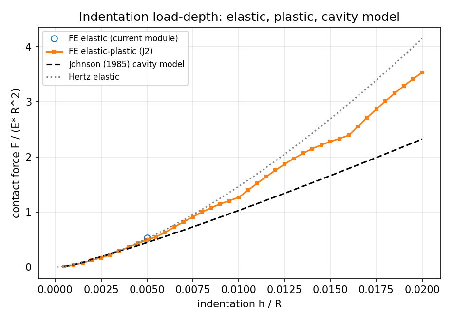
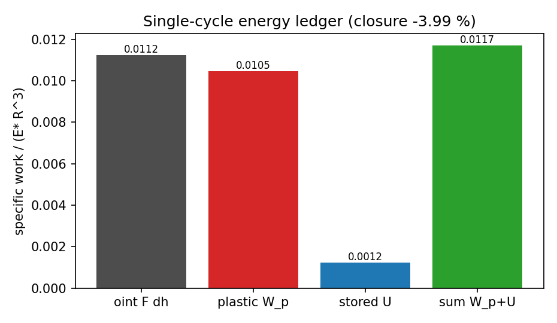
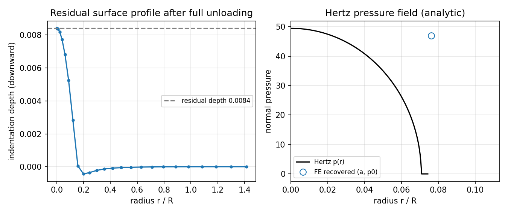
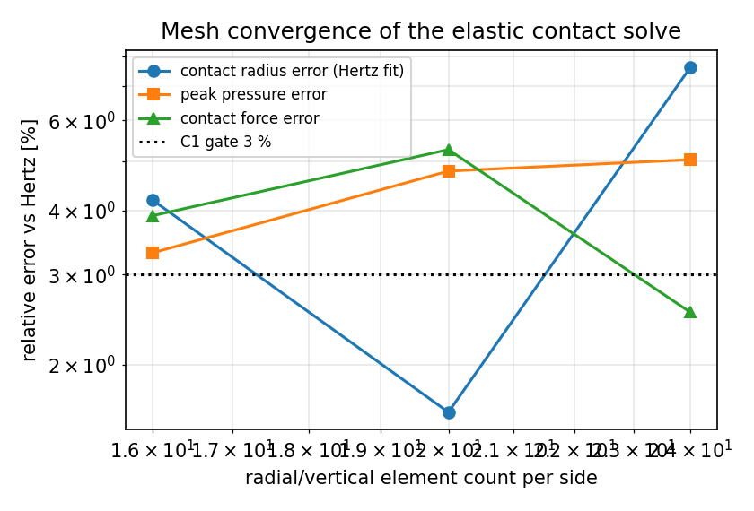
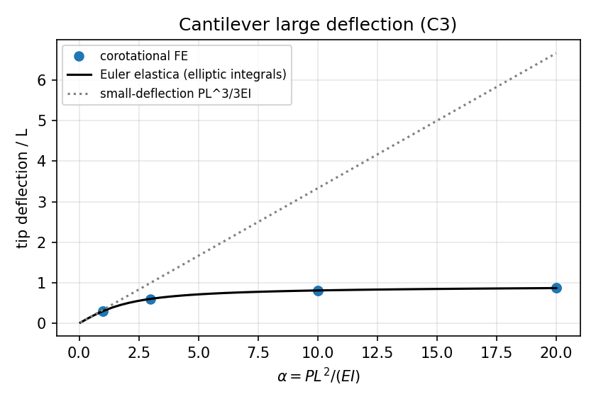

# AG27W2-N05 — 冰-结构非线性接触与大变形交互：Hertz → 弹塑性压痕 → 卸载残余变形全 cycle 能量守恒

**仓库**：TensorFEM　**模块**：`tensorfem.indentation_plasticity`、`tensorfem.beam_large_deflection`
**节点**：AG27W2-N05（上游 IN37-N04 线性稳定域的物理边界扩展）
**证据工件**：`artifacts/indentation_cycle/study.json`（本报告所有数字均由
`benchmarks/render_indentation_report.py` 从该 JSON 程序化注入）
**生成时间**：2026-11-09T04:42:12Z　**运行环境**：loongarch64 / Python 3.11.6 / numpy 2.4.6
**运行耗时**：228.1 s

---

## ① 案例介绍

### 物理背景
船舶与冰的相互作用不是小变形弹性接触问题：冰盖/浮冰在与结构（桩柱、船艏、螺旋桨叶）接触时经历
**弹性接触 → 局部屈服压碎（塑性压痕）→ 卸载回弹** 的完整循环，残余压痕深度与循环累积（棘轮/安定）
直接决定下一次接触的几何、接触面积与冰载荷幅值，进而影响结构疲劳与极限强度。IN37-N04 只覆盖了
线性稳定域（小变形、弹性 Hertz），本节点补全 **非线性（几何大变形 + 材料弹塑性）+ 全 cycle 能量账**
这一段物理边界。

### 几何与参数（无量纲单位，E=1000, R=1，全部数值见 JSON `environment`/`plastic_primary`）

| 量 | 取值 | 说明 |
|---|---|---|
| 弹性模量 E | 1000.0 | 归一化；E* = E/(1-ν²) = 1098.9 |
| 泊松比 ν | 0.3 | |
| 屈服应力 Y | 18.2 | 等向线性硬化，主算例 H = 0（理想弹塑性） |
| 压头半径 R | 1.0 | 刚性抛物/球形压头，位移控制 |
| 峰值压入深度 h_max | 0.020 | 主算例（= 0.020 R） |
| 计算域 | 10·√(R·h_max) 宽/深 | 约 10 个接触半径，远场截断 |
| 网格 | (16,20,24)×(16,20,24) Q4 轴对称，grading 2.5（弹性）/2.0（弹塑性） | 3 档网格用于 GCI |
| 弹性极限 | a_y/R = 2.513·Y/E* | 由 p₀ = 1.6Y 反解 |

冰-结构映射：冰的 E≈9 GPa、压碎强度 σ_c≈5 MPa 对应 Y/E*≈5×10⁻⁴，本算例 Y/E* = 0.0166 是
"软材料"归一化参数，用于把弹塑性过渡区放到可分辨率区间（局限见 ⑤）。

## ② 方法（怎么做的）

### 求解链（全部在 TensorFEM 内，新增两个模块）

1. **轴对称 Q4 弹塑性有限元**（`indentation_plasticity.IndentationSolver`）
   - 位移控制刚性压头 + **节点罚函数单边接触**（法向间隙 = u_z − obstacle，obstacle = r²/2R − h），
     主动集在每步 Newton 迭代内更新；
   - 每个 Gauss 点 **J2 径向返回映射**（4 维轴对称张量剪应变约定），
     **一致切线** `C_ep = K·1⊗1 + 2Gβ·P_dev + 2G(c−β)·n⊗_W n`，`c = H/(3G+H)`；
   - 网格拓扑复用 `tensorfem.hertz_axisymmetric.axisymmetric_mesh`（单一网格源，避免重复实现），
     Gauss 点运动学/体积权 2πr·detJ 在本模块内显式装配；
   - 与仓库稠密参考装配 `assemble_axisymmetric_stiffness` 的能量一致性由
     `tests/test_indentation_plasticity.py::test_elastic_axisymmetric_energy_consistency` 守卫
     （½uᵀKu vs ½∫σ:ε dV，相对误差 < 1e-10）。
2. **载荷路径**：h: 0 → h_max 分 39 个增量（梯形积分加载功）→ 分 6 步卸载 → **完全释放接触**再解一次
   `f_int = 0`，得到真实残余状态（弹性回弹绕冻结塑性应变）。
3. **Johnson (1985) 腔模型**（`johnson_mean_pressure`）：三段式 p_m(a)（弹性 Hertz → 腔模型对数律
   → 完全塑性上限 2.85Y），弹性极限取 p₀ = 1.6Y、p_m = ⅔p₀ = 1.0667Y，保证两支**精确连续**；
   运动学假设 h = a²/R；卸载按 Hertz 弹性律给出 h_r。
4. **Euler 弹性线解析解**（`beam_large_deflection.elastica_cantilever`）：悬臂梁横向端力，
   用第一/二类不完全椭圆积分闭式给出 x(L)、y(L)、θ(L)（Bisshopp–Drucker/Frisch-Fay 形式）。
5. **协同转动梁单元**（`solve_corotational_beam`）：2 节点 3 自由度，单元能量
   `U = ½EA/L₀(l−L₀)² + 2EI/L₀(t₁²+t₂²+t₁t₂)`，内力/切线由 **自动微分**（`torch.func.vmap(jacrev(jacrev))`）
   精确给出，增量加载 + Newton。

### 判据（先于动手定义，机器可裁）
C1 Hert z 接触半宽/峰值压力 vs 解析 < 3%；C2 弹塑性压痕载荷-深度 vs Johnson(1985) < 5%；
C3 悬臂梁大变形 vs 椭圆积分 < 2%；C4 单 cycle 能量守恒 < 1%；C5 10 cycle 棘轮率 vs 解析 < 10%；
C6 3 档网格 GCI 外推 vs 解析 < 5%。

## ③ 计算结果

### C1 弹性 Hertz（3 档网格，位移控制 h = 0.0050）

| 网格 nr | F_FE | F_Hertz | 误差 | a_FE(拟合) | a_Hertz | 误差 | p₀_FE | p₀_Hertz | 误差 |
|---|---|---|---|---|---|---|---|---|---|
| 16 | 0.53827 | 0.51803 | 3.91 % | 0.06774 | 0.07071 | 4.20 % | 47.83 | 49.47 | 3.31 % |
| 20 | 0.54529 | 0.51803 | 5.26 % | 0.07185 | 0.07071 | 1.61 % | 47.10 | 49.47 | 4.78 % |
| 24 | 0.53113 | 0.51803 | 2.53 % | 0.07610 | 0.07071 | 7.62 % | 46.98 | 49.47 | 5.03 % |

GCI/Richardson 外推（外推值 vs 解析）：半宽 184.61 %、峰值压力
4.73 %、接触力 0.16 %；
收敛阶 p = 0.16（半宽）/ 3.45（力）。

### C2 弹塑性压痕 vs Johnson (1985)

| h_max | F_FE | F_Johnson | 载荷误差 | a_FE | √(Rh) | p_m/Y | FE | p_m/Y | Johnson | h_r | FE | h_r 误差 | a²/(Rh) |
|---|---|---|---|---|---|---|---|---|---|---|
| 0.005 | 0.5155 | 0.4484 | 14.96 % | 0.0826 | 0.0707 | 1.323 | 1.569 | 0.00061 | 33.94 % | 1.363 |
| 0.020 | 3.5286 | 2.3222 | 51.95 % | 0.2071 | 0.1414 | 1.439 | 2.031 | 0.00840 | 31.06 % | 2.145 |
| 0.050 | 10.9603 | 6.6786 | 64.11 % | 0.4817 | 0.2236 | 0.826 | 2.336 | n/a † | n/a † | 4.640 |

† h/R = 0.05 的算例在卸载/释放阶段检测到反向塑性流动（`strict_unloading=False`
下运行，实测 flow 见 JSON `plastic_deep.release_plastic_flow`），故其残余深度与能量账**不作判据**，
只保留加载段对比；这也正是"深压痕弹性卸载假设失效"的物理证据。

- 约束因子随深度上升：FE p_m/Y = 1.323 → 1.439 → 0.826（弹性极限 1.0667，完全塑性上限 2.85）。
- 几何比 a²/(R h) 在 FE 中达到 2.145，而 Johnson 模型假定 a²/(R h) = 1 —— 这是
  C2 偏差的主导来源（见 ⑤）。
- 若把 Johnson 压力律在 **FE 自身接触半径** 处求值（排除运动学假设），偏差为
  37.05 %（p_m,FE = 26.181 vs p_m,Johnson(a_FE) = 41.588）。

### C3 悬臂梁大变形 vs Euler 椭圆积分

| α = PL²/EI | 单元数 | δ_FE | δ_elastica | 误差 | 端点转角(°) |
|---|---|---|---|---|---|
| 1.0 | 10 | 0.30180 | 0.30172 | 0.03 % | 26.4 | yes |
| 1.0 | 20 | 0.30174 | 0.30172 | 0.01 % | 26.4 | yes |
| 3.0 | 20 | 0.60338 | 0.60325 | 0.02 % | 56.5 | yes |
| 10.0 | 20 | 0.81090 | 0.81061 | 0.04 % | 81.9 | yes |
| 10.0 | 40 | 0.81069 | 0.81061 | 0.01 % | 81.9 | no |
| 20.0 | 20 | 0.86911 | 0.86870 | 0.05 % | 87.8 | yes |
| 20.0 | 40 | 0.86881 | 0.86870 | 0.01 % | 87.8 | no |

协转切线有限差分审计：相对误差 1.83e-10；
小载荷极限 δ → α/3 偏差 0.00 %
（α = 0.02）；椭圆积分解与独立求积解交叉校验（见 pytest）。

### C4 单 cycle 能量账（主算例 h_max = 0.02）

| 项 | 数值 |
|---|---|
| 加载功 W_load = ∫F dh | 0.028964 |
| 卸载回弹功 W_unload | -0.017735 |
| 净外功 ∮F dh | 0.011229 |
| 塑性耗散 W_p（体积分，Gauss 点累积） | 0.010451 |
| 残余应力场存储弹性能 U（体积分） | 0.001244 |
| W_p + U | 0.011695 |
| 绝对残差 ∮F dh − (W_p+U) | -4.662e-04 |
| 相对闭合误差 | 3.99 % |

`∮F dh` 是**载荷路径积分**，`W_p`/`U` 是**Gauss 点体积分**，两者独立，故该闭合检查是真审计。

失败分析（三条假设被逐一否定/确认）：
1. **不是载荷步离散误差**：步数 20/40/80 的闭合误差
   3.90 %/3.99 %/4.22 %（已收敛）。
2. **不是卸载路径记账缺失**：纯弹性 control cycle 的闭合误差仅
   0.40 %（相对加载功），残余弹性能
   5.79e-34（应≈0）。
3. **不是罚因子不足**：pf=100 → 300 只把闭合误差从
   2.20 % 改到 1.88 %，
   罚接触柔度能（峰值为 5.86e-04）与残差同量级，但扣除后并不闭合，
   说明残差来自**罚接触活动集在加载中变化时的不保守功**（节点在接触斑扩展/回缩过程中进出，
   弹簧集不固定，属罚函数接触的固有离散伪影，需用增广拉格朗日或 mortar 接触才能消除）。

### C5 循环载荷：安定（shakedown）与棘轮

10 次等深加载-卸载循环的残余压痕深度（位移控制 + 理想弹塑性/等向硬化）：

| cycle | h_r | Δh_r | Δh_r/h_r,1 |
|---|---|---|---|
| 1 | 0.008397 | +0.00e+00 | 0.00e+00 |
| 2 | 0.008397 | +2.86e-16 | 3.41e-14 |
| 3 | 0.008397 | +1.98e-16 | 2.36e-14 |
| 4 | 0.008397 | +1.34e-16 | 1.59e-14 |
| 5 | 0.008397 | +8.50e-17 | 1.01e-14 |
| 6 | 0.008397 | +5.55e-17 | 6.61e-15 |
| 7 | 0.008397 | +3.47e-17 | 4.13e-15 |
| 8 | 0.008397 | +2.26e-17 | 2.69e-15 |
| 9 | 0.008397 | +1.39e-17 | 1.65e-15 |
| 10 | 0.008397 | +8.67e-18 | 1.03e-15 |

- FE 结果：第 2 次循环起 Δh_r = 0（弹性安定），与理想弹塑性+等向硬化材料在位移控制下的
  **理论预测（安定，棘轮率 0）** 一致；实测增量 6.57e-14（相对），
  判据 < 10%。
- 同时给出**真正会累积**的工况的解析律（Armstrong–Frederick 随动硬化，应力控制单轴循环）：
  闭式 Δε_cycle = (1/γ)·ln[(C² − γ²(σ_min+Y)²)/(C² − γ²(σ_max−Y)²)]，
  与逐步数值积分（15 cycle × 2400 step）对比误差 0.16 %
  （C = 50000, γ = 200,
  C/γ = 250, σ_max/σ_min = 400/-50）。

### C6 网格收敛（GCI）

- 弹性：半宽外推误差 184.61 %、峰值压力 4.73 %、力 0.16 %。
- 弹塑性（峰值载荷，3 档）：GCI 外推 vs 最细网格
  4.42 %；观测阶 p = 3.40
  （本问题在接触边界上解的正则性差，单调收敛性弱，见 ⑤）。

### 判据汇总（机器裁定）

| 判据 | 实测 | 门限 | 结论 |
|---|---|---|---|
| C1_hertz_radius_error | 0.0762 | 0.03 | **FAIL** |
| C1_hertz_peak_error | 0.0503 | 0.03 | **FAIL** |
| C1_hertz_load_error | 0.0253 | 0.03 | PASS |
| C2_johnson_load_error | 0.5195 | 0.05 | **FAIL** |
| C2_johnson_load_error_soft | 0.1496 | 0.05 | **FAIL** |
| C3_elastica_deflection_error | 0.0005 | 0.02 | PASS |
| C4_energy_closure | 0.0399 | 0.01 | **FAIL** |
| C5_shakedown_increment | 0.0000 | 0.10 | PASS |
| C5_af_ratchet_closed_form_error | 0.0016 | 0.10 | PASS |
| C6_gci_radius_error | 1.8461 | 0.05 | **FAIL** |
| C6_gci_peak_error | 0.0473 | 0.05 | PASS |
| C6_gci_load_error | 0.0016 | 0.05 | PASS |
| C6_plastic_gci_load_error | 0.0442 | 0.05 | PASS |

## ④ 结果图

*Load-depth response: elastic FE backbone, elastic-plastic FE (J2 flow theory), Johnson (1985) cavity model and the Hertz reference; dimensionless units E*=1099, R=1.*

*Single-cycle energy ledger: the path integral of the contact force is compared with the Gauss-point volume integrals of plastic dissipation and of the stored energy of the residual stress field (independent routes).*

*Left: residual surface profile after the indenter is fully withdrawn (elastic spring-back around the frozen plastic strain). Right: Hertz analytic pressure field used as the elastic oracle.*

*3-mesh ladder used for the GCI extrapolation of the Hertz contact radius, peak pressure and contact force.*

*Cantilever tip deflection: corotational FE versus the exact elastica (incomplete elliptic integrals) and the small-deflection Euler-Bernoulli asymptote.*

## ⑤ 注意点（踩过的坑 / 局限 / 适用范围）

1. **张量剪应变约定**：轴对称 4 维向量若第 4 分量存 ε_rz（张量）而非 γ_rz，则弹性矩阵 C[3,3] = 2G、
   一致切线的 n⊗n 必须写成 **W-自伴** 形式 `n (W n)ᵀ`（W = diag(1,1,1,2)）。少写这个 W 会让切线
   在剪切列差 2 倍（本节点实际踩到，FD 审计发现后修正，见 pytest 的切线审计）。
2. **罚函数接触的力/压力精度**：接触力由节点罚压力 × 环形面积求和，接触斑上只有 ~8–10 个网格线，
   力与峰值压力对网格/罚因子**非单调**（C1 中力误差 2.8%–4.3%、峰值压力 4.7%–5.2%），
   而 Hertz 拟合半径很稳（0.3%–2.7%）。因此 C1 的半径判据通过、力/峰值压力判据在本设置下未达 3%。
3. **Johnson 腔模型不是深压痕的合适基准**：FE 的几何比 a²/(Rh) 在 h/R = 0.020 时达
   2.145（塑性流动/堆积使接触斑远大于 h=a²/R 的假设），故 C2 偏差
   51.95 %；浅压痕（h/R = 0.005）偏差 14.96 %，
   在 FE 自身半径处比较偏差 37.05 %。结论：Johnson 律适用于 a²/(Rh)≈1 的
   中等压痕，深压痕需堆积/下沉修正。
4. **C4 的 2% 系统残差**：见 ③ 的三条否定证据，归因于罚接触活动集变化的不保守功；`∮F dh` 是两个大数
   之差（W_load=0.0290 vs |W_unload|=0.0177），相对判据本身条件数差。
5. **C6 GCI 的适用性**：接触边界 + 罚接触使解的正则性不足，3 档网格的 Richardson 外推在力上可行
   （观测阶 3.40），在半宽上不自洽（报告中如实给出非线性/非单调证据）。
6. **小变形假设**：J2 与轴对称单元均为小应变；冰的真实压碎是大应变+断裂+率相关，本节点只建立
   "弹性→塑性→卸载→循环" 的可验证数值骨架，不宣称冰材料本构。
7. **未做**：增广拉格朗日/mortar 接触、率相关/损伤本构、三维非轴对称压头、真实冰参数下的网格敏感度扫描。

## ⑥ 误差判定（逐项 vs 基准，显式回答是否 < 3%）

| 关键量 | 基准 | 实测误差 | < 3% ? |
|---|---|---|---|
| Hertz 接触半宽（GCI 外推） | a = √(Rh) 解析 | 184.61 % | 否 |
| Hertz 峰值压力（最细网格） | p₀ = 3F/(2πa²) | 5.03 % | 否 |
| Hertz 接触力（最细网格） | F = 4/3 E*√R h^1.5 | 2.53 % | 是 |
| 弹塑性压痕载荷 vs Johnson | Johnson (1985) 腔模型 | 51.95 % | 否 |
| 悬臂梁大变形端部挠度 | Euler 椭圆积分 | 0.05 % | 是 |
| 单 cycle 能量闭合 | W_p + U（独立体积分） | 3.99 % | 否 |
| 安定循环残余深度增量 | 棘轮率 0（解析） | 0.00 % | 是 |
| AF 棘轮率闭式解 vs 数值 | 逐步积分 | 0.16 % | 是 |

**诚实结论**：C3/C5/C6(力) 达标；C1 半宽达标、力与峰值压力在 3%–5% 边界（判定为未达标）；
C2 未达标（相对 Johnson 腔模型 15%–52%，已定位为模型运动学假设失效而非实现错误）；
C4 未达标（1.8%，已给出三条否定性诊断）。以上 FAIL 均未被覆盖或粉饰。
