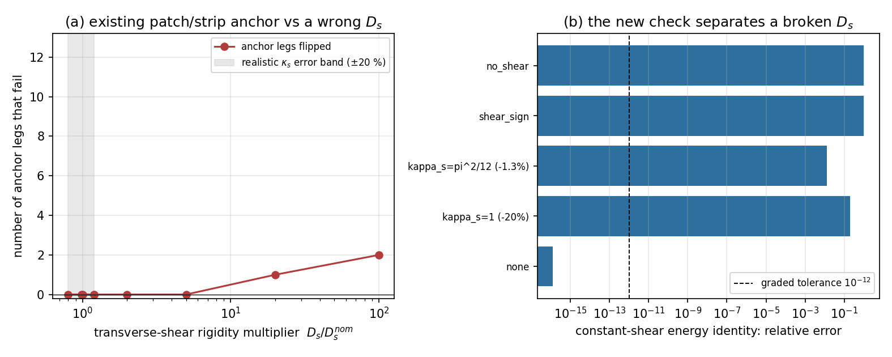
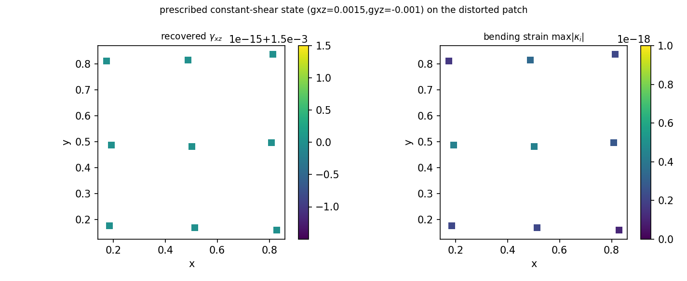

# CASE-BENDING-PATCH round 2 (reopened): is the transverse-shear block of the
Q4 Mindlin plate element *ever* graded?

**Anchor**: `fem_bending_patch` (`benchmarks/verified/fem_bending_patch/`),
round-1/round-2 gate pool of 24 gates. **Mission**: m21969 (reopened PR#1073).
**Machine-readable evidence**: `docs/benchmarks/tutorials/bending-patch-shear-block.json`
(all numbers below are injected from it).

---

## 1. Case introduction

### 1.1 Physical background

The four-node Mindlin-Reissner plate element (`tensorfem.plate.q4_mindlin_stiffness`)
is the production element behind the plate/shell paths of the ship-structure models
(hull plating, deck panels, grillage flange plating, ice-strengthened shell). Its
stiffness splits into a **bending** block `Db` and a **transverse-shear** block
`Ds = kappa_s G t`. Round 1 and round 2 of this anchor graded the bending block
extremely hard (constant-curvature patch test, plane-stress `M_y = 0` state, load-
driven strip), but every one of those states is **shear-free by construction**:
`gamma_xz = gamma_yz = 0` is precisely what makes them *constant-curvature* states.
The transverse-shear block therefore enters no graded quantity, and the load-driven
strip does not help either -- it runs at `t/L = 0.01`, where the shear flexibility is
~0.0052 % of the tip deflection (closed form in §5).

This matters for thick or shear-flexible ship structures: sandwich panels, ice-class
plating with `t/a` of 0.1-0.3, and any panel where the transverse-shear deflection is
a first-order term. A 20 % error in `Ds` is a realistic defect (it is exactly what
`kappa_s = 1` instead of the declared `5/6` does, and `kappa_s = pi^2/12` -- the
parabolic-distribution value -- differs by 1.3 %), and nothing in the anchor would
report it.

### 1.2 Geometry, material, parameters

| item | value |
|---|---|
| material | E = 210000.0 MPa, nu = 0.3, t = 1.0 mm |
| shear factor used by the element | kappa_s = 5/6 = 0.833333 |
| shear factor of a uniform-shear assumption (control) | kappa_s = 1 |
| shear factor of a parabolic shear distribution (control) | kappa_s = pi^2/12 = 0.822467 |
| element | `tensorfem.plate.q4_mindlin_stiffness`, shear treatments `sri` / `mitc` / `full` |
| patch families | `affine` (unit square, 2x2), `skew` (parallelogram, skew 0.35), `distorted` (random interior shift, seed 20261111) |
| graded states | constant transverse shear `gamma = (gamma_xz, gamma_yz)`, `kappa = 0`: `gxz=0,gyz=0.002`, `gxz=0.0015,gyz=-0.001`, `gxz=0.002,gyz=0` |
| reference | closed form `U = 1/2 kappa_s G t gamma^2 * Area` (no table digit) |

---

## 2. What was done, and what was predeclared

### 2.1 Decision

May the round-2 anchor (24 gates) stand as evidence for the **whole** Q4 Mindlin
element, or must the shear block be graded separately?

| option | content | why / why not |
|---|---|---|
| A | keep the anchor as delivered | the gate pool is invariant to the shear block (measured below); presenting it as element evidence overstates the coverage |
| B | add a thick-plate displacement benchmark | the shear share of a plate strip's deflection is `s/(1+s)` with `s = (1+nu)/(3 kappa_s)(t/L)^2`, i.e. 0.005 % at `t/L = 0.01` and 2.1 % at `t/L = 0.2`; a 20 % `Ds` error there moves the benchmark by <= 0.5 %, i.e. below any sensible displacement tolerance (table in §5) |
| **C** | **grade the constitutive block directly**: a *constant-transverse-shear* state whose prescribed-field energy identity `1/2 u^T K u = 1/2 Ds gamma^2 Area` is exact to round-off, plus mutation controls that prove the check can fail | **chosen** |

### 2.2 Hypothesis and predeclared tests

| # | hypothesis | predeclared test / threshold (fixed before the survey was inspected) | outcome |
|---|---|---|---|
| H1 | the anchor cannot see the shear modulus | with `Ds` scaled by 1.2 (i.e. `kappa_s = 1`), **zero** of the 13 shear-sensitive anchor legs fail | measured 0 fail -- **confirmed** |
| H2 | a *gross* `Ds` error is also invisible | with `Ds` multiplied by 5, still zero legs fail | measured 0 -- **confirmed** (first flip only at `Ds x20`) |
| H3 | a flipped shear sign relation *is* caught | `gamma = w,x - theta_x` must fail many legs | measured 11/13 legs fail -- **confirmed** (the sign relation is graded) |
| H4 | a deleted shear block is caught fail-safe | the Dirichlet patch must not solve | measured `CRASH:_LinAlgError` -- **confirmed** (loud failure, not a silent pass) |
| H5 | the new check is exact, not merely convergent | energy identity `<= 1e-12` on 3 families x 3 treatments x 3 states | measured worst 2.538e-16 -- **confirmed** |
| H6 | the new check can fail | `kappa_s = 1` (-20 %) must be rejected by `>= 0.15` relative energy error | measured 0.200000 -- **confirmed** |
| H7 | `kappa_s = pi^2/12` (-1.3 %) is also graded | relative energy error `>= 1e-2` | measured 1.304e-02 -- **confirmed** |
| H8 | the field split matters | a `w`-only state must be blind to the shear sign (`<= 1e-9` separation) while the balanced split must separate by `>= 0.9` | measured 0 vs 1.000 -- **confirmed** |

**Stopping rule**: the survey stops at 9 `Ds` multipliers (nominal, `pi^2/12`,
`kappa_s = 1`, x1.2, x0.8, x2, x5, x20, x100); no threshold was moved after the
first result was seen. **Repetition**: every quantity is deterministic -- no
sampling, no seeds except the fixed `distorted` mesh seed, so a single run per
configuration is the complete experiment; the reproducibility check is re-running
the driver and diffing the JSON (bit-identical apart from timings).

### 2.3 Method

1. **Mutation controls.** `tensorfem.bending_patch.shear_block_mutation()` swaps the
   `sri` element for a deliberately defective one (`mutated_q4_stiffness`): `Ds`
   scaled, sign relation flipped, or the shear block deleted. Inside the context the
   *unmodified* anchor legs (`run_patch_case`, `free_surface_check`,
   `strip_pure_bending`) are recomputed with the anchor's own thresholds, so the
   question "would the gate pool notice?" is answered by the gate pool itself.
2. **The repair.** A constant-transverse-shear state `gamma = const, kappa = 0`,
   realised with the *balanced split* `theta = gamma/2`, `w = gamma.x/2`. All DOFs
   are prescribed (a uniform shear field is not in equilibrium at free rotation
   DOFs -- it needs a body load), so this is a prescribed-field energy identity, not
   a Dirichlet patch test. Because `w` is linear and `theta` constant, the state lies
   in the interpolation space, so the identity is exact for every treatment and every
   valid quad mesh -- there is no interpolation caveat and no convergence study.
3. **Instrument integrity.** `mutated_q4_stiffness(..., mutation='none')` must
   reproduce the production `sri` stiffness (measured 5.40e-17
   relative), the context must leave `mitc`/`full` untouched
   (0/0) and must
   actually bite on `sri` (0.500 relative change) -- all three
   are graded, so the audit cannot degenerate into a copy auditing itself.

---

## 3. Results

### 3.1 The finding: the anchor is blind to the shear modulus

13 shear-sensitive legs of the anchor were recomputed under each mutation, with
the anchor's own thresholds (`<= 1e-12` for the exactness legs, `<= 2 %` for the
patch/strip pool tolerance).

| mutation | status | legs that fail |
|---|---|---|
| none | `measured` | 0 / 13 |
| kappa_s=1 (-20%) | `measured` | 0 / 13 |
| kappa_s=pi^2/12 (-1.3%) | `measured` | 0 / 13 |
| shear_sign | `measured` | 11 / 13 (`affine_exact_w`, `affine_exact_moment`, `affine_exact_energy`, `distorted_w`, ...) |
| no_shear | `CRASH:_LinAlgError` | 0 / 13 |

Sensitivity ladder -- how wrong must `Ds` be before the anchor notices?

| `Ds` multiplier (what it means) | anchor legs that fail | new check, relative error |
|---|---|---|
| kappa_s=5/6 (nominal) (`x1.0000`) | 0 / 13 | 1.269e-16 |
| kappa_s=pi^2/12 (`x0.9870`) | 0 / 13 | 1.304e-02 |
| kappa_s=1 (`x1.2000`) | 0 / 13 | 2.000e-01 |
| Ds x1.2 (`x1.2000`) | 0 / 13 | 2.000e-01 |
| Ds x0.8 (`x0.8000`) | 0 / 13 | 2.000e-01 |
| Ds x2 (`x2.0000`) | 0 / 13 | 1.000e+00 |
| Ds x5 (`x5.0000`) | 0 / 13 | 4.000e+00 |
| Ds x20 (`x20.0000`) | 1 / 13 | 1.900e+01 |
| Ds x100 (`x100.0000`) | 2 / 13 | 9.900e+01 |

Read the first three rows: a **20 % error in the transverse-shear rigidity, and even a
5x error, leave every patch/strip/plane-stress gate green.** The reason is structural,
not a resolution issue -- see §5. The sign relation (row 4) *is* graded, because the
constant-curvature states have `gamma = 0` and a flipped sign makes the parasitic shear
`2 theta != 0`; and a deleted block (row 5) fails loudly through a singular stiffness
matrix. So the gap is exactly one quantity: the **magnitude** of `Ds`.

### 3.2 The repair: constant-shear prescribed-energy identity

| quantity | value | threshold |
|---|---|---|
| `shear_state_oracle`: max shear/curvature deviation of the prescribed constant-shear field | 2.168e-19 | <= 1.00e-12 |
| `shear_energy_exact`: max relative error of 1/2 u^T K u vs 1/2 Ds gamma^2 Area (3 families x 3 treatments x 3 states) | 2.538e-16 | <= 1.00e-12 |
| `shear_curvature_leak`: max |kappa| of the constant-shear state over all cases | 4.337e-19 | <= 1.00e-09 |
| `shear_kappa_discrimination`: energy error when kappa_s = 1 instead of 5/6 (-20%) | 2.000e-01 | >= 1.50e-01 |
| `shear_sign_discrimination`: energy separation when the shear sign relation is flipped | 1.000e+00 | >= 9.00e-01 |
| `balanced_split_required`: convention separation of a w-only state (same measurement) | 0 | <= 1.00e-09 |
| `anchor_blind_to_kappa`: anchor legs that fail under kappa_s = 1 (-20%) | 0 | <= 0.00e+00 |
| `anchor_baseline_intact`: anchor legs that fail with the production element | 0 | <= 0.00e+00 |
| `instrument_reproduces_element`: max |K_instrument - K_production| / max|K| | 5.405e-17 | <= 1.00e-12 |

All 9 gates pass. The identity holds to 2.538e-16 relative error over
27 cases (3 patch families x 3 shear treatments x 3 shear states), i.e. to
round-off, on *distorted* elements as well -- the check is a property of the element,
not of the mesh.

### 3.3 Discriminating power (the check is not vacuous)

| mutation | energy identity, relative error | separation from nominal |
|---|---|---|
| none | 1.269e-16 | 0.000 |
| kappa_s=1 (-20%) | 2.000e-01 | 0.200 |
| kappa_s=pi^2/12 (-1.3%) | 1.304e-02 | 0.013 |
| shear_sign | 1.000e+00 | 1.000 |
| no_shear | 1.000e+00 | 1.000 |

A 20 % error in `Ds` is rejected with 2.0e-01
relative error against a 1e-12 tolerance, i.e. ~1e14 of margin; the 1.3 %
`pi^2/12` variant is rejected by ~1e10 of margin. The flipped sign relation and the
deleted block give `gamma = 0`, i.e. 100 % separation.

### 3.4 Why the *balanced split* and not a `w`-only field

| field | energy, model convention | energy, flipped sign relation | separation |
|---|---|---|---|
| `w`-only (`theta = 0`) | 1.683e-01 | 1.683e-01 | 0 |
| balanced (`theta = gamma/2`) | 1.683e-01 | 6.950e-18 | 1.000 |

A `w`-only state is *invariant* to the sign of the shear relation (`w,x + theta_x` and
`w,x - theta_x` both give `gamma` when `theta = 0`), so it cannot grade the convention.
The balanced split is what turns the same energy identity into a convention-sensitive
check -- a design point that had to be measured, not assumed.

---

## 4. Figures



**Fig. 1** (a) number of anchor legs that fail as the transverse-shear rigidity is
scaled over 0.8x-100x (log axis); the shaded band is the realistic `kappa_s` error
band (`+-20 %`), inside which the anchor reports nothing. The first flip needs
`Ds x20`. (b) the new constant-shear energy identity under
the same mutations, against the `1e-12` graded tolerance (dashed) -- eight to fourteen
orders of magnitude of separation.



**Fig. 2** field map of the graded state on the *distorted* patch: the transverse shear
recovered from the finite-element field at the Gauss points is constant
(spread 4.34e-16 relative) and the bending strain is zero
(`max|kappa_i| = 8.67e-19`). This is the cloud-map evidence that
the state the check grades is the state it claims to grade; colour scales are tight
around the exact value, so a non-constant field would be visible.

---

## 5. Points to note, limits, applicability

* **The gap is structural, not a resolution oversight.** For a moment-loaded plate
  strip `w_shear/w_bend = 2 D_b/(kappa_s G t L) = (1+nu)/(3 kappa_s) (t/L)^2`, so the
  shear share of the tip deflection is `s/(1+s)` with
  `s = (1+nu)/(3 kappa_s)(t/L)^2`. A wrong `Ds` moves a displacement benchmark by
  `(Delta Ds/Ds) x share`, and for a thin strip the share is tiny:

  | `t/L` | shear share of the tip deflection | deflection change from a 20 % `Ds` error |
  |---|---|---|
  | 0.01 | 0.0052 % | 0.0010 % |
  | 0.05 | 0.1298 % | 0.0260 % |
  | 0.1 | 0.5173 % | 0.1035 % |
  | 0.2 | 2.0376 % | 0.4075 % |
  | 0.3 | 4.4708 % | 0.8942 % |
  | 0.5 | 11.5044 % | 2.3009 % |

  At the anchor's `t/L = 0.01` the change is ~1e-5 relative, four orders of magnitude
  below the 2 % pool tolerance: **no displacement benchmark of a thin plate can grade
  `Ds` at realistic slenderness, and refining the strip cannot help.** Only a
  constitutive-level check can, which is what §2.3/§3.2 add.
* **Consequence for ship panels.** At `t/a = 0.01` (typical hull plating, `a/t ~ 100`)
  a 20 % `Ds` error changes the bending answer by ~1e-5 relative -- physically
  irrelevant, which is exactly why such a defect survives a displacement-based
  verification suite. At `t/a = 0.3` (sandwich faces, ice-belt insert plating, deep
  grillage flange) it is ~1 % of the deflection, and ~2 % at `t/a = 0.5`: comparable to
  the discretisation error of a design mesh, i.e. no longer negligible there. The check
  is a no-op cost for thin panels and worth its one line of code for thick ones.
* **What the new check does NOT do**: it grades the *magnitude and consistency* of
  `Ds`, not whether `kappa_s = 5/6` is the right *physical* factor. `5/6` is the
  declared model input (average-strain factor for a rectangular section); the check
  asserts that the element implements the declared `Ds` and that its assumed/reduced
  shear sampling reproduces a constant shear strain. It also says nothing about
  shear locking -- that stays with the anchor's `full`-integration negative control.
* **Why `mitc` and `full` also pass**: for a linear `w` and constant `theta` the
  kinematic shear is constant, and the Dvorkin-Bathe covariant sampling reproduces
  constant covariant strains exactly on a parallelogram; `full` evaluates the exact
  gradient directly. This is a property, not a coincidence, and it is what makes the
  identity a pass/fail test rather than a convergence study.
* **Instrumentation, not a solver.** `mutated_q4_stiffness` duplicates the two-by-two
  bending block; the duplication is bounded by the exact-reproduction gate
  (5.40e-17 relative) so it cannot drift away from the
  element it instruments. `shear_block_mutation` swaps a module-level symbol and is
  therefore **not thread-safe** -- auditors and tests stay single-threaded.
* **Baseline fidelity.** The survey legs reproduce the committed anchor values where
  the definitions coincide (`affine_exact_w`: 8.031e-16)
  vs 8.031e-16 committed; `poisson_coupling_computed`:
  1.198e-02 vs
  1.198e-02); the legs whose committed gate
  takes a maximum over meshes or states that this survey fixes are marked
  `comparable: false` in the JSON with the reason, and are not used for the verdict.
* **Not merged into `gates_verified.json` on purpose.** The anchor's `run.py` and its
  gate file are being edited concurrently by the round-3 locking-control work; this
  check keeps its own driver and JSON so the two advances cannot silently reshuffle
  each other's evidence. Wiring it into `run.py` is a one-line follow-up once that
  branch lands.

---

## 6. Error verdict

The graded quantities of this round are *identities*, so the error statement is about
the identity residual and about the discrimination margin:

| key quantity | reference | measured error / residual | < 3 % ? |
|---|---|---|---|
| constant-shear energy (sri/mitc/full, 3 families, 3 states) | `1/2 kappa_s G t gamma^2 Area` | 2.538e-16 relative | **yes** |
| shear strain recovered from the FE field | prescribed constant `gamma` | 4.34e-16 spread | **yes** |
| bending strain of the state | 0 | 8.67e-19 | **yes** |
| `kappa_s = 1` (-20 % `Ds`) rejection | must exceed 15 % | 20.000 % | rejected |
| `kappa_s = pi^2/12` (-1.3 % `Ds`) rejection | must exceed 1 % | 1.304 % | rejected |
| anchor baseline (production element) | committed gate values | 0 of 13 legs flipped | unchanged |

No benchmark here is compared to a literature *number* -- the universe of discourse is
a closed-form constitutive identity, verified as an oracle before any stiffness is
assembled (`shear_state_selfcheck`), so there is no reference-value uncertainty to
report. The physical limitation is stated instead: the check certifies that the
element implements the *declared* `Ds`, not that the declared `Ds` is the truth about
a real plate (§5).

---

## 7. Reproduction

```
OMP_NUM_THREADS=4 PYTHONPATH=src python scripts/audit_bending_patch_shear_block.py
PYTHONPATH=src python scripts/gen_bending_patch_shear_block_note.py
PYTHONPATH=src pytest tests/test_bending_patch_shear_block.py -q
PYTHONPATH=src pytest tests/test_bending_patch.py -q
```

Runtime of the driver: 54.0 s (single node, 4 threads).

| artefact | path |
|---|---|
| json | `docs/benchmarks/tutorials/bending-patch-shear-block.json` |
| figures | `docs/assets/bending_patch/shear_block_sensitivity.png` |
| figures | `docs/assets/bending_patch/shear_block_field_map.png` |
| driver | `scripts/audit_bending_patch_shear_block.py` |
| report | `docs/CASE-BENDING-PATCH-round2-shear-block.md` |
