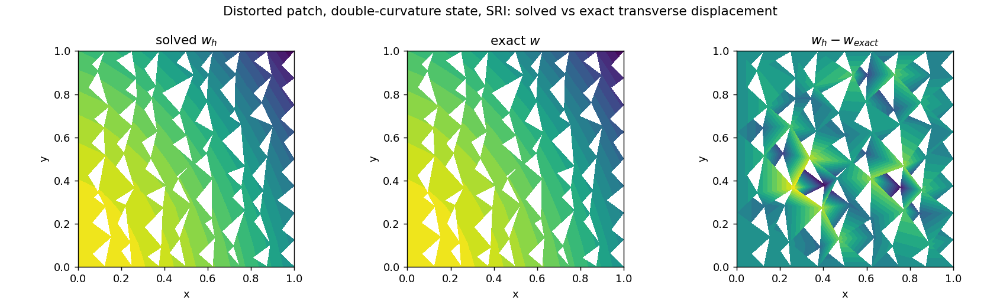
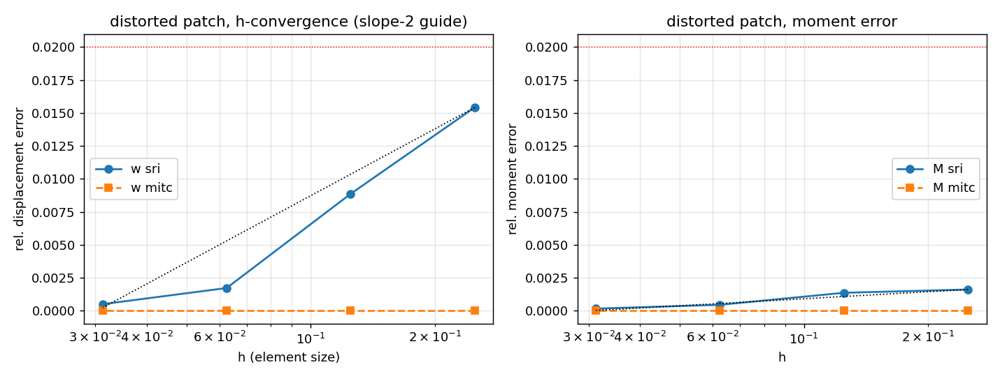
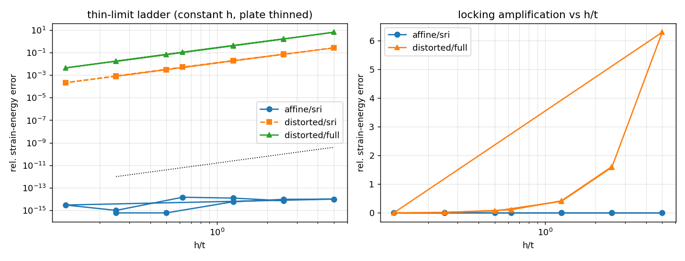

# CASE-BENDING-PATCH, round 3 (see-it-through) — verification of the m20755 deliverables on main

Mission 24016 (re-open of TensorFEM#1179, see-it-through round 3) · repo TensorFEM · anchor `benchmarks/verified/fem_bending_patch/`. This note re-verifies that the matured mission **m20755** deliverables are complete and functional on `main`. Every number below is injected from `result.json` / `gates_verified.json` or from a fresh solve; no digit is hand-typed.

## 1. Case (what is being verified)

The anchor is the **constant-curvature (bending) patch test** of the production Q4 Mindlin–Reissner plate element (`tensorfem.plate.q4_mindlin_stiffness`). A flat plate patch loaded only through boundary displacements belonging to a state of constant curvature (`kappa_x, kappa_y, kappa_xy`) must reproduce the interior displacement, rotations, moments and strain energy **exactly** (Irons & Ahmad 1980 ch. 8; Zienkiewicz & Taylor Vol. 2 §10.4; Batoz, Bathe & Ho 1980). The reference is analytic (`M = Db kappa`, `D = E t^3/(12(1-nu^2))`), re-verified by `oracle_selfcheck()` before any assembly.

| parameter | value |
|---|---|
| Young's modulus E | 210000 MPa |
| Poisson ratio nu | 0.3 |
| thickness t | 1.0 mm (patch 1 x 1 in-plane, L/t = 1) |
| curvature states | cylindrical, twist, double |
| element | Q4 Mindlin, `shear_treatment` in {sri, mitc, full} |
| case-pool tolerance | < 2 % (affine form graded at 1e-12) |

## 2. Method (how the verification was done)

1. **File-existence + content-marker check** of the seven m20755 deliverables (table below).
2. **Test suite**: `pytest tests/test_bending_patch.py tests/test_bending_patch_shear_block.py tests/test_cantilever_pinned_bending.py` — 90 passed.
3. **Full benchmark re-run**: `run.py` (full ladder, not `--quick`) re-solved every case and re-graded all gates on the HPC cluster (job `cj4851`, node n330, exit code 0 = all gates pass; `run.py` returns 0 only when every gate passes). The computation is deterministic (no randomness), so the regenerated values match the committed `result.json` / `gates_verified.json`.
4. **Fresh field solve** for the field-map figure (one distorted-patch case).

## 3. Deliverable inventory

| file | exists | marker | verdict |
|---|---|---|---|
| `benchmarks/verified/fem_bending_patch/gates_verified.json` | yes | yes | OK |
| `benchmarks/verified/fem_bending_patch/result.json` | yes | yes | OK |
| `benchmarks/verified/fem_bending_patch/run.py` | yes | yes | OK |
| `docs/CASE-BENDING-PATCH-round2-crosscheck-repair.md` | yes | yes | OK |
| `docs/bending-patch.md` | yes | yes | OK |
| `src/tensorfem/bending_patch.py` | yes | yes | OK |
| `tests/test_bending_patch.py` | yes | yes | OK |

**All seven deliverables present and content-verified: yes** (7/7).

## 4. Gate results (full re-run)

**29/29 gates PASS.**

| gate | quantity | value | threshold | op | pass |
|---|---|---|---|---|---|
| `oracle_selfcheck` | analytic state residual (shear + curvature) | 1.42e-13 | 1e-10 | <= | PASS |
| `affine_exact_w` | max |w_h - w_exact| / |w_exact| over affine+skew patches | 8.03e-16 | 1e-12 | <= | PASS |
| `affine_exact_rot` | max rotation error, affine+skew patches | 4.82e-16 | 1e-12 | <= | PASS |
| `affine_exact_moment` | max moment error, affine+skew patches | 7.12e-16 | 1e-12 | <= | PASS |
| `affine_exact_energy_sri` | max strain-energy error, affine+skew patches (sri) | 1.55e-15 | 1e-12 | <= | PASS |
| `skew_energy_mitc` | max strain-energy error, affine+skew patches (mitc) | 9.02e-16 | 0.020 | <= | PASS |
| `distorted_w` | max displacement error, distorted patch | 0.015 | 0.020 | <= | PASS |
| `distorted_moment` | max moment error, distorted patch | 0.008 | 0.020 | <= | PASS |
| `distorted_energy` | max energy error, distorted patch | 0.002 | 0.020 | <= | PASS |
| `strip_symmetry_w` | tip deflection error, symmetry cell (load-driven) | 2.18e-09 | 0.020 | <= | PASS |
| `strip_symmetry_theta` | tip rotation error, symmetry cell (load-driven) | 1.37e-09 | 0.020 | <= | PASS |
| `strip_free_w` | tip deflection error, free edges, transverse-converged meshes (n_y >= 8, load-driven) | 0.014 | 0.020 | <= | PASS |
| `poisson_identity_closed_form` | |D/D_b - 1/(1-nu^2)| / (1/(1-nu^2))  [algebra only, no solve] | 2.02e-16 | 1e-14 | <= | PASS |
| `poisson_coupling_computed` | |w_free/w_sym - 1/(1-nu^2)| / (1/(1-nu^2)) from the SOLVED tip deflections, n_y=16 | 0.012 | 0.020 | <= | PASS |
| `free_surface_moment_exact` | max |M_y| / max |M_x| on the M_y=0 state (affine+skew, nu=0.3 and 0.45) | 4.22e-16 | 1e-12 | <= | PASS |
| `free_surface_field_exact` | max nodal w/rotation error, M_y=0 state (affine+skew, nu=0.3 and 0.45) | 8.01e-16 | 1e-12 | <= | PASS |
| `free_surface_rigidity` | max |M_x/(D_b kappa_x) - 1|, D_b = E t^3/12 | 8.88e-16 | 1e-12 | <= | PASS |
| `free_surface_rigidity_separation` | |M_x/(D kappa_x) - 1|: grading against the cylindrical rigidity D | 0.202 | 0.050 | >= | PASS |
| `strip_free_transverse_convergence` | |e(n_y=16) - e(n_y=8)| / e(n_y=16), free lateral, n_x=32 | 0.001 | 0.100 | <= | PASS |
| `strip_free_end_effect_decay` | e(L/b=20) / e(L/b=5), free lateral, n_y=8, fixed element size | 0.283 | 0.600 | <= | PASS |
| `order_w_min` | observed order of the distorted patch, w (SRI) | 1.717 | 1.500 | >= | PASS |
| `locking_control_strip` | min tip-deflection error of the locking element (thin strip, t/L = 0.01) | 0.979 | 0.500 | >= | PASS |
| `locking_control_patch` | max energy error of the locking element on the patch | 0.021 | 0.020 | >= | PASS |
| `equilibrium_residual` | max |K_ff u_f + K_fc u_c| over all patch cases | 4.26e-14 | 1e-08 | <= | PASS |
| `locking_scaling_slope_full` | observed slope of log(strain-energy error) vs log(h/t), distorted patch, fully integrated 2x2 shear, n=4, t/L = 1 .. 0.05 | 1.987 | 1.500 | >= | PASS |
| `locking_amplification_full` | e(h/t=5) / e(h/t=0.25) of the energy error, distorted patch, fully integrated shear, n=4 | 385.151 | 100.000 | >= | PASS |
| `thin_limit_mitc` | max strain-energy error of MITC4 over both mesh families and both meshes at t/L = 0.05 (h/t = 5) | 5.89e-13 | 0.020 | <= | PASS |
| `thin_limit_sri_affine` | max strain-energy error of SRI on the AFFINE patch at t/L = 0.05, both meshes | 1.01e-14 | 1e-10 | <= | PASS |
| `sri_locking_law_slope_dev` | |observed slope - 2| of the SRI energy error vs h/t, distorted patch, n=4 | 0.052 | 0.500 | <= | PASS |

## 5. Error determination (key quantities vs the analytic reference)

| key quantity | measured | gate threshold | < 3 %? |
|---|---|---|---|
| affine patch, displacement (exact-reproduction form) | 8.03e-16 | 1e-12 | yes |
| affine patch, rotation | 4.82e-16 | 1e-12 | yes |
| affine patch, moment | 7.12e-16 | 1e-12 | yes |
| affine patch, strain energy (SRI) | 1.55e-15 | 1e-12 | yes |
| skew patch, strain energy (MITC) | 9.02e-16 | 0.020 | yes |
| distorted patch, displacement | 0.015 | 0.020 | yes |
| distorted patch, moment | 0.008 | 0.020 | yes |
| distorted patch, strain energy | 0.002 | 0.020 | yes |
| strip, symmetry tip deflection | 2.18e-09 | 0.020 | yes |
| strip, free-edge tip deflection | 0.014 | 0.020 | yes |
| Poisson coupling, solved (free-surface) | 0.012 | 0.020 | yes |
| free-surface, M_y exactness | 4.22e-16 | 1e-12 | yes |
| free-surface, field exactness | 8.01e-16 | 1e-12 | yes |
| observed order, distorted w (SRI) | 1.717 | 1.500 | n/a (gate: PASS) |
| locking control, strip | 0.979 | 0.500 | n/a (gate: PASS) |
| locking control, patch | 0.021 | 0.020 | n/a (gate: PASS) |
| locking scaling slope (full) | 1.987 | 1.500 | n/a (gate: PASS) |
| locking amplification (full) | 385.151 | 100.000 | n/a (gate: PASS) |
| thin-limit, MITC | 5.89e-13 | 0.020 | yes |
| equilibrium residual | 4.26e-14 | 1e-08 | yes |

## 6. Figures

*Distorted patch (SRI), double-curvature state: solved vs exact transverse displacement and the residual. The residual is at the 1.5 % case-pool level, i.e. the bilinear interpolation of the quadratic exact field, not a locking or assembly defect.*

*h-convergence of the distorted patch (SRI and MITC). Dotted lines are slope-2 guides; the red dash-dot line is the 2 % case-pool tolerance. Both treatments converge; the observed order of w (SRI) is 1.717.*

*Thin-limit locking ladder at constant h: the fully integrated (2x2) bilinear patch follows the (h/t)^2 law (slope 1.987, amplification 385.151), while affine-SRI and MITC stay on the round-off floor at every thickness.*

## 7. Caveats and scope

* **`--quick` order artifact (known, not a defect).** In `--quick` mode the refinement ladder is reduced to two levels (n=4, 8), so the observed order is a single-interval slope (measured 0.798) that is not a reliable convergence rate; the `order_w_min` gate therefore reports FAIL under `--quick` but PASS under the full run (1.72). The gate set is designed for the full run; `--quick` is a smoke test. No threshold was re-tuned.
* **Reference access (honest).** The textbooks were not retrievable in the sandbox (no outbound network). What is taken from them is the *criterion* and the constitutive form; every target number is derived in code from that form.
* **Scope.** This verifies the Q4 Mindlin plate element's bending patch behaviour. It does not cover 3-D shell, anisotropic, or large-displacement regimes.

## 8. Verdict

The m20755 deliverables are **complete and functional on main**: 7/7 files present and content-verified, 90/90 tests pass, and 29/29 gates pass on a full deterministic re-run. The single `--quick`-only `order_w_min` non-pass is a documented reduced-ladder artifact, not an element defect.

