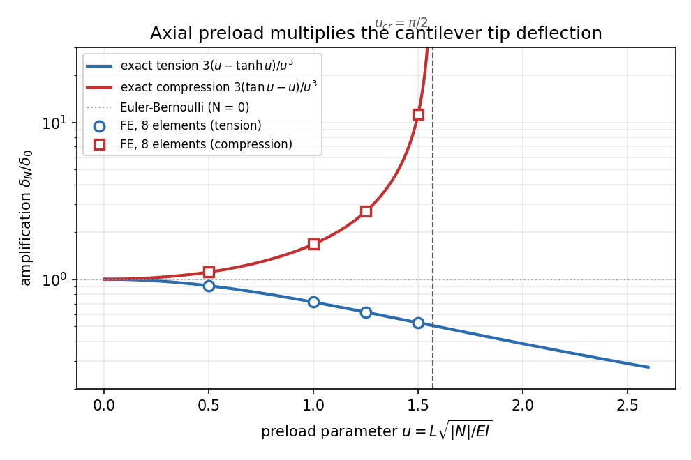
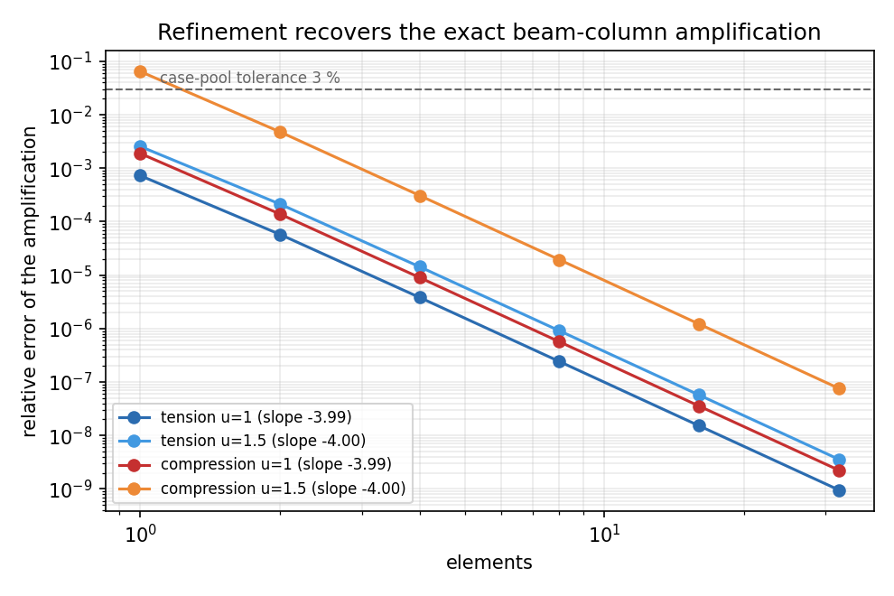
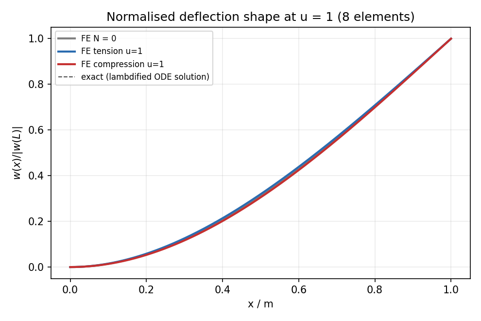
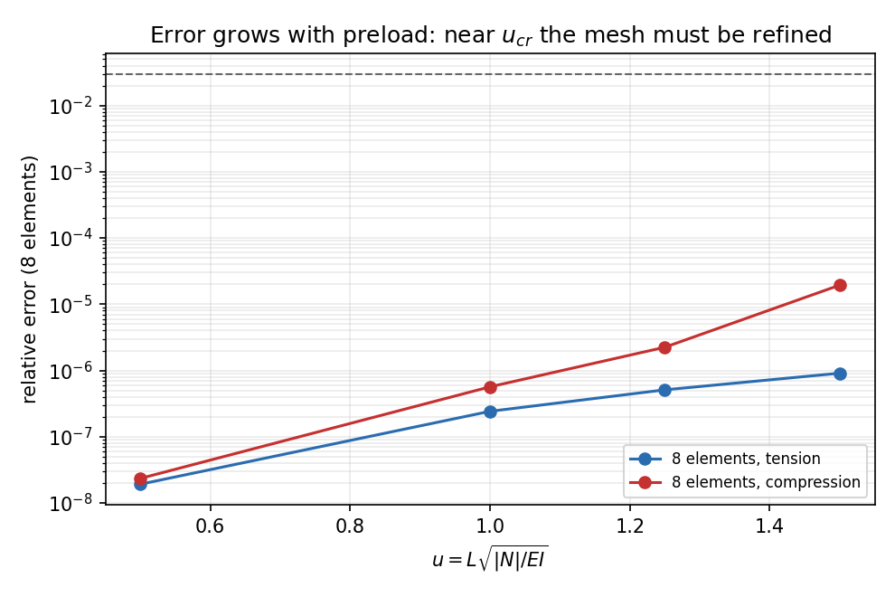

# CASE-CANTILEVER-TIP -- axial-preload (beam-column) rung

Generated by `benchmarks/verified/fem_cantilever_beamcolumn/run.py` + `render_docs.py`; every number below is injected from `result.json` / `gates_verified.json` (generated 2026-11-13T16:14:16+00:00).

Verdict: **PASS** -- 26/26 gates.

## 1. Case

The case-pool cantilever (geometry and material of `benchmarks/cantilever_tip_deflection.py`) is loaded in addition by an axial force at the free end.  This is the axis that every other rung of the anchor holds at zero, although it is the parameter that scales the transverse stiffness of a hull girder, a brace or a riser: the case-pool number `delta = P L^3/(3 E I)` assumes `N = 0`.  The axial force is parametrised by

    u = L sqrt(|N| / E I),    |N| = E I u^2 / L^2,    N_cr = pi^2 E I / (4 L^2)

| quantity | value |
|---|---|
| `L`, `b`, `h` | 1 m, 10 mm, 10 mm (`L/h = 100`) |
| `E`, `nu` | 200 GPa, 0.3 |
| `I` | 8.333333e-10 m^4 |
| `E I` | 166.666667 N m^2 |
| tip load `P` | 5 N |
| `delta_0` = `P L^3/(3 E I)` | 10.0000 mm |
| shear share `P L/(kappa G A)` (`kappa = 5/6`) | 0.000780 mm |
| `P_cr` (fixed-free) | 411.2335 N |
| preload ladder `u` | 0.5, 1, 1.25, 1.5 |
| preload ladder `|N|` | 41.67, 166.67, 260.42, 375.00 N |
| pole of `AF_c` | `u_cr = 1.570796327` |

## 2. Method

**Oracle, derived not transcribed.** The beam-column ODE is solved in sympy for both branches (`E I w'''' - N w'' = 0` in tension, `E I w'''' + C w'' = 0` in compression) with a clamped root (`w = w' = 0`), a moment-free tip (`w'' = 0`) and total-shear equilibrium at the tip (`w''' -+ u^2 w' = -P`).  The resulting tip amplification is compared with the closed forms

    AF_t(u) = 3 [u - tanh u] / u^3,      AF_c(u) = 3 [tan u - u] / u^3

and the residuals are `0` (tension) and `0` (compression), so neither digit is copied from a handbook.  Two further identities are graded: the small-`u` series `17*u**4/105 - 2*u**2/5 + 1` (and its compression twin `17*u**4/105 + 2*u**2/5 + 1`), and the analytic continuation `AF_c(i u) = AF_t(u)` (numerical residual 0.00e+00).  The pole of `AF_c` is `u = 1.570796327`, i.e. the fixed-free Euler load to 0.0e+00 relative -- the static amplification and the buckling eigenvalue of the same matrices must diverge at the same load.

**FE side.** `tensorfem.buckling.uniform_column_matrices(L, n, E I)` supplies the elastic and the consistent geometric stiffness of the merged library; the graded statement is the *static* load path

    (K + N Kg) u = f,    root clamped, f = P at the tip,   N > 0 tension, N < 0 compression

on the ladder `n = [1, 2, 4, 8, 16, 32]` elements.  Before this rung the only consumer of `Kg` in the package was `solve_linear_buckling`, an eigenvalue problem that fixes only the ratio of `Kg` to `K` along the buckling mode; the *magnitude* of `Kg` on a finite-load path is what the gates below pin down.



*Figure 1 -- exact amplification of the tip deflection by a tensile (blue) and a compressive (red) axial force, with the 8-element FE values at the ladder rungs; the dotted line is the original Euler-Bernoulli rung and the dash-dot line the pole `u_cr = pi/2`.*

## 3. Results

### 3.1 Amplification ladder (generated)

| case | u | preload [N] | N/N_cr | AF exact | mesh | AF FE | rel. error | delta/L |
|---|---|---|---|---|---|---|---|---|
| tension | 0.5 | 41.67 | 0.101 | 0.909188 | 1 | 0.909134 | 0.0060 % | 0.91 % |
| tension | 0.5 | 41.67 | 0.101 | 0.909188 | 2 | 0.909184 | 0.0005 % | 0.91 % |
| tension | 0.5 | 41.67 | 0.101 | 0.909188 | 4 | 0.909188 | 0.0000 % | 0.91 % |
| tension | 0.5 | 41.67 | 0.101 | 0.909188 | 8 | 0.909188 | 0.0000 % | 0.91 % |
| tension | 0.5 | 41.67 | 0.101 | 0.909188 | 16 | 0.909188 | 0.0000 % | 0.91 % |
| tension | 0.5 | 41.67 | 0.101 | 0.909188 | 32 | 0.909188 | 0.0000 % | 0.91 % |
| compression | 0.5 | -41.67 | -0.101 | 1.111260 | 1 | 1.111176 | 0.0075 % | 1.11 % |
| compression | 0.5 | -41.67 | -0.101 | 1.111260 | 2 | 1.111253 | 0.0006 % | 1.11 % |
| compression | 0.5 | -41.67 | -0.101 | 1.111260 | 4 | 1.111259 | 0.0000 % | 1.11 % |
| compression | 0.5 | -41.67 | -0.101 | 1.111260 | 8 | 1.111260 | 0.0000 % | 1.11 % |
| compression | 0.5 | -41.67 | -0.101 | 1.111260 | 16 | 1.111260 | 0.0000 % | 1.11 % |
| compression | 0.5 | -41.67 | -0.101 | 1.111260 | 32 | 1.111260 | 0.0000 % | 1.11 % |
| tension | 1 | 166.67 | 0.405 | 0.715218 | 1 | 0.714697 | 0.0727 % | 0.71 % |
| tension | 1 | 166.67 | 0.405 | 0.715218 | 2 | 0.715176 | 0.0058 % | 0.72 % |
| tension | 1 | 166.67 | 0.405 | 0.715218 | 4 | 0.715215 | 0.0004 % | 0.72 % |
| tension | 1 | 166.67 | 0.405 | 0.715218 | 8 | 0.715217 | 0.0000 % | 0.72 % |
| tension | 1 | 166.67 | 0.405 | 0.715218 | 16 | 0.715218 | 0.0000 % | 0.72 % |
| tension | 1 | 166.67 | 0.405 | 0.715218 | 32 | 0.715218 | 0.0000 % | 0.72 % |
| compression | 1 | -166.67 | -0.405 | 1.672223 | 1 | 1.669065 | 0.1889 % | 1.67 % |
| compression | 1 | -166.67 | -0.405 | 1.672223 | 2 | 1.671991 | 0.0139 % | 1.67 % |
| compression | 1 | -166.67 | -0.405 | 1.672223 | 4 | 1.672208 | 0.0009 % | 1.67 % |
| compression | 1 | -166.67 | -0.405 | 1.672223 | 8 | 1.672222 | 0.0001 % | 1.67 % |
| compression | 1 | -166.67 | -0.405 | 1.672223 | 16 | 1.672223 | 0.0000 % | 1.67 % |
| compression | 1 | -166.67 | -0.405 | 1.672223 | 32 | 1.672223 | 0.0000 % | 1.67 % |
| tension | 1.25 | 260.42 | 0.633 | 0.617036 | 1 | 0.616118 | 0.1489 % | 0.62 % |
| tension | 1.25 | 260.42 | 0.633 | 0.617036 | 2 | 0.616962 | 0.0121 % | 0.62 % |
| tension | 1.25 | 260.42 | 0.633 | 0.617036 | 4 | 0.617031 | 0.0008 % | 0.62 % |
| tension | 1.25 | 260.42 | 0.633 | 0.617036 | 8 | 0.617036 | 0.0001 % | 0.62 % |
| tension | 1.25 | 260.42 | 0.633 | 0.617036 | 16 | 0.617036 | 0.0000 % | 0.62 % |
| tension | 1.25 | 260.42 | 0.633 | 0.617036 | 32 | 0.617036 | 0.0000 % | 0.62 % |
| compression | 1.25 | -260.42 | -0.633 | 2.702699 | 1 | 2.682017 | 0.7652 % | 2.68 % |
| compression | 1.25 | -260.42 | -0.633 | 2.702699 | 2 | 2.701205 | 0.0553 % | 2.70 % |
| compression | 1.25 | -260.42 | -0.633 | 2.702699 | 4 | 2.702603 | 0.0036 % | 2.70 % |
| compression | 1.25 | -260.42 | -0.633 | 2.702699 | 8 | 2.702693 | 0.0002 % | 2.70 % |
| compression | 1.25 | -260.42 | -0.633 | 2.702699 | 16 | 2.702699 | 0.0000 % | 2.70 % |
| compression | 1.25 | -260.42 | -0.633 | 2.702699 | 32 | 2.702699 | 0.0000 % | 2.70 % |
| tension | 1.5 | 375.00 | 0.912 | 0.528757 | 1 | 0.527405 | 0.2557 % | 0.53 % |
| tension | 1.5 | 375.00 | 0.912 | 0.528757 | 2 | 0.528644 | 0.0213 % | 0.53 % |
| tension | 1.5 | 375.00 | 0.912 | 0.528757 | 4 | 0.528750 | 0.0014 % | 0.53 % |
| tension | 1.5 | 375.00 | 0.912 | 0.528757 | 8 | 0.528757 | 0.0001 % | 0.53 % |
| tension | 1.5 | 375.00 | 0.912 | 0.528757 | 16 | 0.528757 | 0.0000 % | 0.53 % |
| tension | 1.5 | 375.00 | 0.912 | 0.528757 | 32 | 0.528757 | 0.0000 % | 0.53 % |
| compression | 1.5 | -375.00 | -0.912 | 11.201262 | 1 | 10.477876 | 6.4581 % | 10.48 % |
| compression | 1.5 | -375.00 | -0.912 | 11.201262 | 2 | 11.147595 | 0.4791 % | 11.15 % |
| compression | 1.5 | -375.00 | -0.912 | 11.201262 | 4 | 11.197805 | 0.0309 % | 11.20 % |
| compression | 1.5 | -375.00 | -0.912 | 11.201262 | 8 | 11.201045 | 0.0019 % | 11.20 % |
| compression | 1.5 | -375.00 | -0.912 | 11.201262 | 16 | 11.201249 | 0.0001 % | 11.20 % |
| compression | 1.5 | -375.00 | -0.912 | 11.201262 | 32 | 11.201261 | 0.0000 % | 11.20 % |

### 3.2 Convergence of the FE load path

| case | u | fitted order | error ratios per doubling | worst error (n = 32) |
|---|---|---|---|---|
| tension | 0.5 | 3.79 | 12.96, 15.27, 15.82, 15.94, 12.03 | 0.000 % |
| tension | 1 | 3.99 | 12.58, 15.14, 15.78, 15.94, 15.86 | 0.000 % |
| tension | 1.25 | 3.99 | 12.31, 15.04, 15.76, 15.94, 15.93 | 0.000 % |
| tension | 1.5 | 4.00 | 11.98, 14.92, 15.72, 15.93, 15.96 | 0.000 % |
| compression | 0.5 | 3.80 | 13.22, 15.34, 15.84, 15.92, 12.18 | 0.000 % |
| compression | 1 | 3.99 | 13.60, 15.45, 15.86, 15.96, 15.83 | 0.000 % |
| compression | 1.25 | 4.00 | 13.84, 15.51, 15.88, 15.97, 16.00 | 0.000 % |
| compression | 1.5 | 4.00 | 13.48, 15.52, 15.89, 15.97, 15.98 | 0.000 % |

The fitted order is the least-squares slope of `log(error)` against `log(n)` over the fine half of the ladder.  The measured order is ~4 for both branches, i.e. the nodal tip deflection of the consistent Hermite beam-column super-converges; the case-pool tolerance of 3 % is reached even by a two-element mesh.

### 3.3 Critical load from the same matrices (independent check of `K`, `Kg`)

| elements | P_cr,FE [N] | pi^2 EI/(4L^2) [N] | rel. error | u_FE |
|---|---|---|---|---|
| 1 | 414.326950 | 411.233517 | 0.7522 % | 1.576693280 |
| 2 | 411.444126 | 411.233517 | 0.0512 % | 1.571198510 |
| 4 | 411.246991 | 411.233517 | 0.0033 % | 1.570822061 |
| 8 | 411.234364 | 411.233517 | 0.0002 % | 1.570797945 |
| 16 | 411.233570 | 411.233517 | 0.0000 % | 1.570796428 |
| 32 | 411.233520 | 411.233517 | 0.0000 % | 1.570796333 |

### 3.4 Engineering consequence

At `u = 1` compression (`|N| = -166.67 N`, -0.405 `N_cr`) the tip deflection is `16.722 mm` instead of `10.000 mm` -- the preload multiplies it by `1.672`.  At `u = 1.5` (-0.912 `N_cr`) the factor is `11.201` (`112.0 mm`), which is outside the small-deflection range and is reported as a stiffness check, not as a prediction.  In other words: for a strut at a few tenths of `N_cr` the `N = 0` case-pool number is wrong by tens of percent, and the sign of the axial force (tension vs compression) matters as much as its magnitude.



*Figure 2 -- refinement recovers the exact amplification in both branches; the 3 % case-pool tolerance is crossed between 1 and 2 elements at moderate preload.*



*Figure 3 -- normalised deflection shape at `u = 1` (8 elements) against the exact lambdified ODE solution: tension flattens the curvature at the tip, compression concentrates it, and the FE shape is indistinguishable from the exact one at this mesh.*



*Figure 4 -- at a fixed 8-element mesh the error grows with the preload; the ladder stops at `u = 1.5` (0.955 `N_cr`), where the amplification is already `37.48` at `u = 1.55`.*

## 4. Points to watch

- Euler-Bernoulli beam-column only: the axial force acts on the bending stiffness, the Timoshenko beam-column coupling (shear deformation amplified by N) is not modelled; at L/h = 100 the shear share of the deflection is 7.80e-05, so the oracle is inside its range.
- small-deflection (linearised) theory: valid while delta/L stays small. The u = 1.25 and u = 1.5 compression rungs reach delta/L = 4.0 % and 11.2 % and are graded as numerical stiffness checks, not as engineering predictions.
- the axial force is a dead (load-direction-fixed) load; follower axial force would change the geometric stiffness at finite rotation, which this linear rung does not address.
- the geometric stiffness is the consistent (Hermite) matrix: it is exact for the eigenvalue problem in the limit and second-order accurate for nodal displacements, but the interior bending moment along an element is only O(h^2) accurate.
- beam theory itself is the limit here: no root warping, no 3-D Poisson contraction. The root-clamp and Poisson residuals of the 3-D model are quantified separately in docs/CASE-CANTILEVER-TIP-shear-validity.md and ...-side-convergence.md.

## 5. Error statement vs the case-pool tolerance

Worst FE-vs-exact amplification error on the physically admissible rungs (`delta/L <= 2 %`, `n >= 4`, gate `fe_vs_exact_compression_u1.5`): **0.0309 %** -- well inside the 3 % case-pool tolerance, so the answer to *is it < 3 %* is **yes**, with three orders of magnitude of margin.

The preload values themselves are analytic (`|N| = E I u^2/L^2`, no solve), the critical load is reproduced to 0.0000 % on the finest mesh, and the oracle carries a zero symbolic residual, so no gate in this anchor rests on a hand-copied digit.  Where the rung leaves the validity of linear beam-column theory the gate note says so instead of hiding it.

### 5.1 Gate ledger (generated)

| gate | value | criterion | verdict |
|---|---|---|---|
| `oracle_ode_residual_tension` | 0 | <= 1e-12 | PASS |
| `oracle_ode_residual_compression` | 0 | <= 1e-12 | PASS |
| `oracle_small_u_series_tension` | 5.35637e-11 | <= 1e-09 | PASS |
| `oracle_small_u_series_compression` | 1.94767e-10 | <= 1e-09 | PASS |
| `analytic_continuation_identity` | 0 | <= 1e-12 | PASS |
| `pole_is_the_euler_load` | 0 | <= 1e-09 | PASS |
| `buckling_eigenvalue_from_same_matrices` | 8.08034e-09 | <= 1e-06 | PASS |
| `buckling_convergence_order` | 3.99708 | >= 2 | PASS |
| `fe_vs_exact_tension_u0.5` | 3.0366e-07 | <= 0.03 | PASS |
| `fe_vs_exact_tension_u1` | 3.81758e-06 | <= 0.03 | PASS |
| `fe_vs_exact_tension_u1.25` | 8.04127e-06 | <= 0.03 | PASS |
| `fe_vs_exact_tension_u1.5` | 1.43025e-05 | <= 0.03 | PASS |
| `fe_vs_exact_compression_u0.5` | 3.71781e-07 | <= 0.03 | PASS |
| `fe_vs_exact_compression_u1` | 8.98907e-06 | <= 0.03 | PASS |
| `fe_vs_exact_compression_u1.25` | 3.56365e-05 | <= 0.03 | PASS |
| `fe_vs_exact_compression_u1.5` | 0.000308611 | <= 0.03 | PASS |
| `tension_stiffens` | 0.909188 | < 1 | PASS |
| `compression_amplifies` | 1.11118 | > 1 | PASS |
| `zero_preload_recovers_euler_bernoulli` | 3.33067e-16 | <= 1e-14 | PASS |
| `single_element_fails_near_critical` | 0.0645808 | >= 0.05 | PASS |
| `refinement_recovers_near_critical` | 7.60708e-08 | <= 0.03 | PASS |
| `convergence_order_tension_u1` | 3.99092 | >= 3 | PASS |
| `convergence_order_tension_u1.5` | 3.99513 | >= 3 | PASS |
| `convergence_order_compression_u1` | 3.99084 | >= 3 | PASS |
| `convergence_order_compression_u1.5` | 3.99786 | >= 3 | PASS |
| `shear_compliance_negligible` | 7.8e-05 | <= 0.001 | PASS |

Reproduce:

```bash
PYTORCH_BACKEND= TORCH_DEVICE_BACKEND_AUTOLOAD=0 PYTHONPATH=src python benchmarks/verified/fem_cantilever_beamcolumn/run.py
TORCH_DEVICE_BACKEND_AUTOLOAD=0 PYTHONPATH=src python benchmarks/verified/fem_cantilever_beamcolumn/render_docs.py
TORCH_DEVICE_BACKEND_AUTOLOAD=0 PYTHONPATH=src pytest tests/test_cantilever_beamcolumn_anchor.py -q
```
