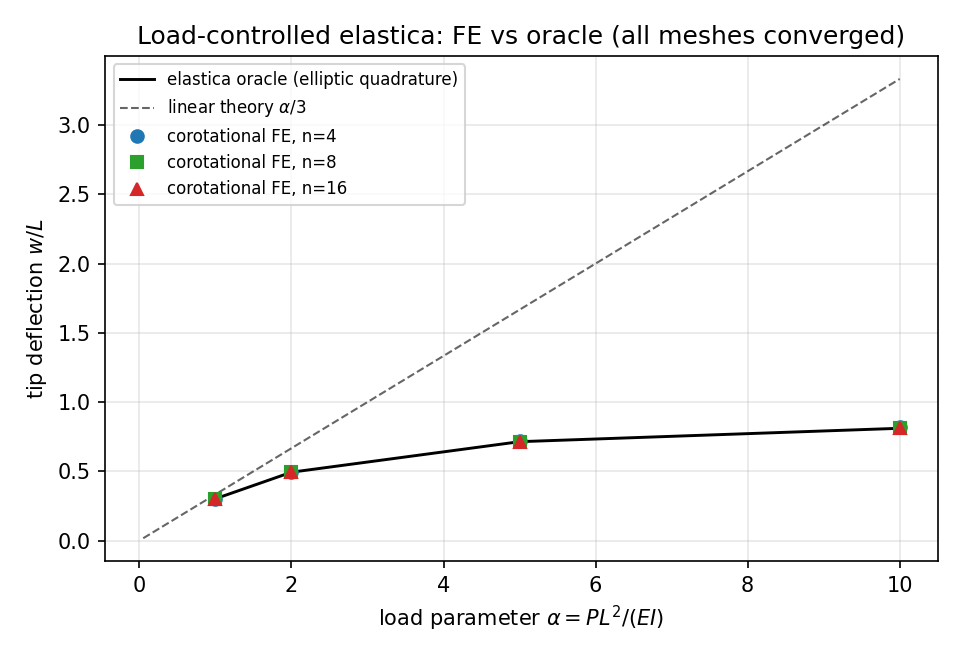
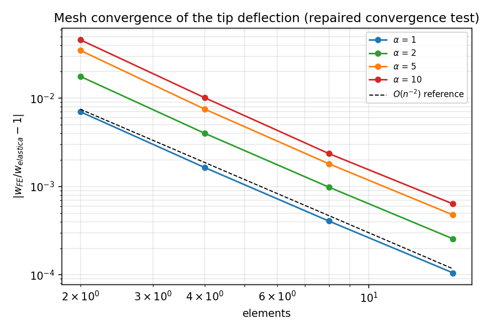
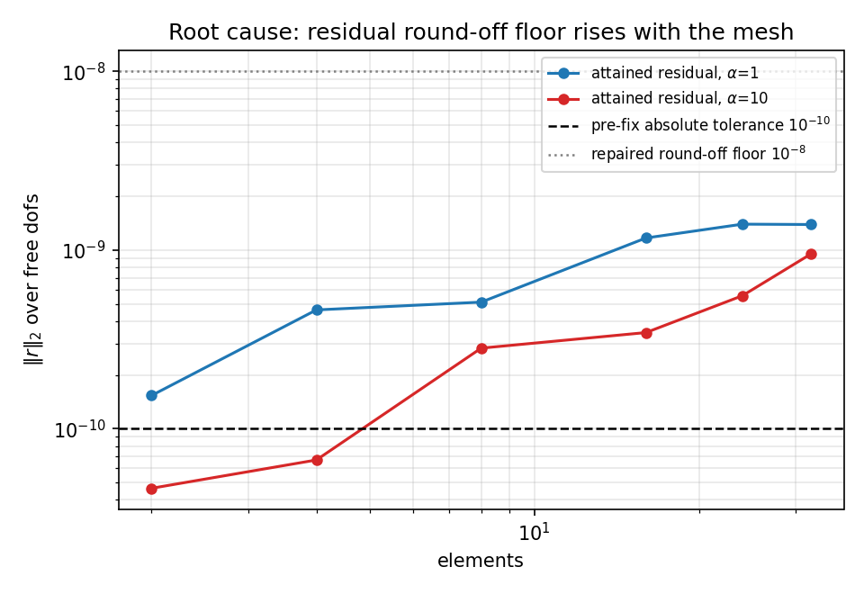
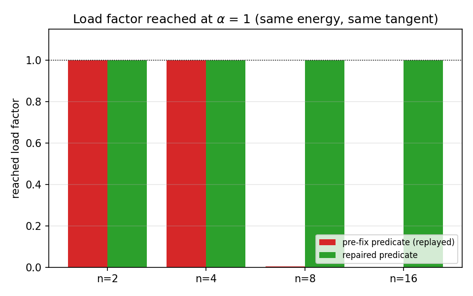

# CASE-CANTILEVER-TIP -- elastica rung: mesh independence repaired

Generated by `scripts/report_elastica_mesh_independence.py`; every number below is
injected from `artifacts/elastica_cantilever/results.json` and
`artifacts/elastica_cantilever/floor_study.json`.  Anchor `CASE-CANTILEVER-TIP`,
round 2 of `docs/elastica-cantilever-validation.md`.

## 1. Case

Tip-loaded cantilever, load control, geometrically nonlinear (finite rotation).
The rung is the large-deflection branch of the cantilever-tip case pool: as
$\alpha \to 0$ it must reproduce the pool's Euler-Bernoulli reference $w = P L^3/(3EI)$.

| quantity | value |
|---|---:|
| length L | 10.0 |
| section b x t | 1.0 x 0.1 |
| E / nu | 1200000.0 / 0.0 |
| flexural rigidity EI | 100 |
| load parameter alpha | 1, 2, 5, 10 |
| accept tolerance | 3% |

## 2. What was open, and what this adds

The merged study reported that the corotational beam fails for `n = 8` and
`n = 16` ("do not converge", load factor 0.00-0.13) while `n = 2, 4` converge,
and attributed the failure to a worsening condition number of the
central-difference tangent.  Its gate therefore stayed `qualified = False`,
so the rung certified nothing beyond `n = 4`.

**Finding: the attribution is wrong.** The tangent is not the problem and the
Newton loop is not divergent.  The loop reaches a fixed point at a residual level
set by double-precision round-off in the internal-force assembly.  That residual
is a cancellation of element contributions whose magnitude is set by `EA/L`, and
its floor is roughly proportional to the number of element contributions -- i.e.
it grows with mesh refinement (measured: 1.5e-10 at `n = 2` against 1.2e-9 at
`n = 16` for `alpha = 1`).  An absolute predicate `||r|| <= 1e-10` is therefore a
mesh-dependent acceptance criterion: on a fine mesh the load increments that
cross the floor are rejected, the step is halved until it falls under
`minimum_increment`, and the run aborts near zero load.  The repair is a
two-branch convergence test (`newton_converged`): relative force residual **or**
(residual at the round-off floor **and** the Newton increment below the
resolution of the iterate).  The energy, the tangent and the load stepping are
untouched.

### 2.1 Replay of the pre-fix loop (falsification test)

`scripts/elastica_convergence_floor_study.py` restores the pre-fix predicate
verbatim on the same energy/tangent and reproduces the reported failure:

| alpha | n | pre-fix load factor | rejected increments | pre-fix error | fixed load factor | fixed error |
|---:|---:|---:|---:|---:|---:|---:|
| 1 | 2 | 1.000 | 0 | 0.70% | 1.000 | 0.7030% |
| 1 | 4 | 1.000 | 0 | 0.16% | 1.000 | 0.1643% |
| 1 | 8 | 0.004 | 8 | 99.57% | 1.000 | 0.0407% |
| 1 | 16 | 0.000 | 7 | 100.00% | 1.000 | 0.0105% |
| 10 | 2 | 1.000 | 0 | 4.58% | 1.000 | 4.5844% |
| 10 | 4 | 1.000 | 0 | 1.01% | 1.000 | 1.0147% |
| 10 | 8 | 0.013 | 8 | 94.87% | 1.000 | 0.2363% |
| 10 | 16 | 0.000 | 7 | 100.00% | 1.000 | 0.0636% |

Where the pre-fix predicate already accepted the state (`n = 2, 4`), the
displacements are **bit-identical** before and after the repair, so the fix does
not move any published number -- it only stops the loop from discarding a
converged state.

## 3. Results

### 3.1 Mesh x load ladder (repaired)

| alpha | n | converged | load factor | residual | `w/L` FE | `w/L` elastica | deflection error | shortening error |
|---:|---:|:---:|---:|---:|---:|---:|---:|---:|
| 1 | 2 | yes | 1.000 | 1.53e-10 | 0.303842 | 0.301721 | 0.7030% | 3.8777% |
| 1 | 4 | yes | 1.000 | 4.62e-10 | 0.302217 | 0.301721 | 0.1643% | 1.0302% |
| 1 | 8 | yes | 1.000 | 5.11e-10 | 0.301844 | 0.301721 | 0.0407% | 0.2639% |
| 1 | 16 | yes | 1.000 | 1.17e-09 | 0.301753 | 0.301721 | 0.0105% | 0.0689% |
| 2 | 2 | yes | 1.000 | 2.22e-11 | 0.502169 | 0.493457 | 1.7655% | 2.2389% |
| 2 | 4 | yes | 1.000 | 4.52e-11 | 0.495437 | 0.493457 | 0.4012% | 0.6570% |
| 2 | 8 | yes | 1.000 | 1.09e-10 | 0.493944 | 0.493457 | 0.0986% | 0.1721% |
| 2 | 16 | yes | 1.000 | 4.88e-10 | 0.493584 | 0.493457 | 0.0256% | 0.0455% |
| 5 | 2 | yes | 1.000 | 2.02e-11 | 0.738609 | 0.713792 | 3.4769% | 0.4573% |
| 5 | 4 | yes | 1.000 | 4.20e-11 | 0.719172 | 0.713792 | 0.7537% | 0.1358% |
| 5 | 8 | yes | 1.000 | 7.55e-11 | 0.715084 | 0.713792 | 0.1811% | 0.0510% |
| 5 | 16 | yes | 1.000 | 2.74e-10 | 0.714132 | 0.713792 | 0.0477% | 0.0152% |
| 10 | 2 | yes | 1.000 | 4.64e-11 | 0.847770 | 0.810609 | 4.5844% | 2.2702% |
| 10 | 4 | yes | 1.000 | 6.68e-11 | 0.818834 | 0.810609 | 1.0147% | 0.1284% |
| 10 | 8 | yes | 1.000 | 2.82e-10 | 0.812525 | 0.810609 | 0.2363% | 0.0041% |
| 10 | 16 | yes | 1.000 | 3.45e-10 | 0.811124 | 0.810609 | 0.0636% | 0.0044% |

Gate: `qualified = True`, `all_converged = True`, `monotone_refinement = True`.

### 3.2 Round-off floor vs the old predicate

The last column asks whether the pre-fix predicate would accept the state the
*repaired* run ends on.  It is an indicator, not the decisive test: whether a run
aborts depends on which increment first crosses the floor, and the two runs walk
slightly different load paths because the accepted increments differ.  The
decisive test is the replay of section 2.1.

| alpha | n | attained residual | pre-fix predicate accepts this state? |
|---:|---:|---:|:---:|
| 1 | 2 | 1.53e-10 | **no** (below the floor) |
| 1 | 4 | 4.62e-10 | **no** (below the floor) |
| 1 | 8 | 5.11e-10 | **no** (below the floor) |
| 1 | 16 | 1.17e-09 | **no** (below the floor) |
| 1 | 24 | 1.39e-09 | **no** (below the floor) |
| 1 | 32 | 1.39e-09 | **no** (below the floor) |
| 10 | 2 | 4.64e-11 | yes |
| 10 | 4 | 6.68e-11 | yes |
| 10 | 8 | 2.82e-10 | **no** (below the floor) |
| 10 | 16 | 3.45e-10 | **no** (below the floor) |
| 10 | 24 | 5.55e-10 | **no** (below the floor) |
| 10 | 32 | 9.49e-10 | **no** (below the floor) |

### 3.3 Figures









## 4. Error vs benchmark (is it < 3%?)

Reference: the inextensible Kirchhoff/Clebsch elastica, solved by elliptic
quadrature and cross-checked against an independent `solve_bvp` route
(route difference <= 8.7e-12).

| alpha | n | deflection error | < 3%? | shortening error | < 3%? |
|---:|---:|---:|:---:|---:|:---:|
| 1 | 2 | 0.7030% | yes | 3.8777% | **NO** |
| 1 | 4 | 0.1643% | yes | 1.0302% | yes |
| 1 | 8 | 0.0407% | yes | 0.2639% | yes |
| 1 | 16 | 0.0105% | yes | 0.0689% | yes |
| 2 | 2 | 1.7655% | yes | 2.2389% | yes |
| 2 | 4 | 0.4012% | yes | 0.6570% | yes |
| 2 | 8 | 0.0986% | yes | 0.1721% | yes |
| 2 | 16 | 0.0256% | yes | 0.0455% | yes |
| 5 | 2 | 3.4769% | **NO** | 0.4573% | yes |
| 5 | 4 | 0.7537% | yes | 0.1358% | yes |
| 5 | 8 | 0.1811% | yes | 0.0510% | yes |
| 5 | 16 | 0.0477% | yes | 0.0152% | yes |
| 10 | 2 | 4.5844% | **NO** | 2.2702% | yes |
| 10 | 4 | 1.0147% | yes | 0.1284% | yes |
| 10 | 8 | 0.2363% | yes | 0.0041% | yes |
| 10 | 16 | 0.0636% | yes | 0.0044% | yes |

All rungs at `n >= 8` satisfy the 3% gate; the largest error over the
whole ladder is 4.5844% (coarse `n = 2`, kept and reported, not dropped).
Fine-mesh maximum deflection error:
**0.2363%** -> gate met.

Small-load linkage with the pool's Euler-Bernoulli reference: at
$\alpha = 10^{-3}$ the oracle satisfies $w/L = \alpha/3$ to
2e-4 relative (`tests/test_elastica_cantilever.py`), so the large-deflection
rung joins the linear rungs of the pool continuously.

## 5. Caveats

- The round-off branch accepts a residual at `1e-8` of the applied load **only if**
  the Newton increment is below `1e-12*(1+||q||)`; the accepted state is therefore
  a fixed point to the resolution of the iterate (last increments measured ~1e-15),
  which is 9 orders below the 3% gate.  This is not a loosened accuracy claim.
- The validity domain of the round-off branch is bounded: the floor grows with the
  assembly size, so a mesh coarse enough to keep it under `RFLOOR` is required;
  it was verified to `n = 32`
  (residual 1.39e-09,
  deflection error 0.0219%).
  Much finer meshes would need `RFLOOR` revisited, not a bigger `max_iterations`.
- The oracle is the **inextensible** Euler-Bernoulli elastica: no transverse shear
  (Timoshenko) and no axial extensibility, and it does not reach the roll-up limit
  `alpha -> infinity`.  The FE model carries a stiff axial rigidity `EA`, whose
  elastic stretch is ~1e-5 of L at these loads.
- The FE path is a dedicated 2-node corotational beam, not a shell/solid model;
  these numbers must not be extrapolated to Shell4 under load control.
- `poisson` is accepted by the driver but unused (the beam energy has no shear
  term); it is carried only for interface symmetry with the other pool rungs.

## 6. Reproduce

```bash
PYTHONPATH=src OMP_NUM_THREADS=1 python scripts/run_elastica_cantilever_benchmark.py \
    --alphas 1,2,5,10 --meshes 2,4,8,16 --out artifacts/elastica_cantilever
PYTHONPATH=src OMP_NUM_THREADS=1 python scripts/elastica_convergence_floor_study.py
PYTHONPATH=src OMP_NUM_THREADS=1 python scripts/report_elastica_mesh_independence.py
PYTHONPATH=src python -m pytest tests/test_elastica_cantilever.py -q
```

