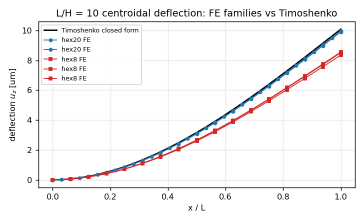
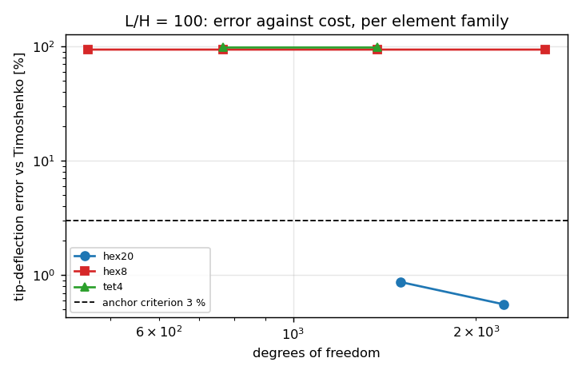
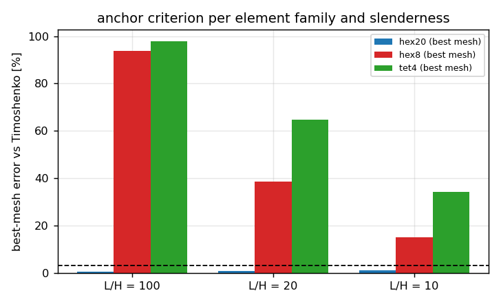
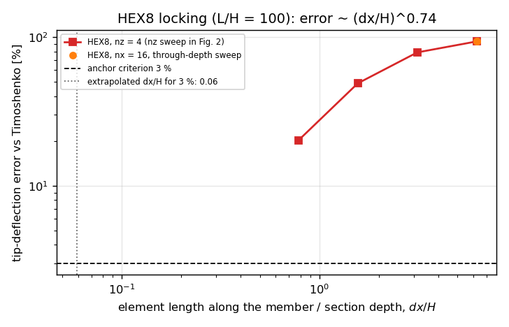

# CASE-CANTILEVER-TIP -- element-family validity of the 3 % criterion

*Generated by `benchmarks/verified/fem_cantilever_hex8/run.py` on 2026-11-14T10:28:22+00:00 (mission `CASE-CANTILEVER-TIP`, anchor `fem_cantilever_hex8`). Every number below is injected from `result.json`; nothing is hand-copied.*
*Verdict: **PASS***

## 1. Case and the debt this closes

The case-pool anchor grades a prismatic cantilever against Euler-Bernoulli / Timoshenko with a `< 3 %` criterion. Every published rung of the anchor is a beam model or a **quadratic** 3-D solid, so the criterion has never been interrogated against the element family a user actually meshes with: a first-order brick (HEX8) or its six-tetrahedron decomposition (TET4). Both carry full integration here, and both are known to lock in bending.

| parameter | symbol | value |
|---|---|---:|
| width | `B` | 10 mm |
| depth (bending direction) | `H` | 10 mm |
| Young's modulus | `E` | 200 GPa |
| Poisson ratio | `nu` | 0.3 |
| tip load (end-face traction, resultant) | `P` | 5 N |
| shear factor | `kappa` | 0.8333 |
| slenderness rungs | `L/H` | 100, 20, 10 |
| case-pool tolerance | | 3 % |

## 2. Method

1. **Oracles re-derived in-driver.** `delta_EB` and `delta_TI` are obtained from the unit-load integrals (bending `int M m/(EI) dx` plus shear `int V v/(kappa G A) dx`) by quadrature; the residual against the closed forms is a gate, so no handbook digit enters the evidence chain.
2. **Three element families, one load path.** Clamped root face (all three dofs), uniform transverse traction on the loaded end face with resultant exactly `P`; the reported quantity is the mean end-face transverse displacement, the same definition the sibling rungs use.
3. **Cost is measured, not assumed.** Every record carries its dof count, so the error is plotted against cost rather than mesh size -- HEX8 and TET4 at different densities are not comparable otherwise.

### Oracle self-check (quadrature vs closed form)

| L/H | EB/TI separation | quadrature residual |
|---:|---:|---:|
| 100 | 0.0078 % | 1.250e-09 |
| 20 | 0.1950 % | 1.248e-09 |
| 10 | 0.7800 % | 1.240e-09 |

## 3. Results

| L/H | family | mesh (nx x ny x nz) | elements | dofs | delta [um] | Timoshenko [um] | error [%] | < 3 % |
|---:|---|---|---:|---:|---:|---:|---:|:--:|
| 100 | hex20 | 16x2x2 | 64 | 1503 | 9913.6724 | 10000.7800 | 0.87 | yes |
| 100 | hex20 | 24x2x2 | 96 | 2223 | 9945.1371 | 10000.7800 | 0.56 | yes |
| 100 | hex8 | 16x2x2 | 64 | 459 | 621.9699 | 10000.7800 | 93.78 | **no** |
| 100 | hex8 | 16x2x4 | 128 | 765 | 622.8106 | 10000.7800 | 93.77 | **no** |
| 100 | hex8 | 16x2x8 | 256 | 1377 | 623.0366 | 10000.7800 | 93.77 | **no** |
| 100 | hex8 | 16x2x16 | 512 | 2601 | 623.0948 | 10000.7800 | 93.77 | **no** |
| 100 | tet4 | 16x2x4 | 768 | 765 | 222.9421 | 10000.7800 | 97.77 | **no** |
| 100 | tet4 | 16x2x8 | 1536 | 1377 | 223.9418 | 10000.7800 | 97.76 | **no** |
| 20 | hex20 | 12x2x2 | 48 | 1143 | 79.2521 | 80.1560 | 1.13 | yes |
| 20 | hex20 | 20x2x2 | 80 | 1863 | 79.5543 | 80.1560 | 0.75 | yes |
| 20 | hex8 | 16x2x2 | 64 | 459 | 48.4051 | 80.1560 | 39.61 | **no** |
| 20 | hex8 | 16x2x4 | 128 | 765 | 49.0634 | 80.1560 | 38.79 | **no** |
| 20 | hex8 | 16x2x8 | 256 | 1377 | 49.2435 | 80.1560 | 38.57 | **no** |
| 20 | tet4 | 16x2x4 | 768 | 765 | 27.0988 | 80.1560 | 66.19 | **no** |
| 20 | tet4 | 16x2x8 | 1536 | 1377 | 28.3971 | 80.1560 | 64.57 | **no** |
| 10 | hex20 | 8x2x2 | 32 | 783 | 9.8990 | 10.0780 | 1.78 | yes |
| 10 | hex20 | 16x2x2 | 64 | 1503 | 9.9626 | 10.0780 | 1.15 | yes |
| 10 | hex8 | 16x2x2 | 64 | 459 | 8.3474 | 10.0780 | 17.17 | **no** |
| 10 | hex8 | 16x2x4 | 128 | 765 | 8.5101 | 10.0780 | 15.56 | **no** |
| 10 | hex8 | 16x2x8 | 256 | 1377 | 8.5552 | 10.0780 | 15.11 | **no** |
| 10 | tet4 | 16x2x4 | 768 | 765 | 6.1275 | 10.0780 | 39.20 | **no** |
| 10 | tet4 | 16x2x8 | 1536 | 1377 | 6.6427 | 10.0780 | 34.09 | **no** |

### Why the through-depth sweep is flat: the controlling parameter

The brick rungs above barely move with `nz`, so the density sweep was re-run along the member instead (`nz = 4` fixed, `nx` swept):

| nx | dx/H | elements | dofs | delta [um] | error [%] |
|---:|---:|---:|---:|---:|---:|
| 16 | 6.250 | 128 | 765 | 622.8106 | 93.77 |
| 32 | 3.125 | 256 | 1485 | 2091.9723 | 79.08 |
| 64 | 1.562 | 512 | 2925 | 5104.7719 | 48.96 |
| 128 | 0.781 | 1024 | 5805 | 7982.7677 | 20.18 |

Observed error order in `dx/H`: **0.74** (log-log fit between the two extreme meshes), i.e. the locking error falls only sub-linearly with the along-member element length. Extrapolating that slope to the anchor's band puts the tolerance at `dx/H = 0.059`, i.e. about 17 first-order elements per section depth along the member -- an extrapolation, not a solved mesh, and recorded as such in the limitations.

### Falsified expectation (kept on the record)

* hypothesis: *8x through-depth (nz 2 -> 16) refinement of the first-order brick halves the tip-deflection error*
* observed ratio: 0.9999
* verdict: **falsified -- the error is flat in nz at fixed nx; the controlling parameter is the along-member element length**

## 4. Figures

*Fig. 1 -- centroidal deflection at `L/H = 10`: the quadratic solid tracks the Timoshenko line, the first-order brick locks (it is far too stiff).*

*Fig. 2 -- error against cost at the case-pool rung `L/H = 100` (log-log) with the anchor's 3 % line.*

*Fig. 3 -- best mesh per family and slenderness against the same 3 % line.*

*Fig. 4 -- the controlling parameter: HEX8 error against the along-member element length `dx/H` (squares) versus the through-depth sweep at fixed `dx/H` (circles); only the former moves the error.*

## 5. Notes and limitations

* Linear elasticity, small strain: this ladder says nothing about the geometrically nonlinear rung (`src/tensorfem/elastica_cantilever.py`).
* Fully integrated HEX8 and TET4 only. Reduced integration with hourglass control, incompatible-mode (Wilson) bricks and TET10 are outside this scope, so the numbers are not a ranking of every first-order strategy.
* The mean end-face displacement includes the load-introduction (Saint-Venant) effect; it is the sibling rungs' definition, which keeps the comparison between rungs fair but biases every family slightly.
* Family and density are only partially separated: the HEX8 in-plane mesh is fixed at nx=16, ny=2 in the rung ladder while HEX20 varies, so the dof-efficiency ratio is a matched-cost comparison, not a converged-cost one; the aspect sweep separates the two effects only inside the brick family.
* The dx/H needed for the 3 % band is an extrapolation of the measured slope from meshes that were actually solved; no run at that density exists, and the slope itself is measured between the two extreme meshes only.
* Rigid-body-motion and patch tests are not repeated here: the trilinear brick and the tet pass them by construction of the library (`src/tensorfem/patch_test.py`), so the ladder grades bending behaviour alone.
* No analytic reference exists for locking itself; the reference is the Timoshenko oracle plus the observed refinement ladder, so the *rate* is reported, not asserted.

## 6. Error judgement against the anchor criterion

| family | rung | best-mesh error vs Timoshenko | < 3 % ? |
|---|---|---:|:--:|
| hex20 | L/H = 100 | 0.56 % | yes |
| hex20 | L/H = 20 | 0.75 % | yes |
| hex20 | L/H = 10 | 1.15 % | yes |
| hex8 | L/H = 100 | 93.77 % | **no** |
| hex8 | L/H = 20 | 38.57 % | **no** |
| hex8 | L/H = 10 | 15.11 % | **no** |
| tet4 | L/H = 100 | 97.76 % | **no** |
| tet4 | L/H = 20 | 64.57 % | **no** |
| tet4 | L/H = 10 | 34.09 % | **no** |

At `L/H = 100` HEX20 reaches **0.56 %** at 2223 dofs (within the 3 % band); HEX8 reaches 93.77 % at 2601 dofs (**outside** the band) against 93.78 % at the coarsest density.

At a comparable cost the brick error is **168.53x** the quadratic-solid error (HEX20 2223 dofs, 0.56 %; HEX8 2601 dofs, 93.77 %).

The brick does not buy the band back through the depth: at fixed `nx` the error moves by 0.01 % over the whole `nz` sweep, while refining along the member takes it from 93.77 % to 20.18 %.

**Consequence for the case pool**: the `3 %` criterion is a statement about *one* discretisation. A rung that claims it must name the element family and the along-member mesh density it was measured with; the anchor's own published evidence is valid, and the family-dependence is now on the record instead of in folklore.
