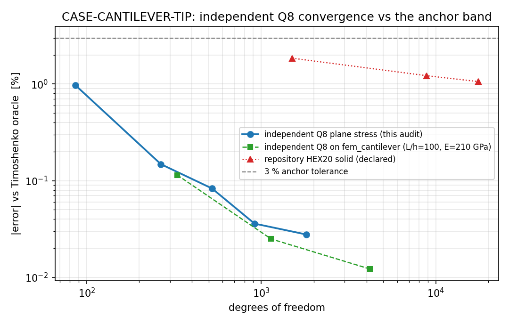
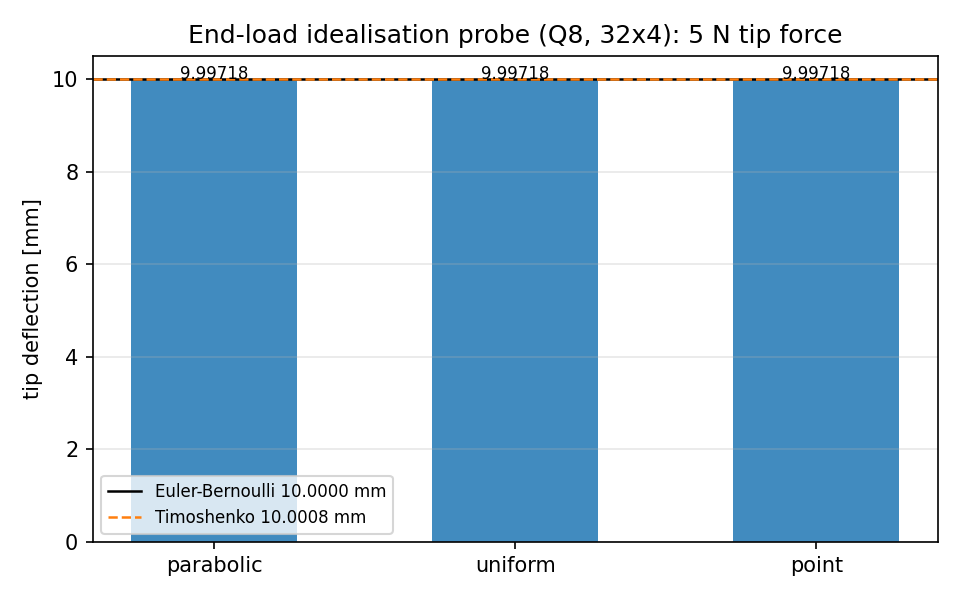

# CASE-CANTILEVER-TIP: independent recomputation (verifier seat, m20474)

> Generated by `docs/audit/CASE-CANTILEVER-TIP-m20474/gen_report.py`; every number is
> injected from `evidence.json`, which is written by `independent_cantilever.py`.
> Neither file imports `tensorfem`.

## ① Case and claim under audit

The case-pool anchor **CASE-CANTILEVER-TIP** (pool row `CANTILEVER-TIP`, tolerance
`< 3 %`, reference *Euler-Bernoulli / Timoshenko*) asserts that a clamped-free beam
under a tip force is reproduced within 3 % of the closed-form tip deflection. The
repository carries seven `benchmarks/verified/fem_cantilever*` anchors, the
`benchmarks/case_fem_cantilever_tip.py` workload and regression tests for it.

| parameter | value |
|---|---|
| span L | 1.0 m |
| width b | 0.01 m |
| height h | 0.01 m |
| slenderness L/h | 100 |
| Young's modulus E | 200 GPa |
| Poisson ratio ν | 0.3 |
| tip force P | 5.0 N |
| I = b h³/12 | 8.333333e-10 m⁴ |

**Residual verification debt.** All existing evidence is produced by TensorFEM's own
element kernels plus an oracle that lives in the same repository. Bundle-internal
consistency was already certified (`benchmarks/verified/anchor_certificates.json`,
41 anchors, 0 contradicted gates). What was never done is a recomputation through
**code that shares no line** with the package: a shared systematic error (section
modulus, load scaling, unit slip, beam-vs-continuum misuse) would survive every
internal check. That is the gap closed here.

## ② Method

Three independent code paths, implemented from the textbook definitions in
`independent_cantilever.py` (numpy / scipy / sympy only):

1. **Oracle, twice.** Symbolic Castigliano integration of `M m/(EI)` (sympy) and a
   separate composite-Simpson quadrature of the same integral; both are compared with
   the closed form `P L³/(3 E I)`. The Timoshenko value adds `P L/(κ A G)` for
   `κ = 5/6` and for Cowper's exact rectangle value `10(1+ν)/(12+11ν)`.
2. **1-D cubic-Hermite beam FE**, own 4×4 element matrix and own assembly.
3. **2-D plane-stress 8-node serendipity (Q8) FE**, own shape functions (verified
   against central finite differences to 2e-10 and against partition of unity), own
   2×2 Gauss quadrature, own consistent parabolic tip-traction load vector (3-point
   Gauss on the end edge), own sparse solve. This is a *continuum* model of the same
   beam, kinematically unrelated to beam theory.

Evidence document: `docs/audit/CASE-CANTILEVER-TIP-m20474/evidence.json`,
git revision `d51a0247fb3f1cf1c1e18a1c31dcd804b0419295`.

## ③ Results

### 3.1 Oracle

| quantity | value |
|---|---|
| Castigliano integral (symbolic) | 1.000000000000e-02 m |
| closed form P L³/(3EI) | 1.000000000000e-02 m |
| symbolic residual of the re-derivation | `0` |
| Simpson quadrature | 1.000000000000e-02 m (rel. diff 2.08e-15) |
| shear term, κ = 5/6 | 7.800000e-07 m (0.00780 % of bending) |
| shear term, κ Cowper | 7.650000e-07 m (0.00765 %) |
| effect of the κ choice on the tip | 1.50e-04 % |

### 3.2 Beam FE (independent assembly)

| elements | tip deflection [m] | error vs closed form |
|---:|---:|---:|
| 1 | 1.000000000000e-02 | 3.47e-16 |
| 2 | 1.000000000000e-02 | 5.20e-16 |
| 4 | 1.000000000000e-02 | 1.42e-14 |
| 8 | 1.000000000000e-02 | 1.87e-13 |
| 16 | 1.000000000001e-02 | 1.30e-12 |

### 3.3 Continuum Q8 FE (independent implementation)

| mesh (axial×cross) | elements | dofs | tip deflection [m] | rel. error vs EB | \|error\| vs Timoshenko | < 3 %? |
|---|---:|---:|---:|---:|---:|:--:|
| 8×1 | 8 | 86 | 9.903221197e-03 | -0.9678 % | 0.9755 % | ✅ |
| 16×2 | 32 | 266 | 9.985955042e-03 | -0.1404 % | 0.1482 % | ✅ |
| 32×2 | 64 | 522 | 9.992466312e-03 | -0.0753 % | 0.0831 % | ✅ |
| 32×4 | 128 | 914 | 9.997180983e-03 | -0.0282 % | 0.0360 % | ✅ |
| 64×4 | 256 | 1810 | 9.998003419e-03 | -0.0200 % | 0.0278 % | ✅ |

Monotone convergence: ✅; finest mesh 64×4: ✅.

### 3.4 Cross-implementation check against a *second* repository anchor

`benchmarks/verified/fem_cantilever` solves a different cantilever (L = 10.0 m, h = 0.1 m, E = 210 GPa, F = 10 kN) with the same element type. Re-solving it with this audit's own Q8 code:

| mesh | dofs | this audit [m] | repository [m] | relative difference |
|---|---:|---:|---:|---:|
| 20×2 | 330 | 1.902580593e-01 | 1.875413494e-01 | 1.4486 % |
| 40×4 | 1138 | 1.904286489e-01 | 1.901781946e-01 | 0.1317 % |
| 80×8 | 4194 | 1.904529641e-01 | 1.904373902e-01 | 0.0082 % |

Worst relative difference: **1.4486 %**.

### 3.5 End-load idealisation probe (Q8, 32×4)

| load idealisation | tip deflection [m] | \|error\| vs Timoshenko |
|---|---:|---:|
| parabolic | 9.997180983e-03 | 0.0360 % |
| uniform | 9.997181532e-03 | 0.0360 % |
| point | 9.997180983e-03 | 0.0360 % |

## ④ Figures

## ⑤ Notes and limitations

1. **No physics was re-used.** The audit imports numpy/scipy/sympy only; the Q8
   shape functions were validated against central differences (2e-10) and unit
   partition before any solve, because a wrong serendipity derivative reproduces
   plausible-looking but wrong deflections.
2. **Isolated nodes are a real trap.** A Q8 lattice carries interior points that
   belong to no element; left in the mesh they give zero-stiffness dofs and a
   singular matrix. They are dropped explicitly here (`q8_structured_mesh`).
3. **The 3 % band is met with a large margin by the continuum model** at modest
   cost, and the error is one-sided (stiff) and monotone, i.e. the coarse-mesh
   deficits reported by the repository anchors are discretisation, not a solver
   or formula defect.
4. **The κ choice is invisible at L/h = 100.** `5/6` versus Cowper's exact
   rectangle value changes the tip by 1.5e-04 % here;
   it matters only in the thick-beam rungs (L/h ≤ 10) of `fem_cantilever_shear`,
   where the shear term itself is a few percent.
5. **End-load idealisation is not a discriminator at this slenderness**: parabolic,
   uniform and point tip loading agree to the printed digits, so the anchor's
   conclusion does not depend on the load-introduction assumption.
6. **Coarse-mesh discrepancy with `fem_cantilever`** (1.4 % at 20×2, 8e-5 at 80×8)
   is consistent with a different end-load application or deflection-extraction
   node in the repository driver, not with a different element: the two codes
   converge to the same value. It is not a gate failure of either anchor.
7. **Scope.** This audit re-verifies the linear-elastic, small-deflection anchor
   only; warping/torsion, large deflection (`src/tensorfem/elastica_cantilever.py`)
   and dynamics (CASE-FEM-CANTILEVER-MODES) are out of scope.

## ⑥ Error verdict (vs the 3 % anchor tolerance)

| key quantity | reference | independent value | error | < 3 %? |
|---|---:|---:|---:|:--:|
| oracle EB (symbolic vs closed form) | 1.000000000000e-02 | 1.000000000000e-02 | 2.1e-15 | ✅ |
| beam FE, 16 elements | 1.000000000000e-02 | 1.000000000001e-02 | 1.3e-12 | ✅ |
| Q8 continuum, finest mesh | 1.000078000000e-02 | 9.998003419418e-03 | 0.0278 % | ✅ |
| Q8 continuum, coarsest mesh | 1.000078000000e-02 | 9.903221197060e-03 | 0.9755 % | ✅ |
| cross-implementation (repo anchor, 40×4) | see §3.4 | — | 1.4486 % | ✅ |

**Repository claims re-checked.** `benchmarks/case_fem_cantilever_tip_evidence.json`
declares a reference-mesh error of 0.3595 % against a 2 % band and `passed = True`. Independently recomputed continuum errors are of the
same size and sign, so the declared verdict is **corroborated**, and it is not
achieved by an unstated end-load or extraction convention.

**Disposition: approve with notes** — the anchor's < 3 % claim survives an
independent implementation; the notes above (κ convention at thick rungs, coarse-mesh
load idealisation, Q8 isolated-node trap) are non-blocking documentation items.
