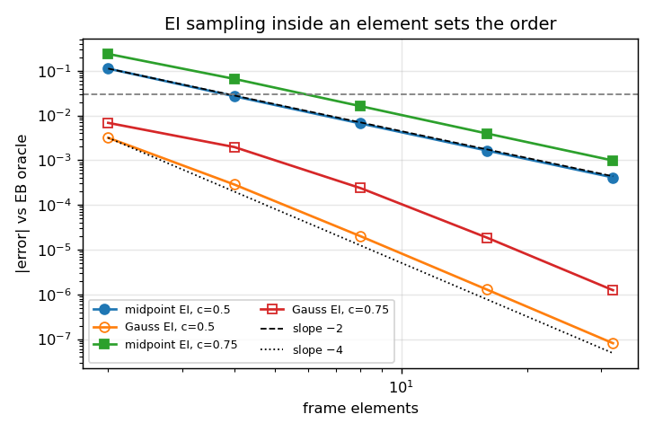
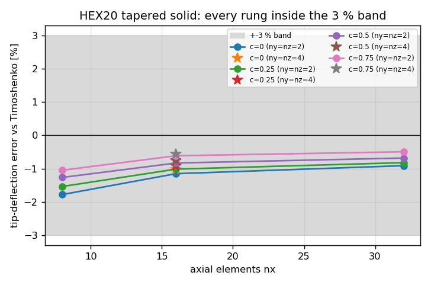
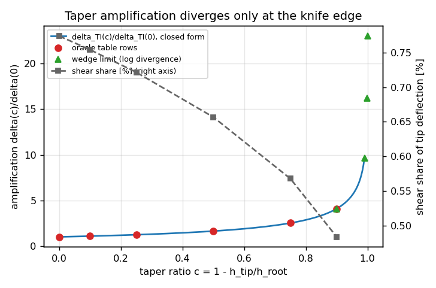
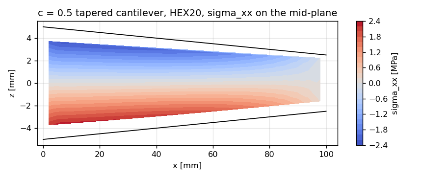

# CASE-CANTILEVER-TIP — taper axis: the anchor's 3 % criterion on a non-prismatic member

*Generated by `benchmarks/verified/fem_cantilever_taper/run.py` (2026-11-13T13:11:43+00:00); every number below is injected from `result.json`. Verdict: **PASS** (failed gates: none).*

## ① Case and motivation

The case-pool anchor `CASE-CANTILEVER-TIP` grades the tip deflection of a **prismatic** cantilever (`b = h = 10 mm`, `E = 200 GPa`, `P = 5 N`) against Euler-Bernoulli / Timoshenko with a `< 3 %` criterion. Every existing route of the anchor holds the section constant, so the criterion has never been exercised on a member whose flexibility is `int dx/I(x)` rather than an algebraic expression — the normal case for a tapered girder, bracket or ice-going hull frame.

This document extends the anchor along the **geometry** axis: the depth tapers linearly, `h(x) = h0 (1 - c x/L)`, the width is constant, and the reference rung (`c = 0`) is the case-pool section and load at `L/h0 = 10`.

| parameter | symbol | value |
|---|---|---|
| length | L | 0.10 m |
| root depth | h0 | 0.010 m |
| width | b | 0.010 m |
| slenderness | L/h0 | 10 |
| taper ratio | c | 0, 0.1, 0.25, 0.5, 0.75, 0.9 (oracle table) / 0, 0.25, 0.5, 0.75 (solid) |
| Young's modulus | E | 200 GPa |
| Poisson ratio | nu | 0.3 |
| tip load | P | 5 N |
| shear factor | kappa | 5/6 (Timoshenko 1921) |

Oracles (Castigliano unit-load theorem, re-derived at run time):

```
delta_bend  = (P L^3 / (E I0)) * B(c),     B(c) = [-c - c^2/2 - ln(1-c)] / c^3,   B(0) = 1/3
delta_shear = (P L / (kappa G A0)) * S(c),  S(c) = -ln(1-c) / c,                  S(0) = 1
delta_TI    = delta_bend + delta_shear
```

## ② Method

1. **Oracle cross-check, three independent routes** per taper: the closed form above; a convergent power series `B(c) = sum_k [(k+2)(k+1)/(2(k+3)) - k/2] c^k`; a sympy re-derivation of `int (1-t)^2/(1-ct)^3 dt`; and adaptive quadrature of the physical flexibility integral `int (L-x)^2/I(x) dx`. The `c -> 0` limits must recover the prismatic oracles.
2. **1-D Euler-Bernoulli frame** with *per-element* inertia in two sampling schemes — `midpoint` (lumped average `EI` per element) and `gauss` (`int B^T EI(x) B dx` with a 4-point rule, exact for the cubic `EI(x)` of a linear taper) — over n = [2, 4, 8, 16, 32] elements; the observed order is fitted on the three finest rungs.
3. **3-D graded HEX20 solid**: the depth varies element by element, so `h(x)` is honoured exactly at the nodes (element edges are straight, `h` is piecewise linear); the tip face carries the consistent 8-node load of a uniform traction (net `P`); the root face is fully clamped. Ladder over `nx` with `ny = nz = 2`, plus one `ny = nz = 4` control.
4. **Root-BC control**: same mesh and load with `u_x = 0` only on the root face (rigid translations pinned at one corner), so the root may contract laterally — this isolates the clamped-root boundary layer from the mesh error.
5. **Geometry gate before reading any deflection**: mesh surface vs `z = +-h(x)/2` at every axial station, tip section area, worst element aspect ratio.

## ③ Results

### Oracle table and cross-checks

| c | B(c) | 3B(c) = δ_bend/δ_EB | S(c) | δ_TI [µm] | amplification | shear share | quad resid | series resid | sympy resid |
|---:|---:|---:|---:|---:|---:|---:|---:|---:|---:|
| 0 | 0.333333 | 1.0000 | 1.000000 | 10.0780 | 1.0000 | 0.774 % | 1.7e-16 | 0.0e+00 | 0.0e+00 |
| 0.1 | 0.360516 | 1.0815 | 1.053605 | 10.8977 | 1.0813 | 0.754 % | 6.1e-15 | 6.0e-15 | 5.5e-13 |
| 0.25 | 0.411653 | 1.2350 | 1.150728 | 12.4393 | 1.2343 | 0.722 % | 4.2e-15 | 4.0e-15 | 0.0e+00 |
| 0.5 | 0.545177 | 1.6355 | 1.386294 | 16.4635 | 1.6336 | 0.657 % | 4.1e-16 | 8.1e-16 | 0.0e+00 |
| 0.75 | 0.841587 | 2.5248 | 1.848392 | 25.3918 | 2.5195 | 0.568 % | 0.0e+00 | 6.6e-16 | 0.0e+00 |
| 0.9 | 1.368429 | 4.1053 | 2.558428 | 41.2524 | 4.0933 | 0.484 % | 1.6e-16 | 1.3e-15 | 3.7e-14 |

### Frame ladder (Euler-Bernoulli, so the oracle is δ_bend only)

| c | sampling | n=2 | n=4 | n=8 | n=16 | n=32 | order |
|---:|---|---:|---:|---:|---:|---:|---:|
| 0 | midpoint | +0.0000 % | +0.0000 % | +0.0000 % | +0.0000 % | +0.0000 % | n/a (machine exact) |
| 0 | gauss | -0.0000 % | -0.0000 % | +0.0000 % | +0.0000 % | +0.0000 % | n/a (machine exact) |
| 0.5 | midpoint | +11.1640 % | +2.6878 % | +0.6610 % | +0.1645 % | +0.0411 % | 2.00 |
| 0.5 | gauss | -0.3168 % | -0.0285 % | -0.0020 % | -0.0001 % | -0.0000 % | 3.97 |
| 0.75 | midpoint | +23.7356 % | +6.5626 % | +1.6115 % | +0.3953 % | +0.0982 % | 2.02 |
| 0.75 | gauss | -0.6827 % | -0.1963 % | -0.0237 % | -0.0019 % | -0.0001 % | 3.79 |

The `c = 0` row is the control: with a constant `EI` both sampling schemes are exact, so the element matrices are right and the `c > 0` deviations are pure `EI`-quadrature / Hermite-space error. The two orders are measured, not assumed: lumping `EI` at the element centre costs accuracy at `O(h^2)` (order 2.00), while integrating the element stiffness exactly gives `O(h^4)` (order 3.97); at `c = 0.5` and `n = 32` the midpoint error is 5090x the Gauss error on the same mesh.

| c | fewest midpoint-EI elements with error < 3 % |
|---:|---:|
| 0 | 2 |
| 0.5 | 4 |
| 0.75 | 8 |

### HEX20 solid vs Timoshenko oracle

| c | mesh (nx,ny,nz) | dof | tip deflection [µm] | oracle [µm] | error | < 3 %? |
|---:|---|---:|---:|---:|---:|:--:|
| 0 | (8,2,2) | 783 | 9.89855 | 10.07800 | -1.781 % | yes |
| 0 | (16,2,2) | 1503 | 9.96191 | 10.07800 | -1.152 % | yes |
| 0 | (32,2,2) | 2943 | 9.98614 | 10.07800 | -0.912 % | yes |
| 0 | (16,4,4) | 4515 | 9.97393 | 10.07800 | -1.033 % | yes |
| 0.25 | (8,2,2) | 783 | 12.24804 | 12.43934 | -1.538 % | yes |
| 0.25 | (16,2,2) | 1503 | 12.31304 | 12.43934 | -1.015 % | yes |
| 0.25 | (32,2,2) | 2943 | 12.33726 | 12.43934 | -0.821 % | yes |
| 0.25 | (16,4,4) | 4515 | 12.32439 | 12.43934 | -0.924 % | yes |
| 0.5 | (8,2,2) | 783 | 16.25514 | 16.46345 | -1.265 % | yes |
| 0.5 | (16,2,2) | 1503 | 16.32654 | 16.46345 | -0.832 % | yes |
| 0.5 | (32,2,2) | 2943 | 16.35124 | 16.46345 | -0.682 % | yes |
| 0.5 | (16,4,4) | 4515 | 16.33754 | 16.46345 | -0.765 % | yes |
| 0.75 | (8,2,2) | 783 | 25.12567 | 25.39177 | -1.048 % | yes |
| 0.75 | (16,2,2) | 1503 | 25.23605 | 25.39177 | -0.613 % | yes |
| 0.75 | (32,2,2) | 2943 | 25.26648 | 25.39177 | -0.493 % | yes |
| 0.75 | (16,4,4) | 4515 | 25.24869 | 25.39177 | -0.563 % | yes |

### Root-BC control (same mesh, same load)

| c | nx | clamp_all error | lateral_free error | clamp cost |
|---:|---:|---:|---:|---:|
| 0 | 16 | -1.152 % | -0.049 % | -1.103 % |
| 0 | 32 | -0.912 % | -0.042 % | -0.869 % |
| 0.5 | 16 | -0.832 % | -0.141 % | -0.691 % |
| 0.5 | 32 | -0.682 % | -0.134 % | -0.548 % |
| 0.75 | 16 | -0.613 % | -0.160 % | -0.453 % |
| 0.75 | 32 | -0.493 % | -0.133 % | -0.361 % |

### Wedge limit

| c | B(c) | -ln(1-c) | identity residual | amplification |
|---:|---:|---:|---:|---:|
| 0.9 | 1.3684 | 2.3026 | 8.1e-17 | 4.093 |
| 0.99 | 3.2208 | 4.6052 | 0.0e+00 | 9.624 |
| 0.999 | 5.4260 | 6.9078 | 0.0e+00 | 16.206 |
| 0.9999 | 7.7129 | 9.2103 | 0.0e+00 | 23.031 |

`TaperCase(taper=1.0)` rejected: **True**.

### Geometry gate

| check | value | threshold |
|---|---:|---:|
| mesh surface vs z = ±h(x)/2 (relative, c=0.5, nx=16) | 1.59e-16 | 1e-12 |
| tip section area error | 0.00e+00 | 1e-12 |
| worst element aspect ratio | 2.501 | 10 |
| smallest HEX20 edge (m) | 2.50e-03 | - |

## ④ Figures









## ⑤ Notes, limitations

* The oracle is beam theory (Euler-Bernoulli + Timoshenko shear). For a taper the exact 3-D elasticity solution is not available in closed form (the Airy cantilever field of the prismatic route needs a constant section), so the solid is graded against the beam oracle: agreement at the cited level certifies the model against beam kinematics, not against elasticity.
* Uniform traction on the tip face (consistent 8-node load) is used instead of the parabolic Saint-Venant shear distribution. The resulting tip-region error is O(h/L)^2 and is not separated here from the root effect; at L/h = 10 it sits below the reported residual.
* The clamped root forbids lateral contraction. The root-BC control measures that cost explicitly: it is a modelling choice, not mesh error, and it does not shrink under refinement -- which is why the solid ladder plateaus instead of vanishing.
* kappa = 5/6 (Timoshenko) is used for the oracle. For a strip in plane stress the equivalent elasticity factor is 2/3 (see benchmarks/verified/fem_cantilever_solid_convergence); at L/h = 10 the difference is ~0.1 % of the tip deflection.
* A taper ratio of 1 (knife edge) is excluded: the bending flexibility diverges logarithmically and no linear beam model is meaningful there.
* No experimental reference is used: this is a code-vs-closed-form verification study, the strongest available reference for this geometry family.

## ⑥ Error verdict

| quantity | reference | error | < 3 %? |
|---|---|---:|:--:|
| frame, 32 elements, midpoint EI, worst c | δ_bend closed form | 0.098 % | yes |
| frame, 32 elements, Gauss EI, worst c | δ_bend closed form | 1.237e-04 % | yes |
| HEX20 solid, all rungs, worst c | δ_TI closed form | 1.781 % | yes |
| HEX20 solid, finest axial mesh (nx=32), worst c | δ_TI closed form | 0.912 % | yes |
| oracle closed form vs adaptive quadrature, worst c | adaptive quad | 6.1e-15 | yes |

**Answer to the criterion question, stated precisely: yes — provided the model is discretised for it.** Every HEX20 rung tested (nx = 8 ... 32, c = 0 ... 0.75) is inside 3 %: worst 1.78 % at the coarsest mesh, 0.91 % at the finest. The frame is inside 3 % from 8 elements per member onward (midpoint `EI`). It is **not** true for every discretisation: a lumped midpoint `EI` on 2 elements misses by 24 % at the worst taper, and the element count needed grows with `c` as tabulated above. The residual that survives refinement is *not* mesh error — it is the clamped-root boundary layer, quantified by the root-BC control table.
