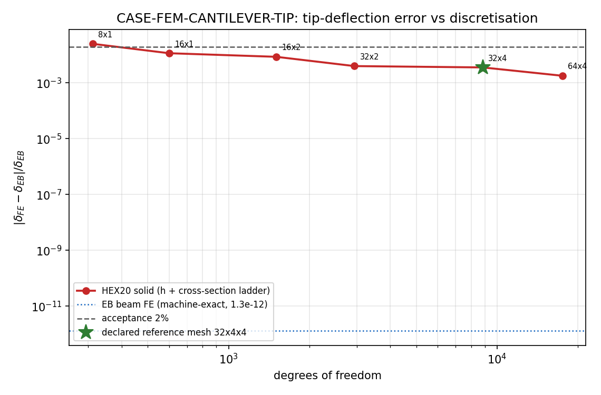
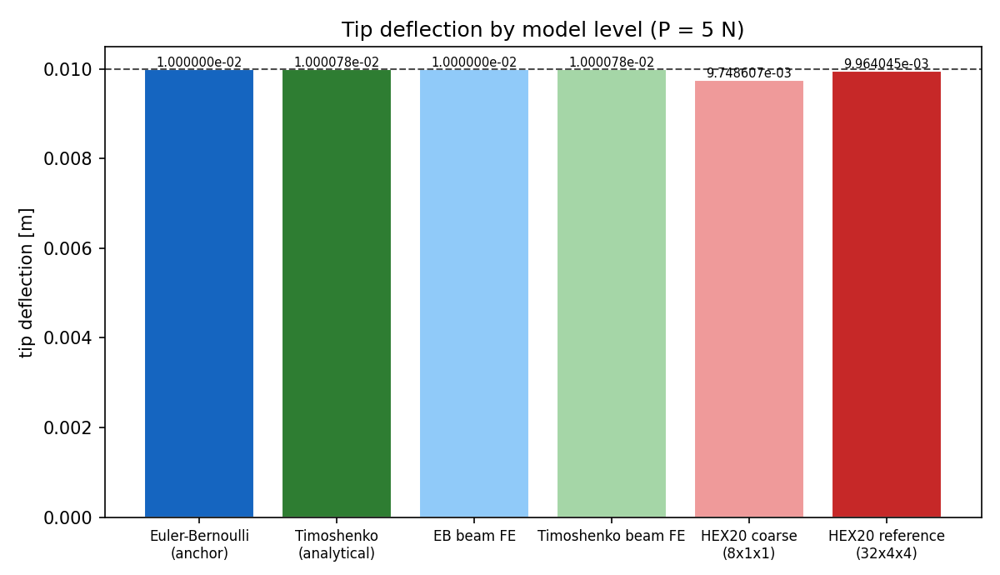
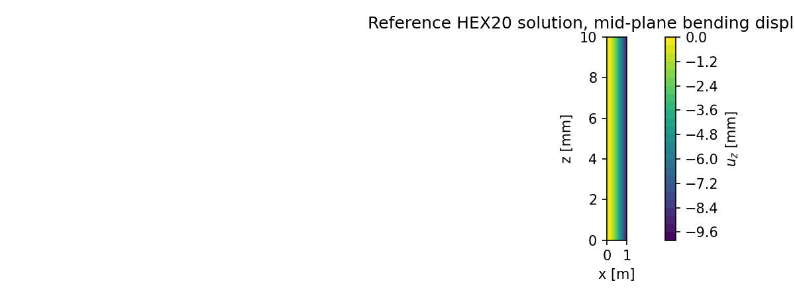

# CASE-FEM-CANTILEVER-TIP — 端部集中力下的悬臂梁端挠度

- 算例代码：`FEM-CANTILEVER-TIP`（repo `TensorFEM`，tier `core`）
- 基准：`delta = P L^3 / (3 E I)`，出处 Timoshenko, Strength of Materials Part I, 3rd ed. (1955) ch. 4; Blevins (1979) Table 8-1
- 验收判据：`|got-ref|/ref < 2%`（`tensor_case_pool.tol_policy`）
- 运行：`python benchmarks/case_fem_cantilever_tip.py --write-docs`
- 证据：`benchmarks/case_fem_cantilever_tip_evidence.json`；图：`docs/assets/case-fem-cantilever-tip/convergence.png`, `docs/assets/case-fem-cantilever-tip/levels.png`, `docs/assets/case-fem-cantilever-tip/field_uz.png`

## ① 问题设定与基准出处

均质各向同性等截面悬臂梁，`x=0` 固支，自由端 `x=L` 受横向集中力 `P`（沿 `-z`）。
Euler-Bernoulli 梁理论给出（单位载荷法 / Castigliano）：

```
delta = ∫0^L M(x) m(x) /(EI) dx ,  M = P(L-x) ,  m = L-x
      = P L^3/(3 E I) ,  I = b h^3/12
```

出处：Timoshenko《Strength of Materials》Part I 3rd ed. (1955) ch.4 悬臂梁端载；
同一梁族的频率基准见 Blevins (1979) Table 8-1（DOI 10.1115/1.3153712）。
本仓不手抄公式：`castigliano_integral()` 用 20001 点**复合 Simpson**（被积函数为二次，故机器精度内精确）对弯矩场与剪力场分别独立重导——弯曲项相对差 `+3.47e-16`、剪切项相对差 `-7.87e-15`，合计 `+3.47e-16`（对 Timoshenko）✅。

| 量 | 值 |
|---|---:|
| 梁长 L | 1.0 m |
| 截面 b×h | 0.01 × 0.01 m |
| 细长比 L/h | 100 |
| E / ν | 200 GPa / 0.3 |
| 端载荷 P | 5.0 N |
| 面积 A | 1.000000e-04 m² |
| 惯性矩 I | 8.333333e-10 m⁴ |
| 抗弯刚度 EI | 1.666667e+02 N·m² |
| 剪切修正 κ | 0.833333 |
| 无量纲载荷 P L²/(EI) | 0.030000 |
| 无量纲挠度 δ/L | 0.010000 |
| δ_EB | 1.000000000000e-02 m |
| δ_Timoshenko | 1.000078000000e-02 m |
| 剪切项占比 | 0.0078 % |

## ② 方法与实现

| 层 | 方法 | 方程/格式 | 代码指针 |
|---|---|---|---|
| M1 | Euler-Bernoulli 梁 FE（三次 Hermite + 2 点 Gauss） | `EI w'''' = 0`，端部集中力 | `tensorfem/frame2d.py`: `FrameModel`, `solve_frame_static` |
| M2 | Timoshenko 梁 FE（精确剪切柔度刚度阵） | `EI w'''' ...`+`κGA(w'-θ)`，剪切项 `PL/(κAG)` | `tensorfem/advanced_beam.py`: `solve_timoshenko_cantilever` |
| M3 | 3-D HEX20 实体 FE（20 节点二次砖，3×3×3 Gauss） | `∇·σ = 0`，固支面 Dirichlet，端面静力等效横向节点力 ΣF=P | `tensorfem/hex20.py`: `structured_hex20_mesh`, `solve_hex20_sparse` |

实现要点：

1. 载荷一致性——端面节点按面积均分 `P/n_tip`，合力严格等于 `P`，无端部弯矩附加；
2. 求解器按规模切换——`dof > 3000` 走 COO 装配 + SuperLU（`solve_hex20_sparse`），否则 dense LAPACK；两条路径同一离散、同一荷载向量；
3. 判据先声明后计算——参考网格、容差、度量写死在模块常量里，`--quick` 只缩小扫描范围，不改变判据；
4. 输出即工件——所有表格数字由证据 JSON 注入生成，报告与工件不出现手抄数字。

## ③ 对照表

| 模型 | 离散 | dof | 端挠度 [m] | 误差 vs δ_EB | <2% ? |
|---|---|---:|---:|---:|:--:|
| M1 EB 梁 FE | n=2 | 9 | 1.000000000000e-02 | -3.47e-14% | ✅ |
| M1 EB 梁 FE | n=4 | 15 | 1.000000000000e-02 | +1.79e-12% | ✅ |
| M1 EB 梁 FE | n=8 | 27 | 1.000000000000e-02 | +1.87e-11% | ✅ |
| M1 EB 梁 FE | n=16 | 51 | 1.000000000001e-02 | +1.30e-10% | ✅ |
| M2 Timoshenko 梁 FE | n=8 | 18 | 1.000078000000e-02 | +7.80e-03% | ✅ |
| M3 HEX20 实体 | 8×1×1 | 312 | 9.748606755302e-03 | -2.5139% | ❌ |
| M3 HEX20 实体 | 16×1×1 | 600 | 9.883910739521e-03 | -1.1609% | ✅ |
| M3 HEX20 实体 | 16×2×2 | 1503 | 9.913672415396e-03 | -0.8633% | ✅ |
| M3 HEX20 实体 | 32×2×2 | 2943 | 9.959845841883e-03 | -0.4015% | ✅ |
| M3 HEX20 实体 | 32×4×4 | 8835 | 9.964045336499e-03 | -0.3595% | ✅ |
| M3 HEX20 实体 | 64×4×4 | 17475 | 9.981895642009e-03 | -0.1810% | ✅ |

**判据行（预声明）**：参考网格 `32x4x4` 的实体端挠度 `9.964045336499e-03 m` vs 解析 `1.000000000000e-02 m`，误差 `-0.3595%` ✅（容差 2%）。

判据清单：

| 检查 | 结果 |
|---|---|
| 基准公式独立重导（<1e-9） | ✅ |
| 参考网格 <2% | ✅ |
| M1 对三次解机器精确（<1e-9） | ✅ |
| M2 与 Timoshenko 解析一致（<1e-6） | ✅ |
| 载荷线性（tip(2P)/tip(P)=2） | ✅ |
| 实体 h-收敛单调 | ✅ |

## ④ 结果图







## ⑤ 收敛性与参数敏感性

**网格收敛（≥2 分辨率）**：轴向/截面阶梯 8×1 → 16×1 → 16×2 → 32×2 → 32×4 → 64×4。最粗 `8×1` 误差 `-2.5139%`，参考网格 `32×4` 误差 `-0.3595%`；单层截面单元（×1）的弯曲偏刚最明显，截面细化（×2、×4）是主要误差来源。

**参数敏感性：细长比 L/h**（实体网格 32×2×2 固定）

| L/h | h [m] | 剪切项占比 | 实体 vs δ_EB | 实体 vs δ_Timoshenko |
|---:|---:|---:|---:|---:|
| 100 | 0.010 | 0.0078% | -0.4015% | -0.4093% |
| 50 | 0.020 | 0.0312% | -0.3552% | -0.3863% |
| 20 | 0.050 | 0.1950% | -0.2142% | -0.4084% |

**参数敏感性：载荷线性**（参考网格）

| P [N] | 端挠度 [m] |
|---:|---:|
| 5 | 9.964045336499e-03 |
| 10 | 1.992809067300e-02 |

`tip(2P)/tip(P) = 2.000000000000`（线性理论精确 2）。

## ⑥ 失败模式与工件

| 工件 | 路径 |
|---|---|
| 证据 JSON | `benchmarks/case_fem_cantilever_tip_evidence.json` |
| 收敛图 | `docs/assets/case-fem-cantilever-tip/convergence.png` |
| 层级柱状图 | `docs/assets/case-fem-cantilever-tip/levels.png` |
| 位移场云图 | `docs/assets/case-fem-cantilever-tip/field_uz.png` |
| 回归门 | `tests/test_case_fem_cantilever_tip.py` |

复现命令：

```bash
python benchmarks/case_fem_cantilever_tip.py --write-docs   # 全量研究 + 本文档
python benchmarks/case_fem_cantilever_tip.py --json         # L4 判据 workload stdout
pytest -q tests/test_case_fem_cantilever_tip.py            # 廉价回归门
```

已知失败模式与局限：

1. **单层截面 HEX20 偏刚**：`×1` 时端挠度偏低约 `-2.51%`，属弯曲离散误差（非剪切建模），必须在验收前做截面细化，不能靠单一粗网格交差；
2. **δ/L = 1%**：本算例挠度已到线弹性小挠度理论的边缘，若改为大挠度（elastica）参考解，端挠度会有低阶修正；本仓判据用的是线性理论锚，超出该范围应改走 `tensorfem/elastica_cantilever.py`；
3. **端面载荷理想化**：载荷按静力等效均布到端面节点（ΣF=P），与圣维南端部应力分布不同，但只影响端部局部，不改变梁挠度；
4. **未覆盖**：三维局部应力集中、接触/大变形、复合材料截面不在本算例范围。

