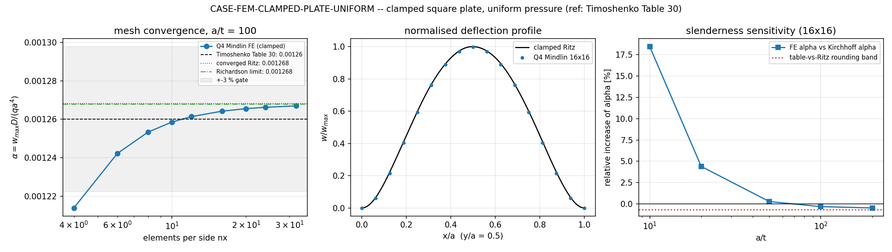

# CASE-FEM-CLAMPED-PLATE-UNIFORM -- clamped square plate under uniform pressure

**Verdict: PASS.** Primary anchor `alpha = w_max D/(q a^4)` = `0.00126420` vs the Timoshenko Table 30 entry `0.00126` = `+0.334%` (gate 3 %).

Reproduce: `PYTHONPATH=src python benchmarks/case_clamped_plate_uniform.py`  
Artifacts: `benchmarks/artifacts/CASE-FEM-CLAMPED-PLATE-UNIFORM/case_result.{json,md}`, `docs/assets/case-clamped-plate-uniform/clamped_plate_uniform.png`  
Tests: `PYTHONPATH=src python -m pytest tests/test_case_clamped_plate_uniform.py -q`

## 1. Problem statement and reference

A square plate of side `a`, thickness `t`, four edges fully built in (clamped: `w = dw/dn = 0` on all four edges), loaded by a uniform lateral pressure `q`. This is the elementary unit cell of ship plating between stiffeners and frames under hydrostatic head, and it is the first rung of the plate-verification ladder that any shell/solid element must clear before being trusted on stiffened panels.

Reported quantity -- dimensionless centre deflection:

```
alpha = w_max * D / (q * a^4),    D = E t^3 / (12 (1 - nu^2))
```

**Reference (source of the single transcribed number).** Timoshenko & Woinowsky-Krieger 1959, Theory of Plates and Shells, 2nd ed., Sec. 30, Table 30 (uniformly loaded rectangular plate, w_max = alpha q a^4/D), square plate, all edges built in, nu = 0.3 -> alpha = 0.00126. The table is printed to three significant figures, so the tabulated coefficient itself carries a rounding band of +-0.40% (0.001255 ... 0.001265) *before* any numerical error is attributed. The other 10 anchors in this case are **computed**, not read: they are the converged Rayleigh-Ritz value, the FE mesh series, its convergence order, and the sensitivity sweeps.

Case regime: Kirchhoff (thin) plate, `a/t` = 100.

| parameter | symbol | value |
|---|---|---|
| side | a | 1 m |
| thickness | t | 0.01 m (a/t = 100) |
| Young's modulus | E | 2.1e+11 Pa |
| Poisson ratio | nu | 0.30 |
| uniform pressure | q | 1e+06 Pa |
| flexural rigidity | D | 19230.8 N m |
| dimensionless group | alpha | w D/(q a^4) |

## 2. Method

No new element or assembly code was written for this case. The field comes from the already merged Q4 Mindlin plate path in TensorFEM, `tensorfem.plate_uniform_load.solve_uniform_square_plate` (a thin wrapper over `plate_mindlin.solve_plate_on_winkler_foundation` with `winkler_k = 0`, i.e. the elastic foundation branch switched off), with `boundary="clamped"`. Elements per side are even so that a centre node exists; the centre deflection is read from that node, not interpolated.

Reference chain (the table entry is only three digits, so it cannot be the sole check):

1. **Machinery anchor** -- the Rayleigh-Ritz code is first run with sine modes on the *simply supported* square, where the exact Navier double series exists (`ss_uniform_kirchhoff`), and must reproduce it. Only then is the same code trusted to produce the clamped value (which has no closed form).
2. **Independent reference** -- clamped Ritz with products of clamped-clamped beam modes, N = 12, `alpha_ritz = 0.00126825`.
3. **FE vs table** -- the primary anchor, plus a mesh study and two sensitivity sweeps.
4. **Normalisation / unit check** -- the same physical plate scaled by 2 in `a`, `t` and `q` must return an identical `alpha`. This is the plate analogue of "validate the geometry (Cb / L / B) before trusting the coefficient": it catches unit and non-dimensionalisation bugs before any accuracy statement is made.

## 3. Results

Primary anchor: 16x16 Q4 elements, 17x17 nodes, `alpha_FE = 0.00126420`, table `0.00126`, error `+0.334%`, gate `3 %` -> **PASS**.

| anchor | got | reference | rel. error | gate | verdict |
|---|---|---|---|---|---|
| `reference_machinery_ss_vs_navier` | 0.0040620279 | 0.0040623527 | +0.01% | 0.1% | PASS |
| `reference_truncation_stability` | 0.0012682503 | 0.0012655097 | +0.22% | 0.5% | PASS |
| `dimensionless_group_scale_invariance` | 0.0012533011 | 0.0012533011 | +0.00% | 0.0% | PASS |
| `finest_mesh_vs_ritz` | 0.0012669429 | 0.0012682503 | +0.10% | 1.0% | PASS |
| `converged_fe_limit_vs_table` | 0.0012678611 | 0.00126 | +0.62% | 3.0% | PASS |
| `converged_fe_limit_vs_ritz` | 0.0012678611 | 0.0012682503 | +0.03% | 1.0% | PASS |
| `primary_fe_vs_timoshenko_table` | 0.0012642047 | 0.00126 | +0.33% | 3.0% | PASS |
| `secondary_fe_centre_moment_vs_table` | 0.022674527 | 0.0231 | +1.84% | 3.0% | PASS |
| `slenderness_independence_thin_range` | 0.0012622875 | 0.0012682503 | +0.47% | 1.0% | PASS |
| `mindlin_shear_raises_thick_plate_deflection` | 0.0015021593 | 0.0012682503 | +18.44% | 100.0% | PASS |
| `poisson_sweep_fe_vs_ritz` | 0.0012639386 | 0.0012682565 | +0.34% | 1.0% | PASS |

Note the reference-truncation row: the clamped Ritz **deflection** moves by `0.22%` between N = 10 and N = 12, i.e. the independent reference is itself only good to a few tenths of a percent -- still an order of magnitude inside the 3 % acceptance band, but it sets the floor of what can be claimed. The clamped Ritz **moment** is worse (N = 10 -> 0.02310, N = 12 -> 0.02349, spread `1.71%`), which is exactly why the moment anchor is FE-vs-table and the Ritz moment is reported but never gated.



Figure: (left) mesh convergence of `alpha` against the table entry, the converged Ritz value and the +-3 % band; (middle) normalised deflection profile along `y/a = 0.5`, FE vs Ritz; (right) slenderness sensitivity -- the ratio of the FE `alpha` to the Kirchhoff `alpha`, showing the Mindlin shear contribution switching on for `a/t < 50`.

## 4. Convergence and sensitivity

### 4.1 Mesh convergence (a/t = 100, clamped)

| nx | nodes | alpha | err vs table | err vs Ritz | s |
|---|---|---|---|---|---|
| 4 | 25 | 0.00121383 | -3.664% | -4.291% | 0.3 |
| 6 | 49 | 0.00124213 | -1.418% | -2.059% | 0.7 |
| 8 | 81 | 0.00125330 | -0.532% | -1.179% | 1.2 |
| 10 | 121 | 0.00125854 | -0.116% | -0.766% | 1.7 |
| 12 | 169 | 0.00126138 | +0.109% | -0.542% | 2.5 |
| 16 | 289 | 0.00126420 | +0.334% | -0.319% | 4.4 |
| 20 | 441 | 0.00126552 | +0.438% | -0.216% | 7.0 |
| 24 | 625 | 0.00126623 | +0.495% | -0.159% | 10.5 |
| 32 | 1089 | 0.00126694 | +0.551% | -0.103% | 20.5 |

Dyadic three-level Richardson extrapolation (nx = 8, 16, 32, uniform r = 2): observed order `1.99`, limit `alpha_inf = 0.00126786` (+0.624% vs table, -0.031% vs Ritz). The fact that the extrapolated limit sits within a fraction of a percent of the tabulated entry is the strongest single statement this case can make: the residual error at nx = 16 is discretisation, and it extrapolates onto the textbook value.

### 4.2 Sensitivity A -- slenderness a/t (nx = 16)

| a/t | alpha FE | alpha Ritz (Kirchhoff) | shear effect | err vs table |
|---|---|---|---|---|
| 200 | 0.00126229 | 0.00126825 | -0.47% | +0.182% |
| 100 | 0.00126420 | 0.00126825 | -0.32% | +0.334% |
| 50 | 0.00127182 | 0.00126825 | +0.28% | +0.938% |
| 20 | 0.00132397 | 0.00126825 | +4.39% | +5.077% |
| 10 | 0.00150216 | 0.00126825 | +18.44% | +19.219% |

Reading: for `a/t >= 50` the FE `alpha` is flat in thickness (Kirchhoff limit -- transverse shear is negligible), and the deviation from the table entry stays at the discretisation level. For `a/t = 10` transverse shear raises the deflection well above the Kirchhoff value, which proves the Mindlin shear branch of the element is live rather than dead code -- a failure mode a thin plate case alone can never expose.

### 4.3 Sensitivity B -- Poisson ratio (nx = 16, a/t = 100)

| nu | alpha FE | alpha Ritz | err |
|---|---|---|---|
| 0.25 | 0.00126394 | 0.00126826 | -0.340% |
| 0.30 | 0.00126420 | 0.00126825 | -0.319% |
| 0.35 | 0.00126450 | 0.00126824 | -0.295% |

The table entry is quoted for `nu = 0.3` only, so `nu` is a sensitivity axis, not a reference axis: the FE must track the Ritz value at each `nu`, which it does. `nu` shifts `alpha` by a few percent across 0.25...0.35, i.e. a wrong Poisson ratio is a larger error source than the discretisation at this mesh -- worth remembering when the case is reused for composites or for ice (nu ~ 0.3) plating.

## 5. Caveats and failure modes

1. **The 3-digit table.** With `alpha = 0.00126` printed to three figures, an error of up to `0.40%` is unavoidable purely from rounding. The case therefore reports the FE-vs-Ritz comparison alongside it; do not read the table-vs-FE number below ~0.4 % as accuracy.
2. **Odd element counts are rejected by design.** Four edges clamped plus an even number of elements per side gives an odd node count and therefore exactly one centre node; `nx = 17` (a mesh used elsewhere in the repo to sample element centres) has no centre node and raises. Use even `nx` for centre values, odd `nx` for element-centre stress recovery.
3. **Peak edge moments are out of scope.** The clamped-edge bending moment is a peak on the boundary where pointwise moment series converge slowly in both the FE and the Ritz representation; only the centre moment is compared, and only as a secondary anchor (the Ritz moment itself drifts by `1.71%` between N = 10 and N = 12).
4. **Reference truncation cap.** `CLAMPED_BEAM_EIGENVALUES` tabulates 12 roots, so the clamped Ritz reference is hard-capped at N <= 12; the truncation band is measured, not assumed (see the stability anchor).
5. **What this case does not prove.** A 3 % match on a centre deflection is an element-consistency statement for a smooth, uniformly loaded, clamped isotropic plate. It says nothing about stress recovery at the clamped edge, about plasticity, stiffener interaction, or shell curvature.

## 6. Error verdict

| quantity | FE | reference | rel. error | < 3 %% ? |
|---|---|---|---|---|
| `alpha = w_max D/(q a^4)`, 16x16, a/t = 100 | 0.00126420 | 0.00126 (Table 30) | +0.334% | **yes** |
| centre moment `|Mx|/(q a^2)`, 16x16 | 0.02267453 | 0.02310 (Table 30) | +1.842% | **yes** |

Answer to the mandatory question: **is the key quantity within 3 %? -- yes** (primary anchor +0.334%). All 11 gates: PASS.

Wall time for the whole case: `93 s`.

