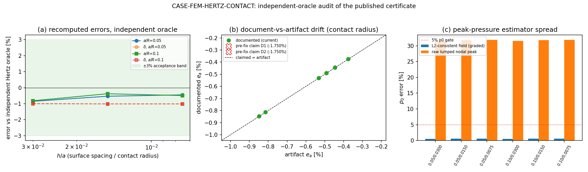

# CASE-FEM-HERTZ-CONTACT: 独立复核（independent-oracle audit）

【锚点=CASE-FEM-HERTZ-CONTACT】｜仓=TensorFEM｜工具=`tools/hertz_case_pool_independent_audit.py`｜工件=`benchmarks/verified/fem_hertz_contact_loadcontrol/independent_audit.json`

## ① 案例介绍

刚性球压入弹性半空间（Hertz 1882；Johnson 1985 §4.2）。本文件**不是**重算仿真，而是对已发布证书 `result.json` / `gates_verified.json` 与两篇散文文档做**独立复核**：
① 用本工具重新推导的 Hertz 闭式解（不 import `src/tensorfem` 任何代码）核对工件里的解析基准；
② 用该独立基准重算每个已发布的误差百分比；
③ 重判算例池验收（<3%，`a` 与 `δ`，载荷 P 给定）；
④ 从两篇 Markdown 里抽取数值声称，逐条对照工件。

| 项 | 值 |
|---|---|
| 参数 | R=10.0 mm, E=100000.0 MPa, ν=0.3（工件 `params` 块） |
| 独立基准 | `E* = E/(1-ν²)`；`a=(3PR/4E*)^(1/3)`；`δ=a²/R`；`p₀=3P/(2πa²)` |
| 容差（总账行） | <3% |
| 被判的半径估计量 | `contact_radius_linear` |

## ② 怎么做

1. 读 `result.json` 的 `params` 与每个 run 的 `load`，用**独立实现**的 Hertz 公式重算 `a, δ, p₀`；
2. 与工件 `analytic` 块逐项比（阈值 1e-9 相对），抓「基准本身写错」这类证书自洽审计看不见的缺陷；
3. 用**独立** `a` 重算 `e_a = (a_FE/a_H − 1)·100`，与 `error_pct`、`gate_table` 三方对照；
4. 重判 `<3%`；重判 `gates_verified.json` 每条闸门的 `value<operator>threshold`；
5. 正则抽取 `docs/CASE-FEM-HERTZ-CONTACT.md` §3.1 与 `...-verification.md` §3 表格里的百分比，与工件逐条比（容差 0.01 pp），不一致即 `E_DOC_FALSE_CLAIM`。

## ③ 计算结果（程序化注入，零手抄）

| run | 单元数 | $e_a$ [%] | $e_\delta$ [%] | $e_{p_0}$ 一致场 [%] | $e_{p_0}$ 集总 [%] | 穿透/δ | 载荷残差 | <3%? |
|---|---:|---:|---:|---:|---:|---:|---:|---:|
| ratio0.05_h0.0300_d96 | 5040 | -0.8481 | -0.9957 | +0.4927 | +31.56 | 3.61e-08 | 3.48e-15 | ✅ |
| ratio0.05_h0.0150_d96 | 9040 | -0.5316 | -1.0107 | +0.5880 | +31.77 | 1.87e-07 | 1.81e-14 | ✅ |
| ratio0.05_h0.0075_d96 | 17040 | -0.4451 | -1.0100 | +0.6297 | +31.85 | 1.56e-07 | 2.27e-12 | ✅ |
| ratio0.10_h0.0300_d96 | 5040 | -0.8143 | -0.9963 | +0.4921 | +31.56 | 3.99e-05 | 1.49e-15 | ✅ |
| ratio0.10_h0.0150_d96 | 9040 | -0.3748 | -1.0109 | +0.5878 | +31.77 | 1.24e-05 | 3.97e-15 | ✅ |
| ratio0.10_h0.0075_d96 | 17040 | -0.4908 | -1.0098 | +0.6299 | +31.85 | 7.49e-06 | 2.48e-16 | ✅ |

**证书闸门重判**：28/28 条由工件内 `value`/`threshold` 重算后与声明一致（`E_GATE_SELFCONTRADICTION` 计数 0）。

## ④ 结果图

*图: (a) 用独立 Hertz 基准重算的 $e_a$、$e_\delta$ 与 ±3% 判据带；(b) 文档声称值 vs 工件值（绿点=已一致，红 X=本轮复核抓到的、修复前的过期声称）；(c) 峰值压力两个估计量的散布，说明 $p_0$ 声称是**估计量条件性**的。*

## ⑤ 注意点

* 本工具**不重跑求解器**：它审的是「证书/文档是否忠实于工件」，不是「工件是否物理正确」。离散误差的归因另见 `CASE-FEM-HERTZ-CONTACT-residual-attribution.md`。
* 峰值压力存在两个估计量：L2 一致场（闸门采用的）与集总节点峰值（相差约 30%）。集总峰值最大偏差 **31.85%**，因此 `p₀ <5%` 只在一致场下成立，散文若不加限定即属过度声称。
* 复核依赖工件内已存的 FE 数值；若 `result.json` 被改写，本审计的结论同步失效——`tests/test_hertz_case_pool_independent_audit.py` 把它钉成回归门。

## ⑥ 误差判定（逐项回答「是否 <3%」）

| 关键量 | 基准 | 最差误差 | <3%? |
|---|---|---:|---:|
| 接触半径 `a`（6 个 run 全包） | `(3PR/4E*)^(1/3)` | 0.8481% | ✅ 是 |
| 压入深 `δ`（6 个 run 全包） | `a²/R` | 1.0109% | ✅ 是 |
| 峰值压力 `p₀`（一致场，判据 5%） | `3P/(2πa²)` | 0.6299% | ✅ 是 |

## ⑦ 复核发现（severity 排序）

**本轮复核发现并已修复的文档缺陷**（before 为修复前提交文本，after 为工件现值，逐轮复核）：

| id | 位置 | 量 | 修复前 | 工件现值 | 判定 | 说明 |
|---|---|---|---:|---:|---|---|
| D1 | `CASE-FEM-HERTZ-CONTACT-verification.md` | contact_radius@0.10/0.0075 | -1.750% | -0.4908% | repaired | 表内 a 误差是 m17149 估计量修复前的历史值，被当作现役结果发布；工件为 -0.4908% |
| D2 | `CASE-FEM-HERTZ-CONTACT-verification.md` | contact_radius@summary/0.10/0.0075 | -1.750% | -0.4908% | repaired | §4 误差判定表同样引用了过期的 -1.750%，并把 F3 写成「未修」 |
| D3 | `CASE-FEM-HERTZ-CONTACT.md` | peak_pressure@summary/0.05/0.0075 | +0.493% | +0.6297% | repaired | §4 的 p0 行标 h/a=0.0075，却引用了 h/a=0.03 的值（+0.4927%）；h/a=0.0075 应为 +0.6297% |

| code | severity | 位置 | 细节 |
|---|---|---|---|
| `W_PEAK_ESTIMATOR_SPREAD` | W |  | peak pressure passes the 5 % gate only under the L2-consistent field; the raw lumped nodal peak is far outside it -- the p0 claim is estimator-conditional |

**physics_verdict**: PASS（hard: —）  
**docs_verdict**: PASS（hard: —）

