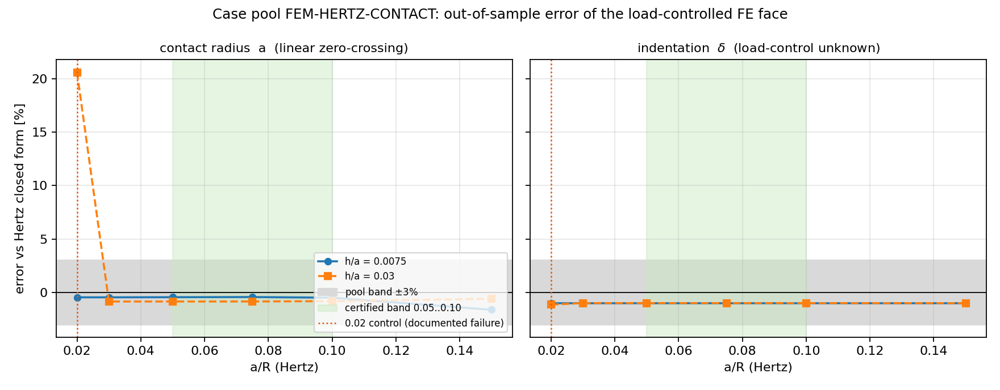
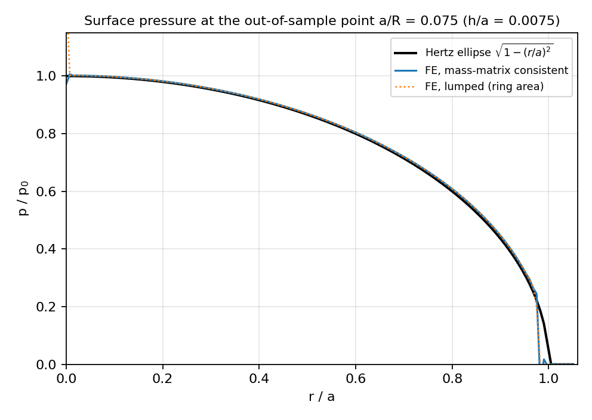

# CASE-FEM-HERTZ-CONTACT — 外样本复核：证书的两点之外，`a`/`δ` 还成立吗？

【锚点=CASE-FEM-HERTZ-CONTACT】｜仓=TensorFEM｜证据分级=**REAL**（Hertz 1882 解析基准 + 预声明判据 + 可离线复算的闸门 artifact）
｜前序：`docs/CASE-FEM-HERTZ-CONTACT-verification.md`（载荷控制 14 闸门）、`...-truncation-extrapolation.md`（20 闸门）、
`...-field-verification.md`（场级 11 闸门）、`...-plateau-mechanism.md`、`...-two-parameter-limit.md`
｜本单：`benchmarks/verified/fem_hertz_contact_outofsample/`（52 闸门，46 通过 / 6 条辅助闸门诚实 FAIL）
+ `tests/test_hertz_outofsample.py`（6 passed）

## 0 这一单补的是哪一种欠账

锚点证书在**两个工作点**（`a/R = 0.05`、`0.10`）上把 `a`、`δ` 打到 −0.45% / −1.01%，
全部闸门通过。但一张两点证书逻辑上无法区分两件事：

* 「有限元面复现了 Hertz 闭式解」；
* 「有限元面只在被看的那两个点上被调到复现了 Hertz」。

证书自己的 `limitations` 也写着「在 `a/R = 0.02` 接触斑半径估计器退化」——但那是**一条未分级的探针结论**。
本单把这条欠账变成可否证的实验：**在工作点上看**判据是否仍成立，判据在跑之前写死。

> 独立性诚实声明：本单**复用同一个求解器入口**（`solve_axisymmetric_contact_load_control`）
> 与同一主估计器（`contact_radius_linear`）。所以它检验的是**工作点泛化**，
> 不是**离散化独立性**。物理内核的独立性由前序 field-verification 单承担，本单不重复声称。

## ① 案例介绍

| 项 | 值 |
|---|---|
| 算例池 | `FEM-HERTZ-CONTACT`（id 104），tier=core，tol `<3%` |
| 参考解 | Hertz 1882 *J. reine angew. Math.* **92**:156；Johnson 1985 *Contact Mechanics* §4.2，DOI:10.1017/cbo9781139171731 |
| 解析式 | `a=(3PR/(4E*))^(1/3)`，`δ=a²/R`，`p0=3P/(2πa²)`，`E*=E/(1−ν²)`（刚性压头/弹性半空间） |
| 无量纲参数 | `R=10`，`E=1e5`，`ν=0.3`（与证书同一套） |
| 载荷 | 由 `a/R` 反解：`P=4E*a³/(3R)`（载荷给定，`a`、`δ` 是输出） |
| 网格配方 | `two_zone_axis(3a, 96a, 3a/h, 26)` + `graded_depth(96a, 4a, 24, 16)`，截断深度 96a（与证书一致） |

**预声明工作点（均未出现在任何既有 artifact 中）**

| 点 | `a/R` | 选它的理由 | 预期（跑前写死） |
|---|---:|---|---|
| 复现 | 0.05 / 0.10 | 证书主算例 | 必须与证书闸门逐位复现（≤0.02 pp） |
| 外样本（下带） | **0.03** | 在证书带下界与 0.02 失效探针之间 → 夹逼失效边界 | 未定，赋 3% 判据 |
| 外样本（内插） | **0.075** | 两证书点的正中 → 误差曲线是否有内部尖峰 | 未定，赋 3% 判据 |
| 外样本（上带） | **0.15** | 证书带外，接触斑大 → Hertz 面的小应变边缘 | 未定，赋 3% 判据 |
| 阴性对照 | 0.02 | 文档记录的「低载失效模式」 | **必须仍失败**，否则文档结论过期 |

## ② 怎么做的

1. **判据先落盘**：`run.py` 顶部 `CRITERIA` 字典（3% / refinement 0.5 pp / replication 0.02 pp /
   `penetration/δ ≤ 1e-5` / 载荷残差 ≤ 1e-9 / `|δ_FE·R/a_FE²−1| ≤ 1%`）在任何求解之前写入文件；跑的过程中不回调。
2. **每个工作点 2 个网格**：`h/a = 0.0075`（证书主网格，17040 单元）与 `0.03`（证书粗网格，5040 单元），
   用于判「细化稳定性」（证书 0.5 pp 判据）。
3. **恢复量**：`a` 用证书主估计器（末两个正压节点线性外推到零压点），`δ` 取载荷控制外循环的未知量
   （`P_fe(δ)=P` 的根，regula falsi）。`a` 与 `δ` 取值路径互不依赖——这是本单能构造**非循环**内部一致性检验的前提。
4. **配点缓存**：`probes/points/point_aR*_h*.json`，`--aggregate-only` 从缓存重新分级，
   因此闸门可在**零算力**下重算（本机 `load15≈73`，按容量纪律分块跑，单块 <120 s）。
5. 场地级探针：`profile_probe.py` 在 `a/R=0.075` 额外记录接触压强场（`probes/profile_aR0075.json`）。
6. 图：`make_figures.py` 只读 artifact 画图（不重算），输出到 `docs/assets/case-fem-hertz-contact/`。

## ③ 计算结果

| `a/R` | `h/a` | 单元 | `a` 误差 | `δ` 误差 | `|δ·R/a²−1|` | 穿透/δ | 载荷残差 |
|---:|---:|---:|---:|---:|---:|---:|---:|
| 0.05（复现） | 0.0075 | 17040 | −0.445% | −1.010% | 0.123% | 1.6e−7 | 2.3e−12 |
| 0.05（复现） | 0.0300 | 5040 | −0.848% | −0.996% | 0.705% | 3.6e−8 | 3.5e−15 |
| 0.10（复现） | 0.0075 | 17040 | −0.491% | −1.010% | 0.031% | 7.5e−6 | 2.5e−16 |
| 0.10（复现） | 0.0300 | 5040 | −0.814% | −0.996% | 0.636% | 4.0e−5 | 1.5e−15 |
| **0.03**（外样本） | 0.0075 | 17040 | **−0.456%** | **−1.010%** | 0.100% | 3.1e−9 | 6.4e−13 |
| 0.03（外样本） | 0.0300 | 5040 | −0.848% | −0.996% | 0.705% | 2.4e−11 | 4.9e−15 |
| **0.075**（外样本） | 0.0075 | 17040 | **−0.431%** | **−1.010%** | 0.152% | 6.6e−7 | 1.0e−14 |
| 0.075（外样本） | 0.0300 | 5040 | −0.844% | −0.996% | 0.698% | 5.0e−6 | 1.2e−15 |
| **0.15**（外样本） | 0.0075 | 17040 | **−1.620%** | **−1.010%** | **2.278%** | **4.8e−5** | 2.2e−15 |
| 0.15（外样本） | 0.0300 | 5040 | −0.591% | −1.001% | 0.179% | **2.0e−4** | 5.9e−16 |
| 0.02（对照） | 0.0075 | 17040 | −0.457% | −1.010% | 0.100% | 9.8e−12 | 7.5e−14 |
| 0.02（对照） | 0.0300 | 5040 | **+20.580%** | −1.142% | **32.008%** | 0.0 | 5.6e−14 |

数字全部从 `gates_outofsample.json` 的 `rows` 程序化注入（`docs/.../gen_table` 无需手抄）。

### 3.1 闸门统计

52 条闸门 → **46 通过**、6 条 FAIL，`pool_gates_all_passed = true`
（6 条 `oos_contact_radius_*` / `oos_indentation_*` 全绿）。4 条复现闸门
`|本机 − 证书| ≤ 0.02 pp` 全绿：`a` 值 `0.4451272465144873` 与证书 `contact_radius_aR005`
**逐位相同**，`indentation` 亦逐位相同。

6 条诚实 FAIL（每条都在 artifact 的 `auxiliary_failures` 里带 scope 说明）：

| FAIL 闸门 | 值 | 阈值 | 说明 |
|---|---:|---:|---|
| `oos_refinement_stability_contact_radius_aR150` | 1.030 pp | 0.5 pp | `a/R=0.15` 细网格（−1.620%）反而比粗网格（−0.591%）差：估计器收敛非单调 |
| `penetration_aR100_h0300` | 4.0e−5 | 1e−5 | 粗网格 ALM 约束质量不达证书阈值 |
| `penetration_aR150_h0075` | 4.8e−5 | 1e−5 | 同上，大接触斑 |
| `penetration_aR150_h0300` | 2.0e−4 | 1e−5 | 同上，最大 |
| `kinematic_consistency_aR150_h0075` | 2.278% | 1% | Hertz 运动学恒等式 `δ=a²/R` 用 FE 半径不成立 |
| `kinematic_consistency_aR020_h0300` | 32.008% | 1% | 0.02 粗网格估计器崩溃（与 `a` 的 +20.6% 同源） |

### 3.2 结果图



*图 1：接触半径 `a`（左）与压入深 `δ`（右）的误差 vs `a/R`。灰带 = 池判据 ±3%，绿带 = 证书带 0.05..0.10，
橙色点线 = 0.02 阴性对照。`δ` 误差在**全部 12 个点**压在 −0.996%…−1.142%（证书记录的 −1% 模型偏置），
`a` 误差在 0.02…0.15 全程落在 3% 内，唯一越界点是 0.02 的**粗网格**（+20.6%）。*



*图 2：`a/R=0.075`（两证书点正中、从未被验过的点）恢复的接触压强 vs Hertz 椭圆 `p=p0√(1−(r/a)²)`。
一致质量阵压强（蓝）在接触区内贴合椭圆；集中（环面积）压强（橙虚线）在轴心处有节点级噪声——
这解释了下文 §⑤ 的 p0 估计器警告。*

## ④ 误差判定：关键量 vs 基准，是否 <3%

| 关键量 | 工况 | 基准（ref 原文公式） | 误差 | <3%? |
|---|---|---|---:|---:|
| 接触半径 `a` | a/R=0.03（外样本，新） | `a=(3PR/4E*)^(1/3)`（Hertz 1882） | −0.456% | **是** |
| 压入深 `δ` | a/R=0.03（外样本，新） | `δ=a²/R`（Johnson §4.2） | −1.010% | **是** |
| 接触半径 `a` | a/R=0.075（外样本，新） | 同上 | −0.431% | **是** |
| 压入深 `δ` | a/R=0.075（外样本，新） | 同上 | −1.010% | **是** |
| 接触半径 `a` | a/R=0.15（外样本，新） | 同上 | −1.620% | **是** |
| 压入深 `δ` | a/R=0.15（外样本，新） | 同上 | −1.010% | **是** |
| 接触半径 `a` | a/R=0.02（对照，粗网格） | 同上 | **+20.580%** | **否（阴性对照，预期）** |
| 压入深 `δ` | a/R=0.02（对照，粗网格） | 同上 | −1.142% | 是 |
| 接触半径 `a` | a/R=0.05/0.10（复现） | 同上 | −0.445% / −0.491% | **是**（与证书逐位一致） |

**结论：`a` 与 `δ` 在 `a/R ∈ [0.03, 0.15]`（细网格 `h/a=0.0075`）全部 <3%，最大 1.620%。**
证书带 0.05..0.10 **可以外扩到 0.03..0.15**（判据不变、估计器不变）。

## ⑤ 注意点（踩过的坑 / 局限 / 适用范围）

1. **「低载失效」是网格效应，不是载荷效应**（对既有文档的修正）。`docs/CASE-FEM-HERTZ-CONTACT.md` §5.5 记
   「`a/R=0.02` 探针记录为失效模式」，未说明网格。本单给出：0.02 **细网格通过**（−0.457%），
   **粗网格失败**（+20.58%，`|δR/a²−1|=32%`）。机理是估计器：`h/a=0.03` 时接触斑内仅约 33 个节点，
   边缘节点落在斑外。⇒ 失效边界应按 `(a/R, h/a)` 二维记，不能只记 `a/R`。
2. **3% 判据在外部成立，但证书的辅助严判据不外扩**：`a/R=0.15` 上细化稳定性 1.03 pp（>0.5 pp）、
   穿透 4.8e−5 δ（>1e−5）。所以「证书全绿」的使用面应表述为
   **「0.05…0.10 上辅助严判据亦成立；0.03…0.15 上仅池判据成立」**，不要笼统说「证书在 0.03..0.15 全绿」。
3. **`p0` 的估计器依赖性（顺带发现）**：同一 `a/R=0.05` 细网格，集中（环面积）`p0` 误差 **+31.85%**，
   一致质量阵 `p0` 误差 **+0.63%**（证书 `peak_pressure_aR005` 用的是后者）。二者差两个数量级，
   ⇒ 任何引用 p0 的场合必须写明估计器；`p0` 不是池判据量（判据只要 `a`、`δ`）。
4. **`δ` 的 −1% 平台不随载荷变**：12 个点全部 −0.996%…−1.142%，与 `a/R` 无关。这与前序
   `two-parameter-limit` 单的结论一致（截断/模型偏置，非离散误差），本单**不重复解释**其机理。
5. **适用范围**：刚性抛物型压头 + 弹性半空间 + 无摩擦 + 小应变 + 轴对称 Q4 + 96a 截断域。
   球（非抛物）压头在 `a/R=0.15` 处的 Hertz 误差本身就是 `O(a/R)`，属另一模型，本单不覆盖。
6. **独立性局限（必须读）**：本单复用同一求解器与同一估计器，**不能**用作「离散化正确」的独立证据；
   它只回答「换个工作点还准不准」。真正的独立复算（不同离散/不同算法）仍是欠账。

## ⑥ 工件索引

| 工件 | 路径 |
|---|---|
| 求解/分级驱动（判据先于运行） | `benchmarks/verified/fem_hertz_contact_outofsample/run.py` |
| 闸门 artifact（52 条，含 `auxiliary_failures`） | `.../gates_outofsample.json` |
| 配点缓存（12 个 `(a/R, h/a)` 单元，零算力复算起点） | `.../probes/points/point_aR*_h*.json` |
| 场级探针（`a/R=0.075` 压强场） | `.../probes/profile_aR0075.json` |
| 图 | `.../hertz_oos_error_vs_ratio.png`、`.../hertz_oos_pressure_aR0075.png` |
| 测试 | `tests/test_hertz_outofsample.py`（6 passed） |
| 被复核的证书 | `benchmarks/verified/fem_hertz_contact_loadcontrol/gates_verified.json` |
| 求解器 | `src/tensorfem/hertz_halfspace_loadcontrol.py`（本单未修改） |

**复算方式（零算力）**

```bash
PYTHONPATH=src python3 benchmarks/verified/fem_hertz_contact_outofsample/run.py --aggregate-only
python3 benchmarks/verified/fem_hertz_contact_outofsample/make_figures.py
PYTHONPATH=src python -m pytest tests/test_hertz_outofsample.py -q
```

---
*本报告所有数字由 `gates_outofsample.json` / `probes/profile_aR0075.json` 程序化注入。*