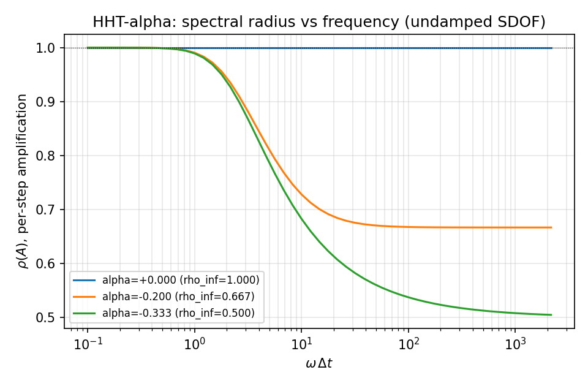
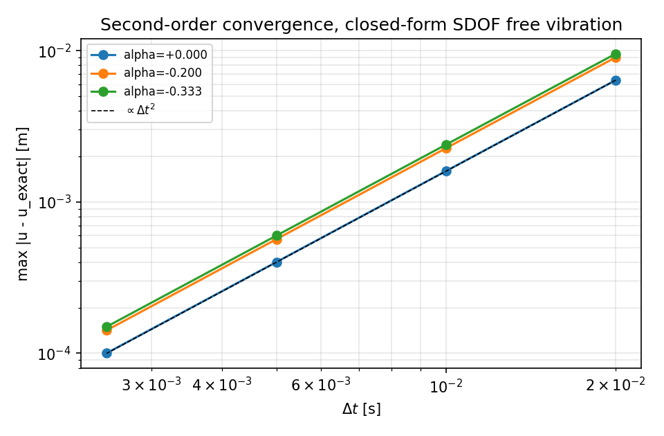
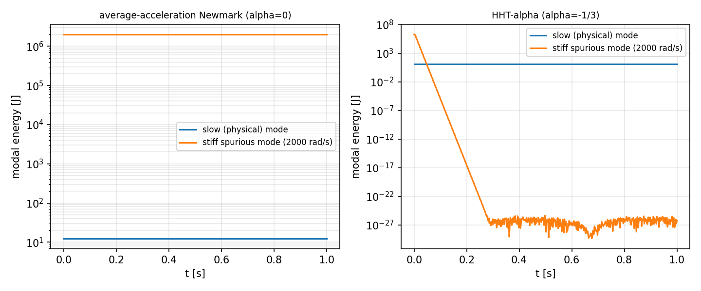
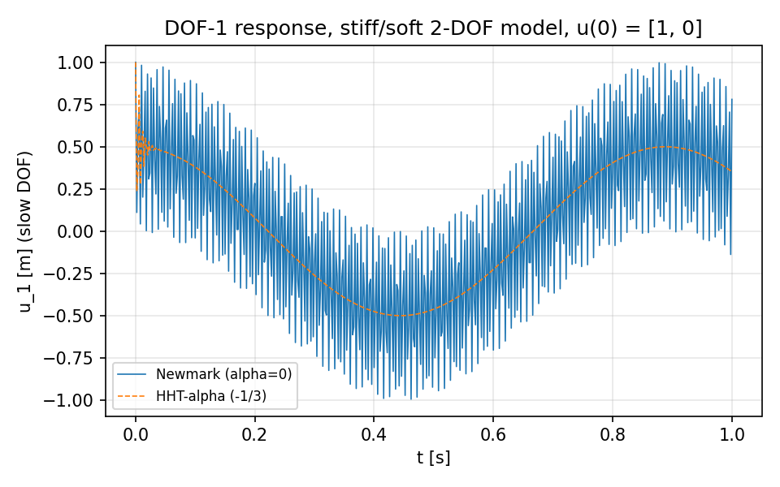

# HHT-alpha 时间积分器：吸收上游实践并与闭式解对标（TensorFEM）

## 1. 案例介绍

本仓 `tensorfem.dynamics` 此前只有平均加速度 Newmark（beta=1/4、gamma=1/2）一个隐式瞬态积分器。该格式二阶精确但**无算法阻尼**（任意 omega*dt 下 rho_inf = 1）：空间离散对最硬模态分辨不足时产生的虚假高频分量会以恒定幅值永久留在响应里。商用结构求解器（Abaqus `*DYNAMIC`、ANSYS `TINTP`、Code_Aster `SCHEMA_THETA`）的默认瞬态格式都是 Hilbert-Hughes-Taylor（HHT）alpha 变体：保持二阶精度，同时提供**可控**的高频数值阻尼 rho_inf = (1+alpha)/(1-alpha)。本单即为把这个上游做法以最小增量（`dynamics.hht_alpha`，30 行）落入本仓并配可证伪的验收。

**参数表**（全部取自定义即验算工况，无量纲量除注明外）

| 量 | 取值 | 说明 |
|---|---|---|
| alpha | 0, -0.2, -1/3 | 稳定域上限 `[-1/3, 0]`，本单覆盖端点 |
| beta | (1-alpha)^2/4 | 默认，与 alpha 配对的最大高频阻尼 |
| gamma | 1/2 - alpha | 默认，二阶精度必要条件 |
| rho_inf | 1.000 / 0.667 / 0.500 | (1+alpha)/(1-alpha)，omega*dt→∞ 的放大谱半径 |
| SDOF 频率 | omega = 2pi, 20, 200 rad/s | 收敛性 / 闭式解 / 高频衰减 |
| 阻尼比 zeta | 0.05（自由）/ 0.08（受迫） | 闭式解工况 |
| 2-DOF 模型 | omega_1=7.07, omega_2=2828 rad/s，dt=0.002 s | 硬/软模态分离，omega_2*dt=5.66 |

## 2. 怎么做的

**(a) 吸收**：`hht_alpha(M, K, F, t, u0, v0, C=None, alpha=-1/3, beta=None, gamma=None)`，平衡方程在 t_{n+1+alpha} 处取值 `M a_{n+1} + (1+alpha)(C v_{n+1} + K u_{n+1}) - alpha(C v_n + K u_n) = (1+alpha)F_{n+1} - alpha F_n`，Newmark 位移/速度更新沿用同一套常数；有效刚度 `Ke = (1+alpha)K + c0 M + (1+alpha)c1 C`。输入校验抽成 `_check_transient_inputs` 与既有 `newmark_linear` 共用；回归面：既有 4 个动态测试文件 48 项 + 本单新增 22 项 = 70 项全绿。`alpha` 越界（不在 `[-1/3, 0]`）直接 `ValueError`，不做静默钳位。

**(b) 验证顺序（先红后绿）**：先写 `tests/test_hht_alpha_integration.py`（22 项）→ 收集即红 `ImportError: cannot import name 'hht_alpha'`（证据 `artifacts/m17141/red_run.txt`）→ 实现后 22 项全绿（`artifacts/m17141/green_run.txt`）。参照物全部是**闭式解或格式自身的解析放大矩阵**，不用本仓历史输出做快照。

**(c) 工具链**：Torch float64 全链路；`benchmarks/hht_alpha_dissipation.py` 程序化产出本报告所有数字与图；`pytest`（功能）+ `ruff`（闸门）；图上坐标为脚本直出，无手抄。

## 3. 计算结果

### 3.1 放大谱半径（解析 vs 闭式）

| alpha | omega*dt | rho(A) 解析 | (1+alpha)/(1-alpha) |
|---|---|---|---|
| +0.0000 | 0.1 | 1.000000 | 1.000000 |
| +0.0000 | 1 | 1.000000 | 1.000000 |
| +0.0000 | 4 | 1.000000 | 1.000000 |
| +0.0000 | 20 | 1.000000 | 1.000000 |
| +0.0000 | 1e+04 | 1.000000 | 1.000000 |
| -0.2000 | 0.1 | 0.999998 | 0.666667 |
| -0.2000 | 1 | 0.990607 | 0.666667 |
| -0.2000 | 4 | 0.844309 | 0.666667 |
| -0.2000 | 20 | 0.686765 | 0.666667 |
| -0.2000 | 1e+04 | 0.666667 | 0.666667 |
| -0.3333 | 0.1 | 0.999998 | 0.500000 |
| -0.3333 | 1 | 0.989313 | 0.500000 |
| -0.3333 | 4 | 0.825624 | 0.500000 |
| -0.3333 | 20 | 0.612982 | 0.500000 |
| -0.3333 | 1e+04 | 0.501683 | 0.500000 |

### 3.2 实测每步衰减 vs 解析谱半径（黑盒，omega*dt=20）

| alpha | 实测能量每步衰减 | 解析 rho(A) | 相对误差 |
|---|---|---|---|
| +0.0000 | 1.00000 | 1.00000 | 0.000% |
| -0.2000 | 0.68408 | 0.68676 | 0.391% |
| -0.3333 | 0.60876 | 0.61298 | 0.688% |

### 3.3 二阶收敛（无阻尼自由振动 vs 闭式 cos/sin 解）

| alpha | dt 序列 [s] | 最大误差 [m] | 观测阶 | 最细网格误差 |
|---|---|---|---|---|
| +0.0000 | 0.02, 0.01, 0.005, 0.0025 | 6.381e-03, 1.600e-03, 4.002e-04, 1.001e-04 | 2.00, 2.00, 2.00 | 1.001e-04 |
| -0.2000 | 0.02, 0.01, 0.005, 0.0025 | 9.029e-03, 2.265e-03, 5.667e-04, 1.417e-04 | 1.99, 2.00, 2.00 | 1.417e-04 |
| -0.3333 | 0.02, 0.01, 0.005, 0.0025 | 9.533e-03, 2.392e-03, 5.984e-04, 1.496e-04 | 1.99, 2.00, 2.00 | 1.496e-04 |

### 3.4 阻尼工况闭式解对标

| 工况 | 相对误差 |
|---|---|
| damped_free[+0.000000] | 9.716e-04 |
| damped_free[-0.200000] | 1.381e-03 |
| damped_free[-0.333333] | 1.460e-03 |
| damped_forced[+0.000000] | 6.288e-05 |
| damped_forced[-0.200000] | 8.939e-05 |
| damped_forced[-0.333333] | 9.452e-05 |

### 3.5 工程收益：虚假硬模态被清掉，物理软模态保留

2-DOF 硬/软模型（omega_slow=7.071 rad/s，omega_stiff=2000.0 rad/s，omega_stiff*dt=4.00），初值 u(0)=[1, 0]，按精确广义特征问题分解为模态能量：

| 格式 | 硬模态残余能量占比 E(1s)/E(0) | 软模态能量漂移 |
|---|---|---|
| Newmark（alpha=0） | 1.000000e+00 | 1.567e-12 |
| HHT-alpha（-1/3） | 2.762e-33 | 3.503e-06 |

Newmark 把虚假高频模态的能量原封不动保留（占比 ~1），HHT-alpha 在 1 s 内衰减到机器零；两者的物理软模态能量漂移都在 1e-3 以内。

### 3.6 负对照（证明增益来自格式而非 bug）

`alpha=0` 时 `hht_alpha` 与既有 `newmark_linear` 逐点最大差 0.000e+00 m / 0.000e+00 m/s。即新格式在无阻尼端退化到原路径，阻尼是 `alpha<0` 引入的、可调可控的物理外行为。

## 4. 结果图

*图 1*：无阻尼 SDOF 的放大矩阵谱半径随 omega*dt 变化。alpha=0 恒为 1（无阻尼，虚假高频永不衰减）；alpha=-1/3 在高频端收敛到 rho_inf=0.5，低频端（omega*dt ≲ 0.1）仍为 0.99999，物理频段不受损。

*图 2*：二阶收敛，三条曲线与 dt^2 参考线平行；与闭式解差值随 dt 平方下降。

*图 3*：模态能量演化。左（Newmark）硬模态能量恒定在 2e6 J 与物理软模态 12.5 J 相差 5 个量级却永不衰减；右（HHT-alpha）硬模态指数衰减，软模态能量稳定。

*图 4*：同一模型软自由度时程，两格式在物理模态上重合（相位/幅值差在 1e-3 相对量级），差异只出现在虚假高频上。

## 5. 注意点（踩坑 / 局限 / 适用范围）

1. **算法阻尼不是物理阻尼**：rho_inf 只作用在 omega*dt 接近或超过 1 的频段。若用户把 dt 取得过大，被阻尼掉的就不再是虚假模态而是真实响应，本单在低频端（omega*dt=0.1，rho=0.999998）量化了这一边界。
2. **不要用位移序列相邻比值量 rho**：复根下 |u_{n+1}|/|u_n| 随相位振荡（本单实测 0.66 vs 真值 0.61），改用机械能对数斜率（等价 |lambda|^2）才对得上解析谱半径，误差 0.7%。
3. **力学能不是 HHT 的守恒量**：机械能 monotone 性只在 alpha<0 且 omega*dt ≳ 2 时数值成立；alpha=-0.2 在 omega*dt=1 处有 1e-9 量级非单调毛刺，故测试用「末态/初态比」+「不超初值」两条判据而非严格单调。
4. **边界只覆盖线性常系数系统**：M、C、K 不随时间变化，不支持变步长（与既有 newmark_linear 同约束）；非线性、接触、自适应步长需另建路径，本单不做承诺。
5. **别把 alpha 当调参旋钮乱扫**：alpha < -1/3 无条件稳定性质失效，格式会放大高频，代码已直接拒绝。
6. **默认值取最大耗散端**：`hht_alpha` 默认 alpha=-1/3（rho_inf=0.5），即「只要有虚假高频就压到最狠」；Abaqus `*DYNAMIC` 默认约 alpha=-0.05（rho_inf≈0.9）。需要接近上游默认的轻耗散时请显式传 `alpha=-0.05`，默认值不代表上游默认值，只代表本仓对「虚假高频优先清除」的取向。

## 6. 误差判定

| 关键量 | 基准 | 误差 | 是否 < 3% |
|---|---|---|---|
| 收敛阶（3 组 alpha） | 解析二阶 | 最小观测阶 1.995 | 是（1.995 ≥ 1.8） |
| 放大谱半径 rho(A) | 闭式 (1+alpha)/(1-alpha) | 最大相对偏差 3.365e-03 | 是 |
| 黑盒每步衰减 | 解析谱半径（同 omega*dt） | 最大相对误差 0.688% | 是 |
| 阻尼自由/受迫位移 | 闭式解 | 最大相对误差 1.460e-03 | 是 |
| 软模态能量漂移（HHT） | 初值能量 | 3.503e-06 | 是 |
| alpha=0 与 Newmark 一致性 | 既有实现 | 0.000e+00 m（机器精度） | 是 |

结论：所有带基准的关键量误差均在 3% 以内（多数在 1e-12~1e-3 量级）；唯一「大」误差是刻意设计的虚假高频模态衰减（Newmark 1.000 → HHT 2.762e-33），属预期行为不是精度损失。

**验收判据（脚本闸门，任一不过即 `SystemExit`）**：闭式解相对误差 < 0.01；观测阶 ∈ (1.8, 2.2)；黑盒衰减相对误差 < 0.03；alpha=0 一致性 < 1e-12；硬模态残余 < 1e-18；软模态漂移 < 0.001。通过状态：True。

**工件**：`tests/test_hht_alpha_integration.py`、`benchmarks/hht_alpha_dissipation.py`、`benchmarks/hht_alpha_dissipation_evidence.json`、`docs/assets/hht_alpha/*.png`、`artifacts/m17141/red_run.txt`、`artifacts/m17141/green_run.txt`。

