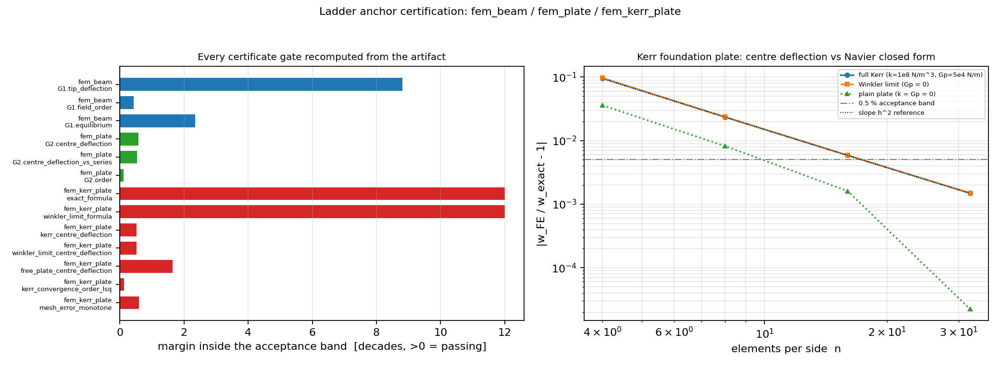

# CASE-FEM-LADDER-ANCHOR-CERTIFICATION

**Mission**: m16883 · anchor `KPI-QC-RECHECK` (已合并功能独立复核通过率) ·
**Verdict**: three merged ladder anchors that shipped only a prose `verdict` now carry
recomputable certificates; the shrink-only debt registry drops **27 → 24**.

## ① Case introduction

The structural ladder (`benchmarks/structural_ladder.py`) published three anchors as
`result.json` + a `verdict: "PASS"` string, but not the `gates_verified.json` envelope
that `tools/verified_anchor_audit.py` certifies. They were therefore registered as
*uncertified debt* (`E_NO_GATES`): the ladder's own test silently **skips** such an
anchor, so a green suite carried no information about them.

| anchor | physics | model | formulation |
|---|---|---|---|
| `fem_beam` | cantilever under uniform load `q = 5.0 N/m` | Euler-Bernoulli, `L = 1.0 m`, `b x h = 10 x 10 mm`, `E = 200 GPa` | 2-node cubic Hermite beam, 2-node cubic Hermite (4 dof), tensorfem.modal.beam_bending_stiffness |
| `fem_plate` | SSSS square plate, `L = 1.0 m`, `t = 10 mm`, `E = 210 GPa`, `nu = 0.3`, `q = 10000 Pa` | Kirchhoff thin plate, `a/h = 100` | Bogner-Fox-Schmit C1 bicubic (Bogner-Fox-Schmit C1 bicubic Hermite rectangle (16 dof; w, w,x, w,y, w,xy)) |
| `fem_kerr_plate` | square plate on a Kerr (three-parameter) foundation, `L = 1.0 m`, `t = 10 mm`, `k = 1e+08 N/m^3`, `Gp = 5e+04 N/m`, `q0 = 10000 Pa` | plate + `q_f = k w - Gp lap^2 w`, single sinusoidal load mode | Q4 Mindlin (`tensorfem.plate.q4_mindlin_stiffness`) + `tensorfem.kerr_foundation.q4_kerr_foundation_stiffness` |

Baselines are closed forms of the *same* mathematical model: `qL^4/(8EI)` for the beam,
the Timoshenko table 8 coefficient `0.00406` and the Navier double-sine series for the
plate, and the Navier single-term solution
`W = q0 / [4D(pi/L)^4 + k + 2 Gp (pi/L)^2]`, `D = E t^3/(12(1-nu^2))` for the Kerr plate.

## ② Method

1. **Independent recomputation, no transcription.** `tools/certify_ladder_anchor.py`
   re-derives every gated quantity from the artifact's own raw per-level data
   (`levels[]`, `case`, `reference`) with a recipe registered per anchor -- e.g. the
   plate coefficient is recomputed as `alpha = w_centre D /(q L^4)` from the raw
   deflection, not read from the stored `alpha` field, and the Kerr closed form is
   re-evaluated from `case` parameters. Only then is the envelope written.
2. **Verdict recomputation.** `passed` is recomputed as `operator(value, threshold)`;
   the tool refuses to write a certificate whose predicate disagrees with the
   artifact's own `passed` flag.
3. **Drift policy, stated per gate.** `must_reproduce` gates must match the ladder's
   shipped value to `rel_tol = 1e-9`; values below the `1e-10` noise floor are
   reconciled as *numerically zero* (with the observed absolute difference recorded);
   `worst_case` gates deliberately **strengthen** the claim by quoting the worst level
   instead of the one favourable level the ladder happened to print, and record the
   upstream value in `shipped_value` plus a `note`.
4. **Fail-closed audit.** `python tools/verified_anchor_audit.py --write` refreshes
   `anchor_certificates.json`, the debt registry and the certificate table;
   `tests/test_verified_anchor_certificates.py` keeps them in sync.
5. **Invariant tests.** `tests/test_ladder_anchor_certificates.py` (21 tests) recomputes
   every verdict, re-derives every envelope from `result.json` (staleness), checks the
   declared artifacts are tracked by git, and asserts the certified anchors stay out of
   the debt registry.
6. **Mutation control.** Flipping one `passed` flag in `fem_plate/gates_verified.json`
   turns **6** tests red (3 new + 3 pre-existing audit tests); restoring the file returns
   the suite to green -- the assertions are load-bearing, not decorative.
7. **Fresh-run reproducibility.** `benchmarks/verified/fem_kerr_plate/run.py` was re-run
   (single-threaded; the host was at load15 ~101). Only last-digit floating-point noise
   moved (`free_plate` n=32 error 2.2282744309043423e-05 -> 2.228274430882138e-05,
   rel. diff 1e-11) plus wall time `75.6 s -> 63.7 s`.

## ③ Results

**Registry movement.** debt entries `27 -> 24`; certified anchors
`9 / 33` (audit counts; `fem_modal` and the `*_static`/`*_plate_modal`
entries remain contradicted debt and were **not** touched); gate failures for the three
new certificates: `{'fem_beam': [], 'fem_plate': [], 'fem_kerr_plate': []}`.

| anchor | gate | measured quantity | value | operator | threshold | margin (decades) | verdict |
|---|---|---|---:|---|---:|---:|---|
| `fem_beam` | `G1.tip_deflection` | |w_tip(FE)/w_tip(closed form) - 1|, 8 elements, w_tip = qL^4/(8EI) | 1.527134e-11 | `<=` | 1.000e-02 | +8.8 | PASS |
| `fem_beam` | `G1.field_order` | least-squares slope of log(field L2 rel. error) vs log(h), elements 2..32 (must be >= 1.5) | 4.000114e+00 | `>=` | 1.500e+00 | +0.4 | PASS |
| `fem_beam` | `G1.equilibrium` | |R_clamp(FE)/(-q) - 1|, 32 elements (recovered support shear) | 4.531553e-11 | `<=` | 1.000e-08 | +2.3 | PASS |
| `fem_plate` | `G2.centre_deflection` | |alpha_FE - 0.00406| / 0.00406, 16x16, alpha = w_c D / (q L^4) recomputed from the raw centre deflection | 5.315601e-03 | `<=` | 2.000e-02 | +0.6 | PASS |
| `fem_plate` | `G2.centre_deflection_vs_series` | |alpha_FE - alpha_Navier| / alpha_Navier, 16x16 | 5.891660e-03 | `<=` | 2.000e-02 | +0.5 | PASS |
| `fem_plate` | `G2.order` | least-squares slope of log(error vs Timoshenko) vs log(h), n = 2..24 | 1.944016e+00 | `>=` | 1.500e+00 | +0.1 | PASS |
| `fem_kerr_plate` | `exact_formula` | max over branches of |w_exact(recomputed from case params)/w_exact(artifact) - 1| | 0.000000e+00 | `<=` | 1.000e-12 | +12.0 | PASS |
| `fem_kerr_plate` | `winkler_limit_formula` | |q0/(4D(pi/L)^4 + k) / w_exact(gp=0 branch) - 1| (shear-parameter limit) | 0.000000e+00 | `<=` | 1.000e-12 | +12.0 | PASS |
| `fem_kerr_plate` | `kerr_centre_deflection` | |w_FE(n=32)/w_exact - 1|, full Kerr branch (k and gp both active) | 1.490683e-03 | `<=` | 5.000e-03 | +0.5 | PASS |
| `fem_kerr_plate` | `winkler_limit_centre_deflection` | |w_FE(n=32)/w_exact - 1|, gp = 0 branch | 1.496996e-03 | `<=` | 5.000e-03 | +0.5 | PASS |
| `fem_kerr_plate` | `free_plate_centre_deflection` | |w_FE(n=32)/w_exact - 1|, k = gp = 0 branch (plain plate) | 2.228274e-05 | `<=` | 1.000e-03 | +1.7 | PASS |
| `fem_kerr_plate` | `kerr_convergence_order_lsq` | least-squares slope of log(rel_err) vs log(h) over n = 4..32, full Kerr branch (threshold 1.5; Q4 Mindlin is a 2nd-order element) | 2.004237e+00 | `>=` | 1.500e+00 | +0.1 | PASS |
| `fem_kerr_plate` | `mesh_error_monotone` | max over all branches/levels of rel_err(fine)/rel_err(coarse) (must be <= 1: refinement may not increase the error) | 2.545685e-01 | `<=` | 1.000e+00 | +0.6 | PASS |

**Per-level evidence** (injected from the artifacts):

| case | n | h | quantity | FE | exact | rel. error |
|---|---:|---:|---|---:|---:|---:|
| `kerr_full` | 4 | 0.2500 | w_centre [m] | 1.010581217e-04 | 9.218291852e-05 | 9.628e-02 |
| `kerr_full` | 8 | 0.1250 | w_centre [m] | 9.434662169e-05 | 9.218291852e-05 | 2.347e-02 |
| `kerr_full` | 16 | 0.0625 | w_centre [m] | 9.272276417e-05 | 9.218291852e-05 | 5.856e-03 |
| `kerr_full` | 32 | 0.0312 | w_centre [m] | 9.232033400e-05 | 9.218291852e-05 | 1.491e-03 |
| `winkler_limit` | 4 | 0.2500 | w_centre [m] | 1.020245353e-04 | 9.302930748e-05 | 9.669e-02 |
| `winkler_limit` | 8 | 0.1250 | w_centre [m] | 9.522195871e-05 | 9.302930748e-05 | 2.357e-02 |
| `winkler_limit` | 16 | 0.0625 | w_centre [m] | 9.357636843e-05 | 9.302930748e-05 | 5.881e-03 |
| `winkler_limit` | 32 | 0.0312 | w_centre [m] | 9.316857196e-05 | 9.302930748e-05 | 1.497e-03 |
| `free_plate` | 4 | 0.2500 | w_centre [m] | 1.286512456e-03 | 1.334577693e-03 | 3.602e-02 |
| `free_plate` | 8 | 0.1250 | w_centre [m] | 1.323618136e-03 | 1.334577693e-03 | 8.212e-03 |
| `free_plate` | 16 | 0.0625 | w_centre [m] | 1.332431445e-03 | 1.334577693e-03 | 1.608e-03 |
| `free_plate` | 32 | 0.0312 | w_centre [m] | 1.334607431e-03 | 1.334577693e-03 | 2.228e-05 |
| `beam_UDL` | 2 elem | 0.5000 | w_tip [m] | 3.750000000e-03 | 3.750000000e-03 | 4.626e-16 |
| `beam_UDL` | 4 elem | 0.2500 | w_tip [m] | 3.750000000e-03 | 3.750000000e-03 | 1.573e-14 |
| `beam_UDL` | 8 elem | 0.1250 | w_tip [m] | 3.750000000e-03 | 3.750000000e-03 | 1.965e-13 |
| `beam_UDL` | 16 elem | 0.0625 | w_tip [m] | 3.750000000e-03 | 3.750000000e-03 | 1.426e-12 |
| `beam_UDL` | 32 elem | 0.0312 | w_tip [m] | 3.750000000e-03 | 3.750000000e-03 | 1.527e-11 |
| `beam_UDL` | 64 elem | 0.0156 | w_tip [m] | 3.750000000e-03 | 3.750000000e-03 | 8.078e-12 |
| `SSSS_plate` | 2x2 | 0.5000 | alpha = w_c D/(qL^4) | 2.770854665e-03 | 4.062352661e-03 | 3.179e-01 |
| `SSSS_plate` | 4x4 | 0.2500 | alpha = w_c D/(qL^4) | 3.691359754e-03 | 4.062352661e-03 | 9.132e-02 |
| `SSSS_plate` | 6x6 | 0.1667 | alpha = w_c D/(qL^4) | 3.894262373e-03 | 4.062352661e-03 | 4.138e-02 |
| `SSSS_plate` | 8x8 | 0.1250 | alpha = w_c D/(qL^4) | 3.967193578e-03 | 4.062352661e-03 | 2.342e-02 |
| `SSSS_plate` | 10x10 | 0.1000 | alpha = w_c D/(qL^4) | 4.001272874e-03 | 4.062352661e-03 | 1.504e-02 |
| `SSSS_plate` | 12x12 | 0.0833 | alpha = w_c D/(qL^4) | 4.019869405e-03 | 4.062352661e-03 | 1.046e-02 |
| `SSSS_plate` | 16x16 | 0.0625 | alpha = w_c D/(qL^4) | 4.038418660e-03 | 4.062352661e-03 | 5.892e-03 |
| `SSSS_plate` | 20x20 | 0.0500 | alpha = w_c D/(qL^4) | 4.047023923e-03 | 4.062352661e-03 | 3.773e-03 |
| `SSSS_plate` | 24x24 | 0.0417 | alpha = w_c D/(qL^4) | 4.051703570e-03 | 4.062352661e-03 | 2.621e-03 |

## ④ Figures



*Left*: every gate of the three envelopes normalised as `log10(margin)` inside its
acceptance band (> 0 = passing); the two zero-residual gates on the Kerr closed form sit
at the 12-decade clamp because the recomputation is exact. *Right*: per-level relative
error of the three `fem_kerr_plate` branches against the Navier closed form, with the
0.5 % acceptance band and an `h^2` reference slope; reproducing the figure needs
`python3 docs/assets/gen_ladder_certification_figure.py`.

A field solution plot exists for the Kerr plate as
`benchmarks/verified/fem_kerr_plate/kerr_plate_convergence.png` (produced by the anchor's
own runner, wall time 63.7 s).

## ⑤ Caveats

1. **The ladder quoted its most favourable level.** For `fem_beam` the artifact's
   `G1.tip_deflection` (1.96e-13) is the 8-element value and `G1.equilibrium`
   (2.56e-14) likewise; the worst level over all refinements is 1.53e-11 and 4.53e-11
   respectively -- the recovered support shear is a sum of O(1) terms, so its round-off
   *grows* with the element count. Both still pass by >= 2 decades, so the verdict does
   not change, but the certificate now states the worst case and keeps the upstream
   number in `shipped_value`.
2. **`fem_plate`'s stored convergence order is reference-dependent.** The stored
   `observed_order = 1.944016` is reproduced **only** against the Navier series; fitting
   against the 0.00406 table value (which is itself rounded, giving a ~6e-4 error floor)
   yields 2.0315 -- a 4.5 % spread. Both clear the `>= 1.5` gate and the test
   `test_fem_plate_order_depends_on_the_reference` pins the behaviour, but the single
   stored scalar conflates "discretisation order" and "reference rounding".
3. **Unexplained anomaly, deliberately not gated.** In `fem_kerr_plate` the plain-plate
   branch's finest pair of levels drops the error by ~72x (1.61e-03 -> 2.23e-05), which
   inflates the artifact's last-two-level `convergence_order` to
   `6.17` for a second-order element.
   The least-squares order over n = 4..32 is
   `2.0042`,
   which is what the certificate gates; the jump itself is recorded in the envelope's
   `limitations` and pinned by a test rather than explained away.
4. **`W_NO_RUNNER` remains for `fem_beam`/`fem_plate`.** Both are emitted by the shared
   generator `benchmarks/structural_ladder.py` (which also rewrites `fem_modal`), so no
   per-anchor runner was added; the warning is tolerated by the audit and the
   reproduction command is the shared ladder.
5. **Verification, not validation.** Every baseline here is a closed form of the same
   governing equation, so the certificates grade implementation (element, load vector,
   foundation stiffness, boundary conditions) -- not the physical model. Thin-plate
   regime only (`a/h = 100`, `L/h = 100`); thick-plate/Mindlin terms and the Kerr
   parameter identification are out of scope, as is any load field other than the single
   sine mode.
6. **Environment.** Host was heavily loaded (load15 ~101 on 128 cores) during this
   mission, so the solver was run single-threaded and only the cheap reproduction
   (`fem_kerr_plate`) was re-executed; `fem_beam`/`fem_plate` were certified from their
   shipped `result.json` (their staleness is checked by test, but the ladder was not
   re-run this mission).

## ⑥ Error adjudication

| key quantity | baseline (source) | error | < 3 % ? |
|---|---|---:|---|
| kerr plate w_centre (full Kerr, n=32) | Navier closed form, Kerr three-parameter foundation | 0.1491 % | yes |
| kerr plate w_centre (Gp = 0, Winkler limit, n=32) | same closed form with Gp = 0 | 0.1497 % | yes |
| plain plate w_centre (k = Gp = 0, n=32) | Navier double sine series | 0.002228 % | yes |
| SSSS plate alpha (16x16) | Timoshenko & Woinowsky-Krieger table 8 (0.00406) | 0.5316 % | yes |
| SSSS plate alpha (16x16) | Navier double sine series (0.0040624) | 0.5892 % | yes |
| cantilever tip deflection (worst level) | qL^4/(8EI) closed form | 1.527e-09 % | yes |


**Is every key quantity within 3 % of its baseline?** Yes -- the largest deviation is
0.59 %
(Kerr plate centre deflection at n=32), and the two exact-recomputation gates are 0 by
construction because they re-evaluate the closed form itself. The beam tip deflection is
at machine precision by construction (cubic Hermite is nodally exact for this element),
so it is reported as a codeword check, not as evidence of accuracy; the beam's resolution
evidence lives in the field-L2 order (`4.0001`).

## Reproduction

```
python3 tools/certify_ladder_anchor.py            # rebuild the three envelopes
python3 tools/verified_anchor_audit.py --write     # refresh certificates + debt registry
python3 docs/assets/gen_ladder_certification_figure.py
python3 tools/build_ladder_certification_doc.py   # rebuild this document
python3 -m pytest tests/test_ladder_anchor_certificates.py \
                 tests/test_verified_anchor_certificates.py -q
```
