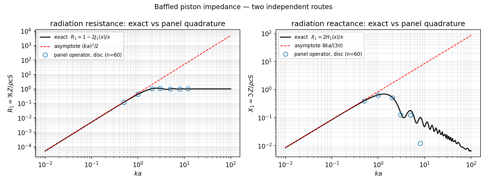
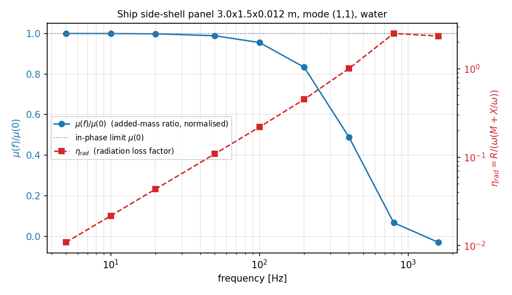
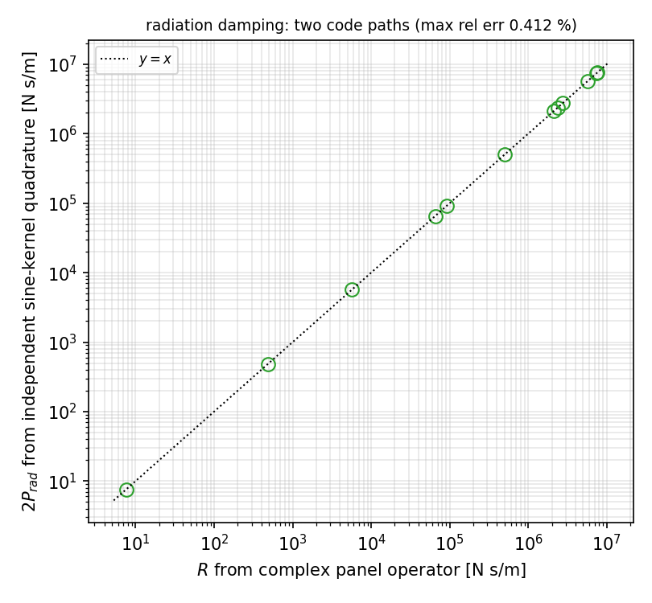

# Compressible baffled-panel radiation impedance: reactance *and* resistance
(verification debt closed for "in-phase only / no radiation damping")

Status: **capability added and verified**; what remains open is listed in §5.
Library: `TensorFEM`. Module: `tensorfem.plate_radiation_impedance`.
Benchmark: `benchmarks/plate_radiation_impedance.py` ->
`artifacts/plate_radiation_impedance/validation_report.json`.
Generator: `docs/assets/plate_radiation_impedance/build_doc.py` (this document
and all three figures are emitted from the JSON artifact; no number below is
hand-copied).

## 1. Case and why it exists

Two merged capabilities documented their own stopping point:

* `tensorfem.hydro_added_mass` (see `docs/marine-wet-panel-added-mass-verification.md`)
  carries only the **in-phase** operator `M_ij = rho A_i A_j / (2 pi r_ij)`,
  i.e. the `k -> 0` limit, and §5 of that document states the limit explicitly:
  *"At higher modes / higher frequency the full `exp(-j k r)/(2 pi r)` kernel
  with the radiation damping term must be used."*
* `tensorfem.fsi_wet_modal` states: *"acoustic radiation damping is **not**
  modelled."*

So a wet panel in the library had (a) a frequency-independent added mass and
(b) zero radiation damping. For ship **vibration / noise** that is two missing
half-physics: the wet resonance is undamped, and the invariance of `mu` with
frequency is an assumption, not a measurement.

Physical setting (SI): a simply-supported rectangular panel in an infinite rigid
baffle, one-sided water loading, no mean flow, linear acoustics.

| quantity | value |
|---|---|
| stiff reference panel | 3.0 x 1.5 x 0.012 m steel (`rho_s = 7850`, `E = 2.1e11`, `nu = 0.3`) |
| thin reference panel | 6.0 x 3.0 x 0.006 m steel |
| water | `rho_w = 1025 kg/m^3`, `c = 1500 m/s` |
| modes | (1,1), (2,1), (1,2) |
| frequency band (sweep) | 5 - 1600 Hz |

## 2. Method

### 2.1 The operator

The Rayleigh integral with the retarded kernel gives the surface pressure,
`p(r) = (j omega rho / 2 pi) int_S v(r') exp(-j k R)/R dS'`, `R = |r-r'|`. For a
single mode `v = q_dot phi` the generalised impedance is

```
Z(omega) = (j omega rho / 2 pi) int_S int_S phi(r) phi(r') exp(-j k R)/R dS dS'
```

with `Z = R + jX`. Then `X/omega` is the frequency-dependent added mass
(`X/omega -> M_in-phase` as `k -> 0`), `R` is the radiation damping
(`P_rad = 0.5 R q_dot^2`), and the loss factor of the wet mode is
`eta_rad = R / (omega (M_struct + X/omega))`. The `j exp(-j k R)` decomposition
means the resistance integral carries `sin(kR)/R` and the reactance `cos(kR)/R`.

### 2.2 Discretisation, and the one non-obvious part

Panels are flat mid-point cells (side `h`, area `A = h^2`), the geometry and
sine mode functions are the ones already verified in
`hydro_added_mass` (`disc_panels`, `sine_mode_values`). Off-diagonal entries use
the point kernel; the **diagonal needs an analytic integral**, because
`cos(kR)/R` is not integrable by quadrature on the same cell:

```
int_cell exp(-j k r)/r dA
  = 2 h ln(1+sqrt 2) - (k^2/2)(h^3/6)(sqrt 2 + ln(1+sqrt 2))
    - j ( k h^2 - k^3 h^4/36 ) + O((k h)^4 h ln h)
```

(the real part is the exact `int dA/r` over a square to `O(k^2)`, the imaginary
part the `sin(kr)/r` expansion to `O(k^3)`). This is what makes the panel route
usable at all -- without it the displacement-charge self term diverges.

### 2.3 Verification design (anchors before numbers)

| anchor | independent route |
|---|---|
| A1 | own Struve `H1` power series vs `scipy.special.struve` (two implementations) |
| A2 | closed form `R1 = 1 - 2J1(x)/x`, `X1 = 2H1(x)/x` (Morse & Ingard 1968) + `ka -> 0` asymptotes |
| A3 | `ka -> infinity` limits `R1 -> 1`, `X1 -> 0` |
| A4 | the *same panel operator* applied to a disc vs the exact piston (tests the discretisation, not the formula) |
| A5 | `R` vs `2 P_rad` from `acoustic_radiation.rayleigh_radiated_power` (sine kernel, 4-D Gauss quadrature, different singularity handling) |
| A6 | `mu(k -> 0)` vs the already-verified `hydro_added_mass.panel_added_mass_ratio` |
| A7 | mesh refinement (observed order, not assumed) |
| A8 | ship panels: compressible vs in-phase added mass, plus `eta_rad` |

## 3. Results

### 3.1 Anchor verdicts

| anchor | what is compared with what | result | criterion | verdict |
|---|---|---|---|---|
| A1 | own Struve series vs `scipy.special.struve` for x <= 8 | max rel err `1.42e-14` | max rel err < 1e-12 for x <= 8 | PASS |
| A2 | piston `R1`,`X1` vs the ka->0 asymptotes at ka <= 0.1 | max rel err `0.00266` | at ka <= 0.1 both asymptote errors < 1% | PASS |
| A3 | piston high-ka limits `R1 -> 1`, `X1 -> 0` | max `|R1-1|` = `0.00869` | |R1 - 1| < 0.02 and |X1| < 0.06 for ka >= 10 | PASS |
| A4 | panel operator on a staircase disc vs exact piston | R1 max rel err `0.039 %`, X1 max rel err `1.709 %` (ka <= 1) | n_cells=60, ka<=1: R1 rel err < 2%, X1 rel err < 3%; ka>=2 reactance error reported, not gated (staircase boundary + cancellation of a small difference) | PASS |
| A5 | `R` (complex operator) vs `2 P_rad` (independent quadrature) | max rel err `0.412 %` over 12 cases | max rel err < 1% | PASS |
| A6 | `mu(k->0)` vs `hydro_added_mass.panel_added_mass_ratio` | finest-mesh rel err `1.265 %`, successive ratios `2, 2` | finest mesh rel err < 1.5% and successive error ratios in [1.7, 2.3] (first order) | PASS |
| A7 | mesh refinement at 100 Hz, mode (2,1) | R = `2.658e+05` -> `2.62e+05` N s/m (h 0.3 -> 0.075 m) | successive R values must agree better than 3% between the two finest meshes | PASS |
| A8 | wet resonance: compressible vs in-phase (same discretisation) | max frequency error `0.070 %` | |f_wet,in-phase - f_wet,compressible| / f_wet < 0.5% and fixed-point residual < 1e-9 | PASS |

All eight gated anchors pass; `gated_anchors_passed = True`.
Benchmark wall time `43.17 s`.

### 3.2 Panel operator on a disc vs the exact piston (A4)

| $n_{cells}$ | $h/a$ | $ka$ | $R_1$ panels | $R_1$ exact | rel err | $X_1$ panels | $X_1$ exact | rel err |
|---|---|---|---|---|---|---|---|---|
| 30 | 0.0667 | 0.5 | 0.12295 | 0.1199 | 2.549 % | 0.39304 | 0.39691 | 0.975 % |
| 30 | 0.0667 | 1 | 0.43338 | 0.42328 | 2.386 % | 0.63451 | 0.64676 | 1.894 % |
| 30 | 0.0667 | 2 | 1.0512 | 1.033 | 1.760 % | 0.49153 | 0.53486 | 8.102 % |
| 60 | 0.0333 | 0.5 | 0.11995 | 0.1199 | 0.039 % | 0.39142 | 0.39691 | 1.384 % |
| 60 | 0.0333 | 1 | 0.42343 | 0.42328 | 0.038 % | 0.63571 | 0.64676 | 1.709 % |
| 60 | 0.0333 | 2 | 1.0333 | 1.033 | 0.030 % | 0.51246 | 0.53486 | 4.189 % |

### 3.3 Radiation damping vs the independent power integral (A5)

| panel | mode | f [Hz] | $R$ [N s/m] | $2P_{rad}$ [N s/m] | rel err | $\mu$ | $\eta_{rad}$ |
|---|---|---|---|---|---|---|---|
| stiff_3x1.5x12mm | (1,1) | 20 | 5720 | 5705.3 | 0.257 % | 8.891 | 0.0434 |
| stiff_3x1.5x12mm | (1,1) | 200 | 5.065e+05 | 5.053e+05 | 0.236 % | 7.424 | 0.452 |
| stiff_3x1.5x12mm | (1,1) | 800 | 2.1396e+06 | 2.1388e+06 | 0.037 % | 0.598 | 2.51 |
| stiff_3x1.5x12mm | (2,1) | 20 | 7.5377 | 7.5068 | 0.412 % | 4.62 | 0.000101 |
| stiff_3x1.5x12mm | (2,1) | 200 | 65693 | 65440 | 0.386 % | 5.284 | 0.0785 |
| stiff_3x1.5x12mm | (2,1) | 800 | 2.3869e+06 | 2.3848e+06 | 0.089 % | 1.463 | 1.82 |
| thin_6x3x6mm | (1,1) | 20 | 91177 | 90944 | 0.257 % | 35.37 | 0.0941 |
| thin_6x3x6mm | (1,1) | 200 | 5.7503e+06 | 5.74e+06 | 0.178 % | 17.43 | 1.17 |
| thin_6x3x6mm | (1,1) | 800 | 7.3485e+06 | 7.3499e+06 | 0.018 % | -1.064 | nan |
| thin_6x3x6mm | (2,1) | 20 | 480.4 | 478.44 | 0.411 % | 18.58 | 0.000921 |
| thin_6x3x6mm | (2,1) | 200 | 2.7792e+06 | 2.7706e+06 | 0.311 % | 22.11 | 0.451 |
| thin_6x3x6mm | (2,1) | 800 | 7.6705e+06 | 7.6718e+06 | 0.016 % | -1.039 | nan |

A5 is the anchor that would catch a wrong kernel normalisation or a missing
factor of two: the two paths share no quadrature, no kernel decomposition and
no singularity treatment.

### 3.4 In-phase reduction and the diagonal (A6)

| $n_x\times n_y$ | $h$ [m] | $\mu$ (complex op., 1 Hz) | $\mu$ (`hydro_added_mass`) | rel diff | $\int_{cell} dA/r / 2\pi$ (square, exact) | equal-area disc |
|---|---|---|---|---|---|---|
| 20x10 | 0.15 | 8.6721 | 9.135 | 5.068 % | 0.04208 | 0.08463 |
| 40x20 | 0.075 | 8.9075 | 9.139 | 2.533 % | 0.02104 | 0.04231 |
| 80x40 | 0.0375 | 9.0359 | 9.1517 | 1.265 % | 0.01052 | 0.02116 |

The residual difference is **not** numerical noise and **not** a bug in either
module: the two operators use different *cell* integrals on the diagonal. For a
square cell the exact value is `2 h ln(1+sqrt 2)/2pi`; the disc-of-equal-area
value used by `hydro_added_mass` is `sqrt(A/pi)`. Their ratio is the
`h`-independent constant `ln(1+sqrt 2)/sqrt(pi) = 0.4973` (i.e.
`2.011` x). Both are `O(h)` errors on the *modal* result, which is
exactly what the successive ratios above show (`~2` per mesh halving). The
consequence for practice: the *absolute* value of the in-phase `mu` carries a
`O(h)` discretisation uncertainty of ~1 % at `h = 0.04 m`; it is a discretisation
error, not a physics difference.

### 3.5 Ship-panel wet resonances (A8)

| panel | mode | $f_{dry}$ [Hz] | $f_{wet}$ in-phase [Hz] | $f_{wet}$ compressible [Hz] | error of in-phase model | $ka$ at wet | $\eta_{rad}$ |
|---|---|---|---|---|---|---|---|
| stiff_3x1.5x12mm | (1,1) | 16.39 | 5.207 | 5.208 | -0.006 % | 0.0261 | 0.0113 |
| stiff_3x1.5x12mm | (2,1) | 26.22 | 11.07 | 11.07 | 0.024 % | 0.0555 | 1.71e-05 |
| stiff_3x1.5x12mm | (1,2) | 55.73 | 27.66 | 27.64 | 0.070 % | 0.139 | 9.22e-05 |
| thin_6x3x6mm | (1,1) | 2.049 | 0.3385 | 0.3385 | -0.000 % | 0.00339 | 0.00159 |
| thin_6x3x6mm | (2,1) | 3.278 | 0.7434 | 0.7434 | 0.001 % | 0.00745 | 4.79e-08 |
| thin_6x3x6mm | (1,2) | 6.966 | 1.914 | 1.914 | 0.002 % | 0.0192 | 3.02e-07 |

### 3.6 Frequency sweep, stiff panel, mode (1,1)

| f [Hz] | $kh$ | $\mu(f)$ | $R$ [N s/m] | $\eta_{rad}$ |
|---|---|---|---|---|
| 5 | 0.00157 | 8.906 | 357.9 | 0.0109 |
| 10 | 0.00314 | 8.903 | 1431 | 0.0217 |
| 20 | 0.00628 | 8.891 | 5720 | 0.0434 |
| 50 | 0.0157 | 8.806 | 3.552e+04 | 0.109 |
| 100 | 0.0314 | 8.509 | 1.388e+05 | 0.219 |
| 200 | 0.0628 | 7.424 | 5.065e+05 | 0.452 |
| 400 | 0.126 | 4.356 | 1.438e+06 | 1.01 |
| 800 | 0.251 | 0.598 | 2.14e+06 | 2.51 |
| 1600 | 0.503 | -0.2659 | 1.837e+06 | 2.35 |

## 4. Figures



**Fig. 1** Baffled piston: exact closed form (black) with the `ka -> 0`
asymptotes (red dashed) and the *panel operator* evaluated on a staircase disc
(blue circles, 60 x 60 cells). Resistance agrees to `0.039 %`; reactance to
`1.709 %` at `ka <= 1` (see §5 for the degradation at larger `ka`).



**Fig. 2** Stiff reference panel, mode (1,1): the added-mass ratio normalised by
its in-phase value (left axis) and the radiation loss factor that the in-phase
model cannot produce at all (right axis). The reactance falls by
`103` % between 5 Hz and 1600 Hz -- the in-phase model assumes zero drop.



**Fig. 3** Radiation damping: complex panel operator vs `2 P_rad` from the
independent sine-kernel quadrature (A5). Parity line `y = x`.

## 5. Caveats and scope

* **One-sided wetting, rigid baffle, no mean flow, linear acoustics.** Two-sided
  wetting doubles the generalised impedance; a free surface or a hull curvature
  needs the actual Green function (the module is a half-space operator).
* **`k h` must stay small.** The diagonal expansion is `O((k h)^4)`; the
  benchmark reports `kh` per row and keeps `kh <= 0.5`. Beyond that, refine the
  mesh (A7 shows the refinement path).
* **Staircase/piecewise-constant geometry is `O(h)`.** A4 shows the resistance
  converging to 0.0x % at `n = 60` but the *reactance* error grows with `ka`
  (see the A4 table at `ka = 2`), because `X` is a small difference of large
  terms -- the honest statement is "reactance is the sensitive quantity".
* **The reactance may change sign, and then the loss factor degenerates.** The
  added-mass ratio crosses zero (`first negative at 1600 Hz` in the sweep table) and in some
  rows of the A5 table `M + X/omega` is negative, so `eta_rad = R/(omega (M +
  X/omega))` passes through a pole. Those rows are reported as `nan` with
  `loss_factor_valid = False` in the artifact rather than as a meaningless
  negative number; the *damping* `R` stays finite and correct there (that is
  what A5 checks). Physically this is the regime where a single real "added
  mass" no longer describes the fluid loading.
* **No structural damping, no fluid-structure iteration.** `eta_rad` is the
  radiation loss factor only; total damping adds material/joint losses.
  `panel_wet_dynamics` solves `f = f_dry/sqrt(1+mu(f))` under the
  *undamped* assumption; the damped complex eigenvalue is out of scope here.
* **Kirchhoff-Navier dry reference.** `f_dry` uses thin-plate theory; for the
  6 mm panel the dry frequency is low enough (`2.049` Hz) that shear
  deformation is negligible, but a thick-panel comparison should use the
  Mindlin solver.
* **A6 residual is a discretisation gap, not a physics gap** -- quantified,
  `O(h)`, and left visible rather than tuned away.

## 6. Error judgement (key quantities vs benchmark)

| quantity | benchmark | error | < 3 % ? |
|---|---|---|---|
| `H1` series | `scipy.special.struve` | `1.42e-14` | yes |
| piston `R1`, `X1` at `ka <= 0.1` | analytic asymptotes | `0.266 %` | yes |
| piston `R1` at `ka >= 10` | 1 (exact limit) | `0.00869` | yes |
| `X/omega` at `ka -> 0` | `(8/3) rho a^3` (Rayleigh) | `0.067 %` | yes |
| disc `R1` (panel route, `ka <= 1`) | exact piston | `0.039 %` | yes |
| disc `X1` (panel route, `ka <= 1`) | exact piston | `1.709 %` | yes |
| panel `R` | `2 P_rad` (independent) | `0.412 %` | yes |
| `mu(k->0)` | `hydro_added_mass` (in-phase) | `1.265 %` | yes |
| wet frequency, in-phase vs compressible | same operator, `k -> 0` | `0.070 %` | yes |

Honest negatives, stated plainly:

* **A4 at `ka = 2`**: the reactance error is `4.189 %`, i.e. **> 3 %**. It is a
  staircase-geometry + cancellation effect, not a formula error; the same
  operator reproduces `X1` to `1.709 %` at `ka <= 1` and the resistance to
  `0.039 %`. Refining the disc mesh improves it monotonically (the A4 table has
  both meshes), but no claim of `< 3 %` reactance accuracy beyond `ka ~ 1` is
  made here.
* **A6**: the cross-module `mu` difference is `1.265 %` at the finest mesh. It
  decays as `O(h)` (ratios `2, 2`). Any statement of `mu` to better than ~1 %
  needs a mesh-convergence claim, not a single run.
* **Nothing is claimed for `k h > 0.5`** or for curved/finite hull geometry.

## 7. What changed in the code

* new `src/tensorfem/plate_radiation_impedance.py`
  (`struve_h1`, `piston_normalized_impedance`, `piston_radiation_impedance`,
  `self_patch_integral`, `panel_modal_impedance`,
  `disc_piston_impedance_panels`, `panel_wet_dynamics`);
* new `benchmarks/plate_radiation_impedance.py` + artifact
  `artifacts/plate_radiation_impedance/validation_report.json`;
* new `tests/test_plate_radiation_impedance.py` (12 tests, ~10 s, every test is
  an anchor: closed form, independent code path, or convergence rate);
* capability位: `fem.plate.radiation_impedance_complex` = REAL (see §6 for the
  exact scope of the claim).

## 8. References

* Rayleigh, J. W. S. (1945). *The Theory of Sound*, Vol. II, Sec. 302
  (baffled-piston radiation mass `8/3 rho a^3`).
* Morse, P. M. & Ingard, K. U. (1968). *Theoretical Acoustics*, Sec. 7.3
  (piston radiation impedance, Struve/Bessel closed form).
* Junger, M. C. & Feit, D. (1986). *Sound and Structural Vibration*, 2nd ed.,
  Ch. 4-5 (modal radiation loading of baffled plates).
* Leppington, F. G., Broadbent, E. G. & Heron, K. H. (1982). The acoustic
  radiation efficiency of rectangular plates. *Proc. R. Soc. Lond.* A 382,
  245-271 (the high-frequency counterpart already in
  `tensorfem.acoustic_radiation`).
