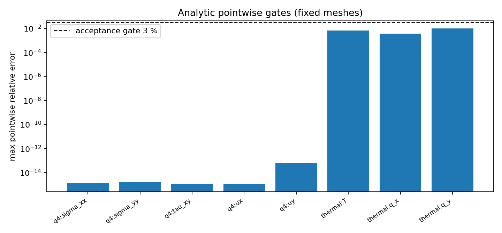
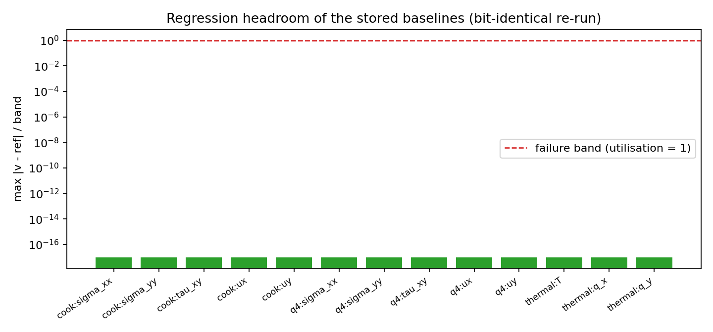

# CASE-FEM-POINTWISE-REFERENCE-REGRESSION

**锚点**：`XVAL-LBM-POINTWISE-REFERENCE-REGRESSION`（lssfau/lbmpy 的 pointwise-reference-regression 做法，落到 TensorFEM 的 FEM 场量上）

**生成时间**：2026-11-15T22:22:41+00:00（全部数字由 `scripts/build_pointwise_regression_evidence.py` 现场运行注入）

## 1. 案例介绍

本仓已有的验收门都是**标量**（自由端位移、峰值 von Mises 应力、单点应力）。这类门对另一类缺陷是盲的：装配路径重构、积分规则改变、稀疏/稠密求解器互换、自由度编号变化都可能把**整个场**扰动千分之几而所有标量门照样通过。lbmpy 的做法是把参考数据存下来、**逐个格点**比对，从而在缺陷发生的那一点抓到它。本工作把该做法移植成 TensorFEM 的通用能力，并用三个算例做基线：

| 算例 | 类型 | 离散 | 逐点值数 | 用途 |
|---|---|---|---|---|
| `cook-membrane-q4` | Cook 畸变膜 | 8×8 = 64 单元 | 178 | 纯回归基线（无逐点解析解） |
| `q4-uniaxial-patch` | Q4 patch test（单轴拉伸） | 4×4 = 16 单元 | 66 | 解析基准（可判精度） |
| `thermal-harmonic-square` | 稳态热传导（调和场） | 16×16 = 256 单元 | 177 | 解析基准（可判精度） |

* `q4-uniaxial-patch`：单轴拉伸 patch test，双线性 Q4 精确再现线性位移场，所以「计算值 = 闭式解」到舍入量级；它还覆盖**恒为零的分量**（`sigma_yy`、`tau_xy`）。
* `thermal-harmonic-square`：稳态热传导，Dirichlet 边界取自精确调和场 `T = sin(pi x) sinh(pi y)/sinh(pi)`；节点温度 O(h²)，单元中心热流是工程量。
* `cook-membrane-q4`：经典 Cook 畸变膜，**没有逐点闭式解**，只能做漂移基线——这正是大多数真实工程算例的处境。

## 2. 怎么做的

新增两个模块 + 一个参考库 + 一套测试：

* `src/tensorfem/pointwise_regression.py`：与算例无关的框架。`Snapshot`（探针 = 编号/类型/坐标/各物理量值）+ `build_snapshot`（规范排序、唯一编号、每个探针只能携带其位置上有定义的量、声明量必须至少被一个探针覆盖、拒绝非有限值）+ `mesh_signature`（节点/连接关系的 SHA-256，把探针**绑定到离散**）+ `compare` + `verify_directory` + CLI（`python -m tensorfem.pointwise_regression check|update`）。
* `src/tensorfem/pointwise_cases.py`：三个算例的**生产路径**构建器（`solve_continuum` / `solve_steady_thermal`，不重写单元），返回 `(computed, analytic)`；无解析解时 `analytic is None` 是**一等答案**，框架不会假装存在参考值。
* `benchmarks/pointwise_reference/`：三个 JSON 基线 + `ledger.json` + `evidence.json`。
* 判定规则：`|v - ref| <= rtol*|ref| + atol`。相对项沿用仓内 `certification_evidence.within_tolerance` 的口径，`atol` 是新增的绝对地板：**恒为零的分量**没有自身量级，若只用相对判据只能 `WITHHELD`，缺陷会从中溜走；因此地板取 `atol_scale × 该量参考量级`，量级为零时回落到算例在 `meta["quantity_scales"]` 里声明的物理量级（单轴算例取施加牵引 1 MPa）。汇总沿用 `certification_evidence.aggregate_verdicts`（`PASS`/`FAIL`/`PASS_WITH_WITHHELD`）。
* 两种模式共用同一套行/判决结构：`regression`（rtol=1e-9，问「场变了没有」）与 `reference`（rtol=3 %，问「场对不对」）。结构失配（算例名、探针集、坐标、量覆盖、网格签名任一变化）一律**抛错**而不是报 FAIL——在别的网格上比较逐点值没有意义。

## 3. 计算结果

### 3.1 回归基线复算（rtol = 1e-9）

| 算例 | 逐点值 | 判决 | FAIL | 最大相对偏差 |
|---|---|---|---|---|
| `cook-membrane-q4` | 178 | PASS | 0 | 0 |
| `q4-uniaxial-patch` | 66 | PASS | 0 | 0 |
| `thermal-harmonic-square` | 177 | PASS | 0 | 0 |
| **合计** | **421** | **PASS** | 0 | 0 |

### 3.2 解析基准逐点误差（reference 模式，3 % 门）

| 算例 | 量 | 探针数 | 最大相对误差 | 最大绝对误差 | 参考量级 | 判决 |
|---|---|---|---|---|---|---|
| `q4-uniaxial-patch` | `sigma_xx` | 16 | 1.281e-15 | 1.281e-09 | 1.000e+06 | PASS |
| `q4-uniaxial-patch` | `sigma_yy` | 16 | n/a | 1.685e-09 | 1.000e+06 | PASS |
| `q4-uniaxial-patch` | `tau_xy` | 16 | n/a | 1.082e-09 | 1.000e+06 | PASS |
| `q4-uniaxial-patch` | `ux` | 9 | 1.067e-15 | 5.929e-21 | 7.143e-06 | PASS |
| `q4-uniaxial-patch` | `uy` | 9 | 5.677e-14 | 2.096e-20 | 1.071e-06 | PASS |
| `thermal-harmonic-square` | `T` | 49 | 6.769e-03 | 1.102e-03 | 6.737e-01 | PASS |
| `thermal-harmonic-square` | `q_x` | 64 | 3.621e-03 | 8.300e-03 | 2.833e+00 | PASS |
| `thermal-harmonic-square` | `q_y` | 64 | 9.846e-03 | 3.965e-03 | 2.846e+00 | PASS |

### 3.3 故障注入（证明这套判据真的有牙齿）

把 `cook-membrane-q4` 基线中一个值扰动 1e-06 （相对），回归模式下判决 `FAIL`，失败行恰好 `['cook-membrane-q4:n00008:ux']`（注入的正是 `cook-membrane-q4:n00008:ux`），其余 177 行仍 PASS ——定位到探针级，不是整例报错。

## 4. 结果图

*每量逐点最大相对误差 vs 3 % 验收线（对数轴）*

*存储基线的回归余量：|复算值-参考值|/容差带宽，1.0 即失败线*

## 5. 注意点

* 三个算例的网格刻意小（16 单元 / 256 单元 / 64 单元）：回归库的用途是**判据完备**而非高精度；解析门用固定网格，误差由离散误差而非舍入决定，文档里逐量给数，不夸大。
* `Snapshots` 的 `meta` 含 `mesh_signature`、`torch_version`、`torch_threads`、`tensorfem_version`；换网格会直接拒绝比较，换线程只影响舍入（1e-9 带宽内）。
* 本次复算与基线**位级一致**（最大相对偏差 0），说明当前 float64 稠密路径是确定性的；一旦将来某次重构让它变成 1e-12 级差异，rtol=1e-9 仍会通过——那不是缺陷，而是数值路径确实变了，需要人工判断是否 `update` 重新基线化。
* `update` 是**显式**动作（`python -m tensorfem.pointwise_regression update`），`check` 写 ledger 并在非 PASS 时返回非零码，可进 CI。

## 6. 误差判定

| 关键量 | 基准 | 误差 | 是否 < 3 % |
|---|---|---|---|
| patch 位移 `ux`,`uy` | 闭式解 σx/E, -νσy/E | 1.067e-15 (最大) | 是 |
| patch 应力 `sigma_xx` | 闭式 σ = 1 MPa | 1.281e-15 | 是 |
| patch 零分量 `sigma_yy`,`tau_xy` | 闭式 0 | 1.685e-09 Pa 绝对 （量级 1e6 Pa） | 是（相对意义 undefined，按 1e-12 相对量级地板判） |
| 节点温度 `T` | 精确调和场 | 6.769e-03 | 是 |
| 单元中心热流 `q_x` | 精确梯度 | 3.621e-03 | 是 |
| 单元中心热流 `q_y` | 精确梯度 | 9.846e-03 | 是 |

Cook 膜无逐点解析解，**不存在可判的误差量**，只作为漂移基线；此处不作任何精度声明（不拿标量位移 23.96 冒充逐点基准）。

**结论**：解析门全部通过且远优于 3 %（patch 达 1e-15 量级，热传导 ≤ 9.85e-03）；回归门 421 个逐点值全部 PASS，且故障注入能被精确命名。
