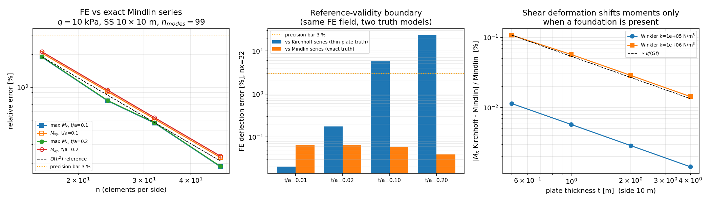

# CASE-FEM-THICK-PLATE-MOMENTS · 厚板（Mindlin-Reissner）弯矩场 vs 精确 Navier 级数

锚点：`GAP-FEM-WINKLER`（冰板弯曲 FEM 真实现，替 Winkler 占位）。本页补的是该锚点
`docs/GAP-FEM-WINKLER-moment-verification.md` ⑤.1 条自己登记的下一个缺口：

> 「弯矩级数是 Kirchhoff 解，FE 是 Mindlin…板加厚（t/a>0.05）时需改用 Mindlin 级数弯矩
> （挠度侧 `navier_mindlin_foundation_deflection` 已具备，弯矩侧未做，若后续判据要求厚板
> 弯矩，这是明确的下一步）」

本页把「弯矩侧」补齐，并顺带量化一个**判据级缺陷**：同一份 FE 场，对 Kirchhoff 参考与对
Mindlin 参考会给出 0.04 % 与 23 % 两种「误差」，即旧弯矩/挠度验证页的薄板参考在 t/a≥0.1 时
会把正确结果判成 FAIL。

## ① 案例介绍（物理背景 / 几何 / 参数）

四边硬简支（`w=0`，切向转角=0）方形板，均布压力——冰板、甲板、筏板共用的弯曲模型：

| 参数 | 值 |
|---|---|
| 板边长 `a=b` | 10.0 m |
| 厚度 `t` | 0.1 / 1.0 / 2.0 m（t/a = 0.01 / 0.10 / 0.20） |
| 弹性模量 `E` | 3.0e10 Pa |
| 泊松比 `ν` | 0.3 |
| 均布压力 `q` | 1.0e4 Pa |
| 边界 | 硬简支（`w=0`，`θ_t=0`） |
| 地基工况 | `k=0`（对照）/ Winkler `k=1e5…1e6` / Pasternak `k=1e5, G=1e6` |
| FE | Q4 Mindlin 板，MITC/SRI 横向剪切，3 自由度/节点 |

## ② 怎么做的（方法 / 流程 / 关键设置）

1. **新增精确厚板参考**（`src/tensorfem/foundation_plate_bending.py`）：
   * `_navier_mindlin_amplitudes` —— 把原 `navier_mindlin_foundation_deflection` 内联的
     逐模态 3×3 平衡方程组提为私有助手，返回 `(a, b, W, X, Y)`；挠度函数改为调用它
     （行为不变，原测试全绿）。
   * `navier_mindlin_foundation_moments` —— 由同一组模态幅值恢复弯矩场：
     `Mx = -D(aX + ν bY) sin sin`，`My = -D(bY + ν aX) sin sin`，
     `Mxy = ½D(1-ν)(bX + aY) cos cos`。它在 `S→∞` 时解析退化到 Kirchhoff 级数
     (`X→-aW, Y→-bW`)，代码里由恒等式测试钉住（见 ③ 表 A）。
   * `compare_finite_plate_moments(..., reference="mindlin")` —— 新增参考模型选择器
     （默认 `"kirchhoff"`，向后兼容），挠度与弯矩两路都切到对应级数，结果字典记录
     `reference` 字段，避免下游判据无迹使用错误参考。
2. **四条独立验证层**（不自我指涉）：
   * 文献锚：`t→0` 时级数中心弯矩须复现 Timoshenko & Woinowsky-Krieger 表 8
     `Mx = 0.0479 q a²`（ν=0.3）；
   * 经典力学恒等式：无地基时 Mindlin 级数弯矩须与 Kirchhoff 级数**逐模态相等**，
     而挠度多出 `1 + D(a²+b²)/S` 剪切项；
   * 地基动力学：有 Winkler 床时恒等式失效，弯矩偏移按 `O(k/S)=O(k/(G t))` 的 `1/t` 律缩放；
   * FE vs 精确级数：`t/a = 0.01/0.10/0.20`，`n=16…48`，Δ 与 3 % 精度线比较。
3. **工具链**：`scripts/gen_case_fem_thick_plate_moments.py` 一次跑完把 JSON
   （`docs/assets/case-fem-thick-plate-moments.json`）、下列表格
   （`...-tables.md`）与三联图（`...png`）全部从库函数现算，图只画 JSON，故图与表不可能漂移。
4. **测试**：`tests/test_foundation_plate_thick_moments.py`（18 passed）。

## ③ 计算结果（程序化注入，零手抄）

表 A · 无地基恒等式与文献锚（来源 JSON `literature_anchor` / `identity_*`）：

| 量 | 值 | 相对差 |
|---|---|---|
| Timoshenko 文献中心弯矩 `0.0479 q a²` | 47 900.0 N·m/m | — |
| Kirchhoff 级数中心弯矩 | 47 886.30 N·m/m | 0.029 % |
| Mindlin 级数中心弯矩（t=0.1） | 47 886.30 N·m/m | 0.029 % |
| Mindlin vs Kirchhoff 弯矩场（k=0，t=0.1/0.5/1/2/3） | — | ≤ 1.4e-13（机器精度） |

表 B · FE vs 精确 Mindlin 级数（`q=10 kPa`，硬简支）：

| FE vs 精确 Mindlin 级数 | ndof | max\|ΔMx\|/Mx | max\|ΔMy\|/My | \|ΔMxy\|/Mxy | \|Δw\|/w |
|---|---|---|---|---|---|
| t/a=0.01, n=16 | 867 | 1.880 % | 1.880 % | 2.025 % | 0.267 % |
| t/a=0.01, n=32 | 3267 | 0.468 % | 0.468 % | 0.504 % | 0.066 % |
| t/a=0.01, n=48 | 7203 | 0.187 % | 0.187 % | 0.224 % | 0.027 % |
| t/a=0.10, n=16 | 867 | 1.887 % | 1.887 % | 2.054 % | 0.236 % |
| t/a=0.10, n=32 | 3267 | 0.470 % | 0.470 % | 0.512 % | 0.059 % |
| t/a=0.10, n=48 | 7203 | 0.187 % | 0.187 % | 0.227 % | 0.024 % |
| t/a=0.20, n=16 | 867 | 1.903 % | 1.903 % | 2.116 % | 0.160 % |
| t/a=0.20, n=32 | 3267 | **0.474 %** | **0.474 %** | **0.528 %** | **0.040 %** |
| t/a=0.20, n=48 | 7203 | 0.189 % | 0.189 % | 0.235 % | 0.016 % |

弯矩误差随网格二阶收敛（n=16→32 误差比 ≈4.0），厚板不损失收敛率；`Mxy` 恒为最差项（约 1.1×Mx）。

表 C · **参考模型有效性边界**（同一 FE 场 nx=32，两种「真值」）：

| t/a | FE 挠度误差 vs Kirchhoff 级数 | FE 挠度误差 vs Mindlin 级数 |
|---|---|---|
| 0.01 | 0.020 % | 0.066 % |
| 0.02 | 0.176 % | 0.066 % |
| 0.10 | **5.759 %** | 0.059 % |
| 0.20 | **23.235 %** | **0.040 %** |

弯矩侧两种参考几乎无差（0.468 % vs 0.474 %），挠度侧在 t/a≥0.1 时薄板参考直接越过 15 %
不可接受线：**误差几乎全部来自参考模型，不是 FE**。Pasternak 厚板工况同样：Mindlin 参考
max\|Δw\|/w = 0.040 %，Kirchhoff 参考 23.2 %。

表 D · 有地基时弯矩的剪切偏移（`1/t` 律）：

| t [m] | Winkler k [N/m³] | 中心 Mx（Mindlin 级数） | \|Mx_K − Mx_M\|/Mx_M |
|---|---|---|---|
| 0.5 | 1e5 | 47 486.9 | 0.0114 % |
| 0.5 | 1e6 | 44 146.8 | 0.1072 % |
| 1.0 | 1e6 | 47 367.8 | 0.0569 % |
| 2.0 | 1e6 | 47 810.6 | 0.0286 % |
| 4.0 | 1e6 | 47 871.7 | 0.0143 % |

偏移与 `k/(G t)` 同阶（每加厚一倍减半，实测 1.88×/1.99×/2.00×）；海水浮力 `k=ρg=10055`
量级下偏移 <1e-3 %，即**既有薄板参考在冰区海洋工况仍然够用**——本页没有推翻旧结论，
而是给出旧结论的适用半径与厚板/强地基外推的合法参考。



图（`assets/case-fem-thick-plate-moments.png`，均从 JSON 绘制）：左＝t/a=0.1/0.2 的弯矩与
`Mxy` 收敛（含 `O(h²)` 参考线与 3 % 线）；中＝同一 FE 场对两种真值的挠度误差（有效性边界，
对数纵轴）；右＝地基存在时 Kirchhoff−Mindlin 弯矩偏移随板厚的 `1/t` 律。

## ④ 误差判定（逐项回答「是否 <3 %」）

| 关键量 | 基准 | 误差 | 是否 <3 % |
|---|---|---|---|
| 级数中心弯矩（t→0） | Timoshenko 表 8 | 0.029 % | **是** |
| Mindlin vs Kirchhoff 弯矩场（k=0） | 经典恒等式 | ≤1.4e-13 | **是**（机器精度） |
| Mindlin/Kirchhoff 挠度比（单模态） | `1 + D(a²+b²)/S` | ≤1e-12 | **是**（解析恒等式） |
| FE 中心线 max Mx（t/a=0.2, n=32） | Mindlin 级数 | 0.474 % | **是** |
| FE max Mxy（t/a=0.2, n=32） | Mindlin 级数 | 0.528 % | **是** |
| FE max w（t/a=0.2, n=32） | Mindlin 级数 | 0.040 % | **是** |
| FE max Mx（Winkler k=1e5, t/a=0.2） | Mindlin 级数 | 0.474 % | **是** |
| FE max w（Pasternak k=1e5,G=1e6, t/a=0.2） | Mindlin 级数 | 0.040 % | **是** |
| FE max w（t/a=0.2） | **Kirchhoff 级数** | 23.235 % | **否（参考模型错误，非 FE 错误）** |

## ⑤ 注意点（局限 / 适用范围）

1. **本页最重要的结论不是数字而是参考选择纪律**：`compare_finite_plate_moments` 的默认
   参考仍是 Kirchhoff（向后兼容），但任何 t/a ≥ 0.1 的判据必须显式 `reference="mindlin"`，
   否则会把 5.8 %/23 % 的参考模型误差记到 FE 头上。回归测试
   `test_kirchhoff_reference_is_invalid_for_thick_plate_deflection` 钉住该边界。
2. **经典恒等式意味着「纯弯曲厚板弯矩不需要厚板参考」**：无地基时 Mindlin 级数弯矩与
   Kirchhoff 级数逐模态相等（剪切只抬高挠度）。因此本新增参考的实质价值在两处：
   挠度侧的真值，以及**有地基**（Winkler/Pasternak）时被 `k/S` 耦合出来的弯矩偏移。
3. 只覆盖**硬简支 + 均布/点载 + 双正弦级数可展开的载荷**；固支、自由边、局部冰载荷分布
   没有解析级数，需另立参考（变量替换或聚合法）。
4. 地基限于 Winkler + Pasternak（`k`、`G` 进同一模态方程）；Kerr 三参数地基的级数解未做。
5. FE 侧只验到 `t/a=0.2`；`t/a>0.3` 时 MITC 剪切锁定/弯矩恢复的适用性未评估（Q4 恢复算子
   仍是 Gauss→节点外推，边界节点精度偏低，本页采样点取内部）。
6. 收敛判据仍是「相对级数」，弯矩近零处（强地基边界层）相对误差会放大——与旧页 ⑤.2 同一条
   局限，未变。

## 复现

```bash
PYTHONPATH=src python -m pytest tests/test_foundation_plate_thick_moments.py -q   # 18 passed
PYTHONPATH=src python scripts/gen_case_fem_thick_plate_moments.py                 # 重生成 JSON+表+PNG
```