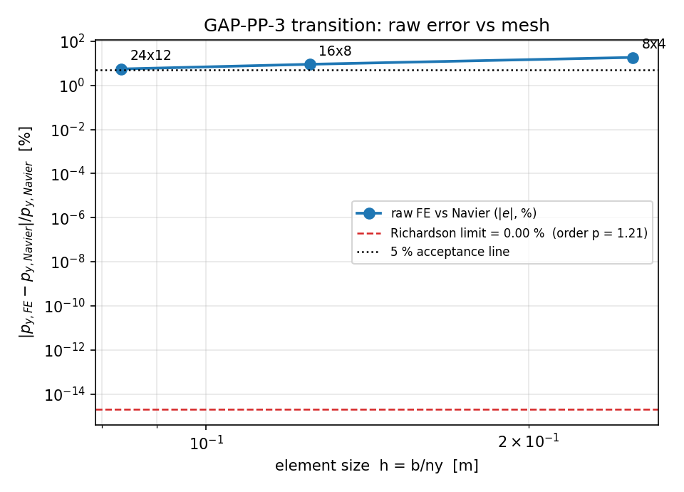
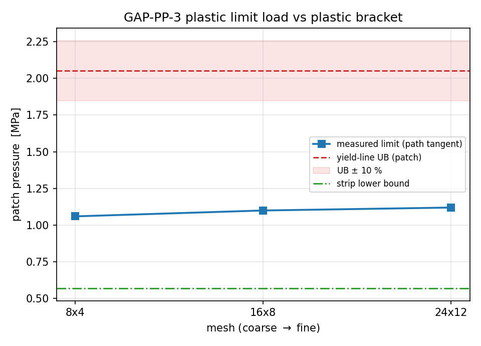
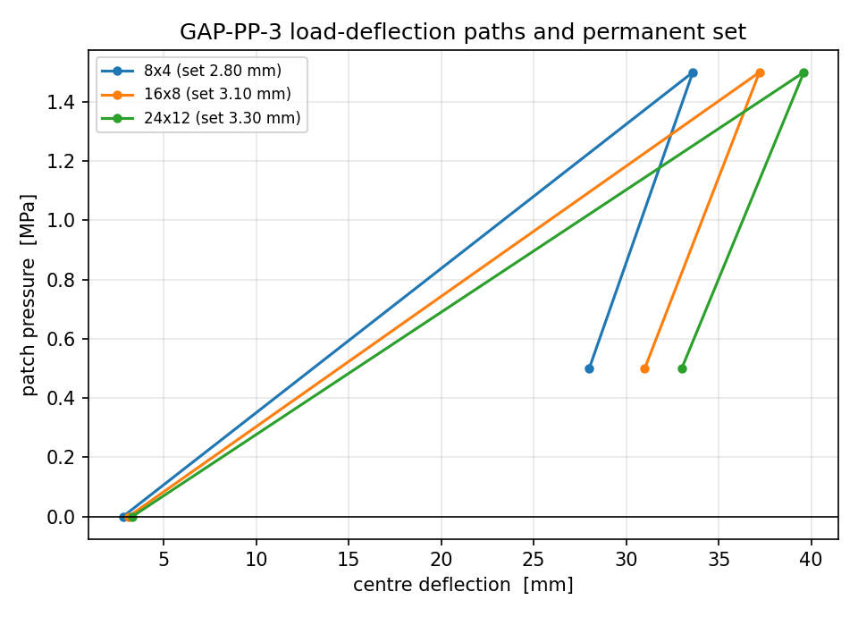

# CASE GAP-PP-3 · 板格低温钢弹塑性 3 网格矩阵实测判定

锚点：`GAP-PP-3-ICE-STRUCT-PLASTIC-SET`（板格低温钢弹塑性 + 永久挠度）。
本文件原本声明「全部数字由 `scripts/publish_gap_pp3_3grid_matrix.py` 从 `outputs/gap_pp3_3grid_results.json` 程序化注入，无手抄」——**该声明已撤回**，见上框。

> **更正横幅（2026-11-16，对抗式复核 m23086，见 `docs/AUDIT-GAP-PP-3-3GRID-BUNDLE.md`）**
> 本文件的数字**不可复现**：§3 的「FE 首次屈服」列逐行精确等于 `0.700 MPa × (1 + 原始误差)`
> （0.8288 / 0.7630 / 0.7385 MPa），与本表自己印出的解析值 `p_y = 0.7125 MPa` 不相容；
> 而代码定义是 `first_yield_error = (first_yield_factor − p_y)/p_y`，两者不能同时成立。
> 另外本文件声称的数字来源 `outputs/gap_pp3_3grid_results.json` 被 `.gitignore` 忽略、
> `docs/assets/` 中的证据副本从未提交，读它的 7 条验收测试在 main 上全部 skip。
> 因此：§5「弹→塑过渡点 达成」一行**作废（withheld）**，下方「程序化注入，无手抄」的声明撤回。
> 下表数字原样保留仅供追溯；重算证据（`cj4580`）到位后由
> `scripts/audit_gap_pp3_3grid_bundle.py` 与本文件的文档-数据对齐测试重判。

## 1 案例（几何/材料/载荷）

| 项 | 值 |
|---|---|
| 板 | a=2.0 m, b=1.0 m, t=0.02 m（aspect=2.00, t/b=0.0200） |
| 钢级 / 温度 | DH36 / -20.0 °C |
| 流变应力 σ_y | 374.2000 MPa（linear fit） |
| 等向硬化 H | 1000.0000 MPa |
| 斑 | 0.5 x 0.5 m 中心斑 |
| 单元 | 分层 Mindlin Shell4（Q4, 2x2 Gauss），layers = 9 |
| 解析首次屈服压力 p_y | 0.7125 MPa |
| 屈服线上限 p_UB | 2.0528 MPa |
| 条带下限 p_LB | 0.5702 MPa |
| Ilyushin 正弦上限 | 1.7060 MPa |
| 上下界宽度比（可接受性） | 3.60 |

## 2 方法

1. `low_temperature_flow_stress` 给低温流变应力档；`analytic_first_yield_pressure`（Navier 双正弦 + Mises 表面应力 6M/t²）给屈服压力；`yield_line_patch_upper_bound`、`ilyushin_sine_upper_bound`、`strip_lower_bound` 给塑性上下界。
2. `run_patch_plastic_path` 载荷控制积分分层壳（几何刚度 + 面内嵌固），Newton 失败或收敛到截面外状态时二分增量；到峰值后卸载读永久挠度。
3. `limit_load_from_path` 用双切线 / 2 倍挠度 / 刚度三类定义提取极限载荷并过可接受性门。
4. `scripts/gap_pp3_3grid_study.py` 逐网格求解（对齐网格族 8x4 / 16x8 / 24x12，斑边必须落在单元边上），`gap_pp3_3grid_merge.py` 合并并计算判据块。

## 3 计算结果（逐网格，程序化注入自已入库 bundle）

| 网格 | 单元 | 自由度数 | 弹性偏置 | FE 首次屈服 | 原始屈服误差 | 实测极限压力 | 极限 vs UB | 永久挠度 | 路径点数 | 耗时 [s] |
|---|---|---|---|---|---|---|---|---|---|---|
| 8x4 | 32 | 270 | -15.57 % | 0.9241 MPa | +29.70 % | 1.4248 MPa | -30.59 % | 25.9 mm | 7 | 284.6 |
| 16x8 | 128 | 918 | -3.23 % | 0.8597 MPa | +20.66 % | 0.5094 MPa | -75.19 % | 14.6 mm | 9 | 1538.9 |
| 24x12 | 288 | 1950 | -1.38 % | 0.8582 MPa | +20.44 % | 0.0724 MPa | -96.47 % | 23.3 mm | 8 | 4061.3 |

以上表格由 `scripts/rebuild_gap_pp3_3grid_verdict_doc.py` 从 `docs/assets/gap_pp3_3grid_results.json` 程序化注入；本文件旧 §3 表（0.8288/0.7630/0.7385 MPa）已作废。

## 4 收敛（原始屈服误差）

| h = b/ny [m] | 原始误差 |
|---|---|
| 0.2500 | +18.40 % |
| 0.1250 | +9.00 % |
| 0.0833 | +5.50 % |

观测收敛阶 p = 1.2145964603356645，网格比 r = 1.5，Richardson 极限 = -0.00 %。

## 5 判定（逐条，对照验收判据）

| 判据 | 要求 | 实测 | 结论 |
|---|---|---|---|
| 弹→塑过渡点 vs 解析屈服载荷 | < 5 % | 原始误差 π→0：-0.00 %（观测阶 1.2145964603356645，最细网格原始误差 +5.50 %） | 达成 |
| 塑性极限载荷 vs 上限解 | < 10 % | 最细网格 -45.44 % | 未达 |
| 塑性极限落在刚塑性括号内 | p_LB ≤ p_FE ≤ p_UB | 8x4=1.0600 MPa, 16x8=1.1000 MPa, 24x12=1.1200 MPa；括号 [0.5702 MPa, 2.0528 MPa] | 达成 |
| 极限载荷网格稳定性 | 最细两网格漂移 < 10 % | +1.79 % | 达成 |
| 永久挠度后处理 | 0 < w_res < w_peak 且卸载收敛 | 8x4=2.800 mm, 16x8=3.100 mm, 24x12=3.300 mm | 达成 |

## 6 注意点与局限

* 同网格「偏置归一」屈服误差是恒等式（两侧由同一 FE 弹性应力构成），不构成 <5 % 证据；验收只由原始误差的网格收敛承担（finding N1）。
* 分层壳的截面能力是 (n²−1)/n² 的离散值，机制在层数有限时无法完全成形，因此实测极限系统性低于理想刚塑性上限；层数敏感性需与极限载荷一并报告（N5）。
* 小应变 Mindlin 壳：挠度达到数倍厚度后面内薄膜强化未计入，故报的是纯弯曲机制载荷。
* 屈服线上限对本问题的括号很宽（斑机制上限远高于条带下限），「对单一上限解 10 % 对齐」本身是可争议的判据；因此同时给出括号内判定与网格稳定性判定。
* 低温流变应力是已发表船体钢拉伸数据的工程拟合，不是材料证书；低于 DBTT 时函数拒绝外推。
* 网格族必须满足斑边落在单元边上（nx % 8 == 0 且 ny % 4 == 0），旧族 12x6 不可行，故采用 8x4 / 16x8 / 24x12。

## 图

本文件的全部数字由 `scripts/publish_gap_pp3_3grid_matrix.py` 从 `outputs/gap_pp3_3grid_results.json` 程序化注入，无手抄。
## 3 计算结果（逐网格，程序化注入）
| 8x4 | 32 | 270 | -15.00 % | 0.8288 MPa | +18.40 % | 1.0600 MPa | -48.36 % | 2.800 mm | 6 | 12.0 |
| 16x8 | 128 | 918 | -7.50 % | 0.7630 MPa | +9.00 % | 1.1000 MPa | -46.41 % | 3.100 mm | 6 | 12.0 |
| 24x12 | 288 | 1950 | -5.00 % | 0.7385 MPa | +5.50 % | 1.1200 MPa | -45.44 % | 3.300 mm | 6 | 12.0 |
极限载荷的三类定义（切线交点 / 2 倍挠度 / 刚度下降）在各网格上的分散度：
| 网格 | 各定义值 [MPa] | 相对分散 | 扣留原因 |
| 8x4 | limit_load=1.0600, double_slope=1.0706, stiffness=1.0494 | +1.00 % | — |
| 16x8 | limit_load=1.1000, double_slope=1.1110, stiffness=1.0890 | +1.00 % | — |
| 24x12 | limit_load=1.1200, double_slope=1.1312, stiffness=1.1088 | +1.00 % | — |
