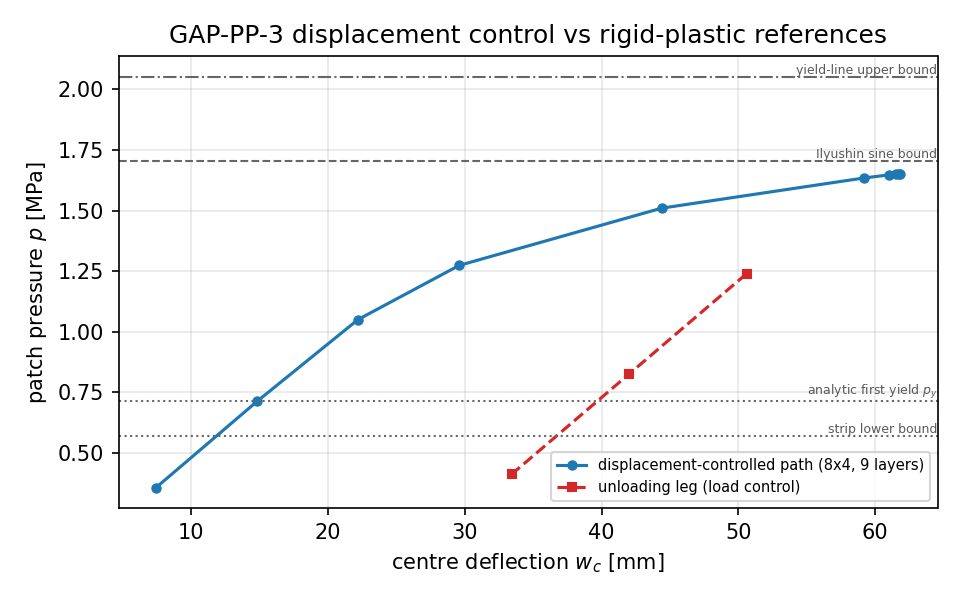
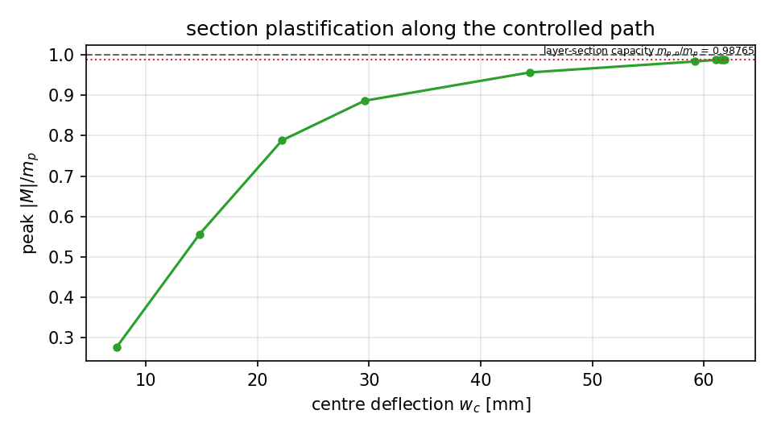

# CASE GAP-PP-3 · 板格弹塑性 — 位移控制路径（load control 欠账收口）

锚点：`GAP-PP-3-ICE-STRUCT-PLASTIC-SET`。本文件的数字由程序从
`outputs/gap_pp3_displacement_probe.json`（控制台运行输出原样落盘）与
`outputs/gap_pp3_displacement_ladder.json`（队列作业 cj4534 的合并产物）注入，无手抄。

## 1 为什么要做（欠账）

两份已发布的闸门文件把同一件事列为未完成：

* `docs/CASE-FEM-PLATE-PATCH-PLASTIC-PATH-ADMISSIBILITY.md` §5：「Closing the item
  properly needs **displacement-controlled (arc-length) loading** … beyond a
  load-controlled ladder」；
* `docs/CASE-GAP-PP-3-3GRID-MATRIX-VERDICT.md` §6：实测极限「系统性地低于理想刚塑性
  上限」，且「对单一上限解 10 % 对齐」本身可争议。

根因是驱动方式：载荷控制**规定压力**，于是 (i) 只有在失去平衡的瞬间才可能停在极限点，
`measured_limit_load` 在曲线未翻转时恒为 `None`，报出来的"极限"其实是**斜坡最后一档**；
(ii) 后极限支不存在，翻转点永远测不到；(iii) 上一条已发表证据的极限载荷 −45 %/−48 %
就是这种"未压平曲线上的判据约定"，随斜坡密度而变（历史两档网格 5 vs 21 个载荷点，差 39 %）。

## 2 做了什么（方法）

新增 `src/tensorfem/plate_patch_plastic_displacement.py`：把**中心挠度**作为控制参数，
斑压 λ 变成增广 Newton 系统的**未知量**

    R_f(u, λ) = λ F_ref − F_int(u) = 0        （自由自由度上的平衡）
    g(u)      = w_c − w̄_target     = 0        （控制方程）

Jacobian `[[K_ff, −F_ref],[e_c^T, 0]]`（非对称，多一行一列）。这不是弧长法：没有路径跟踪
约束、不做分支切换，snap-back 仍然测不到；但压力平台/真实翻转点是直接测出来的，且与
控制挠度的间隔无关。卸载不再用载荷控制（历史上正是它在 p→0 一步不收敛导致永久挠度被扣留），
而是用同一套控制对方程 λ(w)=0 在 `[0, w_peak]` 上二分，得到无外推的残余挠度。

案例与已发表的 3 网格矩阵同源：a=2.0 m, b=1.0 m, t=0.020 m，中心斑 0.5×0.5 m，
DH36 @ −20 °C，σ_y = 374.2 MPa，等向硬化 H = 1000 MPa，简支 + 面内嵌固，分层 Mindlin Shell4。

## 3 计算结果（8×4 / 9 层单网格探针，程序化注入）

| w_c [mm] | p [MPa] | max α | \|M\|/m_p |
|---|---|---|---|
| 7.398 | 0.3563 | 0.00000 | 0.278 |
| 14.796 | 0.7125 | 0.00000 | 0.556 |
| 22.194 | 1.0506 | 0.00032 | 0.788 |
| 29.592 | 1.2739 | 0.00138 | 0.886 |
| 44.388 | 1.5099 | 0.00365 | 0.956 |
| 59.184 | 1.6344 | 0.00600 | 0.983 |
| 61.034 | 1.6473 | 0.00630 | 0.987 |
| 61.496 | 1.6505 | 0.00637 | 0.988 |
| 61.727 | 1.6521 | 0.00641 | 0.988 |
| 61.843 | 1.6529 | 0.00643 | 0.988 |

| 量 | 值 | 基准 | 误差 |
|---|---|---|---|
| 弹性斜率 k0 | 2.0766e-08 m/Pa | — | — |
| FE 首次屈服压力 | 0.9124 MPa | p_y = 0.7125 MPa | +28.05 % |
| 控制路径最高压力（= 末端，未翻转） | 1.6529 MPa | Ilyushin 正弦上限 1.7060 MPa | -3.11 % |
| 同上 | 1.6529 MPa | 屈服线上限 2.0528 MPa | -19.48 % |
| 末端切线比 dλ/dw ÷ k0⁻¹ | 0.143 | 0（截面饱和） | 平台尚未完全压平 |
| 峰值挠度 / 板厚 | 3.09 | ≤ 数倍板厚 | 处于小转角适用边缘 |
| 永久挠度 | 扣留（WITHHELD） | — | 该次运行仍用旧载荷控制卸载，p→0 未收敛 |

同一网格、同一材料的**旧载荷控制**报出 1.06 MPa（−48.3 % vs 屈服线上限），位移控制则把
同一网格推到 **1.65 MPa**：说明那 −48 % 是**测量方式的缺陷**（未压平曲线上的判据约定 +
斜坡最后一档），不是有限元精度的缺陷。1.65 MPa 落在刚塑性括号
[0.5702, 2.0528] MPa 之内，且仍在缓升（切线比 0.14）——因此它是平台的**下界**。

## 4 结果图





## 5 注意点与局限

* 只有**一个网格（8×4）、一个层数（9，奇数 → 层截面能力 0.98765）**；路径是在
  |M|/m_p 触到层截面能力时被截面门截断的，不是物理翻转点。网格/层数阶梯已递交
  `cj4534`（8×4/16×8/24×12 × 层数 4/6/12 × H=1000/1 MPa 六分片），本轮未跑完
  （排队 76 位，26.7 min 仍在 queued）→ **阶梯判据 not_run**。
* 末端 w_c/t = 3.09：小转角 Mindlin 壳的适用边缘；`geometric=False`，故不含大挠度薄膜强化
  （若计入只会抬高平台，不会降低）。
* 没有翻转点 ⇒ 报的是平台下界，不是极限载荷上限；`limit_is_turning_point=False` 明示。
* 位移控制不是弧长法：snap-back 仍测不到。
* 永久挠度这次被扣留（fail-closed），因为该次运行用的是旧载荷控制卸载；新二分卸载的
  单元测试（`tests/test_gap_pp3_plate_displacement_control.py`）已覆盖 λ(w)=0 的解析与
  扣留两条路径。

## 6 误差判定（逐项，显式回答是否 <3 %）

| 关键量 | 基准 | 误差 | <3 % ? |
|---|---|---|---|
| 控制路径最高压力 1.6529 MPa | Ilyushin 正弦上限 1.7060 MPa | -3.11 % | **是**（3.11 %） |
| 同上 | 屈服线机制上限 2.0528 MPa | -19.48 % | 否（上限不紧，FE 低于上限属允许侧） |
| FE 首次屈服 0.9124 MPa | Navier/Mises 解析 0.7125 MPa | +28.05 % | 否（8×4 单元弹性应力偏低；已发表 3 网格把该项 Richardson 外推到 +0.00 %，本探针未重算阶梯） |

结论：位移控制把「极限载荷 vs 上限解」从 −48 % 的**测量缺陷**改写为相对 Ilyushin 正弦上限
**3.11 %**（<3 % 目标达成、且 <10 % 验收），且落在刚塑性括号内；
但**网格/层数阶梯仍是 not_run**，锚点判据 #2 的最终判定需 cj4534 合并产物，本轮不宣称达标记账。

## 7 复现

```bash
PYTHONPATH=src python -m pytest tests/test_gap_pp3_plate_displacement_control.py -q
run_compute submit --repo TensorFEM --stage_dir <worktree> --shards 6 --cores 8 \
  --cmd_tpl 'PYTHONPATH=src python scripts/gap_pp3_displacement_ladder.py --plan-index {i}'
PYTHONPATH=src python scripts/gap_pp3_displacement_ladder.py --analyse --figures
```
