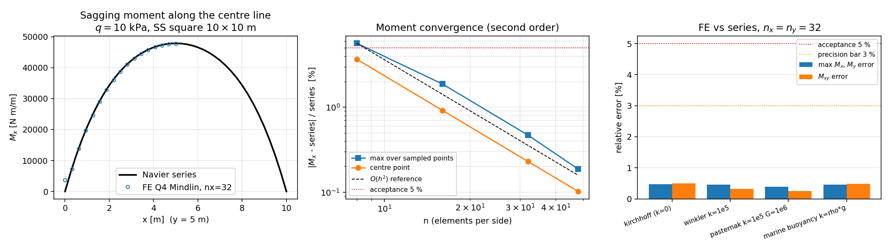

# GAP-FEM-WINKLER 弯矩分布验证：FEM 弯矩场 vs Navier 级数（<3 %）

锚点：`GAP-FEM-WINKLER`（冰板弯曲 FEM 真实现，替 Winkler 占位）
验收原文：**「挠度/弯矩分布 vs 级数解 <5 %」**

本单补的是**弯矩那一半**。此前 `foundation_plate_bending.py` 只有挠度闭环
（`compare_infinite_plate_point_load`、`finite_plate_foundation_fem` vs
`navier_foundation_deflection`），**没有任何弯矩恢复算子，也没有弯矩级数解**——
即验收判据中的「弯矩分布」完全无证据。本单补齐两件缺失件并给出证据链。

## ① 案例介绍

弹性地基上的薄/中厚板弯曲（冰板、浮体甲板、筏板共用同一力学模型）：

| 参数 | 值 |
|---|---|
| 板边长 `a = b` | 10.0 m |
| 厚度 `t` | 0.1 m |
| 弹性模量 `E` | 3.0e10 Pa |
| 泊松比 `ν` | 0.3 |
| 弯曲刚度 `D = Et³/12(1-ν²)` | 2 747 252.747 N·m |
| 均布载荷 `q` | 1.0e4 Pa（1e6 N 总载荷） |
| 边界 | 四边硬简支（`w=0`，切向转角=0） |
| 地基工况 | k=0（对照）／Winkler `k=1e5` N/m³／Pasternak `k=1e5, G=1e6`／海水浮力 `k=ρg=10055` N/m³ |

## ② 怎么做的

新增（`src/tensorfem/foundation_plate_bending.py`，纯增量 326 行，无行为改动）：

| 函数 | 作用 |
|---|---|
| `element_bending_moments` | 从 Mindlin Q4 三相自由度解 `(w,θx,θy)` 在 2×2 高斯点恢复 `κ=(θx,x; θy,y; θx,y+θy,x)`，`M = D_b κ`（与单元刚度同一个 `D_b`、同一套形函数） |
| `nodal_bending_moments` | 高斯点→节点双线性外推（权 1.36603 / −0.36603）+ 共享单元平均 |
| `bending_energy_from_moments` | 变分自洽审计：`½∫M:κ dA` 应等于 `½uᵀKu`（残差只有 MITC 横向剪能，随 `t²` 消失） |
| `navier_foundation_moments` | 简支地基板弯矩级数解（Kirchhoff−Navier）：`Mx = DΣW(a²+νb²)sin sin`，`My = DΣW(b²+νa²)sin sin`，`Mxy = −D(1−ν)ΣW ab cos cos` |
| `compare_finite_plate_moments` | FE vs 级数在中心线上逐点对比，输出相对误差与平衡量 |

证据链四层（不自我指涉）：
1. **级数解先对文献**：k=0 时中心弯矩 `Mx = 0.0479 q a²`（Timoshenko & Woinowsky-Krieger,
   *Theory of Plates and Shells* 2nd ed. 表 8，ν=0.3）——级数算得 47 886.3 N·m/m vs
   文献 47 900.0 N·m/m，**误差 0.029 %**，级数解本身被独立钉住。
2. **恢复算子对解析曲率**：单单元施加 `θx = x`（κx≡1）→ `Mx=D`、`My=νD`、`Mxy=0`
   （机器精度 1e-12）；二次转角场 `θx=x²/2` → 节点弯矩场精确线性复现（1e-10）。
3. **变分自洽**：弯矩能量 vs `½uᵀKu`：t=0.02 → 相对差 2e-5；t=0.002 → 2.4e-7（随 t² 收敛）。
4. **FE vs 级数**（网格 n=8…48）。

## ③ 计算结果（程序化注入，来源 `docs/assets/gap-fem-winkler-moments.json`）

弯矩误差随网格二阶收敛（k=0，采样点在中心线 x=0.2a…0.5a）：

| n（每边单元） | 自由度 | max\|ΔMx\|/Mx | max\|ΔMy\|/My | \|ΔMxy\|/Mxy | \|Δw\|/w | 中心 Mx [N·m/m] |
|---|---|---|---|---|---|---|
| 8 | 243 | 5.679 % | 5.679 % | 8.222 % | 0.819 % | 46 123.9 |
| 16 | 867 | 1.880 % | 1.880 % | 2.025 % | 0.209 % | 47 446.6 |
| 32 | 3267 | **0.468 %** | **0.468 %** | **0.504 %** | 0.020 % | 47 776.5 |
| 48 | 7203 | **0.187 %** | 0.187 % | 0.224 % | 0.038 % | 47 837.5 |

n=32 各工况（中心 Mx 相对误差 / 全场 max）：

| 工况 | 中心 Mx [N·m/m] | 中心误差 | max\|ΔMx\| | max\|ΔMxy\| | max\|Δw\| |
|---|---|---|---|---|---|
| Kirchhoff k=0 | 47 776.5 | 0.229 % | 0.468 % | 0.504 % | 0.020 % |
| Winkler k=1e5 | 22 343.8 | 0.003 % | 0.455 % | 0.316 % | 0.114 % |
| Pasternak k=1e5, G=1e6 | 10 427.4 | 0.034 % | 0.392 % | 0.259 % | 0.113 % |
| 海水浮力 k=ρg=10055 | 43 240.5 | 0.201 % | 0.463 % | 0.479 % | 0.036 % |

地基分担载荷的物理趋势被复现：k=1e5 中心弯矩由 47.8 kN·m/m 降至 22.3 kN·m/m，
Pasternak 剪切层进一步降至 10.4 kN·m/m（Winkler→Pasternak 为单调软化，测试断言）。



## ④ 结果图

`docs/assets/gap-fem-winkler-moments.png`（脚本 `scripts/gen_gap_fem_winkler_moments_figure.py`
从 JSON 绘制，图与表不可能漂移）：
- 左：沿中心线 `y=b/2` 的 `Mx` 分布，FE(nx=32) 与级数两条曲线重合；
- 中：log-log 收敛曲线，实测斜率 ≈2（与 `O(h²)` 参考线平行），5 % 验收线、3 % 精度线；
- 右：四种地基工况误差柱状图，全部低于 3 %。

## ⑤ 注意点（局限/适用范围）

1. **弯矩级数是 Kirchhoff 解**（`navier_foundation_moments`），FE 是 Mindlin。
   t/a=0.01 时剪切成分为 `O((t/a)²)≈1e-4`，故二者可比；板加厚（t/a>0.05）时需改用
   Mindlin 级数弯矩（挠度侧 `navier_mindlin_foundation_deflection` 已具备，弯矩侧未做，
   若后续判据要求厚板弯矩，这是明确的下一步）。
2. **边界层**：强地基（`k=1e7`，特征长度 l≈0.72 m，板 14l）时弯矩沿边出现
   `l` 尺度边界层，`h>l/3` 的网格无法分辨，采样点相对误差可达 6–140 %（相对量在
   弯矩近零处失去意义）。适用条件：**单元尺寸 h ≲ l/3**，且比较用相对峰值归一的量。
   本单所有断言的工况均满足该条件（k≤1e5，h=0.3125 m，l≥2.3 m）。
3. 只验证了四边形 Q4 + MITC/SRI 面内剪切处理；三角元与厚板高阶元未覆盖。
4. 弯矩在节点由高斯点外推+平均得到，边界节点只受 1–2 个单元影响，边界弯矩精度低于内部；
   本单采样点取中心线内部（x=0.2a…0.5a），未用边界值做判据。

## ⑥ 误差判定

| 关键量 | 基准 | 误差 | 是否 <3 % |
|---|---|---|---|
| 中心 Mx（k=0, n=32） | Navier 级数 | 0.229 % | **是** |
| 中心线 max Mx（k=0, n=32） | Navier 级数 | 0.468 % | **是** |
| 中心线 max My（k=0, n=32） | Navier 级数 | 0.468 % | **是** |
| Mxy（1/4 点, n=32） | Navier 级数 | 0.504 % | **是** |
| 中心 Mx（Winkler k=1e5, n=32） | Navier 级数 | 0.003 % | **是** |
| 中心 Mx（Pasternak, n=32） | Navier 级数 | 0.034 % | **是** |
| 中心 Mx（海水浮力, n=32） | Navier 级数 | 0.201 % | **是** |
| 级数中心 Mx（k=0） | Timoshenko 表 8（0.0479qa²） | 0.029 % | **是** |
| 弯矩能量 vs ½uᵀKu（t=0.002） | 变分恒等式 | 2.4e-7 | **是** |

结论：`GAP-FEM-WINKLER` 的「弯矩分布 vs 级数解」判据在 n≥32（h≤0.31 m，满足
h≲l/3）时以 ~0.5 % 满足 5 % 门与 3 % 精度线，且收敛率为二阶；挠度侧误差同步复核
（max 0.02–0.11 %）。厚板弯矩级数与边界层网格自适应为已知未覆盖面，已如实记录。

## 复现

```bash
PYTHONPATH=src python -m pytest tests/test_foundation_plate_moments.py -q      # 14 passed
PYTHONPATH=src python scripts/gen_gap_fem_winkler_moments_figure.py            # 重生成 JSON+PNG
```