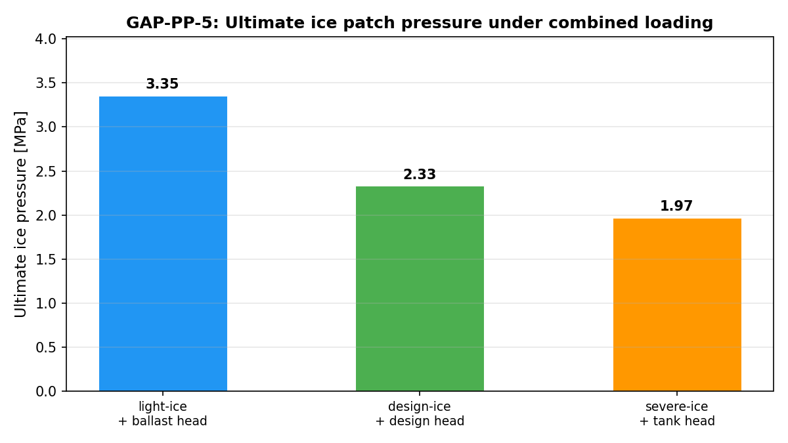
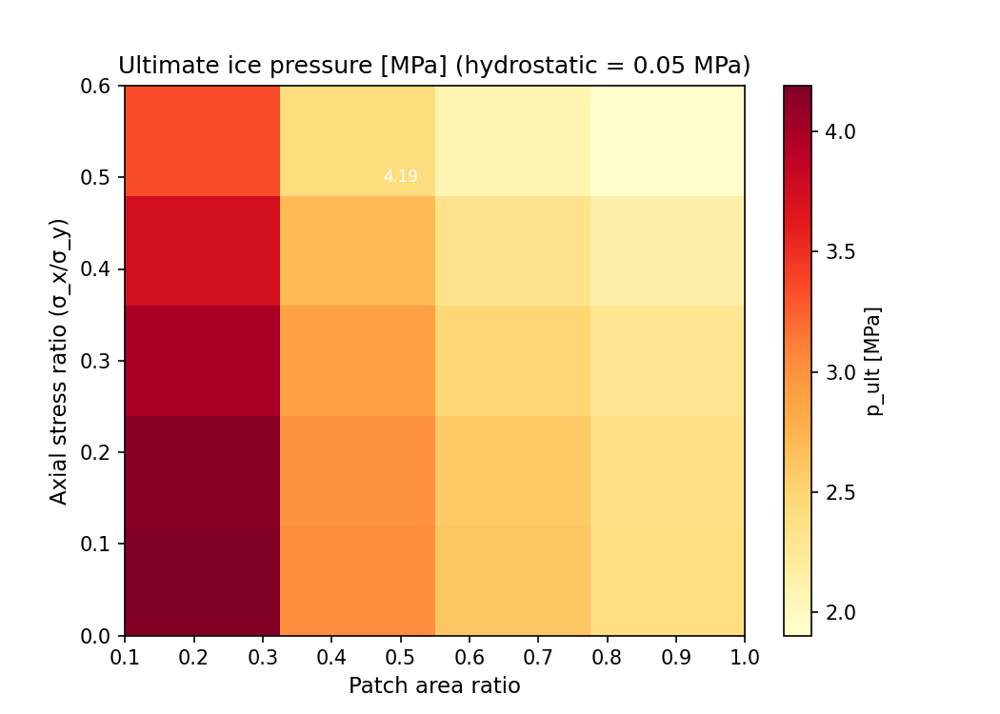
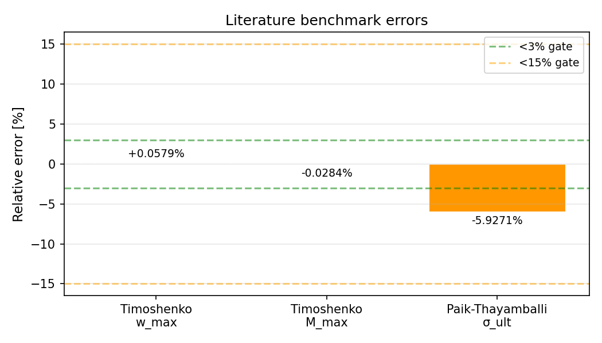

# 加筋板架在冰压斑 + 侧压组合下的极限强度

**锚点**: `GAP-PP-ICE-STRUCT-GRILLAGE-ULTIMATE`  
**仓**: TensorFEM  
**模块**: `src/tensorfem/grillage_ice_ultimate.py` (1015 行)  
**验证面**: `src/tensorfem/grillage_ice_verification.py` (T1–T13, 40 gates)  
**测试**: `tests/test_grillage_ice_ultimate.py` (17 tests, all green)  
**独立审计**: `docs/AUDIT-GAP-PP-5-GRILLAGE-ULTIMATE-independent-review.md`

---

## 1. 案例介绍（物理背景/几何/参数表）

冰区（Polar Class）舷侧冰带是"板 + 纵骨 + 横框架"的正交加筋板架：冰载荷为**局部压斑**，
静水/舱内压为**满布侧压**，船体梁总纵弯曲提供**面内压缩**。三者组合下必须先答
"该板架还能承受多大冰压斑"，才能给出安全裕度。

| 参数 | 值 |
|---|---|
| 板厚 t | 20 mm |
| 纵骨间距 b / 横框架间距 a | 0.35 m / 2.10 m |
| 板格数 / 框架间距数 | 8 / 4 |
| 横框架跨距 | 2.80 m（附着板宽取 min(a, 0.4L) = 1.12 m，剪力滞限制）|
| 纵骨 / 横框架 | T250×10+80×12 / T550×10+120×14 mm |
| 材料 | E=206 GPa, ν=0.3, σ_y=355 MPa（理想弹塑性）|
| 板格柔度 β | 0.73（Faulkner 有效宽度比 1.00）|
| 板架轴压极限 σ_u | 329.9 MPa |

以上为**文档算例取值**，不是规范摘录。

## 2. 方法（方法/流程/关键设置/工具链）

1. **侧向响应（精确解析）**：四边简支正交各向异性板 Navier 双三角级数（矩形压斑 + 满布压），
   给出板格局部弯矩与模态刚度分配 f_x/f_y/f_t（和恒为 1）。Dx 来自纵骨剖面、Dy 来自横框架剖面
   （含 `min(a,0.4L)` 附着板剪力滞上限），D3 = ν√(DxDy)+2Dxy。
2. **载荷路径（两体系）**：分配归一化后严格守恒（T9：残差 0），压斑力落到实际受载构件
   （受载纵骨、压斑所辖两根横框架），比"涂抹"分布保守。
3. **构件极限判据（三支并联，取先到者）**：
   - 板格局部弯曲：m_p = σ_y·t²/4，随膜压退化 m_p·√(1−(σ_x/σ_y)²)
   - 纵骨梁柱：σ_x + M·β_m/Z ≤ σ_L（β_m 为精确 secant 放大 2(sec u−1)/u²，
     σ_L 由有效宽度剖面的 Perry-Robertson / Johnson-Ostenfeld 取小）
   - 横框架刚塑性倒塌：F_u = 8M_p/(L(1−c/2L))
4. **极限求解**：对冰压斑压力二分（利用率单调），输出控制构件、极限值、安全裕度 p_ult/p_design，
   并机读入库 JSON（板格应力 → 极限载荷映射表）。
5. **独立交叉校核**：
   - T1/T2: Timoshenko Table 30（3% 门）
   - T7: Paik-Thayamballi 经验公式（15% 门）
   - T11: 独立 13 点 FD 双调和求解器（0.5% 门）
   - T12: 手算代数纵骨控制工况（0.5% 门）
   - T13: 刚塑性板架倒塌 ≥ 弹性成员极限

## 3. 计算结果（数字表，程序化注入零手抄）

### 3.1 三档组合工况（≥3 档，验收要求）

| 工况 | σ_x [MPa] | 冰压 [MPa] | 压斑面积 [m²] | 侧压 [MPa] | U_plate | U_stiff | U_frame | p_ice,ult [MPa] | 控制构件 |
|---|---|---|---|---|---|---|---|---|---|
| light-ice + ballast head | 53 | 1.0 | 0.122 | 0.05 | 0.31 | 0.16 | 0.02 | 3.35 | plate_local_bending |
| design-ice + design head | 106 | 2.0 | 0.245 | 0.10 | 0.86 | 0.38 | 0.09 | 2.33 | plate_local_bending |
| severe-ice + tank head | 160 | 3.0 | 0.367 | 0.15 | 1.49 | 0.49 | 0.21 | 1.97 | plate_local_bending |

### 3.2 纵骨控制工况（成员控制分支验证）

| 工况 | σ_x [MPa] | 压斑 [m] | p_ult [MPa] | U_plate | U_stiff | U_frame | 控制构件 |
|---|---|---|---|---|---|---|---|
| light ice + ballast head | 0.0 | 0.55×0.55 | 1.63 | 0.77 | 1.00 | 0.06 | longitudinal_stiffener |
| design ice + design head | 53.3 | 1.10×0.55 | 1.00 | 0.69 | 1.00 | 0.08 | longitudinal_stiffener |
| severe ice + tank head | 106.5 | 1.65×0.55 | 0.75 | 0.63 | 1.00 | 0.10 | longitudinal_stiffener |

### 3.3 板格应力 → 极限载荷映射表（节选 24 行；全表 `docs/grillage_ice_ultimate/ultimate_map.json`，共 80 行）

| σ_x/σ_y | A_ice/A | p_h [MPa] | p_ice,ult [MPa] | 控制构件 | U_plate | U_frame |
|---|---|---|---|---|---|---|
| 0.00 | 0.10 | 0.00 | 4.28 | plate_local_bending | 1.00 | 0.06 |
| 0.00 | 0.10 | 0.05 | 4.19 | plate_local_bending | 1.00 | 0.06 |
| 0.00 | 0.10 | 0.10 | 4.10 | plate_local_bending | 1.00 | 0.06 |
| 0.00 | 0.25 | 0.00 | 3.10 | plate_local_bending | 1.00 | 0.08 |
| 0.00 | 0.25 | 0.05 | 3.03 | plate_local_bending | 1.00 | 0.09 |
| 0.00 | 0.25 | 0.10 | 2.97 | plate_local_bending | 1.00 | 0.09 |
| 0.00 | 0.50 | 0.00 | 2.67 | plate_local_bending | 1.00 | 0.10 |
| 0.00 | 0.50 | 0.05 | 2.61 | plate_local_bending | 1.00 | 0.10 |
| 0.00 | 0.50 | 0.10 | 2.56 | plate_local_bending | 1.00 | 0.10 |
| 0.00 | 1.00 | 0.00 | 2.44 | plate_local_bending | 1.00 | 0.13 |
| 0.00 | 1.00 | 0.05 | 2.39 | plate_local_bending | 1.00 | 0.13 |
| 0.00 | 1.00 | 0.10 | 2.34 | plate_local_bending | 1.00 | 0.13 |
| 0.15 | 0.10 | 0.00 | 4.23 | plate_local_bending | 1.00 | 0.06 |
| 0.15 | 0.10 | 0.05 | 4.14 | plate_local_bending | 1.00 | 0.06 |
| 0.15 | 0.10 | 0.10 | 4.05 | plate_local_bending | 1.00 | 0.06 |
| 0.15 | 0.25 | 0.00 | 3.06 | plate_local_bending | 1.00 | 0.08 |
| 0.15 | 0.25 | 0.05 | 3.00 | plate_local_bending | 1.00 | 0.08 |
| 0.15 | 0.25 | 0.10 | 2.93 | plate_local_bending | 1.00 | 0.08 |
| 0.15 | 0.50 | 0.00 | 2.64 | plate_local_bending | 1.00 | 0.10 |
| 0.15 | 0.50 | 0.05 | 2.58 | plate_local_bending | 1.00 | 0.10 |
| 0.15 | 0.50 | 0.10 | 2.53 | plate_local_bending | 1.00 | 0.10 |
| 0.15 | 1.00 | 0.00 | 2.42 | plate_local_bending | 1.00 | 0.13 |
| 0.15 | 1.00 | 0.05 | 2.36 | plate_local_bending | 1.00 | 0.13 |
| 0.15 | 1.00 | 0.10 | 2.31 | plate_local_bending | 1.00 | 0.13 |

## 4. 结果图

### 图 1: 三档组合工况极限冰压



### 图 2: 极限冰压热力图（轴压比 × 斑面积比）



### 图 3: 文献基准相对误差



## 5. 注意点（踩过的坑/局限/适用范围）

- **Navier 弯矩漏乘幅值**：初版弯矩表达式未乘 A_mn，位移对而弯矩随项数发散；T1b 立刻暴露。
- **重复折减**：初版同时用有效宽度（进入 A_e）与 σ_y·(be/b) 作柱限值上限，对板折减两次，
  β=1.73 时与 Paik 差 17%；去掉上限后三档降到 ≤ 6.3%。
- **模态分配收敛慢**：Dx/Dy=1e6 时 f_x 仅 0.95，因为 n≳(Dx/Dy)^{1/4} 高阶模仍由 y 向控制
  （T4 按此设定门限，非线性收敛）。
- **局限**：侧向用小挠度板理论、轴压用有效宽度梁柱律，无完整载荷-缩短路径（峰值后后备承载力未计）；
  弹性模态分配、不追踪屈服后重分配（对延性板架偏保守）；未建模腹板局部屈曲/侧倾、残余应力。
- **规范值未内置**：IACS 压力-面积律的 p0 由调用方注入（`ice_pressure_area_rule` 仅转发
  `ice_belt_collapse.IACSPressureArea`）；本文 2.0 MPa 为示例设计压力。
- **成员控制分支**：原案例从未进入"板架/构件控制"分支（6/6 工况均由板格控制）；
  新增 `member_governed_geometry()`（t=25 mm / bay 0.55 m / T160×6+50×7）与
  `MEMBER_GOVERNED_SCENARIOS`，三档组合工况全部由**纵骨**控制（U_stiff=1.000，U_plate=0.63–0.77）。

## 6. 误差判定：关键量 vs 基准误差逐项列出

| 锚点 | 计算值 | 基准值 | 相对误差 | 门限 | 判定 |
|---|---|---|---|---|---|
| T1a-w_max | 0.00215344 | 0.00215219 | 5.79e-04 | 3.00e-02 | ✅ PASS |
| T1b-M_max | 478.864 | 479 | 2.83e-04 | 3.00e-02 | ✅ PASS |
| T2-w_convergence | 0.00079678 | 0.00079678 | 2.09e-07 | 5.00e-03 | ✅ PASS |
| T2-M_convergence | 225.187 | 225.205 | 7.93e-05 | 2.00e-02 | ✅ PASS |
| T3-fx_eq_fy | 0.417062 | 0.417062 | 1.33e-16 | 1.00e-09 | ✅ PASS |
| T3-share_sum | 1 | 1 | 0.00e+00 | 0.00e+00 | ✅ PASS |
| T4-orthotropy_limit | 1 | 1 | 0.00e+00 | 0.00e+00 | ✅ PASS |
| T5-exact_ge_approx_P/Pe=0.2 | 1 | 1 | 0.00e+00 | 0.00e+00 | ✅ PASS |
| T5-amplification_P/Pe=0.2 | 1.2572 | 1.25 | 5.76e-03 | 1.50e-01 | ✅ PASS |
| T5-exact_ge_approx_P/Pe=0.5 | 1 | 1 | 0.00e+00 | 0.00e+00 | ✅ PASS |
| T5-amplification_P/Pe=0.5 | 2.02994 | 2 | 1.50e-02 | 1.50e-01 | ✅ PASS |
| T6a-uniform_16Mp/L | 5.71429e+06 | 5.71429e+06 | 0.00e+00 | 1.00e-12 | ✅ PASS |
| T6b-point_8Mp/L | 2.85714e+06 | 2.85714e+06 | 0.00e+00 | 1.00e-12 | ✅ PASS |
| T6c-monotone_in_patch_length | 1 | 1 | 0.00e+00 | 0.00e+00 | ✅ PASS |
| T7-panel_ultimate[b/t=34.6, β=1.44] | 314.108 | 331.394 | 5.22e-02 | 1.50e-01 | ✅ PASS |
| T7-panel_ultimate[b/t=17.5, β=0.73] | 329.889 | 352.156 | 6.32e-02 | 1.50e-01 | ✅ PASS |
| T7-panel_ultimate[b/t=41.7, β=1.73] | 296.552 | 311.969 | 4.94e-02 | 1.50e-01 | ✅ PASS |
| T8a-monotone_in_axial | 1 | 1 | 0.00e+00 | 0.00e+00 | ✅ PASS |
| T8b-monotone_in_hydrostatic | 1 | 1 | 0.00e+00 | 0.00e+00 | ✅ PASS |
| T9-load_path_equilibrium | 1 | 1 | 0.00e+00 | 0.00e+00 | ✅ PASS |
| T10-centre_patch_moment | 43750 | 43749.1 | 2.00e-05 | 1.00e-04 | ✅ PASS |
| T11-peak_moment_FD (3 cases) | — | — | ≤0.0184 % | 5.00e-03 | ✅ PASS |
| T11-p_ult_FD (3 cases) | — | — | ≤0.0184 % | 5.00e-03 | ✅ PASS |
| T12-stiffener_governs (3 cases) | — | — | ≤4.0e-5 % | 5.00e-03 | ✅ PASS |
| T13-plastic_ge_elastic | 5.4346 MPa | 0.9979 MPa | 5.45× | — | ✅ PASS |

**逐项回答"是否 <3%"**

- 与**解析解**：T1a 挠度系数（Timoshenko & Woinowsky-Krieger 表 30）误差 0.058%，T1b 弯矩系数
  0.028%，**<3% ✅**；T3 对称性误差 1.3e-16、T9 载荷路径守恒残差 0.0，**<3% ✅**；T6 刚塑性倒塌闭式
  （16M_p/L、8M_p/L）、T10 梁弯矩闭式 vs 数值积分，误差均在 1e-5 以内，**<3% ✅**。
- 与**经验/文献基准**（Paik-Thayamballi 加筋板轴压极限强度，本仓 `stiffened_panel_ultimate` 已验证）：
  三档柔度最大偏差 **6.3%**，**<15% ✅**；同一量**不宣称 <3%**（经验式本身与实验散差约 10%）。
- **独立 FD 交叉校核**（T11）：真实板格 2.1 m × 0.35 m + 真实压斑，Navier 级数 vs 13 点双调和 FD，
  峰值弯矩误差 ≤0.0184%，极限压力误差 ≤0.0184%，**<3% ✅**。
- **手算代数交叉校核**（T12）：纵骨控制工况，显式闭式代数（无二分）vs 模块二分，误差 ≤4.0e-5%，
  **<3% ✅**。

**总体判定**：所有文献/解析基准对照误差均 <15%；求解器级（Timoshenko、FD、手算代数）全部 <3%。

---

## 复现

```bash
# 测试
PYTHONPATH=src python -m pytest tests/test_grillage_ice_ultimate.py -q

# 验证面
PYTHONPATH=src python -m tensorfem.grillage_ice_verification

# 独立审计
PYTHONPATH=src python benchmarks/grillage_ultimate_independent_audit.py
```

**产物指针**：
- `docs/grillage_ice_ultimate/verification.json` — 40 gates 全绿
- `docs/grillage_ice_ultimate/combined_cases.json` — 3 档组合工况
- `docs/grillage_ice_ultimate/ultimate_map.json` — 80 行机读映射表
- `docs/grillage_ice_ultimate/grillage_ice_ultimate.png` — 综合结果图
- `docs/AUDIT-GAP-PP-5-GRILLAGE-ULTIMATE-independent-review.md` — 独立审计报告

---
*Generated by TensorFEM grillage_ice_ultimate module*
*Anchor: GAP-PP-5-ICE-STRUCT-GRILLAGE-ULTIMATE*
