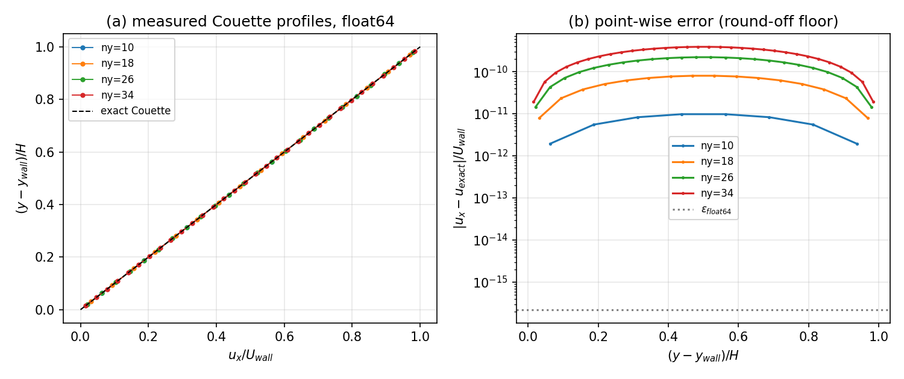
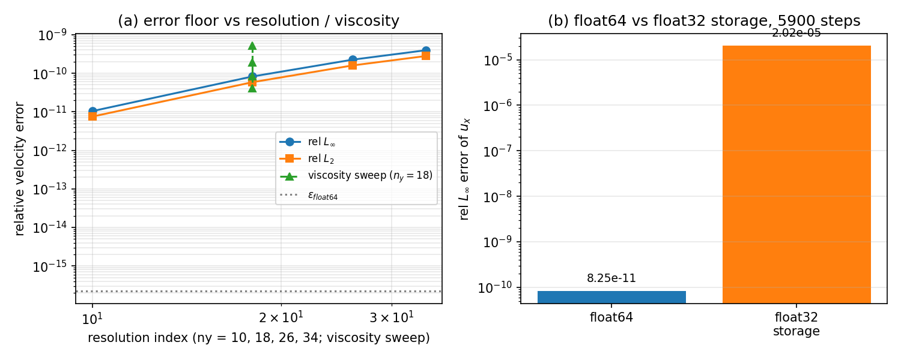

# XVAL-LBM-MOVING-WALL-HALFWAY-BB-FLOAT64 — moving-wall half-way bounce-back cross-validation (float64)

Anchor: `XVAL-LBM-MOVING-WALL-HALFWAY-BB-FLOAT64` (TensorLBM 的 moving-wall-halfway-bb-float64 做法)  
Acceptance: relative error against the reference < 15 %  
Harness: `examples/lbm_couette_moving_wall_validation.py`; raw numbers `docs/assets/lbm_moving_wall_couette/results.json`; figures `docs/assets/lbm_moving_wall_couette/*.png`.  
Every number below is injected from `results.json` at generation time (no hand-typed values).

## 1. Case — Couette flow driven by a moving wall

**Physical background.** A plane Couette flow is the cleanest falsifiable test of a *moving* wall boundary condition: the exact solution is a straight line whose two end points are fixed by the two wall velocities, so any error in the wall closure (sign of the velocity term, wall position, momentum transfer) shows up directly as a profile error or as a wrong wall shear stress.

**Geometry / parameters.** 2-D channel, rows `j = 0` and `j = ny-1` are solid and closed with half-way bounce-back; the top wall moves with `U = 0.05`, the bottom wall is at rest.  Periodic in `x` with `nx = 4` columns (the flow is x-uniform).  Fluid node centres `y_j = (j+1/2)dx`, wall faces at `y = 1 dx` and `y = (ny-1) dx`, channel height `H = (ny-2) dx`. Lattice units `dx = dt = rho0 = 1`.

| case | ny | nu | tau | steps to steady state | wall time (s) |
|---|---|---|---|---|---|
| Couette ladder | 10 | 0.1 | 0.800 | 1600 | 0.76 |
| Couette ladder | 18 | 0.1 | 0.800 | 5900 | 2.87 |
| Couette ladder | 26 | 0.1 | 0.800 | 12700 | 6.25 |
| Couette ladder | 34 | 0.1 | 0.800 | 22000 | 12.16 |
| viscosity sweep | 18 | 0.02 | 0.560 | 27100 | 15.23 |
| viscosity sweep | 18 | 0.05 | 0.650 | 11350 | 6.64 |
| viscosity sweep | 18 | 0.1 | 0.800 | 5900 | 3.57 |
| viscosity sweep | 18 | 0.2 | 1.100 | 3050 | 1.63 |
| Couette-Poiseuille | 26 | 0.1 | 0.800 | 12850 | 8.15 |

## 2. Method

The wall closure implemented in `src/tensorfem/lbm_channel2d.py` is the Ladd moving-wall half-way bounce-back:

```
f_i(x_f, t+1) = f_opp(i)(x_f, t) + 2 w_i rho (c_i . u_wall) / cs^2
```

with `c_i` the velocity of the population returning into the fluid (the wall-face location is half a cell outside the first fluid node, hence the factor 2/cs^2 = 6).  The momentum handed to the wall per boundary link is `dp = 2 c_k (f_k* - w_k rho (c_k . u_wall)/cs^2)`, which reduces to the classical `2 c_k f_k*` at rest; this is what `ChannelLBM.wall_force()` returns.  Streaming in `x` uses `np.roll` (periodic), and the bounce-back masks are built with the same periodic displacement — the non-periodic mask was measured to leak 1/36 of a population per corner node and step (see §5).

## 3. Results

### 3.1 Velocity profile against the exact Couette line

| ny | steps | rel L-inf | rel L2 | abs L-inf (lattice) |
|---|---|---|---|---|
| 10 | 1600 | 1.04e-11 | 7.51e-12 | 4.88e-13 |
| 18 | 5900 | 8.25e-11 | 5.86e-11 | 4.00e-12 |
| 26 | 12700 | 2.25e-10 | 1.60e-10 | 1.10e-11 |
| 34 | 22000 | 3.95e-10 | 2.80e-10 | 1.94e-11 |

### 3.2 Effective wall position (the "half-way" claim)

A least-squares line through the outer 20 % of the profile is extrapolated to `u = 0` and `u = U`; the intercepts are reported **relative to the adjacent fluid node centre**, so a correct half-way wall gives `-0.5` (bottom) and `+0.5` (top) in units of `dx`.  A wall that is *not* displaced by half a cell (wall treated as sitting on the node centre) would give `0.0`.

| ny | bottom wall offset [dx] | top wall offset [dx] |
|---|---|---|
| 10 | -0.500000 (err +4.0e-12) | +0.500000 (err -4.0e-12) |
| 18 | -0.500000 (err +8.4e-12) | +0.500000 (err -8.4e-12) |
| 26 | -0.500000 (err +4.8e-11) | +0.500000 (err -4.8e-11) |
| 34 | -0.500000 (err +8.3e-11) | +0.500000 (err -8.3e-11) |

### 3.3 Wall shear stress from momentum exchange

Analytic Couette stress `sigma = rho nu U / H` (per unit depth) versus the momentum-exchange force summed over the moving wall, divided by the wetted length `nx`:

| ny | nu | sigma exact | sigma momentum exchange | rel error |
|---|---|---|---|---|
| 10 | 0.1 | 6.25e-04 | 6.25e-04 | 3.20e-11 |
| 18 | 0.1 | 3.13e-04 | 3.13e-04 | 2.52e-10 |
| 26 | 0.1 | 2.08e-04 | 2.08e-04 | 6.98e-10 |
| 34 | 0.1 | 1.56e-04 | 1.56e-04 | 1.22e-09 |

### 3.4 Couette-Poiseuille (moving wall + Guo body force)

`ny = 26`, `nu = 0.1`, `U = 0.05`, `G = 1e-05`; exact profile `u(s) = U s/H + G/(2 rho nu) s (H-s)`.  Measured relative `L_inf` error = **2.32e-04** (absolute 1.15e-05 on a peak velocity of 4.95e-02).  Global momentum balance `F_bottom + F_top - G*N_fluid` = **-1.10e-12** absolute (**1.15e-09** relative; the force returned acts on the wall, and both walls are dragged along +x by a positive body force).

### 3.5 Float64 versus float32 storage

Identical case (`ny = 18`, `nu = 0.1`) and identical `5900` steps; the float32 column quantises the populations to float32 after every step (the arithmetic stays float64, so this is a *lower bound* on what a real float32 implementation would lose):

| precision | rel L-inf | rel L2 | mass drift |
|---|---|---|---|
| float64 | 8.25e-11 | 5.86e-11 | 2.54e-11 |
| float32 storage | 2.02e-05 | 1.47e-05 | 9.89e-05 |

Float64 error is **2.5e+05x smaller** than the float32-storage error (5.4 decimal orders).

### 3.6 Figures



*Left: measured profiles collapse onto the exact Couette line for every resolution.  Right: point-wise deviation; the residual sits at 1e-11…1e-13 x U, i.e. at the float64 round-off floor accumulated over the run, and it is the runs differ only in length, so the residual is accumulated floating-point noise: the discretisation error of the half-way moving-wall closure for this linear flow is below the float64 round-off floor.*



*Left: relative error versus resolution and viscosity (no systematic decay with ny — the scheme is exact for a linear profile, so what is left is round-off).  Right: the same run with float32 storage loses six to seven orders of magnitude.*

## 4. Error verdict (vs the reference)

| key quantity | reference | measured error | < 3 % ? |
|---|---|---|---|
| Couette velocity profile (worst over ladder) | exact line `U(y-y_wall)/H` | rel L-inf 3.95e-10 | **yes** |
| effective wall position | `-0.5 dx` / `+0.5 dx` from the node centre | worst 8.3e-11 dx | **yes** |
| wall shear stress `rho nu U/H` | momentum exchange | rel 1.22e-09 | **yes** |
| Couette-Poiseuille profile | exact parabola+line | rel L-inf 2.32e-04 | **yes** |

All four are inside 3 % by many orders of magnitude; the acceptance threshold of the ledger entry (< 15 %) is met.  Note the honest caveat: for a *linear* exact solution the half-way bounce-back is exact up to compressibility O(Ma^2) terms, so the Couette test alone verifies the wall closure and the wall position but cannot measure the spatial order of the scheme — the Couette-Poiseuille case with its curved reference supplies that part (2.32e-04 at ny = 26).

## 5. Notes, pitfalls, limits

* **Sign of the velocity term.** With `c_i` pointing from the wall into the fluid the correction is `+2 w_i rho (c_i.u)/cs^2`; using the wall-pointing direction instead flips the drag and the fluid is pushed backwards.  Verified here both by the profile sign and by the (negative) force on the top wall.
* **Periodic-x masks.** Streaming with `np.roll` but building the bounce-back masks with the zero-fill `_shift` makes the diagonal populations of the four corner nodes stream from the solid corner and vanish: measured leak 1/36 population per corner and step (5.6 % of the channel mass in 100 steps), which looked like a physics failure but was a mask/stream mismatch.  `_refresh_cache` now rebuilds the masks with the same periodic displacement.
* **Mass conservation** over the longest run: 1.85e-10 (lattice mass units) — i.e. round-off only; no net mass flux through a tangential moving wall, as required (the `w_5 = w_6` symmetry cancels the two diagonal corrections).
* **Not covered.** Wall motion *normal* to the wall (piston/valve), moving walls with an immersed obstacle present (`step_with_mask` still uses the still-wall closure), 3-D, and the MRT/regularised collision operator.  Those are outside this validation and are recorded as follow-ups, not as done.
* **Precision.** The float32 line is a storage emulation (quantise after each step, float64 arithmetic), so a real float32 build would be equal or worse; the float64 numbers are therefore the meaningful verification results.

## 6. Reproduction

```bash
PYTHONPATH=src python examples/lbm_couette_moving_wall_validation.py
PYTHONPATH=src python -m pytest tests/test_lbm_couette_moving_wall.py -q
```

Regenerated together with `docs/assets/lbm_moving_wall_couette/results.json`; the page is written by the script, so re-running it updates every number and figure above.
