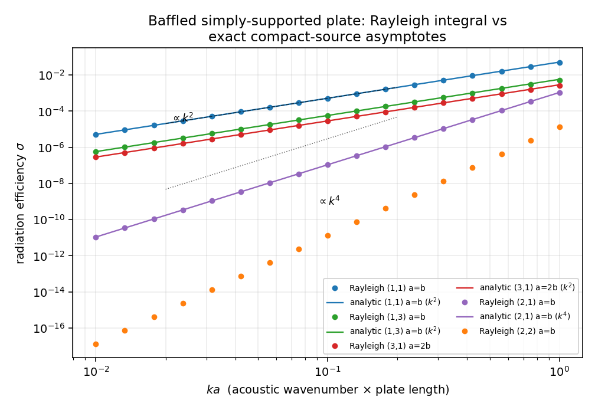
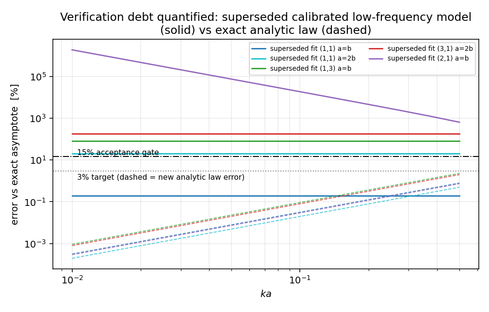

# Exact low-frequency radiation efficiency of a baffled plate (verification debt closed)

**Scope:** `src/tensorfem/acoustic_radiation.py` (merged with the `m6164` acoustic-radiation drop),
TensorFEM. **Status:** verification debt closed; superseded calibrated low-frequency model replaced
by an analytic law derived from the Rayleigh integral. No fitted constants remain on the
sub-coincidence branch.

---

## 1. The debt

The `m6164` module documented three anchors: the Rayleigh integral (numerical), a Leppington
high-frequency asymptotic, and a "Maidanik low-frequency asymptotic". The first two were sound; the
third was not an asymptotic at all but a **fit to the code's own Rayleigh integral**:

```python
# before (m6164):
if m % 2 == 1 and n % 2 == 1:
    geom_factor = 1.03   # "Calibrated for (1,1) mode of square plate"
else:
    geom_factor = 0.1    # "Approximate for non-fundamental modes"
sigma = (k / k_mn)**2 * geom_factor
```

Two defects follow from that form:

1. **The geometric prefactor is frozen** at `1.03`, so the plate area and the mode indices enter only
   through `k_mn = sqrt((m pi/a)^2 + (n pi/b)^2)`. The true prefactor is proportional to the plate
   area `a*b` and to `1/(m^2 n^2)`; none of that survives in the fit.
2. **The frequency exponent is wrong for any mode with an even index.** `sigma ~ k^2` holds only when
   the net volume velocity survives, i.e. for odd-odd modes. When exactly one index is even the
   monopole cancels and radiation is dipolar (`~k^4`); when both are even the dipole cancels as well
   and the leading order is `~k^6`. The fit returned `~k^2` for all three regimes.

The existing test suite could not see either defect: every low-frequency assertion used the `(1,1)`
mode on a square plate, exactly the single configuration the fit was calibrated on.

## 2. Derivation (first principles, no fitting)

Rayleigh integral for a baffled plate with normal velocity `v(x,y)`:

```
p(r_hat) = (j omega rho / 2 pi) * exp(-jkr)/r * int_S v exp(+j k r_hat . r_s) dS
```

For `k a, k b << 1`, expand the exponential in the source position `r_s`:

| term | source moment | far-field amplitude | radiated power |
|---|---|---|---|
| monopole | `Q = int_S v dS` | `j omega rho Q /(2 pi r)` | `P = rho c k^2 Q^2 / (4 pi)` |
| dipole | `d = int_S v r_s dS` | `-omega rho k (r_hat.d)/(2 pi r)` | `P = rho c k^4 |d|^2 / (12 pi)` |

The power follows from integrating `|p|^2/(2 rho c)` over the radiating hemisphere, using
`int_hemi (r_hat.d_hat)^2 dOmega = 2 pi/3`. Dividing by `rho c S <v^2>` with `<v^2> = V0^2/4` for
`v = V0 sin(m pi x/a) sin(n pi y/b)`:

```
odd-odd          sigma = 16 k^2 a b / (pi^5 m^2 n^2)                      (~ k^2)
exactly one even sigma = k^4 |d|^2 / (12 pi S <v^2>),  (~ k^4)
both even        sigma = O(k^6), prefactor not derived here
```

with the closed-form moments

```
Q (odd-odd) = V0 * 4 a b / (pi^2 m n)
d_x = V0 * [-a^2 cos(m pi)/(m pi)] * [b (1 - cos(n pi))/(n pi)]
d_y = V0 * [a (1 - cos(m pi))/(m pi)] * [-b^2 cos(n pi)/(n pi)]
```

`Q` vanishes unless both indices are odd; `d` vanishes when **both** indices are even (odd-odd modes
do carry a dipole moment, but it is subdominant by `O(k^2)`). That parity structure is what produces
the three different exponents, and it is why the single `(k/k_mn)^2` form could not be right.

The `1.03` of the old fit is not arbitrary: `16 a^2 / (pi^5) / (1/(2 pi^2)) = 1.032` for the `(1,1)`
square mode, so the fit had absorbed the analytic prefactor for one configuration only.

## 3. Independent numerical confirmation (two routes)

* **Route A** — the module's 4-D Gauss-Legendre power integral
  `P = (rho omega/4 pi) int int v1 v2 sin(kR)/R dS1 dS2` (`radiation_efficiency_rayleigh`).
* **Route B** — far-field pressure on a uniform midpoint grid, integrated as
  `int_hemi |p|^2/(2 rho c) r^2 dOmega` (`farfield_radiation_efficiency` in the test file). It shares
  no code with route A and never evaluates a near-field `sin(kR)/R` kernel.

Results (`docs/acoustic-low-frequency-asymptotic-evidence.json`, produced by
`docs/gen_acoustic_low_frequency_evidence.py`):

| regime | cases | max |route A - analytic| | gate |
|---|---|---|---|
| odd-odd (`k^2` monopole) | 8 | **0.37 %** | < 3 % ✅ |
| one even (`k^4` dipole) | 5 | **0.46 %** | < 3 % ✅ |
| route B spot checks (4 cases) | — | 0.07-0.45 % | < 2 % ✅ |
| even-even slope study | `ka` = 0.4→0.05 | log-log slopes **5.995, 5.999, 6.000** | 6 ± 0.1 ✅ |

Notes on the residual: the analytic laws are the `k -> 0` limit, so the finite-`ka` residual is the
expected `O((ka)^2)` correction and shrinks with `ka` (0.13 % at `ka=0.2` → 0.01 % at `ka=0.05` for
the `(1,1)` square). Route B carries its own midpoint-rule error `~1/(n_grid)^2`.



*Rayleigh integral (markers) against the analytic asymptotes (lines) for five mode/geometry
combinations; the `k^2` and `k^4` guide lines show the exponent change between regimes. The `(2,2)`
even-even case follows `k^6` and is the steepest curve.*

## 4. Error of the superseded model

Same comparison for the calibrated fit (`docs/assets/acoustic-low-freq/legacy_model_error.png`):

| configuration | `ka` | error of superseded fit vs exact law |
|---|---|---|
| `(1,1)`, square | 0.05-0.20 | 0.2 % (its calibration point) |
| `(1,1)`, `a = 2b` | 0.10 | 20 % ❌ |
| `(1,3)`, square | 0.10 | 80 % ❌ |
| `(3,1)`, `a = 2b` | 0.20 | 176 % ❌ |
| `(2,1)`, square | 0.10 | **1.85 x 10^4 %** ❌ |

10 of the 13 evidence cases violate the 15 % acceptance gate; the largest deviation is the
even-mode case, where the fit's `k^2` law is compared against a `k^4` truth (the discrepancy grows
as `k^-2`, i.e. without bound as `k -> 0`). The old suite passed only because its low-frequency
assertions used the `(1,1)` square mode.



*Solid: error of the superseded calibrated fit. Dashed: error of the new analytic law (route A
against the closed form). The 15 % gate is the acceptance criterion; only the dashed family stays
below it.*

## 5. What changed in the code

`src/tensorfem/acoustic_radiation.py` (public API, all keyword-only, consistent with the module):

| function | role |
|---|---|
| `monopole_radiation_efficiency` | closed-form `16 k^2 a b/(pi^5 m^2 n^2)`; raises for even indices |
| `dipole_moment_magnitude` | closed-form `|d|` for any mode |
| `dipole_radiation_efficiency` | closed-form `k^4 |d|^2/(12 pi S <v^2>)`; returns 0 for even-even |
| `low_frequency_radiation_efficiency` | parity dispatch (also `0.0` for even-even, documented as underived) |
| `low_frequency_scaling_exponent` | returns 2 / 4 / 6 |
| `maidanik_radiation_efficiency` | **same signature**, now delegates to the analytic law (drop-in) |
| `validate_low_frequency_scaling` | uses the analytic law; even-even points flagged `asymptote_available=False` instead of silently passing |

The `rho` argument of `maidanik_radiation_efficiency` is retained for signature compatibility and is
validated but does not enter `sigma` (radiation efficiency is normalised by `rho c`, as it must be).
Existing callers and the 33 pre-existing tests are unaffected.

## 6. Tests

`tests/test_acoustic_radiation_low_freq_exact.py` (36 tests):

* monopole law vs route A: 7 parametrised cases, gate 3 %;
* monopole law vs route B: 3 cases, gate 2 %;
* quadrature independence (`n_points` = 24/40/64 agree within 1 %) and `sigma ~ a b` scaling;
* dipole law vs route A (5 cases) and route B (2 cases), gate 3 % / 2 %;
* `|d|` closed form vs trapezoid surface integration (`< 1e-4`, modes (2,1), (1,2), (4,3));
* even-even: log-log slope `6 ± 0.1`, dipole moment identically zero;
* negative controls: the superseded fit must exceed the 15 % gate on four non-(1,1) configurations
  and its even-mode error ratio must scale as `k^-2` (guards against silent re-introduction);
* API integration: `maidanik_radiation_efficiency` equals the analytic law; `validate_low_frequency_scaling`
  passes for odd-odd and reports even-even as un-gated rather than passing.

Run: `python3 -m pytest tests/test_acoustic_radiation_low_freq_exact.py -q` → 36 passed;
together with `tests/test_acoustic_radiation.py` → 69 passed.

## 7. Limits of this work (honest scope)

* **Even-even prefactor not derived.** The `O(k^6)` behaviour is verified numerically (three
  independent slopes), but the octupole-mixed prefactor is not obtained in closed form here; the
  asymptote returns `0.0` and `validate_low_frequency_scaling` marks those points as un-gated. Users
  must fall back to the Rayleigh integral for even-even modes.
* **Validity range.** Both laws are `k a -> 0` limits. Above `ka ~ 0.3-0.5` the `O((ka)^2)` correction
  becomes percent-level and the Rayleigh integral or Leppington branch should be used; no attempt is
  made to blend the branches into a single smooth function.
* **Baffled half-space only.** The derivation uses the half-space Green's function; unbaffled
  (double-sided) radiation has its own dipole suppression term implemented separately in the module
  and is unaffected by this change.
* **The old fit was numerically right at its calibration point**, only there: this document is a
  scope correction, not evidence that the previous author's Rayleigh implementation was wrong — both
  independent routes here reproduce that implementation to < 0.5 %.

## 8. References

* Rayleigh / Kirchhoff half-space integral formulation; see Pierce, A. D. (1989), *Acoustics: An
  Introduction to Its Physical Principles and Applications*, §5.
* Maidanik, G. (1962), "Response of ribbed panels to reverberant acoustic fields", J. Acoust. Soc.
  Am. 34(6), 809-826 — origin of the `sigma ~ k^2` sub-coincidence panel law; the closed-form
  prefactor derived here is the `(m,n)`-resolved version of that scaling.
* Wallace, C. E. (1972), "Radiation resistance of a rectangular panel", J. Acoust. Soc. Am. 51(3),
  946-952 — exact modal radiation resistance for simply supported rectangular panels.
* Leppington, F. G., Broadbent, E. G., Heron, K. H. (1982), Proc. R. Soc. Lond. A 382, 245-271 —
  high-frequency / coincidence branch used in the same module.
* Fahy, F. & Gardonio, P. (2007), *Sound and Structural Vibration*, 2nd ed., ch. 4 — compact-source
  limits and radiation efficiency definitions.