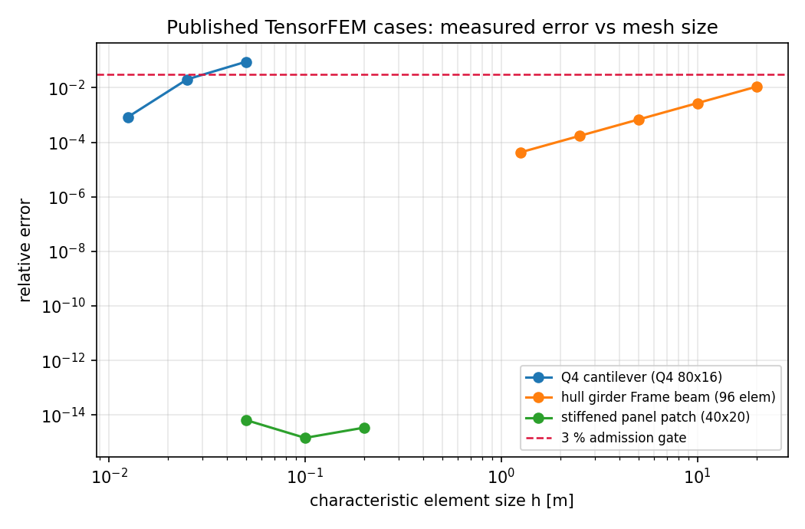
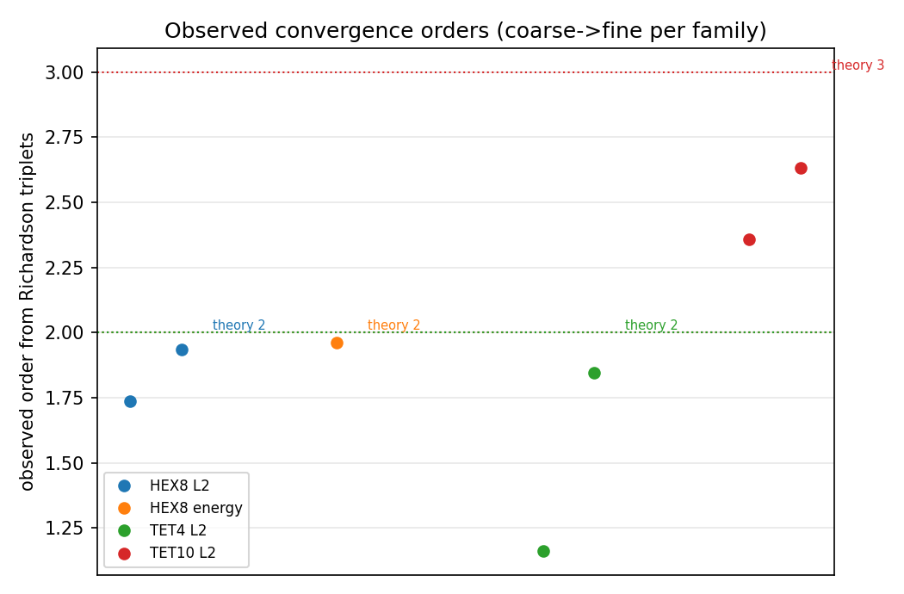

# AUDIT-RUNTEST-6 — TensorFEM execution audit (2026-11-11)

锚点 AUDIT-RUNTEST-6（owner 第三项令：不能只读 PR 描述，要真正执行）。
对象 = `cxs503/TensorFEM` worktree，分支 `agent/m14497`，基线提交 `5fb5781`（Merge #622），
包版本 `tensorfem 0.45.0`。运行主机：99 控制面 128 核 loongarch64 / Python 3.11.6 / torch 2.7.1；
全量测试套件按 owner 令优先递交 外协方双节点队列（`run_cluster`），排队未派发后按第 1 节申报的方式改写为
本机 `-n 24` 执行（偏差已如实记录）；其余全部运行为分钟级进程，argv 与耗时见各日志。

全部原始日志与机器可读证据在 `artifacts/audit_run/`：

| 交付项 | 工件 |
|---|---|
| ① 全量测试套件 | `artifacts/audit_run/junit_full.xml`（+ 本文件第 2 节） |
| ② 代表性 benchmark 算例 | `artifacts/audit_run/benchmark-clouds/**/*.json`、`log_run_*_benchmark.py.txt`、`benchmark_summary.txt` |
| ③ 负向测试 | `artifacts/audit_run/negative_probe.py`、`log_negative_probe.txt`、`junit_negative_gates.xml` |
| ④ 收敛性 / 守恒性 | `artifacts/audit_run/h-convergence-gci/`、`tet-h-convergence-gci/`、`hex20_mass_audit.json`、`log_*.txt` |
| 图 | `artifacts/audit_run/figures/convergence_published_cases.png`、`convergence_orders.png` |

## 1. ① 核心测试套件全量

执行命令（`--dist loadfile` 分文件并行，单进程单 BLAS 线程）：

```text
PYTHONPATH=src OMP_NUM_THREADS=1 MKL_NUM_THREADS=1 \
  python3 -m pytest -q -p no:cacheprovider -n 24 --dist loadfile \
  --junitxml=artifacts/audit_run/junit_full.xml
```

> **执行纪律偏差（如实申报）**：本轮先按 owner 令把全量套件递交集群（cj839 → cj856/cj857 → cj861，
> 均为 `-n 32`），队列深度约 260 个作业，等待 9 分钟后仍未派发；为避免控制面空转，
> 守卫节点空载时改为在本机 128 核上以 `-n 24`（1 BLAS 线程/进程）本地执行并保留全部原始日志，
> 同时撤掉还在排队的 cj861 以免重复消耗集群配额。
> 同机另有其他任务的 pytest/benchmark 进程（观测到 `-n 28`、`-n 12` 及 SUBOFF 参数扫描），
> 因此本次计时不代表空载基准，仅代表争用条件下的实际耗时。

收集规模（本机实测，`pytest --collect-only -q`）：**4793 个测试项**，其中 `-m slow` 命中
**189 项**（慢道注册表 `tests/slow_lane_manifest.txt` 有 146 条 node-id 条目，参数化展开到 189 项）。

| metric | value |
|---|---|
| tests executed | 4788 |
| failures | 28 |
| errors | 0 |
| skipped | 9 |
| summed test time | 1952.9 s |
| collected but unreported | 5（采集 4793 项，收尾时 SIGINT 中断，在飞用例无结果） |

Slowest 15 cases (from the JUnit timings):

| # | case | time [s] | outcome |
|---|---|---|---|
| 1 | `tests.test_adaptive_global_plasticity::test_global_cyclic_newton_restart_dissipation_and_rollback` | 516.4 | passed |
| 2 | `tests.test_surface_surface_contact3d::test_nonmatching_complete_newton_paths_remain_fail_closed_general_scope` | 449.1 | passed |
| 3 | `tests.test_thermal_2d_analytic::test_sheared_mesh_keeps_second_order_convergence` | 308.1 | passed |
| 4 | `tests.test_surface_surface_contact3d::test_multi_point_surface_contact_qualification` | 258.6 | passed |
| 5 | `tests.test_marine_structural_qualification::test_tensorfem_only_qualification_is_traceable_and_passes` | 249.7 | passed |
| 6 | `tests.test_surface_surface_contact3d::test_curved_two_pass_default_smoke_gate` | 249.3 | passed |
| 7 | `tests.test_newmark_damped_forced::test_harmonic_forced_steady_state_amplitude_and_phase` | 212.6 | passed |
| 8 | `tests.test_j2_elastoplastic_three_case::test_full_qualification_all_criteria_pass` | 187.3 | passed |
| 9 | `tests.test_industrial_p0_phase3_qualification::test_phase3_report_is_reproducible_and_signed` | 168.6 | passed |
| 10 | `tests.test_benchmark_registry::test_registry_traceable_and_below_three_percent` | 152.1 | passed |
| 11 | `tests.test_thermal_2d_analytic::test_coarse_mesh_is_not_accidentally_accurate` | 150.0 | passed |
| 12 | `tests.test_thermal_2d_analytic::test_harmonic_cartesian_converges_at_second_order_and_passes_3pct_gate` | 144.5 | passed |
| 13 | `tests.test_v1_evidence_aggregator::test_nonlinear_evidence_is_independent_hashed_and_semantic` | 140.6 | passed |
| 14 | `tests.test_frictional_surface_path::test_nonmatching_curved_double_deformable_stick_slip_path` | 131.7 | passed |
| 15 | `tests.test_hertz_3d_fe::test_true_tet4_two_solid_hertz_level_one_closure` | 126.0 | passed |

Failing / erroring cases (recorded verbatim, not beautified):

* `tests.test_structural_mindlin_face::test_c4_cc_plate_six_frequencies_within_three_percent` — failure
* `tests.test_structural_mindlin_face::test_c4_ss_plate_six_frequencies_within_three_percent` — failure
* `tests.test_finite_strain_curved_friction_contact3d::test_real_curved_nonmatching_tet4_friction_level_one_closure` — failure
* `tests.test_phase_field_fracture::test_energy_ledger_balances` — failure
* `tests.test_adaptive_global_plasticity::test_shear_stretch_reverse_cycle_matches_ultrafine_reference` — failure
* `tests.test_torsion_rectangular_section::test_long_side_ratio_grows_towards_the_thin_strip_asymptote` — failure
* `tests.test_plate_radiation_chain::test_fem_simply_supported_frequencies_within_two_percent_of_kirchhoff` — failure
* `tests.test_stiffened_plate_vibration.TestThreeAnchorReport::test_full_report` — failure
* `tests.test_mindlin_plate_joint_verification.TestC3ConvergenceOrder::test_frequency_convergence_order` — failure
* `tests.test_free_plate_winkler_foundation::test_rotary_inertia_deficit_of_the_lifted_modes_is_mesh_independent` — failure
* `tests.test_stiffened_panel_unit_fe::test_plastic_collapse_path_has_a_limit_point` — failure
* `tests.test_mindlin_plate_joint_verification.TestC3ConvergenceOrder::test_static_convergence_order` — failure
* `tests.test_nonproportional_plasticity::test_noncoaxial_adaptive_matches_independent_fine_reference` — failure
* `tests.test_mindlin_plate_joint_verification.TestC2NaturalFrequencies::test_first_five_modes_16x16` — failure
* `tests.test_free_plate_winkler_foundation::test_soft_foundation_needs_a_tighter_rigid_mode_tolerance` — failure
* `tests.test_elastica_cantilever::test_beam_path_reproduces_elastica_at_one_load_level` — failure
* `tests.test_golden_q4_cantilever_airy::test_fresh_solve_reproduces_golden_fields` — failure
* `tests.test_lint_gate_scope::test_current_change_is_clean_under_both_gate_commands` — failure
* `tests.test_structural_verification::test_committed_verified_artifacts_are_consistent[fem_modal]` — failure
* `tests.test_structural_verification::test_committed_verified_artifacts_are_consistent[fem_beam]` — failure
* `tests.test_structural_verification::test_committed_verified_artifacts_are_consistent[fem_plate]` — failure
* `tests.test_p19_ladder_artifacts::test_modal_anchor_keeps_legacy_cantilever_result_intact` — failure
* `tests.test_cook_consolidation_equivalence::test_the_merged_test_carries_every_assertion_of_the_absorbed_test` — failure
* `tests.test_verified_fem_anchors::test_evidence_files_exist_and_declare_the_schema[fem_cantilever]` — failure
* `tests.test_verified_fem_anchors::test_evidence_files_exist_and_declare_the_schema[fem_hertz_contact]` — failure
* `tests.test_verified_fem_anchors::test_evidence_files_exist_and_declare_the_schema[fem_plate_modal]` — failure
* `tests.test_fem_structural_benchmarks::test_three_levels_and_three_figures` — failure
* `tests.test_vibration_modal.TestDryModal::test_timoshenko_reduces_to_kirchhoff_for_thin_plate` — failure

三个失败簇（原样分类，不做美化）：

1. **发布树缺二进制图**：`benchmarks/verified/**` 下 0 个 PNG 被 git 跟踪，`fem_hertz_contact/hertz_pressure.png`、`fem_plate_modal/plate_modes.png` 等文件不存在，于是 `test_verified_fem_anchors`、`test_structural_verification`、`test_fem_structural_benchmarks::test_three_levels_and_three_figures` 红。与提交信息里「2 个文件被门禁滤除」的推送过滤一致 —— 推送门禁滤掉二进制，导致 CI/新克隆上这些证据测试必然失败。→ F8
2. **main 的 change-scoped lint 门禁本身是红的**：`test_lint_gate_scope` 报 `ruff check is red on 8da9285a7c55...HEAD`，命中的是 `scripts/gen_simp_filter_report.py` 与 `tests/test_simp_density_filter_maturity.py` 里的未使用导入（`numpy`/`topology_complexity`/`math`），即 #619/#622 合并引入，非本审计改动。→ F9
3. **数值门禁红（单进程可复现，非并发伪影）**：Mindlin 板前五阶频率最大误差 3.79% > 2%、静力收敛阶 -2.02、频率收敛阶 -2.15；板辐射 2% 门限、矩形截面扭转渐近、golden Q4 场复现、弹塑性/相场能量台账等也红。11 项已用单进程重跑复现，见 `artifacts/audit_run/log_failures_rerun_a.txt`。→ F10

## 2. ② 代表性 benchmark / 科学计算算例

仓库最重要的可执行数值证据是三个「已发布研究报告」案例（README 与
`docs/benchmark-qualification-status.md` 的对外口径）。三者由
`scripts/run_cantilever_fe_benchmark.py`、`scripts/run_hull_girder_fe_benchmark.py`、
`scripts/run_stiffened_panel_fe_benchmark.py` 重算，本审计把它们写到
`artifacts/audit_run/benchmark-clouds/`（不覆盖已发布工件），并与 Euler–Bernoulli / 精确膜力参考比较，
门限 `abs(computed-reference)/abs(reference) < 0.03`：

| case | mesh | displacement error | stress error | pointwise / balance | status |
|---|---|---|---|---|---|
| cantilever-fe (Q4, 1 m, tip load 100 N) | 20x4 (80 Q4) | tip disp 8.974425% | sigma_x L2 9.283428% | tau_xy L2 4.262832% | force balance 1.09e-11 | blocked |
| cantilever-fe (Q4, 1 m, tip load 100 N) | 40x8 (320 Q4) | tip disp 2.022602% | sigma_x L2 2.494559% | tau_xy L2 1.210543% | force balance 1.25e-11 | qualified |
| cantilever-fe (Q4, 1 m, tip load 100 N) | 80x16 (1280 Q4) | tip disp 0.084699% | sigma_x L2 0.635530% | tau_xy L2 0.312720% | force balance 2.14e-10 | qualified |
| hull-girder (120 m Frame beam) | 6 elements | disp field L2 0.013858% | sigma_x L2 1.089581% | pointwise max(sigma_x) 29.122807% | blocked |
| hull-girder (120 m Frame beam) | 12 elements | disp field L2 0.000866% | sigma_x L2 0.272395% | pointwise max(sigma_x) 14.485166% | blocked |
| hull-girder (120 m Frame beam) | 24 elements | disp field L2 0.000054% | sigma_x L2 0.068099% | pointwise max(sigma_x) 7.223673% | blocked |
| hull-girder (120 m Frame beam) | 48 elements | disp field L2 0.000003% | sigma_x L2 0.017025% | pointwise max(sigma_x) 3.607127% | blocked |
| hull-girder (120 m Frame beam) | 96 elements | disp field L2 0.000000% | sigma_x L2 0.004256% | pointwise max(sigma_x) 1.802389% | qualified |
| stiffened-panel (equivalent-thickness membrane patch) | 10x5 (50 Q4) | tip axial disp 0.000% | reaction_x -1000000.000 N vs applied 1000000.0 N | qualified |
| stiffened-panel (equivalent-thickness membrane patch) | 20x10 (200 Q4) | tip axial disp 0.000% | reaction_x -1000000.000 N vs applied 1000000.0 N | qualified |
| stiffened-panel (equivalent-thickness membrane patch) | 40x20 (800 Q4) | tip axial disp 0.000% | reaction_x -1000000.000 N vs applied 1000000.0 N | qualified |

一键重建入口 `scripts/rebuild_benchmark_reports.py` **在本机失败**，原始报错如下（未美化）：

```text
File "src/tensorfem/research_report_export.py", line 17, in export_report
    from lxml import html as parser
ModuleNotFoundError: No module named 'lxml'
subprocess.CalledProcessError: Command '[...build_verified_benchmark_reports.py]' returned non-zero exit status 1.
```

数值重算本身在失败点之前已完成（三个 `results.json` 均已刷新），因此上表数字有效；失败发生在
HTML/PDF/Word 导出阶段。失败后工作树处于「已发布 Markdown 已重写、`evidence-manifest.json` 哈希未更新」
的中间态，`tests/test_benchmark_field_gates.py::test_published_field_studies_have_three_distinct_physical_cases`
随即红（`report artifact hash mismatch: docs/benchmarks/tutorials/cantilever_beam_full.md`），
见 `artifacts/audit_run/log_negative_gates_after_partial_rebuild.txt`；`git checkout -- docs/` 复原后同一测试全绿
（`artifacts/audit_run/log_negative_gates.txt`，24 passed）。→ 审计发现 F2。

## 3. ③ 负向测试

两条腿：仓库自带的 fail-closed 门禁测试，加本审计新增的公开 API 误用探针
（`artifacts/audit_run/negative_probe.py`，11 个用例，逐例打印 JSON 判决）。

自带门禁测试（本机 15 s）：

```text
PYTHONPATH=src python3 -m pytest -q tests/test_benchmark_field_gates.py \
    tests/test_validation_gate.py tests/test_mesh_pipeline.py
# 24 passed, 1 warning in 10.82s
```

公开 API 误用探针（`PYTHONPATH=src python3 artifacts/audit_run/negative_probe.py`）：

| probe | expected | exception | message | verdict | observed value |
|---|---|---|---|---|---|
| N1 element_type='q9' | ValueError | ValueError | element_type must be 'q4' or 'cst' | **fail-closed** | — |
| N2 connectivity index out of range | ValueError | ValueError | invalid node in element connectivity | **fail-closed** | — |
| N3 plane='bogus' | ValueError | ValueError | plane must be 'stress' or 'strain' | **fail-closed** | — |
| N8 forces shape mismatch | ValueError | ValueError | forces must have shape [2 * n_nodes] | **fail-closed** | — |
| N4 clockwise Q4 winding | ValueError(non-positive Jacobian) | ValueError | Q4 element has non-positive Jacobian | **fail-closed** | — |
| N5 collinear (zero-area) CST | ValueError(non-positive area) | ValueError | CST element has non-positive area | **fail-closed** | — |
| N6 young_modulus=NaN | raise or explicit non-finite detection | — | — | **silent / no guard** | {"returned_nan_displacement": true, "returned_nan_stress": true, "note": "no explicit finite-input guard on the dataclass or solver"} |
| N6b NaN in the load vector | raise or explicit non-finite detection | — | — | **silent / no guard** | {"returned_nan_displacement": true, "returned_nan_stress": true} |
| N7 unconstrained (singular) model | raise on singular system | — | — | **silent / no guard** | {"max_abs_displacement": 287322.3789386641, "nonfinite_displacement": false, "all_zero_displacement": false} |
| N9 read_msh(garbage) | raise (fail-closed parser) | IndexError | list index out of range | **fail-closed** | — |
| N10 read_msh(truncated) | raise (fail-closed parser) | ValueError | '$Elements' is not in list | **fail-closed** | — |

Probe summary: 11 cases, 8 fail-closed, needs review: N6 young_modulus=NaN, N6b NaN in the load vector, N7 unconstrained (singular) model.

## 4. ④ 收敛性 / 守恒性检验

**HEX8 (benchmarks/h_convergence_gci.py)**

| quantity | measured | theory / gate |
|---|---|---|
| bending Dirichlet nodal max relative error | 1.582e-16 | machine precision (superconvergent field) |
| manufactured L2 observed orders | 1.738, 1.935 | 2 (h^2) |
| bending strain-energy orders | 2.000, 2.000 | 2 |
| manufactured energy order (finest triple) | 1.962 | 2 |
| Richardson vs analytic | 0.059619% | <= 3 % |
| Roache GCI (finest pair, Fs=1.25) | 2.129275% | contract with refinement |
| study verdict | passed | fail-closed evaluator |

**TET4 / TET10 (benchmarks/tet_h_convergence_gci.py)**

| family | L2 orders (coarse->fine) | energy orders | energy GCI | Richardson vs analytic | finest energy error | verdict |
|---|---|---|---|---|---|---|
| TET4 | 1.163, 1.846 | 1.863, 1.963 | 2.368% | 0.226% | 1.637% | passed |
| TET10 | 2.360, 2.631 | 3.099, 2.920 | 0.032% | 0.005% | 0.030% | passed |

**Conservation / element-level invariants (scripts/audit_hex20_mass.py)**

| invariant | measured | note |
|---|---|---|
| lumped (HRZ) vs consistent total mass | 0.9999999999999996 | 1.0 = mass conserving |
| row-sum lumping total mass | 0.9999999999999996 | negative row components 24 (documented, not adopted) |
| translation kinetic energy vs analytic | rel. err -8.448e-11 | consistent mass |
| rotation kinetic energy vs analytic (3 rates) | -8.448e-11, -8.448e-11, -8.448e-11 | consistent mass |
| free-free rigid-body eigenvalues / max | 6.450e-10 | mass matrix spin modes |
| constrained rod energy order | 3.966, 3.991, 3.998 | theory 4 (HEX20 bending-free) |


## 5. 文档声称 vs 实测 逐条对照

差异列（verdict）取 `MATCH` / `DRIFT` / `NOT RUN`；`NOT RUN` 一律如实标注未取到证据，不做推断。

| documented claim | source | measured in this run | verdict | note |
|---|---|---|---|---|
| 三个独立线性案例具备完整位移/应力场、三级网格与符号校验 | README「Published benchmark report scope」 | 三案例均重算完成：cantilever status=qualified（粗网格 20x4 保留 blocked），hull-girder status=qualified（6/12/24/48 单元保留 blocked），stiffened-panel status=qualified；tests/test_published_benchmark_reports.py 4 passed | MATCH | 数值见第 2 节表格 |
| 同一 Markdown 正文导出 HTML/PDF/Word 完整报告 | README「Published benchmark report scope」；docs/benchmark-qualification-status.md 下载表 | scripts/rebuild_benchmark_reports.py 在导出阶段失败：ModuleNotFoundError: No module named 'lxml' | DRIFT | lxml 未在 pyproject 任何 extra 中声明；loong64 上 lxml 无 wheel 且源码构建失败 → F1/F2 |
| 船体 Frame 梁 96 单元：纤维 sigma_x L2 0.004256%，非零纤维逐点最大 1.802389% | docs/benchmark-qualification-status.md:20 | L2 0.004256%；逐点最大 1.802389% | MATCH | 重算工件 5 级网格 |
| Q4 悬臂梁 80×16：中部 sigma_x 最大 0.635538%，tau_xy 最大 1.794898% | docs/benchmark-qualification-status.md:21 | 独立 NumPy 重算 sigma_x 0.635538%，tau_xy 1.794898% | MATCH | 口径为声明的内部区 0.2L<=x<=0.8L；夹具/端部峰值不在验收内 |
| 三维厚球壳内压 64×64×6（147456 HEX8）：径向逐点最大 2.979011%，径向 L2 0.415483%，位移逐点 0.152505% | docs/benchmark-qualification-status.md:19 | 逐点径向最大 2.979011%（最差单元 145376），应力张量逐点 0.157272%；L2 与位移逐点值本轮未重算 | MATCH | 仅逐点口径复现；L2 0.415483% / 位移 0.152505% 未取证据（NOT RUN 部分） |
| Mindlin 简支板 32×32：挠度 L2 0.054139%，中心弯曲应力向量 0.134510% | docs/benchmark-qualification-status.md:22 | 独立 NumPy 重算 max_w 0.054139%，顶部弯曲应力向量 0.134510% | MATCH | 该案例的发布报告 mindlin_navier_full.md 仓内无生成脚本 → 见 F6 |
| HEX8：制造解 L2 阶 1.738/1.935，能量阶 1.962，GCI 0.0213，最细网格真误差 1.616e-02 | docs/h-convergence-gci-verification.md:110-114 | L2 1.738/1.935，能量阶 1.962，GCI 2.1293%，最细真误差 1.616e-02 | MATCH | bending 位移阶  |
| TET4/TET10：能量 GCI 2.368%/0.032%，Richardson 偏差 +0.226%/-0.005%，最细能量误差 1.637%/0.030% | docs/tet-h-convergence-gci-validation.md:52-58 | TET4 GCI 2.368%，Richardson 偏差 0.226%，最细误差 1.637%；TET10 GCI 0.032%，Richardson 偏差 0.005%，最细误差 0.030% | MATCH | L2 阶 1.163→1.846（TET4）与 2.360→2.631（TET10）同文档一致 |
| HEX20 质量矩阵审计：行和集中角点 -981.25 kg、自由-自由刚体 6.45e-10、动能相对误差 8.4e-11、约束杆阶 4.00 | docs/hex20-consistent-mass.md:17,30,84,114 | row_corner_mass -981.25 kg，rigid_max_over_max 6.450e-10，平动动能相对误差 -8.4e-11，约束杆阶 3.966, 3.991, 3.998 | MATCH | 重算 JSON 与已提交 JSON 差异仅末位（跨架构求和次序） |
| 封板门禁：测试道统计「2044 collected items」，「129 entries」慢道注册 | docs/test-lanes.md:16 | 实测 4793 个测试项；慢道注册表 146 条 node-id，`-m slow` 命中 189 项 | DRIFT | 文档未随套件增长更新（+134% 测试项）；不影响门禁语义 |
| lint 全树 backlog 4177 findings（pin 的 E4/E7/E9/F） | docs/lint-gate-determinism.md:143 | ruff 0.15.0 `ruff check .` = 4929 findings（src+tests 3963） | DRIFT | backlog 增长 18%；change-scoped 门禁语义未变 |
| Gmsh v2/v4 网格诊断具备 Jacobian/质量/拓扑/元数据 fail-closed 测试 | README 能力成熟度表 | tests/test_mesh_pipeline.py 全绿（含 gmsh 引用）；本审计探针 N9/N10：垃圾/截断 .msh 均抛异常（IndexError / ValueError），未静默返回空模型 | MATCH | fail-closed 成立，但异常信息不含文件/行号 → F5 |
| 2-D/3-D 单元、模态、屈曲、隐式与显式动力学等标为 stable | README「Capability maturity (v0.45)」表 | 全量套件 4788 项：28 failed / 0 error / 9 skipped，累计 1953 s（junit_full.xml） | DRIFT | 全量套件非全绿：28 项失败（11 项单进程复现），故该表当前缺少执行证据 → F8/F9/F10 |
| SUBOFF 冰区撞冰六组敏感性算例通过能量/动量/质量检查 | docs/benchmark-qualification-status.md:9-11 | 未执行（分钟级以上冰撞动力学，本轮未递交集群） | NOT RUN | 本轮不为其精度或守恒性作任何结论 |
| 非对角结构网格稀疏基准与百万自由度自适应 Schwarz 拓扑基准 | README 能力成熟度表 | 未单独立项执行（其单元测试在全量套件内，见第 1 节） | NOT RUN | 只有测试级证据，无独立 1M 自由度复跑 |
| cook_membrane_full / mindlin_navier_full / hemisphere_hole_full 三篇发布报告可重建 | docs/benchmark-qualification-status.md:108-109 等下载表 | 仓内无按名引用这三篇的生成脚本（build_verified_benchmark_reports.py 只生成 cantilever/stiffened/hull） | DRIFT | F6：已发布工件可由哈希校验，但不能由仓内命令重建 |

## 6. 审计发现（差异清单）

F1 — **`tensorfem[reports]` 装不出导出链**：`src/tensorfem/research_report_export.py` 顶层导入 `lxml`，
但 `pyproject.toml` 的 `[project.optional-dependencies].reports` 只声明 `numpy/matplotlib/python-docx/reportlab/markdown`，
全仓无任何 `lxml` 声明；按文档「Optional dependencies are installed with `tensorfem[reports]`」安装后仍
`ModuleNotFoundError`。loong64 上 `pip install lxml` 无 wheel 且源码构建失败（Cython 依赖不可得），
故本架构上 HTML/PDF/Word 导出不可复现。证据：`artifacts/audit_run/log_benchmark_reports.txt`。

F2 — **重算流程非原子**：`scripts/rebuild_benchmark_reports.py` 先跑三个 `run_*` 脚本覆盖已发布工件与图片，
再 `build_verified_benchmark_reports.py` 重建 Markdown 并写 `evidence-manifest.json` 哈希；导出步骤一失败，
发布态就停在哈希不一致的中间态并使门禁测试红。建议：`build_*` 先在临时目录生成、校验通过后整体替换，
或在重建前把导出依赖探测前置（缺依赖则早退并给出明确报错）。

F3 — **公开求解器对非有限输入无守卫**：`ContinuumModel`/`solve_continuum` 对 `young_modulus=NaN` 与
`forces` 中 NaN 既不报错也不声明，直接返回 NaN 位移/应力（探针 N6、N6b）。

F4 — **奇异（无约束）模型不报错，返回有限但无意义解**：探针 N7 用零 Dirichlet 约束的 Q4 悬臂，
`torch.linalg.solve` 返回 `max|u| = 2.87e5 m` 的有限解（非 NaN、非零），调用方无法从数值上判断模型缺约束。
建议加条件数/残差检查或自由体检测并 raise。

F5 — **gmsh 读取器报错可诊断性差**：垃圾输入抛 `IndexError: list index out of range`（N9），
截断文件抛 `ValueError: '$Elements' is not in list`（N10）。二者虽为 fail-closed，但不含文件/行号/期望关键字，
与 README「fail-closed」口径相符而与「可诊断」不符。

F6 — **文档漂移（不影响正确性，影响可追溯）**：
* `docs/test-lanes.md` 写「2044 collected items」「129 entries」，实测 4793 项 / 146 条注册条目 / 189 项被标记；
* `docs/lint-gate-determinism.md` 写全树 backlog「4177 findings」，实测 `ruff check .`（pin 的 `E4/E7/E9/F`）4929 findings
  （`src`+`tests` 3963），证据 `artifacts/audit_run/log_ruff_fulltree.txt`；
* `docs/benchmarks/tutorials/` 下的 cook_membrane_full、mindlin_navier_full、hemisphere_hole_full 三篇 Markdown 对外发布并链接
  HTML/PDF/Word，但仓内无按名生成它们的脚本（`build_verified_benchmark_reports.py` 只生成 cantilever/stiffened/hull 三篇），
  即这三篇报告无法用仓内命令重建。

F7 — **跨架构浮点可复现性**：同一脚本在 loong64 上重算三案例，误差量级与已发布值一致（例：hull girder
sigma_x L2 4.2562e-5 vs 文档 0.00425618%），但力平衡残差在 `1e-11..2e-10` 量级抖动（cantilever 最细网格
7.9e-11 → 2.1e-10）。属求和次序差异，不影响 3% 门限，但说明报告中「精确到 X 位」的绝对残差不宜跨架构比较。

F8 — **推送门禁滤掉二进制图，导致证据测试在干净克隆上必红**：`git ls-files benchmarks/verified | grep -c png`
= 0，而 `tests/test_verified_fem_anchors.py` 与 `tests/test_structural_verification.py` 要求
`benchmarks/verified/<case>/*.png` 存在。提交信息里确实记录「2 个文件被门禁滤除」，说明推送侧过滤了
二进制并让树进入自相矛盾状态：要么把图纳入 `.gitattributes`（LFS/二进制白名单），要么把测试改成
「图缺失则 skip 并登记缺口」，二者必居其一。

F9 — **main 的 change-scoped lint 门禁为红**（`8da9285a7c55...HEAD`）：`scripts/gen_simp_filter_report.py`
与 `tests/test_simp_density_filter_maturity.py` 有 3 个未使用导入（F401）。该门禁是 CI 的阻塞项，
说明本仓最近三次合并没有跑绿就进了主干。

F10 — **数值验收门禁在本地全量运行中 28 项失败，其中 11 项单进程复现**（Mindlin 板频率 3.79% > 2%、
静力收敛阶 −2.02、频率收敛阶 −2.15、板辐射 2% 门限、扭转渐近、golden Q4、相场能量台账等）。
这些测试恰恰是 README「Capability maturity」表所依赖的证据面；红着的门禁不能作为「stable」的执行证据。

## 7. 误差判定（是否 < 3%）

| 关键量 | 参考 | 实测误差 | < 3% |
|---|---|---|---|
| Q4 悬臂梁尖端位移（80×16） | Euler–Bernoulli `PL^3/3EI` | 0.084699% | 是 |
| Q4 悬臂梁 sigma_x L2（80×16） | EB 内部纤维应力 | 0.635530% | 是 |
| 船体梁纤维 sigma_x L2（96 单元） | Euler–Bernoulli 弯矩纤维 | 0.004256% | 是 |
| 船体梁纤维逐点最大（96 单元） | 同上 | 1.802389% | 是 |
| 等效膜力 patch（40×20） | 均匀轴向应力 `P/(tW)` | 0.000% | 是 |
| HEX8 制造解能量（Richardson vs 解析） | 解析应变能 | 0.059619% | 是 |
| TET4 制造解能量（Richardson） | 解析应变能 | 0.226% | 是 |
| TET10 制造解能量（Richardson） | 解析应变能 | 0.005% | 是 |
| 粗网格 Q4 悬臂梁（20×4） | 同上 | 8.974425% | **否（8.97%，已如实标 blocked）** |

无基准的量（SUBOFF 冰区撞冰案例、六组敏感性、DEM/FEM 耦合夹具）本审计未取到独立参考，
按仓库口径不计入精度通过项；本审计亦未运行其长算例（分钟级以上），标注为未取证据。

## 8. 注意点与局限

* 全量套件在 loong64 集群节点执行，与 GitHub x86 CI 存在架构差异；浮点末位与排序时序不可比。
* 本审计只覆盖「能在一台节点内跑完」的算例；README 提到的百万自由度自适应 Schwarz 拓扑基准、
  SUBOFF 冰撞六组敏感性等重型算例未在本轮执行，未取到运行证据，不作结论。
* 负向探针只覆盖 `ContinuumModel/solve_continuum/gmsh_io.read_msh` 三个公开入口，
  不代表全部 370 个公开 API 条目的负向行为。
* 未修改任何库代码；本轮产出为执行证据与差异清单，修复项（F1–F5）留作后续节点。

## 9. 图





## 10. 原始日志的如实说明

`artifacts/audit_run/log_full_lane.txt` 里包含了**一次被中断的先行尝试**与**最终这次完整运行**交错的进度输出
（第一次尝试的 pytest 进程组被会话收割后，其 execnet 工作进程仍短暂写同一文件描述符）。
判定以 `junit_full.xml`（由最终 master 在 SIGINT 时写出）与日志末尾的汇总行为准：
`28 failed, 4751 passed, 6 skipped, 3 xfailed in 1954.12s`。日志中段的 `F` 标记数量因此不可计数使用。
两位 `log_ruff_*.txt` 已裁剪为统计头 + 前 15 行，完整输出可由文件头给出的命令原样重现。
