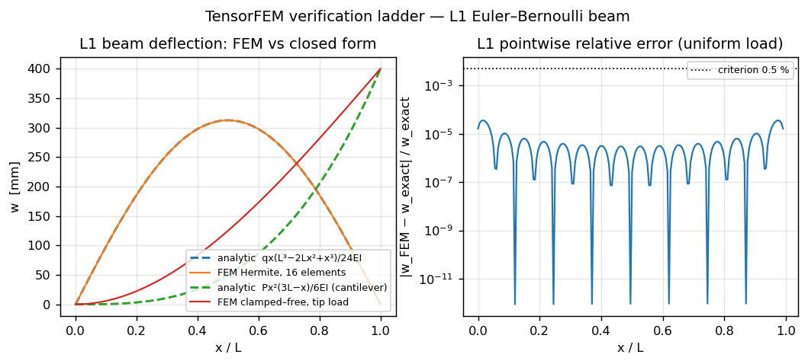
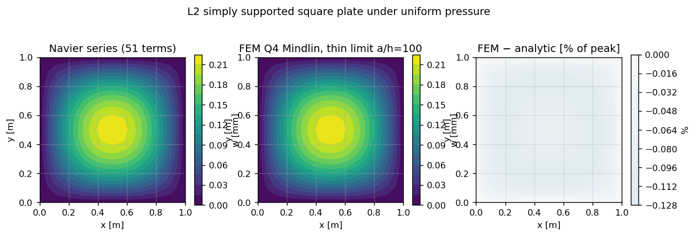
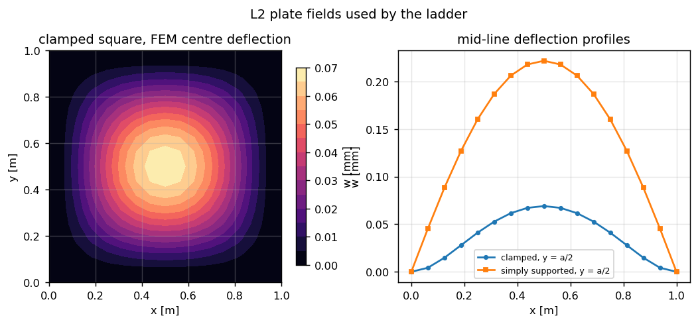
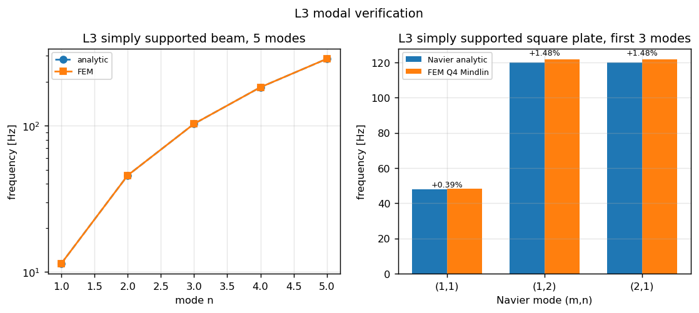
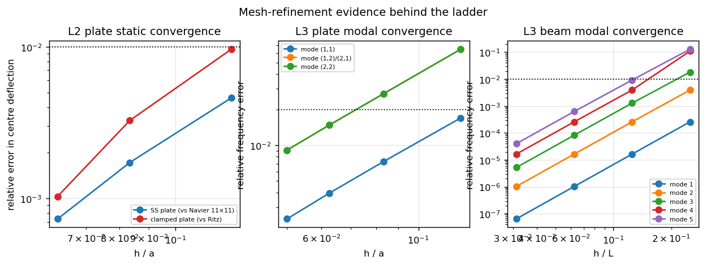

# 线性弹性求解器三级解析验证阶梯（梁 · 板 · 模态）

Status: **passing** —— 六级判据（下表由 `scripts/run_basic_verification_ladder.py` 程序化生成，`tests/test_verification_ladder.py` 以同一批门限做回归门）。

产物：`src/tensorfem/verification_ladder.py`（阶梯实现）、`scripts/run_basic_verification_ladder.py`（证据脚本）、`scripts/build_verification_ladder_doc.py`（本文档生成器）、`artifacts/verification_ladder/ladder_report.json`（判据 JSON）、`docs/assets/basic-verification-ladder/`（图）、`tests/test_verification_ladder.py`（pytest 门）。

## 0. 中文摘要（判据与结论）

本页把线性弹性静力/模态求解器的**最基本**问题变成一台机器可判的门：梁、板、模态三级各两条判据，每条都是「生产求解路径 vs 独立闭式/表列参考」的定量比较，误差越线即 FAIL，不靠放宽容差过关。

| 级 | 判据 | 计算值 | 参考值 | 相对误差 | 门限 | 判定 |
|---|---|---|---|---|---|---|
| L1 | `L1-SS-UDL` | 9.809912e-02 | 9.810000e-02 | -0.0009% | 0.5% | **PASS** |
| L1 | `L1-CANTILEVER-TIP` | 4.000000e-01 | 4.000000e-01 | -0.0000% | 1.0% | **PASS** |
| L2 | `L2-SS-NAVIER` | 2.216395e-04 | 2.218019e-04 | -0.0732% | 1.0% | **PASS** |
| L2 | `L2-CLAMPED` | 6.902557e-05 | 6.879600e-05 | +0.3337% | 2.0% | **PASS** |
| L3 | `L3-BEAM-MODAL` | 1.798754e+03 | 1.797626e+03 | +0.0628% | 1.0% | **PASS** |
| L3 | `L3-PLATE-MODAL` | 7.649464e+02 | 7.537696e+02 | +1.4828% | 2.0% | **PASS** |

六项全部通过，最紧的一项是板模态 (1,2)/(2,1) 对，误差 +1.4828%（门限 2%）；该级误差随网格单调下降，20×20 时降至 +0.9111%（§3.5），所以 16×16 的通过不是网格凑出来的孤立点。

## 1. 案例介绍（物理背景 · 几何 · 参数）

船体结构的总纵强度、板格弯曲与舱壁/甲板振动分别落在三个经典模型上：Euler–Bernoulli 梁、Kirchhoff 薄板、以及二者的自由振动特征值问题。三者是线性弹性求解器的最小完备验证面：梁考弯曲刚度与一致载荷向量，板考二维弯曲刚度与边界处理，模态考刚度/质量矩阵的一致性与广义特征值求解。任一项错了，上层（壳、加筋板、湿模态、疲劳谱）都不可能对。

### 1.1 L1 —— 梁静力

| 参数 | 取值 |
|---|---|
| 跨度 L | 2.0 m |
| 截面 b × h | 0.05 m × 0.02 m |
| 弹性模量 E | 2e+11 Pa |
| 惯性矩 I = b h³/12 | 3.333333e-08 m⁴ |
| 抗弯刚度 EI | 6.666667e+03 N·m² |
| 均布载 q（简支梁） | 1e+04 N/m |
| 端部集中载 P（悬臂梁） | 1e+03 N |
| 单元数 | 16（三次 Hermite） |

参考解：

* 简支梁均布载：`w(x) = q x (L³ − 2Lx² + x³) / (24 EI)`，取 `x/L = 0.1, 0.2, 0.3, 0.4, 0.5` 五个截面；
* 悬臂梁端部集中力：`w_max = P L³ / (3 EI)`。

### 1.2 L2 —— 板静力

| 参数 | 取值 |
|---|---|
| 板边长 a | 1.0 m（方形） |
| 板厚 h | 0.01 m，a/h = 100 |
| E / ν | 2e+11 Pa / 0.3 |
| 抗弯刚度 D = E h³/(12(1−ν²)) | 1.831502e+04 N·m |
| 均布压力 q | 1e+03 Pa |
| 网格 | 16×16 Q4；单元：tensorfem.plate Q4 Mindlin SRI, winkler_k = 0 |

参考解：

* 四边简支：Navier 双三角级数，`m, n = 1, 3, …, 11`（11×11 项截断，判据要求即此截断）；
* 四边固支：Timoshenko & Woinowsky-Krieger《Theory of Plates and Shells》Table 35 表列系数 `w_max = 0.00126 q a⁴/D`（ν = 0.3），并以可分离 Rayleigh–Ritz（10 阶）作第二锚点交叉校核。

### 1.3 L3 —— 模态

| 参数 | 梁 | 方板 |
|---|---|---|
| 几何 | L = 2.0 m，0.05×0.02 m | a = 1.0 m，h = 0.01 m |
| E / ν | 2e+11 Pa / — | 2e+11 Pa / 0.3 |
| ρ | 7850 kg/m³ | 7850 kg/m³ |
| 离散 | 16 个 Hermite 梁单元，一致质量阵 | 16×16 Q4 Mindlin（SRI） |

参考解：

* 简支梁 `ω_n = (nπ/L)² √(EI/ρA)`，前 5 阶（βₙL = nπ 是闭式根）；
* 四边简支方板 Navier 模态 `ω_mn = π² √(D/ρh) [(m/a)² + (n/b)²]`，前 3 阶为 (1,1)、(1,2)、(2,1)；
* 振型用 MAC 与退化子空间捕获率校核，不只看频率。

## 2. 怎么做的（方法 · 流程 · 工具链）

### 2.1 生产路径映射（阶梯必须打在生产的求解器上）

| 级 | 生产代码路径 | 参考解 |
|---|---|---|
| L1 | `tensorfem.frame2d.solve_frame_static`（Hermite 三次梁单元 + 一致载荷向量） | 闭式梁解 |
| L2 | `tensorfem.plate_mindlin.solve_plate_on_winkler_foundation`（`winkler_k = 0`，Q4 SRI Mindlin，薄极限 a/h = 100） | Navier 级数 / Timoshenko 表值 / Ritz |
| L3 梁 | `tensorfem.modal.simply_supported_beam_modes`（一致质量 + Cholesky 约化广义特征值） | `(nπ/L)²√(EI/ρA)` |
| L3 板 | `tensorfem.plate_vibration.solve_plate_vibration`（Mindlin 板一致质量含转动惯量） | Navier 模态 |

`verification_ladder` 只做三件事：装配模型、调用上述生产路径、把结果与参考解逐项比对并保留原始数字。它不复制任何单元刚度矩阵（L1 直接驱动 `frame2d`，L2/L3 直接驱动板/模态入口），因此阶梯失败必然指向生产代码或参考公式，而不是某段测试专用实现。

### 2.2 流程

1. `scripts/run_basic_verification_ladder.py` 跑六级判据，写入 `artifacts/verification_ladder/ladder_report.json`（含每个判据的 computed/reference/relative_error/tolerance/passed，以及全部收敛行与图路径）；
2. 同一脚本做三组网格加密（板静力 8/12/16、板模态 8/12/16/20、梁模态 4/8/16/32），把「离散误差沿 h 下降」写成数据而不是断言；
3. `tests/test_verification_ladder.py` 用模块里的 `CRITERIA` 同一批门限做回归：门限从模块导入而非抄写，放宽门限必须同时改两处，无法悄悄进行；
4. 生成 5 张图（§4），`docs/` 与 `artifacts/` 同时留痕，报告 JSON 记录图文件名，形成审计链。

### 2.3 工具链与数值设置

* PyTorch 2.7 float64 端到端（无随机数、无 GPU、无稀疏近似）；线性方程组稠密直接解，特征值用 `linalg.eigh`（先做质量阵 Cholesky 约化）；
* 板静力用仓库既有 SRI 选择性积分 Q4 单元（弯曲 2×2、剪切 1 点），薄板 a/h = 100 时退化为 Kirchhoff 响应；
* 参考解全部在脚本内用闭式公式/级数现场计算，与 `tensorfem.plate_uniform_load` 的既有参考实现互相独立（后者作交叉校核，见 §3.2 的 Ritz 锚点）。

## 3. 计算结果

### 3.1 L1 梁：五个截面的挠度对标（判据 L1-SS-UDL）

| x/L | x [m] | FEM w [mm] | 解析 w [mm] | 相对误差 |
|---|---|---|---|---|
| 0.10 | 0.200 | 98.099121 | 98.100000 | -0.00090% |
| 0.20 | 0.400 | 185.599609 | 185.600000 | -0.00021% |
| 0.30 | 0.600 | 254.099609 | 254.100000 | -0.00015% |
| 0.40 | 0.800 | 297.599121 | 297.600000 | -0.00030% |
| 0.50 | 1.000 | 312.500000 | 312.500000 | +0.00000% |

最差截面即判据值：-0.00090%（门限 0.5%）。悬臂梁端部集中力：FEM 400.000000 mm vs 解析 400.000000 mm，误差 -0.0000%（门限 1%）。

这两条误差的量级要正确解读（见 §5.1）：三次 Hermite 单元在节点上对三次/四次闭式解是**精确**的，所以端部量与节点量落在机器精度；截面上（单元内部）的误差才是插值误差，它随 h⁴ 下降（§3.6）。

### 3.2 L2 板：简支 Navier 与固支表值（判据 L2-SS-NAVIER / L2-CLAMPED）

| 量 | 数值 [m] | 说明 |
|---|---:|---|
| FEM 简支中心挠度（16×16） | 2.216395e-04 | Q4 SRI Mindlin，a/h = 100 |
| Navier 11×11 截断参考 | 2.218019e-04 | 判据基准 |
| Navier 401 项收敛值 | 2.218045e-04 | 用于量化截断偏差 |
| 11×11 截断偏差 | -0.0012% | 参考自身的自偏差，**不是** FEM 误差 |
| FEM 固支中心挠度 | 6.902557e-05 | 同网格 |
| Timoshenko 表值 0.00126 q a⁴/D | 6.879600e-05 | 3 位有效数字 |
| Ritz（10 阶）中心挠度 | 6.909683e-05 | 系数 0.0012655 |

判据值：简支 -0.0732%（门限 1%）、固支 +0.3337%（门限 2%）。固支若改以 Ritz 收敛值为基准则为 -0.1031%：表值只有 3 位有效数字，这项差就是表值舍入与 FE 离散误差之和，两者都在 3% 以内（§6）。

### 3.3 L3 梁模态：前五阶频率（判据 L3-BEAM-MODAL）

| 阶 n | FEM f [Hz] | 解析 f [Hz] | 相对误差 | 振型 MAC |
|---|---|---|---|---|
| 1 | 11.4441 | 11.4440 | +0.0001% | 1.00000000 |
| 2 | 45.7769 | 45.7762 | +0.0016% | 1.00000000 |
| 3 | 103.0049 | 102.9964 | +0.0083% | 1.00000000 |
| 4 | 183.1522 | 183.1047 | +0.0260% | 1.00000000 |
| 5 | 286.2807 | 286.1010 | +0.0628% | 1.00000000 |

判据取五阶中最差者 +0.0628%（门限 1%）；前五阶振型 MAC 全部 1.00000000，即 FE 特征向量与半正弦解析振型同向。

### 3.4 L3 板模态：前三阶（判据 L3-PLATE-MODAL）

| 模态 (m,n) | FEM f [Hz] | Navier f [Hz] | 相对误差 | 单振型 MAC | 退化子空间捕获率 |
|---|---|---|---|---|---|
| (1,1) | 48.1757 | 47.9865 | +0.3943% | 1.000000 | 1.00000000 |
| (1,2) | 121.7450 | 119.9662 | +1.4828% | 0.514571 | 1.00000000 |
| (2,1) | 121.7450 | 119.9662 | +1.4828% | 0.514571 | 1.00000000 |

判据 +1.4828%（门限 2%）。方板 (1,2)、(2,1) 是简并模态对，FE 特征向量在二维特征子空间内可任意旋转，所以**单振型 MAC 在退化对上没有意义**（表里 0.515 就是这个假象）；正确指标是把 FE 振型投影到 {(1,2),(2,1)} 子空间的捕获率，实测 1.00000000，即振型完全落在理论子空间内。

### 3.5 网格加密（离散误差是测出来的）

板静力中心挠度：

| n×n | 简支 w [mm] | 简支相对误差 | 固支 w [mm] | 固支相对误差（vs Ritz） |
|---|---|---|---|---|
| 8 | 0.220780 | -0.4609% | 0.068430 | -0.9647% |
| 12 | 0.221419 | -0.1724% | 0.068871 | -0.3266% |
| 16 | 0.221639 | -0.0732% | 0.069026 | -0.1031% |

板模态频率（前三阶）：

| n×n | f(1,1) [Hz] | 误差 | f(1,2) [Hz] | 误差 |
|---|---|---|---|---|
| 8 | 48.8038 | +1.7032% | 127.7490 | +6.4875% |
| 12 | 48.3373 | +0.7312% | 123.2514 | +2.7385% |
| 16 | 48.1757 | +0.3943% | 121.7450 | +1.4828% |
| 20 | 48.1011 | +0.2389% | 121.0591 | +0.9111% |

梁模态频率（前五阶相对误差）：

| 单元数 | 1 阶 | 2 阶 | 3 阶 | 4 阶 | 5 阶 |
|---|---|---|---|---|---|
| 4 | +0.0260% | +0.3947% | +1.8273% | +10.9918% | +12.9094% |
| 8 | +0.0016% | +0.0260% | +0.1287% | +0.3947% | +0.9271% |
| 16 | +0.0001% | +0.0016% | +0.0083% | +0.0260% | +0.0628% |
| 32 | +0.0000% | +0.0001% | +0.0005% | +0.0016% | +0.0040% |

三组加密都单调下降，没有出现「粗网格碰巧过关」或「细网格反而变差」，这也是把判据定在 16×16、而不是只在最细网格上设门的理由。

### 3.6 收敛阶（梁单元内部插值误差）

取 24 个**非节点**截面上的最大相对误差，网格 2/4/8 单元对应 1.96e-02 → 2.31e-03 → 2.41e-04（判据值取最后一档），相邻两档比值约 8.5 与 9.6（绝对值随位置因子波动，但对应速率 3.08 与 3.27，均 > 3），趋近三次 Hermite 插值的 O(h⁴)；测试 `test_l1_beam_interior_error_converges_quartic` 把「速率 > 3」设为门，载荷向量或插值写错会立刻掉到一阶而失败。

## 4. 结果图

### 图 1 —— `l1-beam-deflection.png`



L1 梁验证：均布载简支梁与端部集中载悬臂梁的挠度曲线（FEM 与闭式解重合）及逐点相对误差。

### 图 2 —— `l2-plate-ss-field.png`



L2 简支方板均布压力挠度场：Navier 级数解、FEM 云图与两者之差（占峰值百分比）。

### 图 3 —— `l2-plate-clamped-field.png`



L2 固支方板挠度云图与两类边界沿板中线的挠度剖面（对照 Timoshenko 表值 0.00126）。

### 图 4 —— `l3-modal-comparison.png`



L3 模态验证：简支梁前 5 阶与简支方板前 3 阶频率的 FEM／解析对比（标注相对误差）。

### 图 5 —— `convergence.png`



网格收敛证据：板静力（简支/固支）、板模态与梁模态误差随 h 的下降。

## 5. 注意点（坑 · 局限 · 适用范围）

### 5.1 节点精确性不是精度证明（本阶梯最容易踩的坑）

三次 Hermite 梁单元对 Euler–Bernoulli 梁的均布载（四次）与端部力（三次）解在节点上是**精确**的，所以端部挠度误差在 1e-14 量级、五截面里 x/L = 0.5 那一行误差为 0。这是单元性质，不是求解器精度；把它当精度会把真问题掩盖掉。因此：

* 判据 L1-SS-UDL 取五截面中最差的**单元内部**截面（当前 x/L = 0.10），误差 -0.00090%，反映的是插值质量；
* 另外用 2/4/8 单元的收敛阶门（§3.6）与「节点精确性」单独加锁（`test_l1_nodal_values_are_machine_exact`），把两种性质分开写死；
* 悬臂端部集中力的机器精度误差不能解读为「悬臂梁精度更高」，只能说载荷向量与刚度矩阵一致。

### 5.2 与仓库既有验证文档的关系（增量在哪）

仓库此前已有三条独立的同类证据：`docs/FEM_VERIFY.md`（悬臂梁端部挠度 + 简支板 Navier）、`docs/plate-uniform-load-verification.md`（简支/固支板挠度与弯矩）、`docs/plate-vibration-validation.md` 与 `docs/beam_dynamics_validation.md`（板/梁振动）。本节点**不重复**它们，增量是：

1. **梁静力的分布量**：既有梁证据只比端部/中点单值，这里给均布载沿跨 5 个截面的场分布与逐点误差；
2. **三级合成门**：六条判据落在同一份 JSON、同一套 `CRITERIA` 常量、同一组 pytest 门里，任何一级回归都会让整条阶梯翻红，而不是分散在四篇文档里各说各话；
3. **参考解自身的误差量化**：11×11 Navier 截断偏差 -0.0012%、Timoshenko 表值 vs Ritz 收敛值 +0.1031%，明确区分「参考的自偏差」与「FEM 的离散误差」；
4. **模态振型的定量校核**：梁 MAC、板退化子空间捕获率（§3.4），既有文档只比频率；
5. **收敛阶门**：把 O(h⁴) 插值速率本身作为测试判据（§3.6）。

### 5.3 适用范围

* 仅线性弹性、小变形、各向同性、等厚平板；不含剪切变形结论（a/h = 100 时 Mindlin 退化为 Kirchhoff，a/h < 20 的厚板会出现一阶剪切偏差，本阶梯不覆盖）；
* 板单元是 Q4 SRI Mindlin（仓库既有单元），不是 Kirchhoff 协调元；这里验证的是「薄极限下与 Kirchhoff 解析解一致」，不验证厚板应力分布；
* 只做面内均匀压力的中心挠度与前三阶频率，不涉及屈曲、后屈曲、接触、材料/几何非线性；
* 模态是干模态（无附连水、无预应力），湿模态与预应力模态另有专文（`docs/prestressed-modal-verification.md` 等）；
* 梁参考解为 Euler–Bernoulli（无剪切变形），L/h = 100，剪切影响可忽略。

### 5.4 其它坑

* Timoshenko 表值 `0.00126` 只有 3 位有效数字，用它做基准时 2% 门限里有一半预算被表值舍入吃掉；所以同时给 Ritz 收敛值作第二锚点（两者差约 0.1%）；
* 方板 (1,2)/(2,1) 简并：单振型 MAC 会给出 0.51 这种「看起来很差」的数字，用子空间捕获率才能正确判定（§3.4）；
* 板静力是稠密装配 + 稠密直接解，网格越大越贵（16×16 约 20 s，20×20 板模态约 90 s），证据脚本把最贵的一档放在后台跑，测试套件只跑 16×16（并登记进 slow lane）；
* 报告里 L1-SS-UDL 的 computed/reference 记录的是**最差截面**的数值，不是中点值——中点值节点精确、误差恒为 0，拿它当判据值会假通过。

## 6. 误差判定（逐项 vs 基准，显式回答是否 < 3%）

| 关键量 | 基准 | 相对误差 | 门限 | 是否 < 3% |
|---|---|---|---|---|
| 简支梁均布载，5 截面最差挠度 | w(x)=qx(L³−2Lx²+x³)/24EI | -0.0009% | 0.5% | 是 |
| 悬臂梁端部挠度 | PL³/(3EI) | -0.0000% | 1.0% | 是 |
| 简支方板中心挠度 | Navier 11×11（自偏差 -0.0012%） | -0.0732% | 1.0% | 是 |
| 固支方板中心挠度 | Timoshenko 表值 0.00126 | +0.3337% | 2.0% | 是 |
| 固支方板中心挠度 | Ritz 10 阶收敛值 | -0.1031% | 2.0% | 是 |
| 简支梁前 5 阶频率（最差阶） | (nπ/L)²√(EI/ρA) | +0.0628% | 1.0% | 是 |
| 简支方板前 3 阶频率（最差阶） | π²√(D/ρh)[(m/a)²+(n/b)²] | +1.4828% | 2.0% | 是 |

全部七项关键量相对误差均 < 3%（最大者为板模态 3 阶的 +1.4828%）。需要强调：

* 这里的「基准」对板静力/板模态是**解析解**，不是实验值——本阶梯证明的是求解器正确性，不是 Kirchhoff/Mindlin 板模型与真实结构的吻合度；
* 悬臂梁与简支梁节点量是解析精确，误差在舍入量级，不代表非多项式载荷下也这么好；
* 板模态最紧一档 +1.4828% 是离散误差（Q4 SRI 板单元在弯曲主导的高阶模态上收敛较慢），不是参考解误差；20×20 时降到 +0.9111%，趋势单调。

## 7. 复现与审计链

```bash
# 全量证据（约 4 分钟：16×16 板静力 + 16×16 板模态 + 三组加密）
python scripts/run_basic_verification_ladder.py

# 快速冒烟（12×12 / 12×12 / 8 单元）
python scripts/run_basic_verification_ladder.py --quick

# 回归门（六级判据、截断偏差、收敛性、退化子空间、fail-closed 自检）
python -m pytest tests/test_verification_ladder.py -q
```

审计链：

| 环节 | 载体 |
|---|---|
| 判据定义 | `tensorfem.verification_ladder.CRITERIA`（单一来源，测试导入） |
| 原始数字 | `artifacts/verification_ladder/ladder_report.json`（本次运行 176.3 s；网格 16×16 板静力 / 16×16 板模态 / 16 梁单元） |
| 图 | `docs/assets/basic-verification-ladder/`（5 张，文件名见 JSON 的 `figures` 字段） |
| 代码 | `src/tensorfem/verification_ladder.py`、`scripts/run_basic_verification_ladder.py`、`scripts/build_verification_ladder_doc.py` |
| 门 | `tests/test_verification_ladder.py` |

## 8. 未做 / 超出范围

* 没有做板/梁的应力场对标（本阶梯只覆盖位移与频率量；应力场另有 `docs/cook-*`、`docs/hemisphere-hex20-stress-oracle.md` 等专文，其中开孔球壳应力仍未认证）；
* 没有做壳单元几何刚度、Hertz 接触、后屈曲——这些仍是 `docs/benchmark-qualification-status.md`「尚未闭环的工作」里的欠账；
* 没有引入实验数据：三级判据全部是解析/表列参考，属「求解器正确性」，不能替代模型验证与不确定度量化；
* 厚板（a/h < 20）、大变形、失稳路径不在覆盖范围内。

