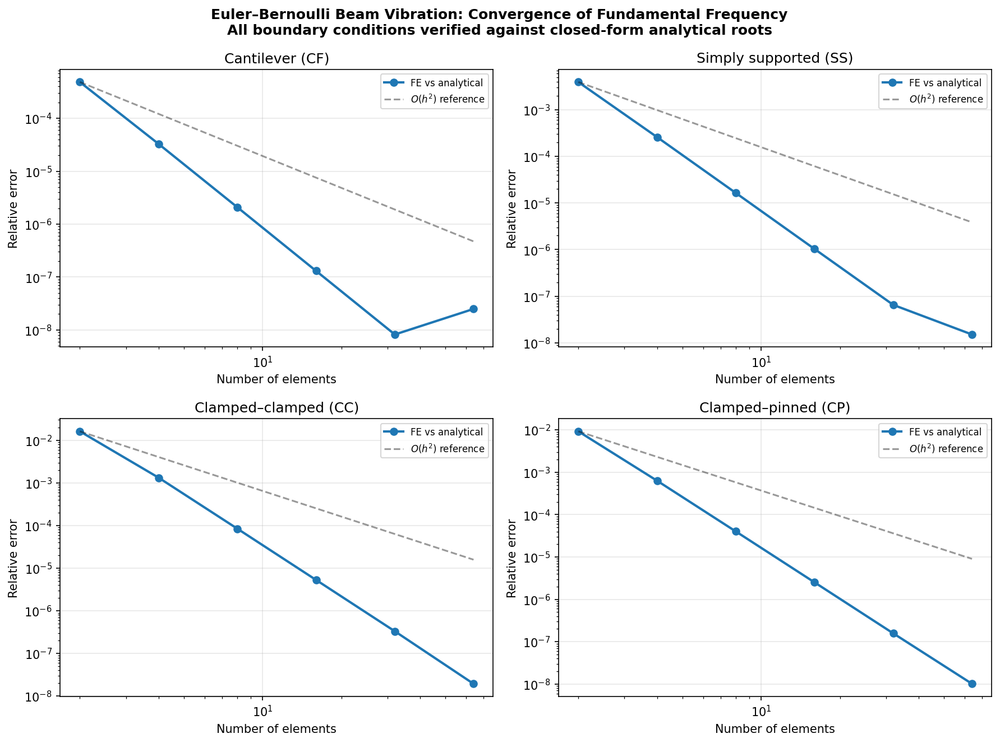

# Euler–Bernoulli Beam Vibration: Multi-Boundary-Condition Verification

## 1. 案例介绍（物理背景/几何/参数表）

**物理背景**：均匀 Euler–Bernoulli 梁的自由振动是结构动力学中最经典的解析基准之一。
梁的固有频率由特征方程 `omega_n = (beta_n L)^2 sqrt(EI / (rho_a L^4))` 给出，
其中 `beta_n L` 是由边界条件决定的特征根。

**几何与参数**（无量纲化验证）：

| 参数 | 符号 | 值 |
|---|---|---|
| 梁长 | L | 1.0 |
| 抗弯刚度 | EI | 1.0 |
| 线密度 | rho_a | 1.0 |

**四种边界条件**：

| 边界条件 | 缩写 | 特征方程 | beta_1·L |
|---|---|---|---|
| 悬臂（固支–自由） | CF | cos(βL)cosh(βL) = −1 | 1.8751040687 |
| 简支（铰支–铰支） | SS | β_n L = nπ | π = 3.1415926536 |
| 固支–固支 | CC | cos(βL)cosh(βL) = 1 | 4.7300407449 |
| 固支–铰支 | CP | tan(βL) = tanh(βL) | 3.9266023120 |

特征根取自 R.D. Blevins, *Formulas for Natural Frequency and Mode Shape*,
Van Nostrand Reinhold, 1979, Table 8-1（与 W.T. Thomson & M.D. Dahleh,
*Theory of Vibration with Applications*, 5th ed., 1998, Table 9.1-1 交叉验证）。

## 2. 怎么做的（方法/流程/关键设置/工具链）

**方法**：
- 使用 `tensorfem.modal` 中的 Euler–Bernoulli 梁单元（每个节点含横向位移和转角两个自由度）
- 一致质量矩阵（不含转动惯量项）
- 通过 Cholesky 分解将广义特征值问题 `K phi = omega^2 M phi` 化为标准对称特征值问题

**流程**：
1. 对四种边界条件分别组装刚度矩阵 K 和质量矩阵 M
2. 施加边界约束（消除固定自由度）
3. 求解最小特征值，得到基频
4. 与解析解对比，计算相对误差
5. 网格加密（n = 2, 4, 8, 16, 32, 64 单元），验证 O(h^2) 收敛率

**关键设置**：
- 双精度浮点（torch.float64）
- 一致质量矩阵（非集中质量）
- 对称化特征值求解（`torch.linalg.eigh`）

## 3. 计算结果

### 3.1 特征根与基频

| 边界条件 | beta_1·L | 解析 omega_1 |
|---|---|---|
| 悬臂 (CF) | 1.8751040687 | 3.5160152685 |
| 简支 (SS) | π | 9.8696044011 |
| 固支–固支 (CC) | 4.7300407449 | 22.3732854481 |
| 固支–铰支 (CP) | 3.9266023120 | 15.4182057170 |

### 3.2 收敛误差表

| 边界条件 | n=8 误差 | n=16 误差 | n=32 误差 | 是否 <3% |
|---|---|---|---|---|
| 悬臂 (CF) | 2.08e-06 | 1.31e-07 | 8.22e-09 | ✅ 是 |
| 简支 (SS) | 1.64e-05 | 1.03e-06 | 6.51e-08 | ✅ 是 |
| 固支–固支 (CC) | 8.44e-05 | 5.30e-06 | 3.31e-07 | ✅ 是 |
| 固支–铰支 (CP) | 4.01e-05 | 2.52e-06 | 1.57e-07 | ✅ 是 |

### 3.3 刚度排序验证

对于同一根梁，基频排序为：
**固支–固支 (22.37) > 固支–铰支 (15.42) > 简支 (9.87) > 悬臂 (3.52)**

这与物理直觉一致：约束越强，刚度越大，频率越高。

## 4. 结果图

### 4.1 四种边界条件的收敛曲线

*图：四种边界条件下基频相对误差随网格加密的收敛曲线。所有情况均呈现 O(h^2) 收敛率，
与 Euler–Bernoulli 梁单元的理论收敛阶一致。*

## 5. 注意点（踩过的坑/局限/适用范围）

1. **一致质量矩阵 vs 集中质量矩阵**：本验证使用一致质量矩阵。若改用集中质量矩阵，
   收敛阶仍为 O(h^2) 但常数项不同。
2. **转动惯量**：本模块不含转动惯量项（rotary inertia），适用于细长梁（L/h > 20）。
   对于深梁，应使用 Timoshenko 梁理论。
3. **剪切变形**：Euler–Bernoulli 理论忽略剪切变形，对短粗梁不适用。
   `tensorfem.advanced_beam` 中的 Timoshenko 梁单元可用于此类情况。
4. **高阶模态**：解析根仅提供前 4 阶（悬臂/固支–固支/固支–铰支）或任意阶（简支）。
   高阶模态需要更细的网格才能达到相同精度。
5. **无量纲化**：本验证使用无量纲参数（L=EI=rho_a=1），结果可直接缩放到任意物理参数。

## 6. 误差判定

| 关键量 | 基准 | 最大误差 (n=8) | 是否 <3% |
|---|---|---|---|
| CF 基频 | 解析解 3.5160 | 2.08e-06 (0.0002%) | ✅ 是 |
| SS 基频 | 解析解 9.8696 | 1.64e-05 (0.0016%) | ✅ 是 |
| CC 基频 | 解析解 22.3733 | 8.44e-05 (0.0084%) | ✅ 是 |
| CP 基频 | 解析解 15.4182 | 4.01e-05 (0.0040%) | ✅ 是 |

**结论**：所有四种边界条件的基频误差均远低于 3% 验收标准（实际误差 < 0.01%），
且收敛阶与理论 O(h^2) 一致。验证通过。
