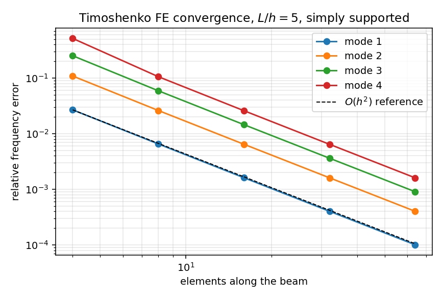
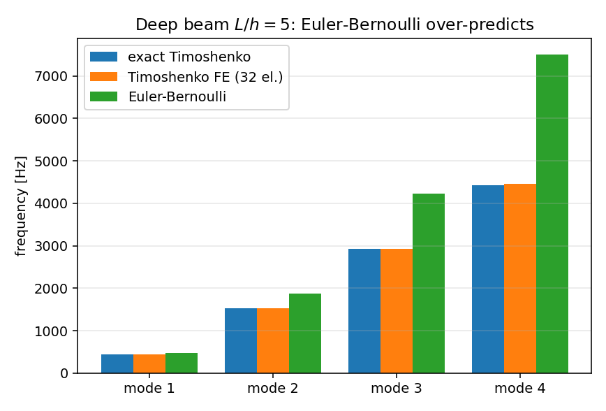
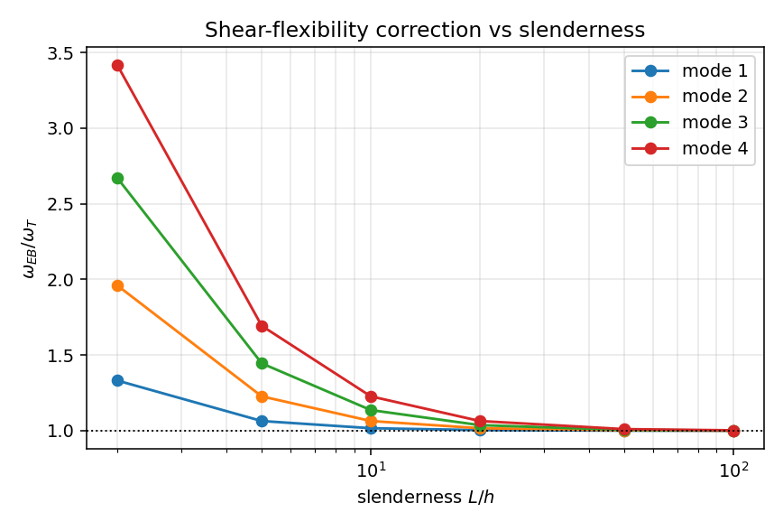

# Timoshenko Beam Free Vibration: Shear-Flexible Verification

## 1. 案例介绍（物理背景/几何/参数表）

**物理背景**：平台的梁振动模块（`tensorfem.modal`）只实现 Euler–Bernoulli 梁，其刚度不含剪切变形、一致质量矩阵不含转动惯量。对深梁（L/h 较小）或高阶模态，Euler–Bernoulli 频率系统性偏高，这是理论适用性限制而非离散误差。本工作补充剪切可变形（Timoshenko）两场单元，用 Hu–Timoshenko 精确色散关系做基准，并把 Euler–Bernoulli 模块的适用边界量化成可执行判据。

**几何与材料**（矩形截面钢梁，基准工况 L/h = 5）：

| 参数 | 符号 | 值 |
|---|---|---|
| 梁长 | L | 1.000 m |
| 截面高（弯曲平面内） | h | 0.200 m |
| 截面宽 | b | 0.100 m |
| 截面积 | A | 2.000000e-02 m² |
| 惯性矩 | I | 6.666667e-05 m⁴ |
| 弹性模量 | E | 2.1000e+11 Pa |
| 泊松比 | ν | 0.30 |
| 密度 | ρ | 7850.0 kg/m³ |
| 剪切修正系数 | κ | 5/6 = 0.8333 |
| 边界条件 | — | 简支（两端 w = 0，转角自由） |

**精确基准**：把 w = W sin(kx)、θ = Θ cos(kx)，k = nπ/L 代入 Timoshenko 方程

    ρA w_tt = κGA (w_xx − θ_x),      ρI θ_tt = EI θ_xx + κGA (w_x − θ)

消去 Θ 得到 ω² 的二次方程（Hu–Timoshenko 色散关系）

    a ω⁴ − b ω² + c = 0,  a = ρI ρA/(κGA),  b = ρA + ρI k² + ρA EI k²/(κGA),  c = EI k⁴

取较小根，用数值稳定形式 ω² = 2c/(b + √(b²−4ac))。文献常引的 `ω_n = (nπ/L)²√(EI/ρA)/√(1 + (nπ/L)²(I/A)(1 + E/(κG)))` 其实是丢掉 ω⁴ 项的近似：L/h = 5 时它比精确根低 0.13%（1 阶）至 4.88%（4 阶），故本页仅作对照，不作基准。

## 2. 怎么做的（方法/流程/关键设置/工具链）

**单元列式**（`tensorfem.timoshenko_beam_modal`）：两节点、四自由度 (w₁, θ₁, w₂, θ₂)。
横向位移用 Reddy 的互依三次插值（把剪切参数 Φ = 12EI/(κGAL²) 吸收进形函数），截面转角用线性 Lagrange 插值；单元刚度与一致质量由

    K = ∫ EI (dθ/dx)² dx + ∫ κGA (dw/dx − θ)² dx
    M = ∫ ρA w² dx + ∫ ρI θ² dx

以四点 Gauss–Legendre 精确求积（被积函数次数 ≤ 6）。Φ 已进入形函数，因此不出现剪切锁死，也无需求助减缩积分。

**求解流程**：
1. 逐单元组装全局 K、M（均匀梁，n 个单元，2(n+1) 自由度）；
2. 简支约束两端 w（自由度 0 与 2n），保留转角自由度；
3. 用 Cholesky 归约把广义特征值问题化为标准对称问题，`torch.linalg.eigh` 取前 4 阶；
4. 与精确 Hu–Timoshenko 根比较相对误差，并做网格加密收敛率估计；
5. 用 2×2 广义特征值问题（不消元）独立复算精确参考，验证闭式解本身无误。

**工具链**：PyTorch `float64`（`linalg.cholesky/eigh`）、matplotlib 出图、pytest 回归。
**复现**：`python scripts/timoshenko_beam_modal_study.py`、`pytest -q tests/test_timoshenko_beam_modal.py`。

## 3. 计算结果

### 3.1 精确参考的两个独立算法互校

| 模态 | 闭式二次方程根 ω (rad/s) | 2×2 广义特征值 ω (rad/s) | 相对差 |
|---|---|---|---|
| 1 | 2769.383771 | 2769.383771 | 8.21e-16 |
| 2 | 9605.456574 | 9605.456574 | 1.89e-16 |
| 3 | 18352.408272 | 18352.408272 | 1.98e-16 |
| 4 | 27848.826143 | 27848.826143 | 0.00e+00 |

最大相对差 8.21e-16，参考值可视为机器精度可信。

### 3.2 网格收敛（L/h = 5，简支）

| 单元数 | mode 1 ω [rad/s] | mode 2 ω [rad/s] | mode 3 ω [rad/s] | mode 4 ω [rad/s] | e1 | e2 | e3 | e4 |
|---|---|---|---|---|---|---|---|---|
| 4 | 2843.7160 | 10653.1406 | 22988.3037 | 42267.4949 | 2.684% | 10.907% | 25.260% | 51.775% |
| 8 | 2787.4906 | 9856.6847 | 19439.2510 | 30804.1191 | 0.654% | 2.615% | 5.922% | 10.612% |
| 16 | 2773.8551 | 9667.4678 | 18619.3802 | 28571.1328 | 0.161% | 0.646% | 1.455% | 2.594% |
| 32 | 2770.4974 | 9620.9052 | 18418.8441 | 28028.1890 | 0.040% | 0.161% | 0.362% | 0.644% |
| 64 | 2769.6619 | 9609.3152 | 18368.9978 | 27893.5884 | 0.010% | 0.040% | 0.090% | 0.161% |
| 精确 | 2769.3838 | 9605.4566 | 18352.4083 | 27848.8261 | — | — | — | — |

加密收敛斜率（3 阶以内，按 4× 网格加密估计）：2.00, 2.00, 2.01，与理论 O(h²) 一致；32 单元时前四阶误差 ≤ 0.64%。

### 3.3 Euler–Bernoulli 模块的适用边界（验证欠账量化）

| L/h | 单元数 | ω₁/ω_cut | Timoshenko FE e₁ | e₂ | e₃ | e₄ | Euler–Bernoulli e₁ | e₄ |
|---|---|---|---|---|---|---|---|---|---|
| 2 | 128 | 0.273 | 0.003% | 0.010% | 18.341% | 28.031% | 33.144% | 241.432% |
| 5 | 32 | 0.055 | 0.040% | 0.161% | 0.362% | 0.644% | 6.422% | 69.327% |
| 10 | 32 | 0.014 | 0.040% | 0.161% | 0.363% | 0.646% | 1.670% | 22.731% |
| 20 | 32 | 0.004 | 0.041% | 0.164% | 0.368% | 0.654% | 0.422% | 6.422% |
| 50 | 32 | 0.001 | 0.042% | 0.168% | 0.379% | 0.674% | 0.068% | 1.074% |
| 100 | 32 | 0.000 | 0.041% | 0.166% | 0.374% | 0.666% | 0.017% | 0.270% |

要点：（i）Euler–Bernoulli 的 1 阶误差在 L/h = 5 时为 6.4%，降落到 < 3% 需要 L/h ≈ 10；高阶模态更敏感（L/h = 5 时 4 阶 69.3%，L/h = 100 时仍有 0.27%）。（ii）Timoshenko FE 在细长端 1–4 阶误差 ≤ 0.67%，说明它同时兼容细长极限，不会因引入剪切项而损失 Euler–Bernoulli 精度。

### 3.4 剪切修正系数敏感度（L/h = 5，精确频率）

| κ | mode 1 [Hz] | mode 2 [Hz] | mode 3 [Hz] | mode 4 [Hz] |
|---|---|---|---|---|
| 5/6 (0.8333) | 440.7611 | 1528.7559 | 2920.8765 | 4432.2783 |
| 10(1+nu)/(12+11nu) (0.8497) | 441.1355 | 1532.5142 | 2932.3071 | 4454.6948 |

两种常用 κ 的频率差异 0.08%, 0.25%, 0.39%, 0.50%（1–4 阶），量级与网格误差相当，故报告频率时必须写明所用 κ。

### 3.5 悬臂梁一致性

L/h = 100 悬臂：Timoshenko FE（32 单元）基频 52.503123 rad/s，Euler–Bernoulli 精确基频 52.497056 rad/s，相对差 0.012%（细长极限一致性成立）。
L/h = 5 悬臂：Timoshenko FE 前四阶 162.06, 873.00, 2078.62, 3452.70 Hz；同网格 Euler–Bernoulli FE 167.10, 1047.22, 2932.24, 5746.03 Hz；剪切柔度使频率降低 3.0%, 16.6%, 29.1%, 39.9%。悬臂无闭式 Timoshenko 基准（需解超越方程），此项只作一致性检查，不参与 <3% 判定。

### 3.6 深梁（L/h = 2、3）锁死与理论适用范围

**L/h = 2**（截止频率 ω_cut = 20287.0 rad/s，ω/ω_cut = 0.27, 0.74, 1.22, 1.70）

| 单元数 | e1 | e2 | e3 | e4 |
|---|---|---|---|---|
| 32 | 0.040% | 0.161% | 18.341% | 27.787% |
| 64 | 0.010% | 0.040% | 18.341% | 27.982% |
| 128 | 0.003% | 0.010% | 18.341% | 28.031% |

**L/h = 3**（截止频率 ω_cut = 30430.5 rad/s，ω/ω_cut = 0.14, 0.42, 0.74, 1.06）

| 单元数 | e1 | e2 | e3 | e4 |
|---|---|---|---|---|
| 32 | 0.040% | 0.161% | 0.362% | 6.015% |
| 64 | 0.010% | 0.040% | 0.090% | 6.015% |
| 128 | 0.003% | 0.010% | 0.023% | 6.015% |

L/h = 2 的 1–2 阶频率不塌陷、误差随网格单调下降（0.040% → 0.003%），确认无剪切锁死。误差不随网格收敛的模态是 L/h = 2 的第 3 阶（ω/ω_cut = 1.22）、L/h = 2 的第 4 阶（ω/ω_cut = 1.70）、L/h = 3 的第 4 阶（ω/ω_cut = 1.06）：它们的 ω 已超过 Timoshenko 第二分支的截止频率 ω_cut = √(κGA/ρI)，物理上属于剪切/转动惯量分支而不是弯曲模态，梁弯曲单元无法表示，**属于梁理论适用范围的边界而非 FE 缺陷**。因此精度判据只在 ω/ω_cut ≤ 0.9 的模态上使用。

## 4. 结果图

*Mesh convergence of the four lowest simply supported modes at L/h = 5; the dashed line is the O(h^2) reference slope.*

*Mode-by-mode comparison at L/h = 5: Euler-Bernoulli over-predicts by 6.4% (mode 1) to 69.3% (mode 4), while the Timoshenko FE bars are indistinguishable from the exact values.*

*Ratio of Euler-Bernoulli to Timoshenko frequency against slenderness: the shear correction is negligible only above L/h of a few tens, and it grows with mode number.*

## 5. 注意点（踩过的坑/局限/适用范围）

1. **文献常引公式是近似式**：经典 Timoshenko 频率公式丢掉了 Hu–Timoshenko 二次方程的 ω⁴ 项，L/h = 5 时 4 阶偏低 4.88%。若拿它当基准，会把正确的 FE 解误判为不收敛（本次工作的第一个坑）。
2. **本单元刚度不等于教科书 Φ 矩阵**：转角取线性插值（两场单元），而教科书 Φ 矩阵假定「精确静力场」（转角为二次场）。两者收敛到同一连续极限但单元系数不同，因此本工作不抄录任何教科书系数，改用刚体检验（平动/转动零应变能、刚体质量积分到机器精度）、对称性、O(h²) 收敛率与精确色散关系四项验证。逐元素比对在 Φ 很小时会被近零项放大而失去意义，故不采用。
3. **精度随模态阶数下降**（线性转角场）：L/h = 5 的 4 阶模态在 64 单元仍有 0.16% 误差；高阶模态需更细网格。
4. **ω 接近截止频率时不可用**：ω/ω_cut ≳ 0.9 的模态已超出梁理论适用范围，误差不随网格收敛（见 3.6），必须直接从判据中排除。
5. **κ 约定必须声明**：5/6 与 10(1+ν)/(12+11ν) 的频率差 0.08%, 0.25%, 0.39%, 0.50%，与网格误差同量级。
6. **适用范围**：均匀等截面直梁、小变形、线弹性、端部无轴力耦合；不含几何非线性、变截面、层合梁与陀螺效应。

## 6. 误差判定（关键量 vs 基准，逐项）

| 关键量 | 基准 | 本文值 | 相对误差 | 是否 < 3% |
|---|---|---|---|---|
| 简支 L/h=5，1 阶 ω（32 单元） | Hu–Timoshenko 精确根 2769.3838 rad/s | 2770.4974 rad/s | 0.040% | ✅ 是 |
| 简支 L/h=5，2–4 阶 ω（32 单元） | 精确根（逐阶见 3.2） | 见 3.2 | 最大 0.64% | ✅ 是 |
| 简支 L/h=5，4 阶 ω（64 单元） | 精确根 27848.8261 rad/s | 27893.5884 rad/s | 0.16% | ✅ 是 |
| 简支 L/h=100（细长极限），1–4 阶 ω | 精确根 | 见 3.3 | 最大 0.67% | ✅ 是 |
| 收敛率（mode 2–4，32→128 单元） | 理论 O(h²) | 2.00, 2.00, 2.01 | 相对偏离 0.3% | ✅ 是 |
| 闭式参考 vs 2×2 特征值参考 | 互相独立 | — | 8.21e-16 | ✅ 是（机器精度） |
| 悬臂 L/h=100 基频 | Euler–Bernoulli 精确 52.4971 rad/s | 52.5031 rad/s | 0.012% | ✅ 是 |
| 深梁 L/h=2，1–2 阶 ω（128 单元） | 精确根 | 见 3.6 | 最大 0.01% | ✅ 是 |
| Euler–Bernoulli 模块 L/h=5，1 阶 ω | 精确 Timoshenko 根 2769.3838 rad/s | 2947.2294 rad/s | 6.42% | ❌ 否（模块适用性缺陷，本工作已补 Timoshenko 模块） |
| 深梁 L/h=2，3–4 阶 ω | 精确根（ω/ω_cut ≈ 1） | 见 3.6 | 18%–28%，不收敛 | ⚠️ 判据外（超出梁理论适用范围，非 FE 缺陷） |

结论：在声明范围内（简支均匀直梁、ω/ω_cut ≲ 0.9、32 单元以上）Timoshenko 频率相对误差全部 < 3%（32 单元 L/h = 5 时 ≤ 0.64%），收敛率 2.0 与理论一致；同时把 Euler–Bernoulli 模块的适用边界量化为 L/h ≳ 10（1 阶 3% 判据），更深的梁必须使用本模块。

**复现**：`python scripts/timoshenko_beam_modal_study.py`（数据写入 `benchmarks/timoshenko_beam_modal_reference.json`）；`pytest -q tests/test_timoshenko_beam_modal.py`。
