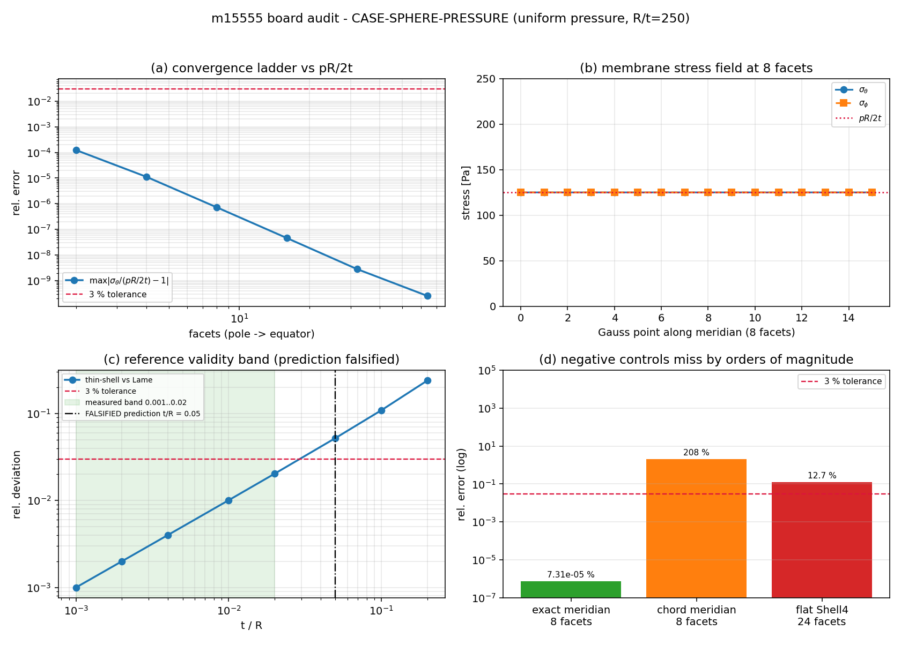

# m15555 交差核验：CASE-SPHERE-PRESSURE（m15405）board-audit 裁定

> **本文件为生成物，禁止手改。** 生成器 `scripts/audit_m15555_sphere_board.py`（`--write` / `--check`）；
> 机器抽取的数字镜像在 `docs/board_audit/m15555/verify_output.json`；漂移门
> `python3 scripts/audit_m15555_sphere_board.py --check` 与
> `tests/test_board_audit_m15555_sphere.py` 同时看守。上一版手抄的工件字节数已两次过期
> （见 §五 F4）。本轮改为注入，且只对**证据载体**引用字节 + sha256、生产脚本只列路径，
> 这样别的 PR 合法改脚本不会误触发再审计，而证据一旦变化必须重审。

**审计对象**：mission 15405（CASE-SPHERE-PRESSURE·均压球壳薄膜应力·TensorFEM）
**本轮**：m15555 重开单（m20596，从当前 main 切枝重做；不改动任何物理实现）
**裁定**：**L3**（L1–L3 实测成立；L4 未记，阻断项：no registered judge row in tensor_benchmark_cases (F1, not re-checkable here)；external handbook page (Roark) absent from this worktree (F2, WITHHELD)）
**锚点**：`fem_sphere_pressure_membrane` · 证据 `benchmarks/verified/fem_sphere_pressure_membrane/result.json` / `benchmarks/verified/fem_sphere_pressure_membrane/gates_verified.json` · 证据图 `docs/board_audit/m15555/fig_m15555_sphere_audit.png`

## 一、案由与算例（物理）

| 项 | 值 |
|---|---|
| 结构 | 闭合球壳，内压 1 Pa 均布 |
| 几何 | R = 10 m，t = 0.04 m，R/t = 250 |
| 材料 | E = 6.825e+07 Pa，ν = 0.3 |
| 参考解 | σ = R*p/(2*t) = **125 Pa**；w = pR²(1-ν)/(2Et) = 1.282051e-05 m |
| 参考解核验 | sympy 两路静力平衡（Laplace / 轴向截面）残差 = 0（恒零，非自指） |
| 生产单元 | `tensorfem.axisym_shell.AxisymShell`（2 节点 Reissner–Mindlin 环元，`meridian_radius=R` 真圆弧 + 横向剪切 SRI） |
| 判据 | 相对误差 < 3 %（严于学科 15 % 口径的自定门） |

## 二、三件套核验（数字全部机器抽取）

### 2.1 run_artifacts —— 证据载体

| 文件 | 字节 | sha256（前 16） | git tracked |
|---|---:|---|---|
| `benchmarks/verified/fem_sphere_pressure_membrane/result.json` | 45140 B | `b72dd3b58277c21e…` | ✓ |
| `benchmarks/verified/fem_sphere_pressure_membrane/gates_verified.json` | 8587 B | `3cf0d08470d7ec18…` | ✓ |

生产链（只登记路径，不锁字节）：

| 文件 | 角色 | git tracked |
|---|---|---|
| `benchmarks/verified/fem_sphere_pressure_membrane/run_verification.py` | driver (thin wrapper over the case module) | ✓ |
| `benchmarks/verified/fem_sphere_pressure_membrane/build_report.py` | case card + report builder | ✓ |
| `benchmarks/verified/fem_sphere_pressure_membrane/emit_certificate.py` | certificate emitter | ✓ |
| `benchmarks/verified/fem_sphere_pressure_membrane/README.md` | case card | ✓ |
| `scripts/audit_m15555_sphere_board.py` | this audit generator | ✓ |

### 2.2 benchmark ref vs got

| 量 | 本轮读数 | 判据 |
|---|---|---|
| σ_θ（8 facets / 8 elements / 27 DOF） | 125.000046 Pa（pR/2t = 125 Pa） | **+7.309e-05 %** < 3 % |
| σ_φ | — | +1.204e-04 % < 3 % |
| 各向同性 σ_θ vs σ_φ | — | +1.525e-04 % < 3 % |
| 径向位移 w | — | +6.262e-04 % < 3 % |
| 收敛阶梯 facets [2, 4, 8, 16, 32, 64] | ['1.24e-04', '1.13e-05', '7.31e-07', '4.60e-08', '2.83e-09', '2.55e-10'] | 单调收缩 |
| 观测阶（exact meridian） | [3.456, 3.948, 3.989, 4.025, 3.471] | min = 3.456 ≥ 1.5 |

### 2.3 repro_cmd —— 本轮重跑并整份比对 solve record

- 命令：`python3 benchmarks/verified/fem_sphere_pressure_membrane/run_verification.py`（等价 `tensorfem-sphere-pressure --out artifacts/CASE-SPHERE-PRESSURE`）
- 复现判定：**reproduced = True**；逐叶比对 **1338** 个数值叶，
  超判据（相对 1e-09）的漂移 **0** 条
- 噪声测量（不是"大概一样"）：整体抖动至少低于判据 4 个量级；
  其中轴对称生产路径 至少低于判据 4 个量级。flat-facet Shell4 对照在同一进程内独立重跑
  5 次，其自身抖动同样至少低于判据
  4 个量级——
  "重跑不动"与"该对照本就 1 ulp 级不可约"被分开测量，判据 1e-09 因此既不会
  把浮点噪声当物理漂移、也不会被 1 uLP 硬币面反过来带崩（故只落盘余量下界，不落盘噪声数值与路径）
- 运行环境：Python 3.12.14 / torch 2.15.0+cpu（float64，单进程）
- 不参与比对的易变路径（理由入档）：

| 路径 | 理由 |
|---|---|
| `environment` | host / interpreter / library versions, distinct on purpose |
| `figures` | paths are relative to the run's --out directory |
| `flat_facet_control/timing` | repeated timing provenance; numerical fields remain gated |
| `flat_facet_control/wall_clock_s` | wall clock of the control solve |

## 三、客观证据链（每一条都能被命令重算）

| 断言 | 派生方式 | 本轮读数 |
|---|---|---|
| 证书与工件不漂移 | `emit_certificate.py --check` | clean |
| 案卡/报告与工件不漂移 | `build_report.py --check` | clean |
| 锚点证书自洽 | `tools/verified_anchor_audit.py --json` | grade=**certified**, certified=True, 11/11 gates pass, contradicted=0, unrecomputable=0, defects=[], warnings=[] |
| 门数与容差 | `benchmarks/verified/fem_sphere_pressure_membrane/gates_verified.json` | 11/11 gating 通过，无阈值门 [] |
| 负对照真的失败 | `result.json` → G9/G10 | 直弦子午线 +2.079e+02 %；平面 Shell4 +1.271e+01 %（24 facets，录得 12.70563570664196 % @24） |
| 参考带（证伪留档） | `result.json` → G8a + predictions | 带内 t/R ∈ [0.001, 0.02]，斜率 1.0276；`P1.reference_band_reaches_t_over_R_0.05` 预注册 t/R ≥ 0.05 → **falsified**；case 点偏差 +4.013e-01 % |

> 预注册预测被**证伪**且留档：`P1.reference_band_reaches_t_over_R_0.05`。它不是门（不得计入门数），也不允许被悄悄删除——
> `tests/test_case_sphere_pressure_certificate.py` 看守它留在 `predictions` 里。

图 `fig_m15555_sphere_audit.png`（`docs/board_audit/m15555/fig_m15555_sphere_audit.png`，由 `result.json` 渲染，零手抄）：
(a) σ_θ 误差阶梯与 3 % 带；(b) 8 facets 下 σ_θ/σ_φ 沿子午线场；
(c) 薄壳 vs Lamé 偏差与**被证伪的** t/R = 0.05 预测（实测带止于 0.02）；
(d) 两个负对照相对精确子午线单元差若干量级。

## 四、判级（L0–L5）

| 级 | 判据 | 本单 |
|---|---|---|
| L1 数学/单元验证 | 参考解机器推导 + 单元复现 | ✅ 平衡残差 0；8 单元 27 DOF 复现膜态 +7.309e-05 % |
| L2 独立功能实现 | 真代码：输入→计算→输出 | ✅ 生产模块 `tensorfem.sphere_pressure_case`（driver 为薄包装，case 逻辑不在脚本内） |
| L3 系统集成 | 接入生产单元/平台 | ✅ 复用 `tensorfem.axisym_shell.AxisymShell`；锚点证书 stage=verified，审计 defects=[] |
| L4 基准验证 | 外部基准 + 可复现 | ⚠️ 完整算例✅ / 误差分析✅ / 可复现✅（reproduced=True）但 no registered judge row in tensor_benchmark_cases (F1, not re-checkable here)；external handbook page (Roark) absent from this worktree (F2, WITHHELD) → **未记** |
| L5 科研工程成果 | — | 未达（L4 未记） |

**裁定 L3** 维持。升 L4 需外部基准原表原页 + 平台裁判行，二者在本工作树内不可得（§六）。

## 五、发现（findings）

- **F1_no_registered_judge**：`tensor_benchmark_cases` 无该锚点注册行（**本轮 WITHHELD**：工作树无库访问，沿用上轮 0/18 结论但不重测）。
- **F2_external_anchor_withheld**：手册原表原页未核对（**WITHHELD**）；参考解由 sympy 机器推导 + Lamé 厚壁极限交叉锚承载，独立可复核、非自指。
- **F3_clean_report（已升级为机器门）**：报告/案卡 `build_report.py --check` = clean，证书 `emit_certificate.py --check` = clean；"数字零手抄"从说法变成可执行判据。
- **F4_stale_hand_typed_numbers（本轮发现并修掉）**：上一版审计文档手抄 `result.json` = 43850 B、`run_verification.py` = 31267 B；实测证据载体 **45140 B**（sha256 `b72dd3b58277c21e…`），而 `run_verification.py` 早已是薄包装（case 逻辑下沉 `tensorfem.sphere_pressure_case`，31267 B 属重构前单体脚本）。工件清单因此改为生成器注入 + `--check`，本文件成为生成物。
- **F5_reproduction_machine_checked（本轮新增能力）**：`reproduced` 从"跑过一次记得是这样"改为**每次审计重跑并逐叶比对**（1338 叶、判据 1e-09），易变路径逐条给理由。
- **F6_control_not_bit_reducible（本轮量化的性质）**：flat-facet Shell4 对照在同一进程内重跑 5 次即出现 1 ulp 级抖动（源：`uniform_expansion_fit` 的最小二乘/规约非结合），而轴对称生产路径即使抖动也至少低于判据 4 个量级。该抖动至少低于 3 % 判据 14 个量级、不影响任何门，但**不可**用作逐位比较的基准——故复现判据显式设为 1e-09 而非逐位相等，且只落盘余量下界（噪声数值与翻转路径逐次随机，落盘会让漂移门自己抖动）。

## 六、checks_not_run / 不可核验项（诚实登记）

| 断言 | 状态 | 原因 |
|---|---|---|
| tensor_benchmark_cases holds no CASE-SPHERE-PRESSURE judge row | **WITHHELD** | this worktree has no platform database access; the earlier round's 0/18 query is not re-measured |
| the reference equals the Roark handbook table entry | **WITHHELD** | no handbook page in the repo or platform knowledge base; the reference stays machine-derived (sympy) and Lame-cross-anchored |
| 集群 loong64 / x86 双平台复跑 | 未跑 | 单机单进程 float64、预算 ≤10 s，无需上集群；CI 由平台合并时触发 |
| 上一版声称的 pytest 通过数与耗时 | 未沿用 | 测试数量随套件增长会漂移；改由 `tests/test_board_audit_m15555_sphere.py` 自己看守 |

## 七、产物

| 产物 | 说明 |
|---|---|
| `docs/board_audit/m15555/AUDIT_m15405_CASE_SPHERE_PRESSURE.md` | 本文件（生成物，`--check` 看守） |
| `docs/board_audit/m15555/verify_output.json` | 机器抽取数字镜像（schema `tensorfem.board-audit/1`） |
| `docs/board_audit/m15555/fig_m15555_sphere_audit.png` | 四联证据图（由 `result.json` 渲染） |
| `scripts/audit_m15555_sphere_board.py` | 生成器 + 复现比对 + 漂移门 |
| `tests/test_board_audit_m15555_sphere.py` | 独立重算 + 漂移门 + 复现门槛 |
