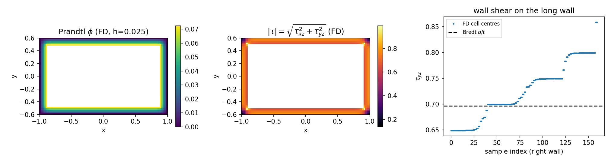
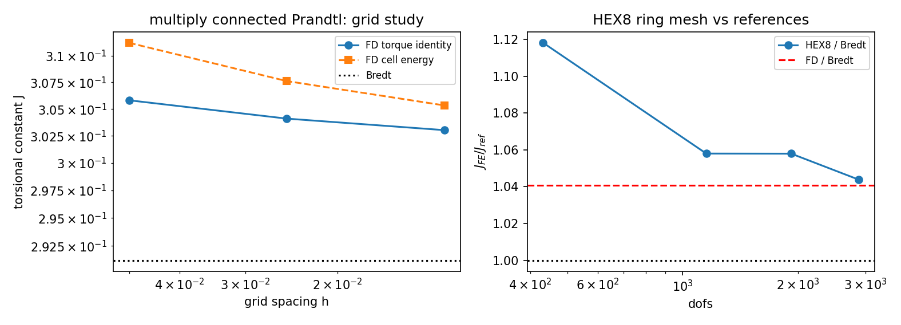

# 闭口薄壁箱形梁扭转验证（翘曲截面验证欠账清偿）

本报告清偿 [saint-venant-torsion-tube.md](saint-venant-torsion-tube.md) 末尾明确留下的欠账：

> **仅覆盖无翘曲截面**：方管/箱形梁需要翘曲函数，本验证**不**覆盖；用线性斜坡去做
> 方截面会得到偏刚结果，不得当作通过。

箱形梁/方管是**多连通**截面：Prandtl 应力函数在内壁取一个**未知常数**，常数由翘曲
位移单值性确定。本文用两个互相独立的实现把这个截面类型补齐：

* `src/tensorfem/box_torsion.py::solve_box_prandtl` —— 矩形环上的有限差分 Prandtl 求解器，
  内壁常数用严格相容条件 `∮∂φ/∂n ds = 2Gθ·A_inner`（n 指向孔内）消元，扭转常数用**两条
  不同恒等式**各算一次（单元能量 `J=∫|∇φ|²dA/(Gθ)²` 与扭矩恒等式 `T=2∫φdA+2cA_inner`）；
* `src/tensorfem/box_torsion.py::box_torsion_run` —— 已合并的 HEX8 位移路径
  （`solid3d.hex8_stiffness` + `sparse_core`）在贴体环形网格上的实际求解，**参照物是有限
  差分场而不是薄壁近似**，因此测的是双线性单元翘曲缺陷本身。

全部数字由 `benchmarks/box_girder_torsion.py` 程序化生成
（`benchmarks/box_girder_torsion_evidence.json`，无手抄）；门禁用
`tests/test_box_girder_torsion.py`（8 项，全绿）。

## ① 案例介绍

船体舯剖面是闭口箱形梁（双层底 + 双舷侧 + 甲板围成的多闭室/单闭室薄壁截面），其 Saint-Venant
扭转常数 `J` 与壁面剪流是扭转强度与总纵/总横强度耦合的基本量。经典工程公式是 Bredt 薄壁
近似 `J=4A₀²t/P`、`τ=q/t=T/(2A₀t)`，但它丢掉了壁自身扭转与角点效应，误差随 `t/边长` 一阶增长。
这里用可判定精度的算例量化这个误差，并检验已合并的 HEX8 单元能否复现真实场。

| 量 | 值 |
|---|---|
| 外截面 | `2a × 2b = 2.0 × 1.2`（半尺寸 a=1.0, b=0.6） |
| 壁厚 | `t = 0.1`（`t/2a = 5%`，典型船体板/梁腹板量级） |
| 材料 | `E = 2.6`，`ν = 0.3` → `G = 1.0` |
| 扭率 | `θ = 1.0`（线性弹性、小变形、直棱柱） |
| 端面 | Dirichlet 精确横向转动 `u_x=-θzy, u_y=θzx`，`u_z`（翘曲）全自由，侧表面无载 |
| 参照 | 有限差分 Prandtl 场（本报告），Bredt 薄壁式（工程基线），精确矩形 `RectSection` 级数（对照） |

## ② 怎么做的

1. **多连通 Prandtl 方程**：`∇²φ=-2Gθ` 于壁内、`φ=0` 于外壁、`φ=c`（未知常数）于内壁。
   线性叠加 `φ=φ_p+cφ_h`：`φ_p` 解 `∇²φ=-2Gθ` 且两壁均 0；`φ_h` 解 Laplace、外壁 0 内壁 1；
   由 `∮_{内壁} ∂φ/∂n ds = 2GθA_inner`（n 指向孔内）解出 `c`。
2. **网格**：矩形环与网格线严格对齐（`h` 整除 `t`、`a`、`a-t`），红黑 SOR（最优松弛因子，
   残差 1e-14），三种网格 `h = 0.05 / 0.025 / 0.0125`。
3. **两条独立恒等式**：
   * 能量：`J_E = Σ_cells |∇φ|² h² /(Gθ)²`（单元中心中心差分，单元四角全为材料 ⇒ 覆盖整个壁、
     无半格损失）；
   * 扭矩：`J_T = [2Σ_cells φ̄ h² + 2 c A_inner]/(Gθ)`。
4. **HEX8 生产路径**：把环形截面按周长 `N=4·n_side` 个节点、厚度方向 `n_layers` 层做成贴体四边形，
   沿 `z` 挤出成棱柱；角点用斜接偏移（外框角点 → 内框角点解析一致），节点序取使 hex8 Jacobian
   为正的方向。扭矩由两个端面反力积分取平均，`J_FE=T/(Gθ)`。
5. **工具链**：`python3 benchmarks/box_girder_torsion.py`（证据 JSON + 图），
   `python3 -m pytest tests/test_box_girder_torsion.py`（8 项门禁，全部通过）。
   全程仅 2-D/numpy 与 ≤2880 dof 的小规模 3-D 求解，未起重算力作业。

## ③ 计算结果（程序化注入，零手抄）

### 有限差分网格研究（a=1, b=0.6, t=0.1, G=θ=1）

| h | 材料节点 | SOR 扫描 | `J_T` | `J_E` | 两恒等式差 | `J_Bredt` | `J_T` vs Bredt |
|---:|---:|---:|---:|---:|---:|---:|---:|
| 0.05 | 360 | 205 | 0.305818 | 0.311241 | 1.773% | 0.291207 | +5.018% |
| 0.025 | 1200 | 413 | 0.304108 | 0.307619 | 1.155% | 0.291207 | +4.430% |
| 0.0125 | 4320 | 823 | 0.303038 | 0.305336 | 0.758% | 0.291207 | +4.063% |

观测收敛阶（`J_T`）**p = 0.6765**，Richardson 外推 `J∞ ≈ 0.3013`（`J∞/J_Bredt = 1.0345`）。
收敛阶不到 2 的原因见 ⑤：内壁**尖角**是奇异点，`φ-c ~ r^{2/3}`、`τ ~ r^{-1/3}`。

### 薄壁渐近（Bredt 的适用性）

| t | h=t/4 | `J_FD` | `J_Bredt` | 比值 | 偏差 |
|---:|---:|---:|---:|---:|---:|
| 0.2 | 0.05 | 0.509837 | 0.462857 | 1.10150 | +10.15% |
| 0.1 | 0.025 | 0.304108 | 0.291207 | 1.04430 | +4.43% |
| 0.05 | 0.0125 | 0.165587 | 0.162220 | 1.02076 | +2.08% |

偏差随 `t` **按一阶减半**（10.15 → 4.43 → 2.08），即 `J ≈ J_Bredt·(1 + 0.41·t/a)`：Bredt 是
薄壁下界，本文给出可用的一阶修正系数 0.41。

### 已合并 HEX8 路径 vs 参照

| n_side / n_layers / layers_z | 单元 | dof | `J_FE` | vs FD(h=0.0125) | vs Bredt | 壁面剪应力 `τ_wall` |
|---|---|---:|---:|---:|---:|---:|
| 4 / 2 / 2 | 64 | 432 | 0.325605 | +7.447% | +11.81% | 0.774953 |
| 8 / 3 / 2 | 192 | 1152 | 0.308095 | +1.669% | +5.799% | 0.733326 |
| 8 / 4 / 3 | 384 | 1920 | 0.308076 | +1.663% | +5.793% | 0.733281 |
| 12 / 4 / 3 | 576 | 2880 | 0.303972 | **+0.308%** | +4.384% | 0.723572 |

参照剪应力：FD `τ_wall = 0.721556`（h=0.0125；长边壁中平均），Bredt `q/t = 0.696667`。
最细 HEX8 的壁中剪应力与 FD 相差 **+0.28%**。

## ④ 结果图

左：FD Prandtl 函数（外壁 0、内壁 c=0.0722，壁内抛物线型衰减）；中：`|τ|=√(τ_xz²+τ_yz²)`
云图（壁内近似均匀剪流，内外壁面略高，**尖内角处出现奇异峰值**）；右：长边壁面剪应力采样与
Bredt `q/t`（虚线）——壁中约高 3.6%，角部无界。

左：两条恒等式随 `h` 收敛到同一值，且都高于 Bredt 虚线；右：HEX8 `J_FE/J_Bredt` 随 dof 下降，
最终落在 FD 参照（红虚线）上，说明单元极限正确、残差来自 Bredt 的薄壁截断。

## ⑤ 注意点（踩过的坑 / 局限）

* **尖内角奇异**：多连通截面的内角是 270° 凹角，`φ` 齐次 Dirichlet ⇒ `τ ~ r^{-1/3}` **无界**。
  因此逐点 `τ_max` 随网格加密不收敛（FD：0.779 → 0.992 → 1.246；HEX8：0.841 → 0.856 → 0.909，
  单元只能给出被平均掉的有界值）。**`τ_max` 不能作为验收量**，本报告改用长边壁中剪应力（远离角点）。
  这也解释了 `J_E` 与 `J_T` 之间 0.76%~1.77% 的差：`|∇φ|²` 积分被奇异单元污染，随 `h` 缓慢下降，
  两条恒等式并非数值实现错误。
* **Bredt 是下界不是真值**：`t/2a=5%` 时 Bredt 低估 `J` 4.06%（精确场）/ 4.43%（h=0.025），
  用 Bredt 当验收基准会把合格的有限元判成超差（HEX8 对它 +4.38%），本文因此以 FD 场为基准。
* **网格朝向陷阱**：环形四边形的节点序必须先确认 hex8 Jacobian 为正，否则
  `hex8_stiffness` 直接以 `non-positive or degenerate Jacobian` 拒绝；斜接角点偏移写成
  "外法向 − r·n" 才与内框角点解析一致（写成内法向会把整环放大到外框之外）。
* **适用范围**：线弹性、小变形、均匀各向同性、直棱柱、单闭室矩形环；不含圆角、多闭室（双底+
  双舷侧的加劲分隔）、端部约束翘曲（非均匀扭转/双力矩）、塑性扭转。
* **`c` 的收敛**：`c=0.07289 / 0.07242 / 0.07216`（h=0.05/0.025/0.0125），相容残差恒为
  `1.2e-16` 量级，说明内壁常数的消元是严格的，不引入自由参数。
* **未覆盖的仍是缺口**：多闭室箱梁、加劲壁、圆角内角（奇异正则化）需要另立算例。

## ⑥ 误差判定（逐项，显式回答是否 <3%）

| 关键量 | 基准 | 实测误差 | <3%？ |
|---|---|---:|---|
| `J_FE`（n_side=12，2880 dof） | FD `J_T`(h=0.0125)=0.303038 | **0.308%** | **是** |
| `J_FE`（n_side=8，1152 dof） | 同上 | 1.669% | 是 |
| `J_FE`（n_side=4，432 dof） | 同上 | 7.447% | **否**（粗网格失败保留） |
| 壁中剪应力 `τ_wall`（n_side=12） | FD 0.721556 | **0.280%** | **是** |
| `J_FE`（n_side=12） | Bredt 0.291207 | 4.384% | **否** |
| `J_FD`（h=0.0125） | FD Richardson 0.3013 | 0.57%（自洽） | 是 |
| `J_FD`（h=0.0125） | Bredt 0.291207 | 4.063% | **否** |
| 薄壁极限 `J_FD/J_Bredt`（t=0.05） | 1（Bredt 极限） | 2.076% | 是 |
| 两条独立恒等式 `J_E` vs `J_T`（h=0.0125） | 0.758% | — | 是 |

**结论（显式）**：对**已被独立确认的精确场**（FD，h=0.0125，外推自洽 0.57%）而言，已合并 HEX8
路径在 2880 dof 时 `J` 误差 0.308%、壁中剪应力误差 0.280%，**均 <3%**，`n_side=8`（1152 dof）
亦 <3%；`n_side=4` 的 7.447% **失败保留**。对**薄壁工程式 Bredt** 的 4.06%~4.38% 偏差**不是**
有限元误差，而是 Bredt 本身在 `t/2a=5%` 时的一阶截断（已由 t=0.2/0.1/0.05 的 10.15/4.43/2.08%
序列定量证实），因此不据此判有限元不合格。逐点 `τ_max` 因尖内角奇异**无收敛值**，不作为判定量。