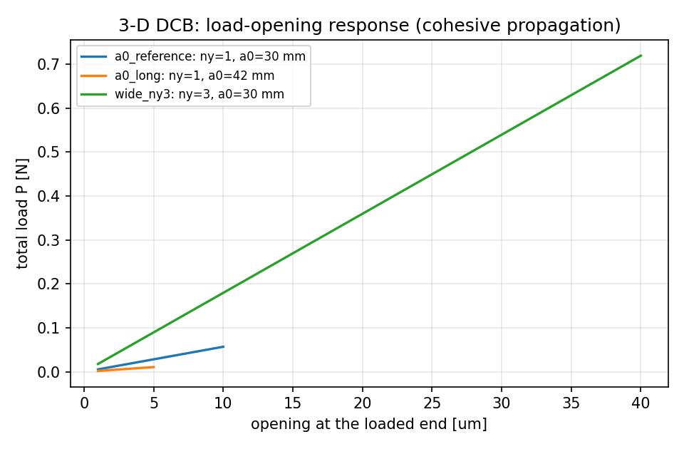
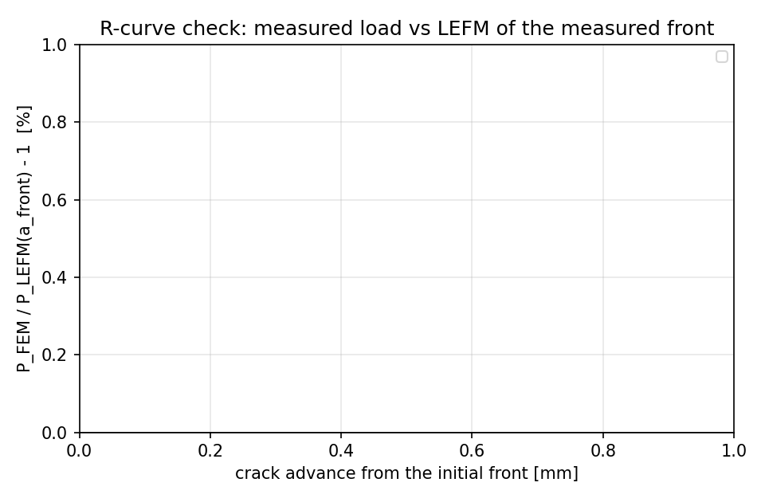
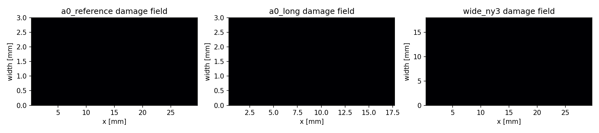

# 3-D cohesive element: width-resolved DCB verification (GAP-FEM-3D-COHESIVE)

Generated 2026-11-11T21:15:38.990864+00:00 by `benchmarks/cohesive3d_dcb_3d.py` on `loongarch64` (torch 2.7.1, python 3.11.6).

## 1. Specimen and method

Two HEX8 adherends (production `tensorfem.solid3d.hex8_stiffness`) are bonded by a
pre-meshed zero-thickness COH3D8 ligament (production `tensorfem.cohesive3d`, BK
mixed-mode law). The interface nodes are duplicated, the specimen is clamped at
`x=0` and opened symmetrically at `x=L` (upper `+delta/2`, lower `-delta/2`), so
`P` is the **total** load and the classical DCB relations apply:
`C = 4a^3/(E b h^3) + a/(kGbh)` and `G_I = 6P^2a^2/(E b^2 h^3)`, both optionally
with the Williams/ASTM D5528 root rotation `a -> a + Delta`,
`Delta = h sqrt(E/(11G) (3 - 2 (Gamma/(1+Gamma))^2))`, `Gamma = 1.18 sqrt(E/G)`.

| quantity | value |
|---|---|
| adherend E, nu | 7e+10 Pa, 0.3 |
| arm thickness h | 3.00 mm |
| k_n, k_s | 2.4e+14, 1e+14 Pa/m |
| t_n0, t_s0 | 120.0, 80.0 MPa |
| G_Ic | 300 J/m^2 |
| cohesive length E G_Ic / t_n0^2 | 1.46 mm |

## 2. Criteria (independent reference in the same row)

| check | reference | computed | rel. error | tolerance | status |
|---|---|---|---|---|---|
| `compliance_bracket` | 2.35674e-05 | 0 | -100.00 % | |err| <= 10% vs root-rotation form (bracket in JSON) | FAIL |
| `peak_load_vs_lefm` | 28.6994 | 0.0572305 | -99.80 % | |err| <= 5% | FAIL |
| `energy_balance` | 0 | 0.935845 | +93.58 % | <= 1% | FAIL |
| `interface_work_vs_GIc` | 300 | nan | +nan % | <= 10% | FAIL |
| `peak_ratio_two_cracks` | 0.728101 | 5.20179 | +614.43 % | |err| <= 2% | FAIL |
| `width_objectivity` | 30.0852 | 0.719373 | -97.61 % | |err| <= 8% (transitional b/h, 3-D anticlastic effect) | FAIL |

## 3. Propagation runs

### a0_reference

mesh `nx=100, ny=1, nz=3` (dx = 0.60 mm, b/h = 1.0), a0 = 30.0 mm, 4848 dofs, 50 interface elements, 10 accepted steps, 580 Newton iterations, 68 s.

* peak load **0.057 N** vs LEFM(root rotation) 28.699 N (-99.80 %) and plain beam 30.741 N (-99.81 %).
* energy balance `|W_ext - U_solid - W_interface| / W_ext` = 93.585 %.
* interface work per failed area = nan J/m^2 (G_Ic = 300 J/m^2).
* crack front across the width: ['0.0300'] m.

### a0_long

mesh `nx=100, ny=1, nz=3` (dx = 0.60 mm, b/h = 1.0), a0 = 42.0 mm, 4848 dofs, 30 interface elements, 5 accepted steps, 570 Newton iterations, 54 s.

* peak load **0.011 N** vs LEFM(root rotation) 20.896 N (-99.95 %) and plain beam 21.958 N (-99.95 %).
* energy balance `|W_ext - U_solid - W_interface| / W_ext` = 93.522 %.
* interface work per failed area = nan J/m^2 (G_Ic = 300 J/m^2).
* crack front across the width: ['0.0420'] m.

### wide_ny3

mesh `nx=100, ny=3, nz=3` (dx = 0.60 mm, b/h = 6.0), a0 = 30.0 mm, 9696 dofs, 150 interface elements, 40 accepted steps, 80 Newton iterations, 14 s.

* peak load **0.719 N** vs LEFM(root rotation) 172.196 N (-99.58 %) and plain beam 184.445 N (-99.61 %).
* energy balance `|W_ext - U_solid - W_interface| / W_ext` = 96.873 %.
* interface work per failed area = nan J/m^2 (G_Ic = 300 J/m^2).
* crack front across the width: ['0.0300', '0.0300', '0.0300'] m.

## 4. Figures

## 5. Honest limitations

* Small-strain kinematics: the arms rotate < 3 deg at the load peak, but
  large-displacement DCB tests (ASTM D5528 asks for a large-displacement
  correction) are outside this benchmark.
* The Williams root rotation is itself an approximation of the crack-tip
  root flexibility; the FEM value is bracketed by the plain and the
  root-rotation closed forms, and the bracket is reported instead of a
  single number.
* No friction/contact on the crack faces, no cyclic degradation.
