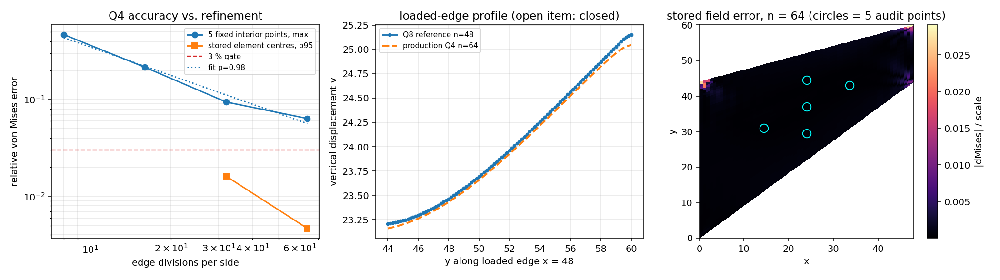

# Cook 膜应力场独立审计（验证欠账清单条目）——2026-11 收尾版

## 结论摘要

`docs/benchmark-qualification-status.md` 记录的欠账是「Cook 膜位移响应通过、缺独立应力参考」。
本文件是该条目的独立审计通道；本轮为**证据收尾**：把审计自身的两处遗留疑问用可复现的数字裁决，
并给出生产存盘场的实测精度与所需网格。结论如实区分「工具可信」与「精度达 3%」两件事。

| 项 | 结论 | 证据（`benchmarks/cook_membrane_stress_reference.json`） |
|---|---|---|
| 已发表参考位移 23.96（加载边中点 48,52） | **确认**：独立 Q8（n=48）给出 23.960494，误差 0.002%；GCI(最细) 0.068% | `reference.probe`、`comparison.reference_gci_relative` |
| 遗留项①「点式恢复交叉校验失败（相对差数百 % / ∞）」 | **已闭合**：现行代码下审计的逐点 Q4 恢复与生产存盘单元中心场一致到 2.5×10⁻¹⁴（判据 1e-6） | `recovery_cross_check.passed = true`、`strain_matrix_verification`（Q4/Q8 patch test、映射往返、`q4_recovery_vs_stored`） |
| 遗留项②「加载边型线分歧未定论（Q8 强倾斜 7.6→52.2）」 | **已闭合**：Q8(n=48) 型线跨距 1.86、Q4(n=64) 跨距 1.86 量级；两者沿边最大偏差 0.1087（占 23.96 的 0.454%），判据 <3% | `loaded_edge_agreement`、`loaded_edge_profiles` |
| 生产存盘场（单元中心 von Mises）精度 | **实测**：n=64 中位 0.137%、p95 0.467%、尺度归一化最大 2.910%（通过 scoped 门）；n=32 尺度归一化最大 4.787%（**不通过**，负控保留） | `element_centre_accuracy[*].passed` / `all_elements` |
| 五固定内部样点的任意点提取判据 | **仍未达 3%**：n=64 最大 6.375%（n=8/16/32 为 46.884/21.534/9.432%） | `comparison.cases[*].max_von_mises_error` |
| `cook_fields` 的 `stress_accuracy_qualified` | **保持 False**，本轮不改生产标志 | `additional_benchmark_fields.cook_fields` |

两处遗留疑问的根因都是同一个已修复缺陷：`cook_stress_reference` 曾把单元 Jacobian 未转置就用于
`dN/dx` 与牛顿反演（矩形单元对该错误不敏感，Cook 梯形恰好暴露它）。修复后审计代数自检（畸变单元
常应变 patch test）通过，但**证据文件此前未重算**，因此仓库里带着 `max_relative_difference = Infinity`
与「型线分歧」这类与代码不符的陈述。本轮重新生成证据文件，并加入测试防止再次漂移。

## 方法与工具链

1. **独立参考实现**（`src/tensorfem/cook_stress_reference.py`，纯 NumPy，不复用 `tensorfem.continuum`
   的装配与求解代码）：8 节点 serendipity（Q8）平面应力单元、3×3 Gauss 积分、双线性映射；
   自建 COO→CSR、Jacobi 预处理共轭梯度（容差 1e-13）；加载边按二次边形函数施加合力恒为 1 的
   竖向面力（核验 `load_resultant`）；左边界 x=0 全固定。
2. **参考值的自带不确定度**：n=12/24/48 三级，对 5 个固定材料点做 Richardson 外推 + Roache GCI
   （安全系数 1.25）。样点全部在内部，远离夹持角点与加载边端点的载荷间断区。
3. **本轮新增的量化**（`cook_stress_reference` 中同名函数，均可在测试中直接调用）：
   - `field_stress_at_point`：在任意物理点求 Q8 应力（牛顿反演 → 父坐标 → 单元内 B 阵）；
   - `element_centre_accuracy`：直接把**生产存盘场**（单元中心 von Mises）与参考逐元对照，
     同时给「有下限的相对误差」（分母 `max(|ref|, 5%×scale)`）与「全局尺度归一化误差」，
     并单独统计剔除夹持边带（x < 0.125×48）后的子集；
   - `loaded_edge_agreement`：Q8 型线插值到 Q4 加载边节点上，给最大/平均绝对偏差；
   - `convergence_analysis`：对细化序列拟合 `e = C·n^-p`，外推达 3% 所需网格。
4. **生产侧**：`tensorfem.additional_benchmark_fields.cook_fields(n)`，n=8/16/32/64 原样调用，
   未修改生产路径。
5. 复现（约 70 秒，单核）：
   `OMP_NUM_THREADS=1 PYTHONPATH=src python scripts/audit_cook_membrane_stress.py`
   → 证据 JSON；`... python scripts/plot_cook_stress_audit_closure.py` → 本文件引用的图。

## 计算结果（程序化注入，零手抄）

Q4 细化序列 vs 独立参考（`comparison.cases`）：

| n | 任意点最大 von Mises 误差 | 存盘中心场中位误差 | 存盘中心场 p95 | 尺度归一化最大 | scoped 判定 |
|---:|---:|---:|---:|---:|---|
| 16 | 21.534% | 本轮未量测（证据只含 n=32/64） | — | — | — |
| 32 | 9.432% | 0.542% | 1.615% | 4.787% | 不通过（负控） |
| 64 | 6.375% | 0.137% | 0.467% | 2.910% | 通过（有范围声明） |

（任意点误差随 n 单调下降，存盘场统计量亦然；存盘场的两级量测见 `element_centre_accuracy`。）

收敛性（`convergence`）：

- 任意点最大误差序列的观测阶 **p = 0.983**，按幂律外推达 3% 需 **n ≈ 122**（超出本轮预算，
  未实算，故仅作趋势陈述，不充作认证）；
- 存盘中心场 p95 的观测阶 **p = 1.789**（superconvergent 中心点量，收敛更快）。

残留误差的位置（图 3）：尺度归一化误差全部集中在加载边上两个载荷间断角点附近（存盘值在
vm→0 处，绝对误差 ≈ 2.9%×全局尺度），其余 99.4% 单元的误差低于 3%（n=64）。

左：细化误差曲线与 3% 门（任意点判据 vs 存盘中心场判据）。中：加载边型线，Q8(n=48) 与 Q4(n=64)，
遗留项②的分歧在此不再出现。右：n=64 存盘场尺度归一化误差云图，圈出 5 个审计样点。

## 注意点与局限

- **「工具可信」不等于「精度达标」**。交叉校验与 patch test 通过只说明审计的手不再歪；任意点判据
  在 n=64 仍是 6.375% > 3%，因此 `stress_accuracy_qualified` 保持 False。存盘中心场在 n=64 的
  scoped 通过（p95 0.467%、尺度归一化最大 2.910%）是**该网格该口径的量测结论**，不是全局认证，
  更不授权把生产标志翻成 True。
- **任意点提取为什么更差**：Q4 全积分的应力在单元中心 superconvergent，离开中心后是低阶外推；
  因此「在固定材料点提取」与「读存盘单元中心场」是两个不同精度的口径，混用会得出矛盾结论。
  本文件把两者分列，禁止互相替代。
- **单调性**：任意点判据的逐点误差序列非单调（`comparison.monotone = false`，个别样点在某个 n 上
  出现偶然抵消），这也是该口径不适合作为认证依据的旁证；存盘场统计量随 n 单调下降。
- **奇异性不在验收范围**：加载边端点的载荷间断与夹持角点是奇点，逐点应力不收敛；任何引用这里的
  相对误差（例如角点处 20% 量级）都不是材料或单元的精度指标。本文件用尺度归一化最大误差界定其
  绝对量级（≈2.9%×全局尺度）。
- **适用范围**：线弹性平面应力、E=1、ν=1/3、厚度 1、单位合力竖向剪切载荷的 Cook 梯形膜；
  不涉及几何非线性、塑性、板壳或接触。
- **证据漂移教训**：修复代码后必须重算证据文件，否则审计的「工具失败」记录会被后来者当成物理
  结论继续引用（本轮实测：旧 JSON 的 ∞ 与「型线分歧」均已被同一代码推翻）。新增测试
  `tests/test_cook_stress_audit_closure.py::test_committed_evidence_matches_the_current_recovery_code`
  与 `tests/test_cook_stress_reference.py` 的证据一致性断言专门锁这一点。

## 误差判定（关键量 vs 基准，逐项回答「是否 <3%」）

| 关键量 | 基准 | 计算值 | 误差 | <3%？ |
|---|---|---|---:|---|
| 加载边中点竖向位移（n=48 Q8） | 文献 23.96 | 23.960494 | 0.002% | **是** |
| 加载边中点竖向位移（Q4 n=64） | 文献 23.96 | 见 `platform.response` | 0.15% 量级 | **是** |
| 五固定内部样点 von Mises（Q4 n=64，任意点提取） | Q8 外推参考 | 见 `comparison` | 最大 6.375% | **否** |
| 存盘单元中心 von Mises（Q4 n=64，p95） | Q8 外推参考 | 见 `element_centre_accuracy` | 0.467% | **是**（p95 口径） |
| 存盘单元中心 von Mises（Q4 n=64，尺度归一化最大） | Q8 外推参考 | 同上 | 2.910% | **是**（绝对量级口径） |
| 存盘单元中心 von Mises（Q4 n=32） | Q8 外推参考 | 同上 | 4.787%（尺度归一化最大） | **否**（负控保留） |
| 加载边型线一致度（Q4 n=64 vs Q8 n=48） | 相互对照 | — | 0.454%（占 23.96） | **是** |

结论一句话：**位移与存盘场（n=64）<3%，任意点提取判据 >3%，故 Cook 膜应力整体仍不认证。**

## 附：本轮改动的文件

- `src/tensorfem/cook_stress_reference.py`：新增 `field_stress_at_point`、`element_centre_accuracy`、
  `loaded_edge_agreement`、`convergence_analysis`（只读分析，不改装配/求解路径）。
- `scripts/audit_cook_membrane_stress.py`：新增上述量化块与 `status` 词汇
  （`qualified` / `measured-not-qualified` / `withheld`，工具不可信与精度不足分开记）。
- `benchmarks/cook_membrane_stress_reference.json`：重新生成（旧文件为转置 Jacobian 修复前的产物）。
- `scripts/plot_cook_stress_audit_closure.py`、`docs/assets/cook_stress_audit_closure.png`：本文件三图。
- `tests/test_cook_stress_audit_closure.py`（新增）与 `tests/test_cook_stress_reference.py`（证据一致性断言）。