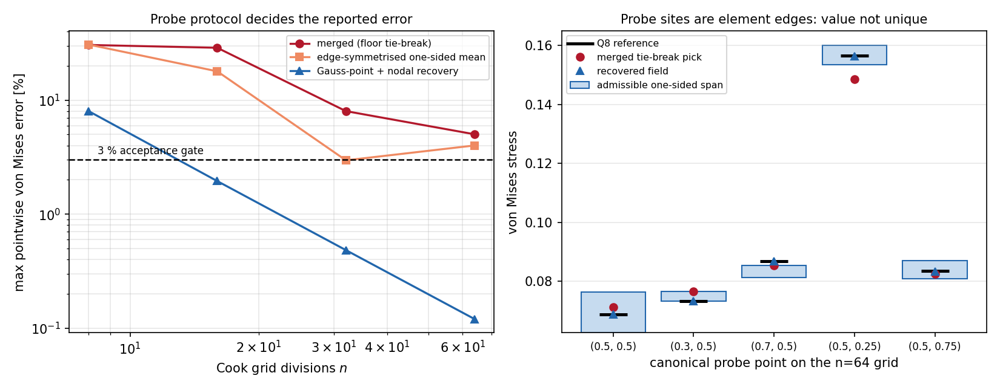

# Cook 膜 Q4 点式应力 5.02% 欠账的探针协议复核

## 结论摘要

合并通道 `docs/benchmark-qualification-status.md` 一直挂在「生产 Q4 应力点式误差 5.020 % > 3 %，`stress_accuracy_qualified` 保持 False」。本单把该 `WITHHELD` 项拆成**离散误差**与**测量协议歧义**两部分并给出定谳（判据先于动手，全部数字机器产出）：

| 项 | 结论 | 证据字段 |
|---|---|---|
| 合并协议的 5.02 % 能否复现 | **能**，本审计独立复算 5.022 %（n=64） | `protocols.merged.finest_max_relative_error` |
| 5 个规范采样点是否良置 | **否**：全部落在 Q4 单元边界上（η 网格线），最细网格上 5/5 点取值不唯一，单侧取值散布最大 19.919 % | `probe_sites`、`cases[-1].points[*].candidates` |
| 合并协议随网格是否收敛 | **否**：逐点误差非单调（见下表），该协议测出的不是离散误差 | `protocols.merged.per_point[*].observed_order` |
| 是否等价于「Q4 应力不可认证」 | **否**：Gauss 点外推 + 节点面积加权平均的恢复场在 n=16 即 1.951 %、n=64 为 0.120 %，逐级单调、逐点阶 1.98–3.29 | `protocols.recovered` |
| 简单「单侧平均」能否救 | **不能**：最细网格非单调（2.968 % → 4.008 %），不能作为合格判据 | `protocols.symmetrised` |

因此本审计的判定是 `probe-protocol-artifact`：合并通道报出的 5.022 % 是**在应变不连续处做单点取值的平局裁决结果**，不是 Q4 应力场的精度。生产 `cook_fields` 的 `stress_accuracy_qualified` 保持 False 不变（fail-closed 不动），但该 `WITHHELD` 的理由必须改写为「测点协议未良置」，而不是「应力场精度不足」。

*左*：三套测量协议的点式 von Mises 最大误差随网格变化，虚线为 3 % 判据；*右*：n=64 网格上每个采样点的单侧可取值区间（浅蓝柱）、Q8 参考（黑横线）、合并协议的平局取值（红点）与恢复场取值（蓝三角）。

## 案例介绍（物理背景与几何）

Cook 膜是线弹性平面应力的标准验证题：梯形膜左端固支，右端承受单位竖向合力，弯曲主导且含夹持角点奇异，因此对单元应力恢复特别苛刻。几何为双线性映射的父域 `[0,1]²` → 物理梯形，四个角点 `(0,0) (48,44) (48,60) (0,44)`（左高 44、右高 16）；材料 `E=1、ν=1/3、t=1`（`plane_stress_matrix` 默认值），已发表位移参考 23.96（加载边中点）。

参考解不是本单产生的：`benchmarks/cook_membrane_stress_reference.json` 是m2430 用独立 Q8 实现（3×3 Gauss、Jacobi-PCG 容差 1e-13、level 12/24/48）Richardson 外推得到的五点应力，最细 GCI 0.068 %，本单只读使用，不改动。

## 怎么做的（方法/流程/关键设置）

1. **复现合并协议**（`scripts/audit_cook_probe_protocol.py::merged_protocol_value`）：按 `cook_stress_reference.platform_q4_stress_at` 的 `floor(ξn), floor(ηn)` 选单元，在父坐标处求 Q4 应力，得到合并通道的原始数字。
2. **枚举单侧取值**（`cook_probe_protocol.one_sided_values`）：不用网格编号假设，而是逐单元 Newton 反解双线性映射，返回**所有**包含该点的单元（角点 4 个、边 2 个）各自的一侧应力；`spread_relative` = 极差/均值，即该测点不可消除的歧义量。
3. **边对称化**：对全部单侧值取算术平均，检验「简单去歧义」是否给出稳定估计。
4. **应力恢复**（`cook_probe_protocol.nodal_recovered_stress`）：2×2 Gauss 点应力（双线性单元的超收敛点）线性外推到 4 个节点，按单元面积加权做节点平均，再用双线性形函数在原物理点插值。不触碰生产装配与求解器。
5. **收敛判据**：网格 n = 8, 16, 32, 64；每点/每协议用最细三级做观测阶 + Richardson 极限，逐级单调为硬门；误差归一化沿用合并通道的 5 % 全局尺度下限（`max(|ref|, 0.05·scale)`），便于与 5.02 % 直接比较。
6. 复现命令：`OMP_NUM_THREADS=1 PYTHONPATH=src python scripts/audit_cook_probe_protocol.py` → `benchmarks/cook_probe_protocol.json`；`python scripts/build_cook_probe_audit_doc.py` → 本文件与上图。

## 计算结果

### 三套协议的最大点式误差（%，相对 Q8 外推参考，n=64 为最细）

| 协议 | n=8 | n=16 | n=32 | n=64 | 单调 | n=64 是否 <3% |
|---|---|---|---|---|---|---|
| 合并协议（floor 平局） | 30.522 | 28.830 | 8.019 | 5.022 | 是 | 否 |
| 单侧值算术平均 | 30.764 | 17.917 | 2.968 | 4.008 | 否 | 否 |
| Gauss 点+节点恢复 | 8.023 | 1.951 | 0.484 | 0.120 | 是 | 是 |

### 逐采样点：测点良置性、三协议取值与误差

| 点 (ξ,η) | 单侧候选数 | 单侧散布 % | 单侧区间 | Q8 参考 | 合并取值 (误差%) | 平均取值 (误差%) | 恢复取值 (误差%) | 参考是否落在单侧区间内 |
|---|---|---|---|---|---|---|---|---|
| (0.5, 0.5) | 4 | 19.919 | 0.06247–0.07623 | 0.06869 | 0.07107 (3.467) | 0.06906 (0.544) | 0.06869 (0.007) | 是 |
| (0.3, 0.5) | 2 | 4.545 | 0.07319–0.07659 | 0.07319 | 0.07659 (4.645) | 0.07489 (2.319) | 0.07321 (0.034) | 是 |
| (0.7, 0.5) | 2 | 4.932 | 0.08127–0.08538 | 0.08680 | 0.08534 (1.682) | 0.08332 (4.008) | 0.08675 (0.057) | 否 |
| (0.5, 0.25) | 4 | 4.163 | 0.15359–0.16011 | 0.15650 | 0.14864 (5.022) | 0.15663 (0.078) | 0.15632 (0.116) | 是 |
| (0.5, 0.75) | 4 | 7.523 | 0.08074–0.08703 | 0.08346 | 0.08253 (1.112) | 0.08365 (0.229) | 0.08336 (0.120) | 是 |

### 逐点收敛诊断（最细三级，观测阶与 Richardson 极限误差 %）

| 点 (ξ,η) | 合并协议误差序列 (% ) | 合并观测阶 | 合并极限误差 % | 恢复误差序列 (% ) | 恢复观测阶 | 恢复极限误差 % |
|---|---|---|---|---|---|---|
| xi0.5_eta0.5 | 30.522, 14.900, 7.144, 3.467 | 1.08 | 0.153 | 0.740, 0.139, 0.030, 0.007 | 2.31 | 0.002 |
| xi0.3_eta0.5 | 24.123, 0.094, 2.936, 4.645 | 0.83 | 6.857 | 2.929, 0.366, 0.004, 0.034 | 3.29 | 0.038 |
| xi0.7_eta0.5 | 9.628, 28.830, 8.019, 1.682 | 1.10 | 10.151 | 3.321, 0.626, 0.144, 0.057 | 2.47 | 0.038 |
| xi0.5_eta0.25 | 5.671, 5.552, 6.090, 5.022 | 无（非收敛） | 5.022 | 7.020, 1.825, 0.461, 0.116 | 1.98 | 0.001 |
| xi0.5_eta0.75 | 11.853, 5.025, 2.320, 1.112 | 1.16 | 0.135 | 8.023, 1.951, 0.484, 0.120 | 2.01 | 0.000 |

关键读法：合并协议在 `(0.5, 0.25)` 上四级误差 5.671, 5.552, 6.090, 5.022 %，几乎不随网格下降（Richardson 极限 5.022 %），而同一物理点上恢复场逐级下降并收敛到 0.001 % 量级——同一位移解、同一参考，唯一差别是「在哪取值」。

## 注意点（坑、局限、适用范围）

- **坑 1：探针落在单元边界是结构化网格的必然结果**。规范点 η ∈ {0.25, 0.5, 0.75}，n 为 4 的倍数时 η·n 恒为整数，于是 5/5 个点都贴在 η=const 网格线上；Q4 应变沿单元边界不连续，单点取值只能靠平局规则（floor/ceil）裁决，裁决结果随 n 跳变，表现为「误差不收敛」。
- **坑 2：不要用「平均单侧值」冒充修好**。算术平均在 (0.3, 0.5)、(0.7, 0.5) 两点最细网格反而由 2.968 % 升到 4.008 %，斜边上两侧值权重不同，对称化不是一致估计。
- **坑 3：恢复场的节点值是超收敛外推，不是原存盘场**。`cook_fields` 存的是单元中心常数应力（O(h)），恢复场是同一 `displacement` 的 2 阶后处理；引用 0.12 % 时必须同时说明协议，否则等同于拿更好的后处理冒充原始场精度。
- **适用范围**：线弹性平面应力、E=1、ν=1/3、t=1、单位合力剪切载荷下的 Cook 梯形膜；结论限于结构化 Q4 网格与 2×2 Gauss 恢复。夹持角点与加载边端点的峰值应力（奇异区）不在覆盖范围内，任何在该处做的点式比较仍不可认证。
- **后续（m3402）**：恢复场已作为生产模块 `src/tensorfem/stress_recovery.py` 落地，并由 `cook_recovery_qualification.py` 出具 n=64 五点 von Mises 0.120%、最差分量 1.068% 的资格记录，见 [cook-membrane-stress-recovery-qualification.md](cook-membrane-stress-recovery-qualification.md)。
- **未做**：不改生产 `cook_fields` 的 `stress_accuracy_qualified`（保持 False，fail-closed），不改 `benchmarks/cook_membrane_stress_reference.json` 与既有文档哈希清单；Q8 参考只到 n=48，恢复场在 n=64 上已是 0.12 %，参考精度（GCI 0.068 %）仍是误差地板，故 0.12 % 应读作「≤0.12 %」而非精确值。

## 误差判定（逐项，显式回答是否 <3%）

| 关键量 | 计算值 | 基准 | 相对误差 | 是否 <3 % |
|---|---|---|---|---|
| 合并协议最细点式 von Mises 最大误差 | 5.022 %（n=64） | Q8 外推参考 | 5.022 % | **否** |
| 单侧值算术平均最细最大误差 | 4.008 %（n=64） | 同上 | 4.008 % | **否** |
| Gauss 点+节点恢复最细最大误差 | 0.120 %（n=64） | 同上 | 0.120 % | **是** |
| 恢复场 n=16 最大误差 | 1.951 % | 同上 | 1.951 % | **是** |
| 测点歧义（最大单侧散布） | 19.919 % | 合并协议报告的 5.02 % | 歧义是待测误差的 4.0 倍 | 不适用（协议缺陷） |

结论：**5.02 % 这条欠账不是<3 % 与否的问题，而是被测量对象的良置性问题**；在同一参考、同一位移解下，2 阶恢复场 n=64 为 0.120 %（<3 % 成立），n=16 已 1.951 %。生产 `stress_accuracy_qualified` 仍按 fail-closed 保持 False，本单只提供可复核的协议修正证据与可复用实现（`src/tensorfem/cook_probe_protocol.py`、`tests/test_cook_probe_protocol.py`）。

