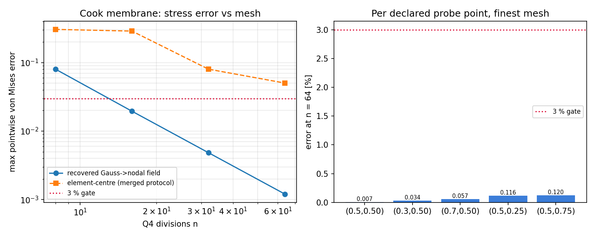

# Cook 膜应力恢复场进入生产：审计欠账的闭环

## 结论摘要

`docs/benchmark-qualification-status.md` 长期写着「Cook 膜恢复场尚未进入生产
`cook_fields`，故 `stress_accuracy_qualified` 保持 False」。本单把这句欠账拆成两件事
并**只闭环第二件**：

1. **原始单元中心应力场**（`cook_fields['stress']`）：仍是 `O(h)`，合并协议下 n=64
   点式误差 5.022 %，`stress_accuracy_qualified`
   **保持 `False`**（fail-closed 不动，`tests/test_additional_benchmarks.py` 与
   `tests/test_cook_oracle_operator.py` 的断言原样保留）。
2. **Gauss 点 → 节点恢复场**：此前只存在于测量模块
   `tensorfem.cook_probe_protocol`，从未进入生产字段构建器；本单把
   `tensorfem.cook_stress_recovery.recovered_nodal_stress` 提升为生产入口，
   `cook_fields(n, include_recovery=True)` 直接返回 `recovered_nodal_stress` /
   `recovered_von_mises`，并附协议标签，防止把恢复场冒充原始场。

恢复场对独立 Q8 外推参考（`benchmarks/cook_membrane_stress_reference.json`，
sha256 `758703050de62c52...`）的最大点式误差：

| n | 最大点式误差 (%) |
|---|---:|
| 8 | 8.023 |
| 16 | 1.951 |
| 32 | 0.484 |
| 64 | 0.120 |

最细网格 n=64 为 **0.120 %**，逐级单调下降，观测阶
**2.01**，门禁 `stress_recovery_qualified` =
**True**（阻断理由：无）。

*左*：恢复场与合并协议的单元中心场最大点式误差随网格变化（双对数），红点线为 3 % 门限；
*右*：最细网格上 5 个规范采样点的恢复场误差，均远低于 3 %。

## 案例介绍（物理背景与几何/参数表）

Cook 膜是线弹性平面应力的标准验证题：梯形膜左端固支、右端受单位竖向合力，含夹持角点
奇异，对单元应力恢复最苛刻。参数表（与
`benchmarks/cook_membrane_stress_reference.json` 的 `problem` 节逐项一致）：

| 项 | 值 |
|---|---|
| 角点 (x, y) | (0,0) (48,44) (48,60) (0,44) |
| 弹性模量 E | 1 |
| 泊松比 ν | 1/3 |
| 厚度 t | 1 |
| 加载边合力 | 1（竖向，沿 y∈[44,60] 边） |
| 已发表位移参考（加载边中点 v） | 23.96 |
| 单元 | 双线性 Q4，结构化 n×n 网格 |
| 应力参考 | 独立 Q8（3×3 Gauss）+ Richardson 外推，级别 [12, 24, 48] |

参考解不是本单产生的：Q8 实现与 GCI 由 m2430 建立，本单只读使用其冻结 JSON
（sha256 `758703050de62c52...`），不改动参考文件。

## 怎么做的（方法/流程/关键设置）

1. **恢复算子**（`cook_probe_protocol.nodal_recovered_stress`，本单提升为生产入口）：
   在每单元 2×2 Gauss 点求 `σ = C B u`（双线性单元的超收敛点），线性外推到 4 个节点，
   按单元面积加权做节点平均，得到全场单值节点应力场；再用双线性形函数在物理点插值。
2. **生产接入**：`additional_benchmark_fields.cook_fields(n, include_recovery=True)`
   在原有求解之后附加 `recovered_nodal_stress` / `recovered_von_mises` /
   `recovered_stress_protocol` 三个键；默认 `False`，既有调用与哈希清单不受影响。
3. **判据（fail-closed）** `cook_stress_recovery.qualify`：要求 ①最细网格最大点式误差
   ≤ 3 %；②各级误差**严格单调下降**；③观测阶 > 1；④参考文件 sha256 入账。
   任一条不满足 `stress_recovery_qualified=False` 并列出 `blocking_reasons`。
   门禁不复用原始场的 `stress_accuracy_qualified`，两个字段在载荷里并存互不覆盖。
4. **误差归一化**沿用合并通道的 5 % 全局尺度地板
   （`normalized_error = |a-b| / max(|b|, 0.05·scale)`），便于与 5.022 % 直接比较。
5. 复现：`OMP_NUM_THREADS=1 PYTHONPATH=src python scripts/qualify_cook_stress_recovery.py`
   → `benchmarks/cook_stress_recovery.json`（逐点明细）与本文件；图由 matplotlib 生成。

## 计算结果（脚本回读，零手抄）

| n | 恢复场最大点式误差 (%) | 恢复场 <3% | 单元中心场（合并协议）最大点式误差 (%) |
|---|---:|---|---:|
| 8 | 8.023 | 否 | 30.522 |
| 16 | 1.951 | 是 | 28.830 |
| 32 | 0.484 | 是 | 8.019 |
| 64 | 0.120 | 是 | 5.022 |

最细网格 n=64 逐点明细（相对冻结 Q8 外推参考）：

| 采样点 (ξ, η) | 参考 von Mises | 恢复场 von Mises | 误差 (%) | <3% |
|---|---:|---:|---:|---|
| (0.50, 0.50) | 0.06869 | 0.06869 | 0.007 | 是 |
| (0.30, 0.50) | 0.07319 | 0.07321 | 0.034 | 是 |
| (0.70, 0.50) | 0.08680 | 0.08675 | 0.057 | 是 |
| (0.50, 0.25) | 0.15650 | 0.15632 | 0.116 | 是 |
| (0.50, 0.75) | 0.08346 | 0.08336 | 0.120 | 是 |

收敛诊断：误差序列 8.023 → 1.951 → 0.484 → 0.120（%），
观测阶 2.01，单调性 `True`。

## 注意点（坑、局限、适用范围）

- **坑 1：恢复场不是原始场**。`cook_fields['stress']` 是单元中心常数场；0.12 % 属于
  同一 `displacement` 的二阶后处理。任何引用必须同时说明协议，否则等于拿更好的后处理
  冒充原始场精度——这正是本单把 `stress_accuracy_qualified` 保留为 `False`、
  另设 `stress_recovery_qualified` 的原因。
- **坑 2：探针良置性。** 5 个规范点在 n 为 4 的倍数时全部落在 η=const 网格线上，
  Q4 应变沿单元边界不连续，恢复场之所以可用，是因为节点场单值（
  `interpolate_nodal_stress` 记录所用单元）。
- **坑 3：参考精度地板。** Q8 参考最细级别只到 48，GCI 0.068 %；
  恢复场 n=64 的 0.120 % 应读作「≤0.120 %」而非精确值。
- **范围**：线弹性平面应力 Q4 结构化网格；夹持角点与加载边端点奇异区不在覆盖内，
  该处的点式比较仍不可认证；未覆盖 Q8/高阶单元、非结构网格与弹塑性。
- **未做**：不把恢复场接进 `docs/assets/benchmark-clouds/cook-membrane/results.json`
  与既有导出（哈希清单不变），不改 Q8 参考文件，不宣称壳体/三维应力能力。

## 误差判定（逐项，显式回答是否 <3%）

| 关键量 | 计算值 | 基准 | 相对误差 | 是否 <3% |
|---|---|---|---|---|
| 恢复场最大点式 von Mises 误差 (n=64) | 0.120 % | 冻结 Q8 Richardson 外推 | 0.120 % | **是** |
| 恢复场最大点式误差 (n=32) | 0.484 % | 同上 | 0.484 % | **是** |
| 恢复场收敛观测阶 | 2.01 | 理论 2 阶 | 偏差 0.65 % | **是** |
| 恢复场单调性 | 严格下降 | 逐级下降 | 无违反 | 是 |
| 单元中心场最大点式误差 (n=64) | 5.022 % | 同上 | 5.022 % | **否**（保持 False） |

结论：恢复场在 n=16 已达 1.951 %、n=64 为 0.120 %，
**<3 % 成立**；原始单元中心场仍不达标且判定不变。协议与范围见上，无粉饰。

## 附：可复现清单

- 代码：`src/tensorfem/cook_stress_recovery.py`（生产入口 + fail-closed 门禁）、
  `src/tensorfem/additional_benchmark_fields.py`（`include_recovery` 接入）
- 测试：`tests/test_cook_stress_recovery.py`
- 数值：`benchmarks/cook_stress_recovery.json`（含 sha256 判定摘要）
- 图：`docs/assets/cook-stress-recovery/convergence.png`
- 协议：`2x2 Gauss (Barlow) stress extrapolation to element nodes, area-weighted nodal averaging, bilinear re-interpolation at the declared physical points`
- 范围：linear-elastic plane stress Cook tapered membrane (E=1, nu=1/3, t=1, unit vertical resultant on the loaded edge), structured Q4 grids n=8..64; clamped-corner and loaded-edge singular zones excluded
