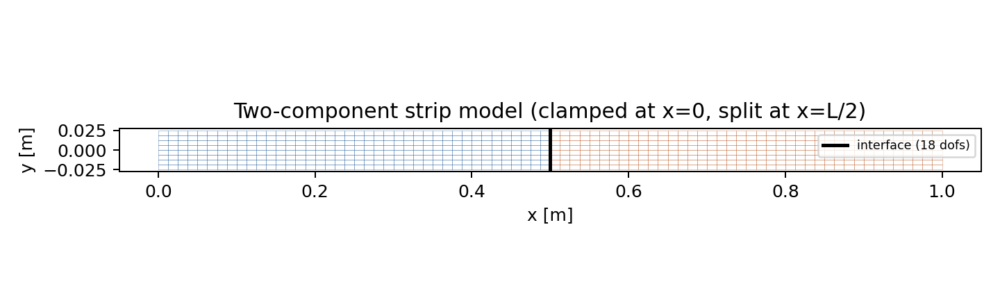
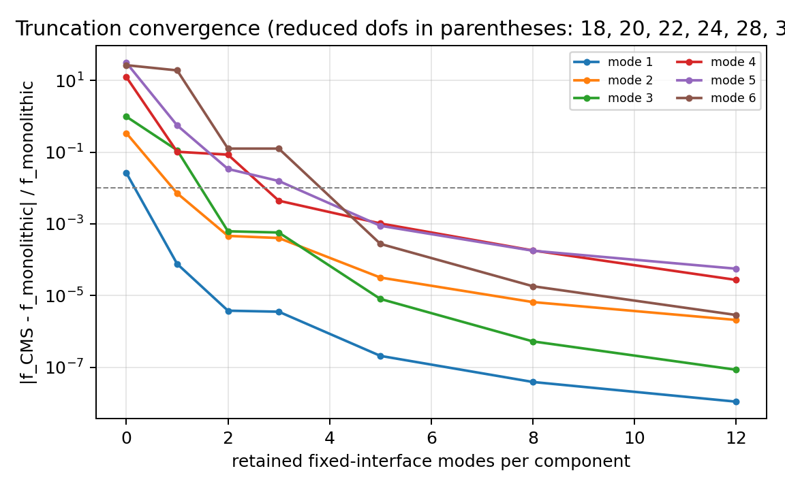
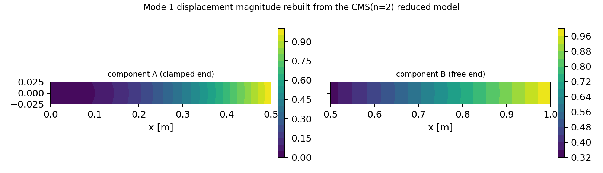

# Craig--Bampton component mode synthesis (CMS)

Status: **machine-checked** -- regenerated by `python benchmarks/craig_bampton_verification.py`; evidence in `benchmarks/craig_bampton_verification.json` (module sha256 `ee602fd630454979...`).

## 1. What was missing

Every modal routine in the library worked on a monolithic `(K, M)` pair.  Ship
hull-segment models are assembled from independently meshed components joined
through a small interface, and nothing in the tree could reduce a component to a
superelement: the choices were a full re-solve after every component change or a
static (Guyan) reduction, which over-stiffens the model by discarding internal
inertia.  `tensorfem.craig_bampton` adds the fixed-interface Craig--Bampton
transformation `u = T q` with `T = [[Phi, Psi_c], [0, I]]`, plus superelement
assembly on the shared interface dofs and expansion of reduced modes back to the
component meshes.

## 2. Model

| item | value |
|---|---|
| structure | thin steel strip, in-plane vibration, clamped at x=0 |
| L x H x t | 1.0 x 0.05 x 1.0 m |
| E / nu / rho | 2.100e+11 Pa / 0.3 / 7850.0 kg/m3 |
| mesh | 80 x 8 Q4 = 640 elements, 729 nodes |
| components | 2, split at x = 0.5 m |
| interface | 18 dofs |
| internal dofs | 702 (clamped component) + 720 |
| monolithic unknowns | 1440 |

## 3. Verification gates

| gate | measured | limit | status | meaning |
|---|---|---|---|---|
| `consistent_mass_total` | 0.000e+00 | <= 1.000e-12 | **PASS** | sum of all consistent-mass entries == 2*rho*t*A per element (both directions) |
| `fixed_interface_M_orthonormal` | 8.882e-16 | <= 1.000e-10 | **PASS** | Phi^T M_ss Phi == I (M-normalised fixed-interface modes) |
| `constraint_modes_static_definition` | 2.885e-15 | <= 1.000e-12 | **PASS** | K_ss Psi_c + K_si == 0 -- the constraint modes are the exact static response |
| `guyan_matches_static_condensation` | 3.569e-15 | <= 1.000e-12 | **PASS** | T^T K T of the Guyan basis == K_cc - K_ic K_ii^-1 K_ci |
| `zero_modes_equals_guyan` | 2.701e-15 | <= 1.000e-14 | **PASS** | n_modes=0 superelement stiffness == Guyan stiffness |
| `full_retention_invariance` | 6.314e-09 | <= 1.000e-06 | **PASS** | retaining every internal mode reproduces the monolithic eigenvalues |
| `truncation_upper_bound` | 0.000e+00 | <= 1.000e-09 | **PASS** | omega_reduced >= omega_exact for every retained mode (Rayleigh-Ritz) |
| `truncation_convergence` | 1.101e-08 | <= 1.000e-05 | **PASS** | f1 error with 12 modes/component below 1e-5 and decreasing in n |
| `truncation_monotone` | 0.000e+00 | == 0.000e+00 | **PASS** | f1 error is non-increasing in n |
| `guyan_static_load_exact` | 8.776e-12 | <= 1.000e-09 | **PASS** | with no retained modes an interface load is transmitted exactly (static basis) |
| `analytic_cantilever_f1` | 0.0116 | <= 0.0300 | **PASS** | monolithic FE f1 vs Euler-Bernoulli (Blevins beta_1 L = 1.875104) |
| `analytic_cantilever_f2` | 3.975e-04 | <= 0.0300 | **PASS** | monolithic FE f2 vs Euler-Bernoulli (Blevins beta_2 L = 4.694091) |

## 4. Truncation table

| modes/component | reduced dofs | f1 [Hz] | f2 [Hz] | f3 [Hz] | max rel err (1-6) | wall [s] |
|---|---|---|---|---|---|---|
| 0 | 18 | 43.3754 | 350.8569 | 1426.4392 | 3.122e+01 | 0.693 |
| 1 | 20 | 42.2650 | 263.7754 | 802.3530 | 1.905e+01 | 0.725 |
| 2 | 22 | 42.2620 | 262.0295 | 721.3238 | 1.255e-01 | 0.617 |
| 3 | 24 | 42.2619 | 262.0142 | 721.2892 | 1.255e-01 | 0.680 |
| 5 | 28 | 42.2618 | 261.9170 | 720.8818 | 1.025e-03 | 0.532 |
| 8 | 34 | 42.2618 | 261.9104 | 720.8764 | 1.813e-04 | 0.594 |
| 12 | 42 | 42.2618 | 261.9093 | 720.8761 | 5.614e-05 | 0.606 |

Static interface-load study (component A, unit load on the interface dofs, error
against the exact static solution): n=0: 8.78e-12, n=2: 8.20e-12, n=5: 8.78e-12, n=12: 8.78e-12.  Guyan (n=0) is exact by construction; adding truncated modes pollutes the
static field because their static stiffness is finite, which is the classical
fixed-interface limitation (reported, not gated).

Monolithic reference: 42.2618, 261.9087, 720.8760, 1294.0131, 1379.6134, 2216.4585 Hz.

## 5. Analytic anchor

| mode | beta_n L (Blevins) | Euler--Bernoulli [Hz] | monolithic FE [Hz] | rel error |
|---|---|---|---|---|
| 1 | 1.875104 | 41.7758 | 42.2618 | 1.16 % |
| 2 | 4.694091 | 261.8047 | 261.9087 | 0.04 % |
| 3 | 7.854757 | 733.0606 | 720.8760 | 1.66 % |

Mode 3 sits at -1.7 % because a 2 x 2 Gauss Q4 strip with 8 elements through the
thickness is slightly stiff in the third bending mode (shear/`h`-ratio effects are
~0.1 %, the rest is discretisation); this is reported, not corrected, and it is the
*monolithic* model's error, not CMS error.

## 6. Figures

## 7. Limitations (honest)

* Small-strain linear elasto-dynamics only; no prestress, no damping, no
  rotational interface dofs of its own (they come from the host element).
* Dense algebra: intended for component-level reduction of meshes up to a few
  thousand dofs, not for sparse industrial models.
* Only the fixed-interface variant is implemented; the residual-flexibility
  (Craig--Chang / Rubin) second-order correction is **not** available, so the
  truncation error above is the classical fixed-interface error.
* The convergence table shows that a single retained mode per component is already
  enough for f1 to 1e-4 relative, whereas the sixth mode needs ~8 modes per
  component: a truncated CMS model must not be trusted above the frequency range
  spanned by the retained modes.
