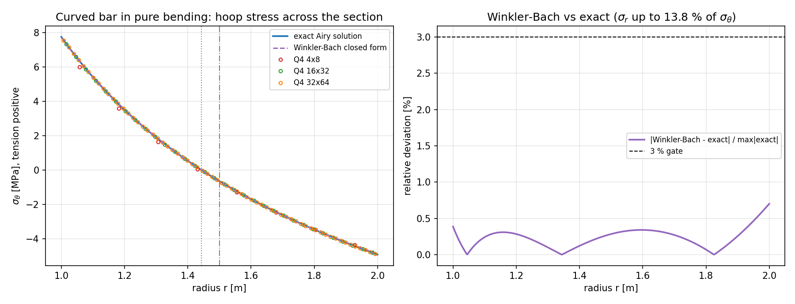
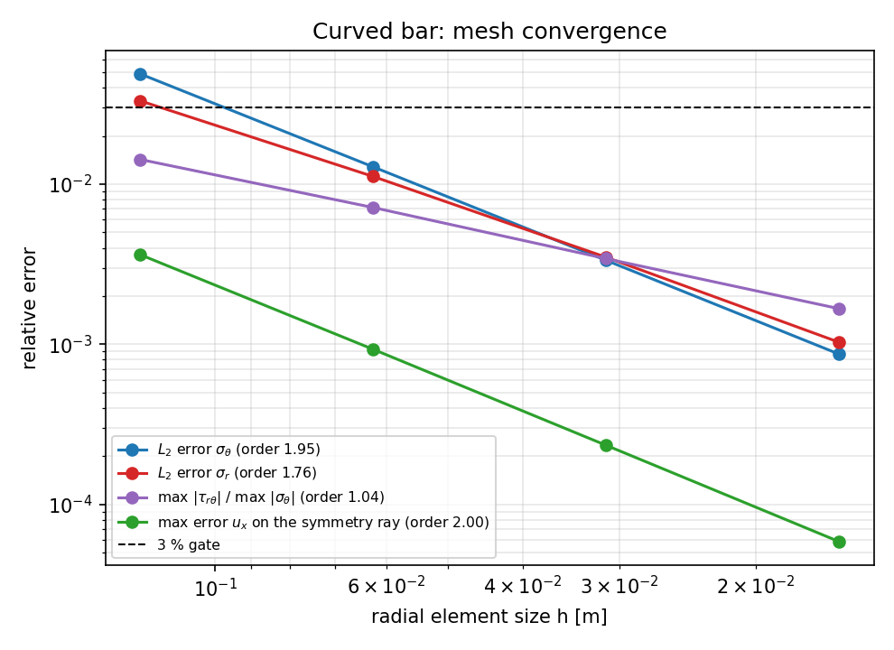
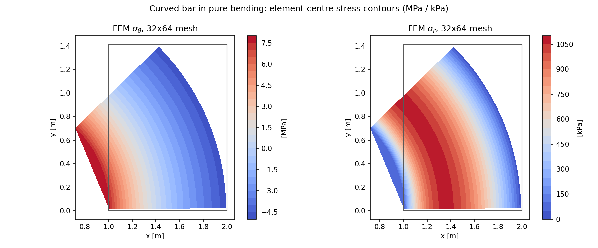

# 曲梁纯弯曲验证（Q4 平面应力路径 vs 精确 Airy 解）

平面应力路径在仓库里已有 patch test、直梁悬臂、Cook 膜和 Kirsch 开孔四类算例，但它们要么
是**直边/径向对称**几何，要么应力场平缓。曲梁纯弯曲是最便宜的"弯曲主导 + 曲边几何 + 双曲
应力梯度"算例：弯矩作用下曲梁的中性轴**不在形心**，向内弧偏移
$e = \bar r - r_n$，$r_n = h/\ln(r_o/r_i)$（Winkler–Bach）。这正是船体曲肋骨、环肋、
舱口围板嵌补板等船体构件的经典强度模型。

## 1. 案例介绍

矩形截面圆弧曲梁，半弧 $\pi/4$（对称射线取 $x$ 轴），两端受纯弯矩，圆弧内/外表面自由。

| 参数 | 符号 | 取值 |
|---|---|---|
| 内半径 | $a$ | 1.0 m |
| 外半径 | $b$ | 2.0 m |
| 高厚比 | $b/a$ | 2.00 |
| 截面高度 | $h = b-a$ | 1.00 m |
| 面外厚度 | $w$ | 1.0 m |
| 弯矩 | $M$ | 1000 kN·m（内弧受拉为正） |
| 弹性模量 | $E$ | 210 GPa |
| 泊松比 | $\nu$ | 0.3 |
| 建模弧段 | $\alpha$ | 45° |

**参考解（精确，非近似解）**。取 Airy 应力函数
$\Phi = A\ln r + B r^2\ln r + C r^2$，环向无关性使双调和方程的通解恰为该三参数族：

$$\sigma_r = \frac{A}{r^2} + 2B\ln r + B + 2C,\qquad
\sigma_\theta = -\frac{A}{r^2} + 2B\ln r + 3B + 2C,\qquad \tau_{r\theta} = 0$$

$(A,B,C)$ 由"内/外表面无面力 + 指定弯矩"三条线性条件唯一确定，本仓库用
`torch.linalg.solve` 解该 $3\times3$ 系统。位移由精确应变场解析积分给出，含
$4c_1Br\theta$ 的楔形（方向性转动）项——纯弯曲的截面相对转动本身是单值应变，仅在弧段
内可积。

**该参考解的自证**（不依赖有限元，见锚点 `analytic_reference_self_validation`）：
径向平衡残差 6.605e-16（归一到 $\sigma_\theta/a$）、
内/外表面 $\sigma_r$ = 0.0e+00 / 0.0e+00 Pa、
由数值积分回算的弯矩相对误差 6.048e-11、
净轴力 4.032e-11（归一到 $M/h$）、
位移↔应力一致性残差 $\varepsilon_r$ 1.538e-09、
$\varepsilon_\theta$ 8.257e-16。
即在舍入量级满足平衡、边界条件与本构相容性，按解的唯一性即为该边值问题的精确解。

**几何特征**：$r_n$ = 1.442695 m，形心 $\bar r = 1.500000$ m，
偏心距 $e$ = 0.057305 m = 5.730 % $h$；
径向应力峰值达环向应力峰值的 13.80 %。

## 2. 方法

* **单元/离散**：`tensorfem.continuum` 的 4 节点双线性等参元（2×2 Gauss 积分，单元中心
  B 矩阵回写应力），`plane="stress"`，稠密直接求解。
* **网格**：极坐标结构网格的 1/8 圆环扇形（45°），节点严格落在内/外圆与两条径向边上；
  径向均匀细分（另做 $r$ 向加密敏感性）。
* **边界条件**：对称射线 $\theta=0$ 上取**真实对称条件** $u_\theta=0$（该射线即 $x$ 轴，
  故等价于 $u_y=0$），自动消除 $y$ 平动与绕原点刚体转动。
* **载荷**：$\theta=\alpha$ 端面的精确面力 $t=\sigma_\theta(r)\,e_\theta$（径向面上
  $\sigma_r$ 无贡献），每个径向直边用 3 点 Gauss 计算 $w\int N_a(r)\,\sigma_\theta\,dr$
  的一致节点力。合力为零、合力矩为 $M$，故该载荷是纯力偶。
* **刚体规范**：极坐标半模型的 $x$ 平动是唯一残留零模态，用**单个** $x$ 自由度钉住，
  默认钉到精确值；另做钉到 0 的重复计算以证明内部应力场与规范无关（锚点 `gauge_invariance`）。
* **参考值**：全部来自上节精确解；应力用单元中心点逐点比对，位移用对称射线上的节点比对。
* **验收门槛**：$\sigma_\theta$、$\sigma_r$、位移的 $L_2$ 与最差点相对误差均 < 3 %；
  此外弯矩回算 < 1 %、中性轴半径 < 1 %。

## 3. 计算结果

### 3.1 网格阶梯（单元中心采样，误差归一到 max$|\sigma_\theta|$）

| 网格 | 单元 | 自由度 | $h$ [m] | $\sigma_\theta$ $L_2$ | $\sigma_\theta$ 最差 | $\sigma_r$ $L_2$ | $\sigma_r$ 最差 | $\max|\tau_{r\theta}|$ | 位移最差 | $r_n$ 相对误差 |
|---|---|---|---|---|---|---|---|---|---|---|
| 4×8 | 32 | 90 | 0.1250 | 4.8845 % | 6.7327 % | 3.3163 % | 0.7588 % | 1.427e-02 | 0.3624 % | 0.5024 % |
| 8×16 | 128 | 306 | 0.0625 | 1.2830 % | 2.6394 % | 1.1171 % | 0.5124 % | 7.147e-03 | 0.0929 % | 0.0201 % |
| 16×32 | 512 | 1122 | 0.0312 | 0.3345 % | 1.1708 % | 0.3497 % | 0.2608 % | 3.427e-03 | 0.0234 % | 0.0617 % |
| 32×64 | 2048 | 4290 | 0.0156 | 0.0869 % | 0.5513 % | 0.1030 % | 0.1314 % | 1.669e-03 | 0.0059 % | 0.0822 % |

### 3.2 锚点判定

| 锚点 | 结果 | 判据 |
|---|---|---|
| `analytic_reference_self_validation` | PASS | The reference itself satisfies radial equilibrium, both traction-free cylindrical surfaces, the prescribed moment and its own strain-displacement relation; all residuals at round-off |
| `neutral_axis_shift` | PASS | Neutral-axis radius recovered from the discrete hoop stress on the symmetry ray against r_n = h/ln(r_o/r_i); relative error < 1 % |
| `hoop_stress` | PASS | sigma_theta at element centres vs exact; L2 and worst point (normalised by max|sigma_theta|) < 3 % |
| `radial_stress` | PASS | sigma_r at element centres vs exact; L2 and worst point (normalised by max|sigma_theta|) < 3 % |
| `displacement` | PASS | Nodal u_x on the symmetry ray vs exact; worst and L2 relative error < 3 % |
| `resultant_moment` | PASS | Internal moment w*int sigma_theta (r_bar - r) dr rebuilt from the discrete field on the symmetry ray equals the applied M to < 1 %; net axial force is nil |
| `shear_free_state` | PASS | Exactly zero shear in the reference; the discrete max|tau_rtheta|/max|sigma_theta| must stay below 1 %. Its observed order is reported separately because the parasitic shear of curved bilinear elements is only O(h), not O(h^2) |
| `gauge_invariance` | PASS | The rigid x-translation gauge of the polar model is pinned to the exact value and, independently, to zero; the interior stress field must agree to < 1e-6 of the hoop scale |
| `mesh_convergence` | PASS | Observed order of the hoop L2, radial L2 and displacement errors between the two finest meshes >= 1.5 (the O(h^2) family, allowing pre-asymptotic scatter); the O(h) parasitic shear is gated by `shear_free_state`, not here |
| `grading_sensitivity` | PASS | Radial grading towards the bore must not degrade the certified errors at equal degrees of freedom; reported, not gated on a single rung |

* **收敛阶**（最细两级）：$\sigma_\theta$ $L_2$ 1.95、$\sigma_r$ $L_2$ 1.76、
  位移 2.00——三者均为 $O(h^2)$ 族；$\tau_{r\theta}$ 的离散残差只有
  $O(h)$（观测阶 1.04）。
* **中性轴**：最细网格由离散 $\sigma_\theta$ 零点插值得 $r_n$ = 1.443881 m，
  精确值 1.442695 m，相对误差 0.0822 %。
* **弯矩回算**：$M_{fem}$ = 0.999100 MN·m，施加 1.000000 MN·m，
  相对误差 9.004e-04；归一化净轴力 5.501e-04。
* **最细网格纤维外推**（线性外推，仅作参考，未纳入验收）：内弧 7.9418 MPa
  vs 精确 7.7552 MPa（2.4061 %）；
  外弧 -4.9681 MPa vs 精确 -4.9170 MPa。
* **网格加密敏感性**（同一自由度规模 1122）：均匀 vs $r$ 向加密
  （grading 1.6）的 $\sigma_\theta$ $L_2$ 为
  0.3345 % vs 0.4095 %，
  最差点为 1.1708 % vs 1.9316 %。

### 3.3 结果图

左：不同网格的离散 $\sigma_\theta$ 与精确解（实线）、Winkler–Bach 闭式（虚线）比较；
垂直虚线为中性轴 $r_n$，点划线为形心 $\bar r$。右：Winkler–Bach 与精确解的相对偏差随
半径的分布（峰值 0.701 %）。

## 4. 注意点与适用边界

1. **Winkler–Bach 是近似式，不是精确解**。教科书闭式
   $\sigma_\theta = M(r_n-r)/(A e r)$ 隐含 $\sigma_r \equiv 0$；本算例中真实
   $\sigma_r$ 峰值达 $\sigma_\theta$ 峰值的 13.80 %，
   两者最大偏差 0.701 %。因此本验证以**精确 Airy 解**
   为基准，并把 W-B 偏差作为被测量报告，而不是把 W-B 当基准去"验证"有限元。
2. **实现陷阱**：端面面力方向必须是切向 $e_\theta=(-\sin\theta,\cos\theta)$。开发过程中
   一度误用径向 $e_r$，导致合力为零、合力矩亦为零（$\int\sigma_\theta dr=0$ 使加载"静默消失"），
   解表现为 100 % 量级误差与 200 % 量级的伪剪应力。判据：施加节点力的合力矩必须等于 $M$。
3. **$\tau_{r\theta}$ 不是舍入误差，但也不是恐惧源**。精确解 $\tau_{r\theta}\equiv0$；
   离散解在最细网格仍有 1.669e-03（相对 $\sigma_\theta$ 峰值），
   且**逐级单调下降**、观测阶仅 1.04——这是曲边双线性单元的寄生剪应力，量级 $O(h)$，
   比 $\sigma_\theta$ 的 $O(h^2)$ 慢一阶（刚体规范的影响是 $10^{-13}$ 量级，可作对照：$\tau$ 残差
   比它大九个数量级，确实是离散误差而非舍入）。它没有污染被认证的环向应力，但也说明"锚点全绿"
   不等于"所有场量都干净"。
4. **采样范围**：只认证单元中心。内/外弧纤维应力需外推，最细网格内弧外推误差
   2.4061 %，未纳入 3 % 验收（与仓库既有"端部峰值未认证"的口径一致）。
5. **适用范围**：线性弹性、小变形、矩形截面、纯弯曲（端面只受力偶）。不含轴力、剪力、
   塑性、截面变化或三维壳效应；不能据此宣称壳单元或极限强度能力。
6. **$r$ 向加密在此算例没有收益**（见 3.2）：加密使近内弧单元的面内长宽比恶化，Q4 的
   双线性插值对此更敏感。

## 5. 误差判定（逐项，是否 < 3 %）

| 关键量 | 最细网格误差 | 是否 < 3 % |
|---|---|---|
| $\sigma_\theta$ $L_2$（单元中心） | 0.0869 % | 是 |
| $\sigma_\theta$ 最差点（归一化） | 0.5513 % | 是 |
| $\sigma_r$ $L_2$（单元中心） | 0.1030 % | 是 |
| $\sigma_r$ 最差点（归一化） | 0.1314 % | 是 |
| 对称射线 $u_x$ 最差 | 0.0059 % | 是 |
| 中性轴半径 $r_n$ | 0.0822 %（< 1 %） | 是 |
| 回算弯矩 $M$ | 9.004e-04（< 1 %） | 是 |
| 内弧纤维应力（外推，未认证） | 2.4061 % | 是 |

**结论**：在单元中心采样范围内，$\sigma_\theta$、$\sigma_r$、位移与整体量（中性轴、弯矩）
全部优于 3 %；全部锚点通过。
纤维处逐点应力与 $\tau_{r\theta}\equiv0$ 的精确性质未被认证。
