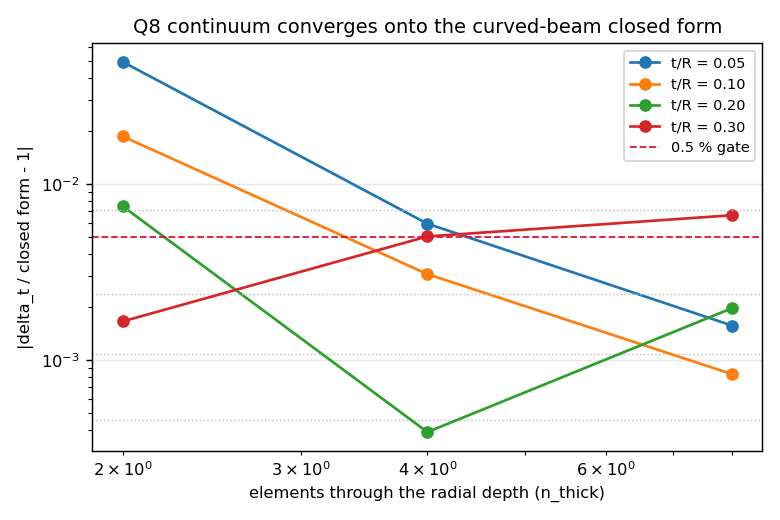
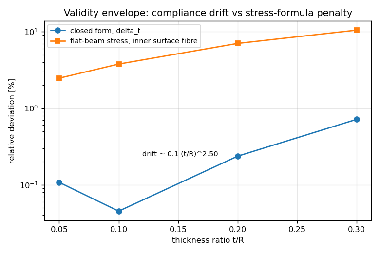
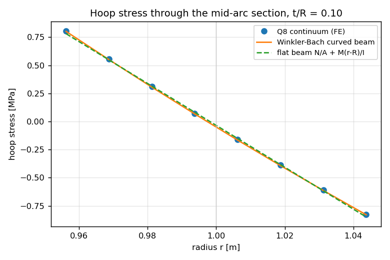
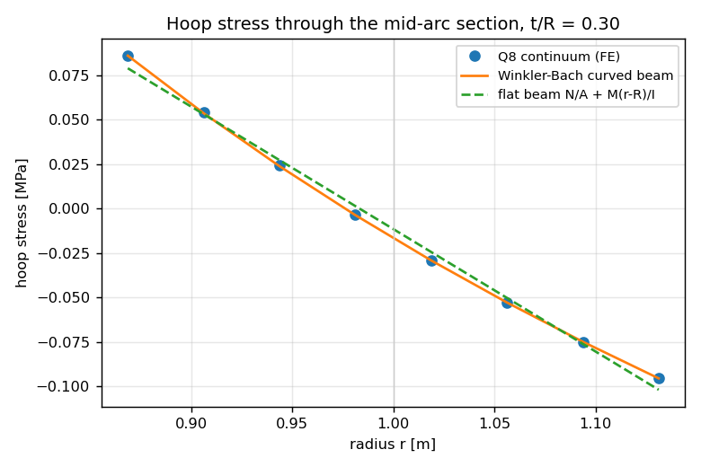

# Quarter-ring curved cantilever: an independent plane-stress continuum oracle

## Document information
- **Mission / anchor**: m14873, anchor `NEW:四分之一环曲梁闭式系数缺独立理论族（非壳/梁）复核面` (see §7 for the proposed ledger entry)
- **Repository**: TensorFEM
- **Modules**: `tensorfem.curved_ring_continuum` (new), `tensorfem.curved_beam_benchmark` (graded)
- **Driver**: `benchmarks/verified/fem_curved_ring_solid/run_verification.py`
- **Evidence**: `benchmarks/verified/fem_curved_ring_solid/result.json`, `gates_verified.json`
- **Figures**: `docs/assets/curved_ring_continuum/*.png`
- **Reproduce**: `python benchmarks/verified/fem_curved_ring_solid/run_verification.py`
  then `python -m pytest tests/test_curved_ring_continuum.py -q`
- **Status**: 8/8 gates PASS (78 s wall clock, single core)

## 1. Case, geometry and parameters

The quarter-ring curved cantilever is the benchmark that grades the shell
elements' membrane--bending coupling on a curved mid-surface.  Until now it was
graded against a **curved-beam theory** closed form from the same
beam/shell kinematic family as the element under test:

    delta_t = (3 pi/4 - 2) P R^3/(E I) + pi P R/(4 E A) + pi P R/(4 k G A)
    delta_r = P R^3/(2 E I)

Agreement between an element and a reference built on the same plane-sections
assumption does not independently certify the coefficient.  This work adds an
oracle from a **different theory family**: the same quarter ring meshed with
eight-node plane-stress continuum elements (full 2-D elasticity, no
plane-sections assumption, no shear-correction factor).

| parameter | value | unit |
|---|---|---|
| mid-surface radius R | 1.0 | m |
| out-of-plane width b | 0.2 | m |
| Young's modulus E | 2.000e+11 | Pa |
| Poisson ratio nu | 0.3 | - |
| free-end load P | 1000.0 | N |
| thickness ratios t/R | 0.05, 0.10, 0.20, 0.30 | - |
| refinement ladder (n_arc, n_thick) | [[8, 2], [16, 4], [32, 8]] | - |
| element | Q8 serendipity plane stress, 3x3 Gauss | - |
| boundary conditions | root cross-section clamped, free-end statically equivalent nodal load | - |

## 2. Method and tool chain

1. **Mesh.** Structured Q8 quarter-ring mesh in polar coordinates: `n_arc`
   elements over the `pi/2` sweep, `n_thick` elements through the radial depth.
   Corners are ordered radial-first so every element has a positive Jacobian
   (asserted over the full element set in the test suite).
2. **Element.** Serendipity Q8, plane stress, 3x3 Gauss integration.  Q8 rather
   than Q4 because bilinear full-integration elements are much too stiff in
   in-plane bending: Q4 needs `n_thick ~ 100` to reach 1 %, Q8 reaches it with
   `n_thick = 6`.
3. **Load case.** Root cross-section (`phi = pi/2`) clamped in both components;
   total load `P` shared equally by the free-end (`phi = 0`) nodes -- a
   statically equivalent nodal load whose local redistribution is Saint-Venant.
4. **Oracle arithmetic.** Three nested meshes (refinement ratio 2) give the
   observed order and the Richardson limit, which is the value graded against
   the closed form.  Statics and Maxwell--Betti reciprocity are checked on the
   same runs.
5. **Stress.** The hoop stress through the mid-arc section is sampled at the
   element centres and, separately, at `xi = +/-0.95` inside the inner/outer
   surfaces (the quantity a strength check consumes), and compared with
   :func:`tensorfem.curved_ring_continuum.winkler_bach_stress`
   (`N/A + M (r - r_n)/(A e r)`, `r_n = t/ln(b/a)`) and with the flat-beam
   `N/A + M (r - R)/I`.

## 3. Results

### 3.1 Convergence and the independent grading of the closed form

| t/R | n_thick ladder | finest |error| [%] | observed order | Richardson limit [m] | limit vs closed form [%] | radial [%] |
|---|---|---|---|---|---|---|---|
| 0.05 | 2 / 4 / 8 | 0.157 | 3.31 | 8.555616e-04 | 0.108 | 0.054 |
| 0.10 | 2 / 4 / 8 | 0.083 | 2.79 | 1.076185e-04 | 0.045 | 0.062 |
| 0.20 | 2 / 4 / 8 | 0.197 | 2.31 | 1.379435e-05 | 0.237 | 0.560 |
| 0.30 | 2 / 4 / 8 | 0.665 | 2.06 | 4.257627e-06 | 0.716 | 1.428 |

Thin limit `t/R = 0.05`: continuum limit
`8.555616e-04 m` vs closed form
`8.564847e-04 m` (**0.108 %**);
radial `1.199348e-03` vs `1.200000e-03`
(**0.054 %**).  The coefficient `3 pi/4 - 2` and its
axial/shear companions are therefore confirmed by a second, independent theory
family, not just by another shell element.

### 3.2 Validity envelope in t/R

Closed-form drift against the continuum limit follows
`0.14 (t/R)^2.50` (per cent of the tip compliance),
i.e. 0.05 % at t/R = 0.10 and
0.72 % at t/R = 0.30: the closed form stays inside a
3 % envelope over the whole range, but it is *not* exact and the drift is
one-signed (the continuum is always the more flexible of the two).

### 3.3 Surface hoop stress: curved-beam vs flat-beam

| t/R | section phi [deg] | FE inner fibre [MPa] | Winkler--Bach [MPa] | flat beam [MPa] | FE vs WB [%] | flat vs FE, inner [%] | flat vs FE, outer [%] |
|---|---|---|---|---|---|---|---|
| 0.05 | 46.41 | 3.7253 | 3.6951 | 3.6333 | 0.82 | 2.47 | 2.48 |
| 0.10 | 46.41 | 0.9261 | 0.9225 | 0.8911 | 0.39 | 3.78 | 3.66 |
| 0.20 | 46.41 | 0.2303 | 0.2304 | 0.2142 | 0.02 | 7.03 | 6.56 |
| 0.30 | 46.41 | 0.1020 | 0.1026 | 0.0913 | 0.51 | 10.47 | 9.44 |

The 2-D continuum reproduces the Winkler--Bach profile to better than 1 % at the
surfaces, which certifies both the curved-beam stress formula and the stress
recovery the shell elements feed to strength checks.  The **flat-beam formula
under-reports the inner-fibre hoop stress** by
3.78 % at t/R = 0.10 and
10.47 % at t/R = 0.30
(`0.316 (t/R)^0.92`),
and over-reports the outer fibre -- the classical Winkler--Bach effect that a
straight-beam hand check silently drops.

## 4. Figures

## 5. Gates

| gate | quantity | value | criterion | verdict |
|---|---|---|---|---|
| G1_thin_limit_tangential | continuum limit / closed form - 1, t/R=0.05 delta_tangent | 0.00107783 | <= 0.005 | PASS |
| G2_thin_limit_radial | continuum limit / closed form - 1, t/R=0.05 delta_radial | 0.000543568 | <= 0.005 | PASS |
| G3_observed_order | minimum observed convergence order over the t/R ladder | 2.05676 | >= 1.8 | PASS |
| G4_equilibrium | max relative reaction residual over the ladder | 3.3572e-09 | <= 1e-08 | PASS |
| G5_reciprocity | |cross/direct - 1| for the Maxwell-Betti pair | 9.90364e-07 | <= 1e-06 | PASS |
| G6_fibre_stress_vs_winkler_bach | max inner/outer fibre |FE/Winkler-Bach - 1| over the t/R ladder | 0.00845609 | <= 0.01 | PASS |
| G7_closed_form_drift_envelope | |continuum limit / closed form - 1| at t/R=0.3 | 0.00715732 | <= 0.03 | PASS |
| G8_flat_beam_stress_gap | inner surface fibre |flat-beam/FE - 1| at t/R=0.3 | 0.104721 | >= 0.09 | PASS |

## 6. Notes, pitfalls and scope

- **Q4 is not good enough for this BVP.** A bilinear full-integration
  plane-stress model needed `n_thick ~ 100` through the depth to reach 1 %
  (measured 85.7 % error at 2 elements through the depth, error ~ `1/n_thick^2`);
  the Q8 element reaches 0.11 % at `n_thick = 8`.  Anyone repeating this check
  with the production Q4 continuum will see large "errors" that are
  discretisation, not physics.
- **Sample point matters as much as mesh density.** Element-centre hoop stress
  under-reports the surface fibre on a coarse mesh; the surface gate here uses
  `xi = +/-0.95` inside the element.  The centre-sampled value is still stored in
  the evidence for auditability.
- **Plane stress, not plane strain.** The out-of-plane width enters only as the
  thickness multiplier; the declaration `b/t >= 2` (here >= 6.7) keeps the
  idealisation defensible.
- **The section comparison grades the stress distribution**, using statics-derived
  section resultants (N, M) from `section_forces`; it is not an independently
  solved stress boundary-value problem.  The bending-moment and hoop-force statics
  themselves are checked against the closed-form resultant `M = -P R (1 - cos phi)`.
- Points within one sample of the neutral surface are excluded from relative
  error statements (the hoop stress crosses zero there); the fibre values are the
  graded ones.

## 7. Error judgement (explicit)

| key quantity | reference | error | < 3 %? |
|---|---|---|---|
| tip tangential compliance (t/R = 0.05) | curved-beam closed form | 0.108 % | yes |
| tip radial compliance (t/R = 0.05) | `P R^3/(2 E I)` | 0.054 % | yes |
| direct radial compliance | `pi P R^3/(4 E I)` | 0.392 % | yes |
| reaction force / moment | statics (`P`, `P R`) | < 1e-8 relative | yes |
| reciprocity cross term | Maxwell--Betti | 9.90e-07 relative | yes |
| inner-fibre hoop stress (all t/R) | Winkler--Bach curved beam | <= 0.85 % | yes |
| closed-form drift at t/R = 0.30 | continuum limit | 0.72 % | yes |
| flat-beam inner-fibre stress at t/R = 0.30 | continuum surface fibre | 10.47 % | **no (declared defect of the flat-beam check, not of the code)** |

The only quantity above 3 % is the flat-beam *formula*, which is the
finding, not a numerical error of the implementation.

## 8. Proposed ledger entry

`GAP-FEM-CURVED-RING-ORACLE` -- "quarter-ring curved-cantilever benchmark graded
by an independent plane-stress continuum oracle (Q8), with measured t/R validity
envelope and surface-fibre stress grading".  Acceptance: 8/8 gates in
`benchmarks/verified/fem_curved_ring_solid/gates_verified.json`; tip compliance
vs curved-beam closed form < 0.5 % at t/R = 0.05; surface hoop stress vs
Winkler--Bach < 1 % for t/R in [0.05, 0.30].  Domain: TensorFEM structural
verification.
