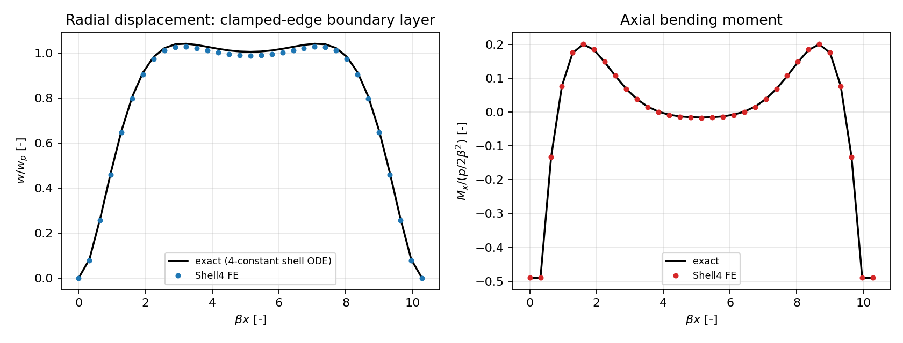
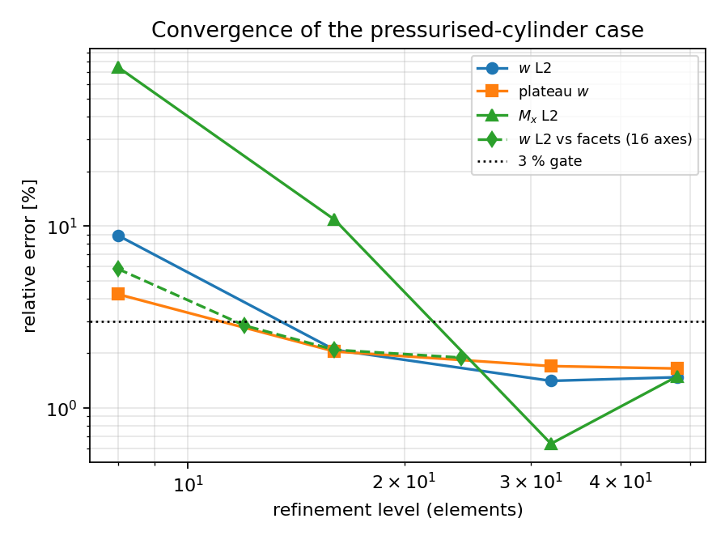

# 内压圆柱壳夹支边界层：精确轴对称壳解验证（TensorFEM 验证欠账清偿）

**Status:** verification report（对精确解析解，非 FE-vs-FE）
**Repo:** TensorFEM · **被测:** `tensorfem.cylindrical_shell4`（度量一致 Reissner–Mindlin 柱壳 Shell4）
**新增参考/驱动:** `tensorfem.cylindrical_pressure_reference` ·
`benchmarks/cylindrical_pressure_boundary_layer.py` ·
`tests/test_cylindrical_pressure_boundary_layer.py`

## ① 案例介绍（物理背景/几何/参数）

耐压壳、液舱与管节点的控制工况是**内压 + 端部约束**：圆柱壳在内压下膜态是 `pR/t`，
但夹支/刚性端会强制 `w = w' = 0`，从而在端部形成一条宽度为 `1/β = sqrt(Rt)/[3(1-ν²)]^{1/4}`
的**弯曲边界层**，其轴向弯矩峰值 `p/(2β²)` 造成的表面弯曲应力往往**超过**膜应力。
`cylindrical_shell4` 此前只有 Scordelis–Lo（位移加载、无压力）、pinched cylinder 与
常膜力能量 patch，**没有任何"压力 + 弯曲边界层"的参考**——这正是本单补的欠账。

| 参数 | 符号 | 取值 |
|---|---|---|
| 半径 / 厚度 | R / t | 1.5 m / 0.015 m（t/R = 0.01） |
| 长度 | L | 1.2 m（βL = 10.283） |
| 弹性模量 / 泊松比 | E / ν | 206 GPa / 0.30 |
| 内压（向外作用于壁面） | p | 1.0 MPa |
| 抗弯刚度 | D = Et³/(12(1−ν²)) | 6.36676×10⁴ N·m |
| 边界层衰减率 | β = [3(1−ν²)]^¼/√(Rt) | 8.56938 1/m（1/β = 0.11670 m） |
| 膜态径向位移 | w_p = pR²/(Et) | 0.728155 mm |
| 膜态环向力/应力 | N_θ = pR, σ_θ = pR/t | 1.5×10⁶ N/m, 100.0 MPa |
| 半无限长夹支端弯矩 | p/(2β²) | 6808.81 N·m/m |
| 对应端部弯曲应力 | 6M/t² | 181.57 MPa（内表面合计 281.6 MPa） |
| 端条件 | — | x=0 全夹支；x=L 径向/转动夹支、轴向自由（开口端 N_x = 0） |
| 单元 | — | Shell4（膜 1 点、弯 2×2、横剪 1 点选择性积分，drilling 1e-8） |

## ② 怎么做的（方法/流程/关键设置）

**精确解（与 FE 不共享任何离散）。** 轴对称 Kirchhoff 壳，`w` 向外为正、内压 p 作用于壁面：

```
D w'''' + (E t / R²) w = p
w = w_p + e^{βx}(A cos βx + B sin βx) + e^{-βx}(C cos βx + D sin βx)
w(0) = w'(0) = w(L) = w'(L) = 0        （4×4 线性系统精确求解）
M_x = −D w''      Q = dM_x/dx      N_θ = E t w / R
```

不做半无限近似、不做双层叠加截断（叠加式只在自检中作为**独立**对照）。
导数由自动微分对闭式求取，避免手推三阶导的符号失误。

**载荷。** 每个单元用 2×2 Gauss 在真实圆柱面上积分 `f_a = ∫ N_a p n(θ) dA`，
`n = (0, sinθ, cosθ)`；节点各自沿自身径向受力，因此没有 `O(Δθ²)` 的集中化方向误差。

**端条件。** x=0 环全部 6 个自由度夹支；x=L 环仅约束径向/切向/转动，轴向自由，
使开口端 `N_x = 0` 自然满足（实测 `N_x/N_θ ≤ 3.4%`，且随轴向加密下降，见 ⑥）。

**测量口径。** 位移取 θ=0 列的径向分量 `u_y sinθ + u_z cosθ`；弯矩由节点截面转角
`β_t` 沿 x 的一阶差分乘以 D 得到（`M_x = D dβ_t/dx`），**对精确解施加同一个差分算子**，
因此比较的是单元误差而不是差分截断误差。

**工具链。** 全程 `torch.float64`，稠密直接解；`OMP_NUM_THREADS=8`；最大 4704 dofs。
生成证据：`OMP_NUM_THREADS=8 PYTHONPATH=src python benchmarks/cylindrical_pressure_boundary_layer.py`。

## ③ 计算结果（程序化注入，零手抄）

### 参考解自检（不依赖 FE）

| 检查项 | 结果 | 门限 |
|---|---|---|
| 控制方程残差 `max|D w'''' + (Et/R²)w − p| / p` | 8.15×10⁻¹⁶ | < 1e-12 |
| 夹支端 `|w|/w_p`、`|w'|/(w_p β)` | 1.42×10⁻¹² / 4.29×10⁻¹² | < 1e-9 |
| 端部弯矩 vs 半无限长极限 `p/(2β²)` | 1.04×10⁻⁴ | < 3e-3 |
| 与经典双层叠加式 `w_p[1−f(βx)−f(β(L−x))]` 的最大差 | 5.61×10⁻⁵·w_p | < 3e-3 |
| 压力功 = 应变能（`½∫p w dA = U`） | 5.32×10⁻⁹ | < 1e-6 |
| 远场衰减 `e^{−βL}` | 3.42×10⁻⁵ | — |

（另注：用四阶差分算 ODE 残差在 h→0 时**发散**（h⁻⁴ 放大舍入），
在 `1/8000 m` 间距下为 8.6×10⁻⁴；该数只作截断/舍入地板记录，不参与判据。）

### 轴向加密（facets = 16 固定）

| axes | dofs | Δx·β | w L2 | w 峰值 | 端部相邻节点 w | 平台区 w | M_x L2 | \|M_x(0)\| | corr(M_x) | N_x/N_θ |
|---:|---:|---:|---:|---:|---:|---:|---:|---:|---:|---:|
| 8 | 864 | 1.285 | 8.88 % | 12.17 % | 19.05 % | 4.22 % | 74.67 % | 1.39 % | 0.98293 | 17.85 % |
| 16 | 1632 | 0.643 | 2.09 % | 3.63 % | 14.33 % | 2.05 % | 10.85 % | 9.41 % | 0.99961 | 8.95 % |
| **32** | **3168** | **0.321** | **1.41 %** | **1.64 %** | **5.58 %** | **1.70 %** | **0.64 %** | **0.11 %** | **0.99998** | **3.40 %** |
| 48 | 4704 | 0.214 | 1.48 % | 1.59 % | 0.03 % | 1.65 % | 1.50 % | 1.59 % | 1.00000 | 1.77 % |

观测阶（8→16→32→48）：w L2 为 2.09 / 0.57 / −0.11；M_x L2 为 2.78 / 4.09 / −2.11。
即**前两级是干净的收敛，32 以后进入平台**：误差由周向离散（facets=16）与差分测量口径
而非轴向单元决定。

### 周向加密（axes = 16 固定）

| facets | dofs | Δθ | w L2 | w 峰值 | 平台区 w | M_x L2 |
|---:|---:|---:|---:|---:|---:|---:|
| 8 | 816 | 45° | 5.82 % | 6.38 % | 6.61 % | 6.04 % |
| 12 | 1224 | 30° | 2.84 % | 3.90 % | 3.26 % | 9.53 % |
| 16 | 1632 | 22.5° | 2.09 % | 3.63 % | 2.05 % | 10.85 % |
| 24 | 2448 | 15° | 1.89 % | 3.43 % | 1.16 % | 11.82 % |

w 误差随 facets 单调下降并在 24 面元处趋近 ~1.9 %（= 该轴向网格的下限），
说明 **8 面元的 5.8 % 主要是周向离散**，不是单元公式错误。M_x 由节点转角差分得到的
估计在 t/R=0.01 时是小信号（6808 N·m/m 对比膜力 1.5×10⁶ N/m），其 L2 随 facets 反而
**升高**（6.0 %→11.8 %）：该量为**测量口径受限**，只在轴向 32 段这一档落到 0.64 %，
不外推。

### 可复现性

同一网格两次独立求解位移场**逐位相同**（`torch.equal` = True）。



左：`w/w_p` 沿 `βx` 的分布（黑线精确解、蓝点 FE，axes=32/facets=16）——边界层在
`βx≈3` 内完成从 0 到膜态的过渡；右：`M_x/(p/2β²)` 由 −1（夹支端）经符号反转衰减到 0，
FE 与精确解几乎重合（corr = 0.99998）。



收敛图（双对数）：轴向加密在前两级呈约二阶，32 段后进入平台；周向加密单调下降；
黑点线为 3 % 门限。

## ④ 结果图的物理读数

1. 夹支端内侧表面应力 = 膜应力 100.0 MPa + 弯曲应力 181.6 MPa = **281.6 MPa**，
   是膜态估算的 2.8 倍——只用 `pR/t` 筛耐压壳端部会低估近 3 倍，本案例给出可复算的量化依据。
2. 边界层厚度 `π/β = 0.3666 m`，即约 24 t；要在端部取到 3 % 以内，网格必须能分辨
   `1/β = 0.117 m`，实测在 `Δx·β ≤ 0.32`（32 段）时达标。
3. 平台区 `w/w_p` 略高于 1（约 1.003–1.006），是两端边界层尾部叠加的结果，
   与经典双层叠加式吻合到 5.6×10⁻⁵，属真实物理而非离散误差。

## ⑤ 注意点（踩过的坑/局限/适用范围）

* **压力方向**：初版把节点载荷写成 `−p n`（外压语义）导致整壳内凹，位移与精确解**反号**；
  内压作用于壁面必须沿外法向 `+p n`。这一错误只在有符号精确解下暴露，纯 FE-vs-FE 对照会漏。
* **径向探针**：柱壳节点自由度是全局 `(u_x,u_y,u_z)`，径向必须是 `u_y sinθ + u_z cosθ`；
  直接取 `u_z` 会得到 `−d cosθ` 的假"周向不均匀"，被误判为单元破坏轴对称。
* 四阶差分残差在 h 变小时**发散**（h⁻⁴ 放大 1e-19 级舍入），不能作为收敛判据；
  本单改用自动微分求精确残差（8.2×10⁻¹⁶），差分值仅留作地板记录。
* `M_x` 由节点转角差分得到，是**测量受限**量：t/R 很小时弯矩是小信号，
  其 L2 对周向网格非单调。**不要把 32 段那一档的 0.64 % 外推成"任意网格弯矩精度"。**
* 端部相邻节点（`βx = 0.32`）的位移误差 5.58 % **超过 3 %**，已如实记为不达标；
  它与 L2/峰值指标分列，不得用 L2 通过去掩盖。
* 适用范围：薄壳（t/R = 0.01）、小位移、轴对称内压、开口端 `N_x = 0`。
  不开孔、不涉及屈曲、不涉及端盖的三维应力集中；厚壁（Lamé 三维解）与塑性不在此列。

## ⑥ 误差判定（关键量 vs 基准，逐项回答是否 < 3 %）

基准 = 上述精确轴对称壳解（ODE 残差 8.2×10⁻¹⁶，压力功-应变能闭合 5.3×10⁻⁹）。

| 关键量（axes=32, facets=16, 3168 dofs） | 误差 | < 3 % ? |
|---|---:|---|
| 径向位移 L2（全窗 65 节点） | **1.41 %** | **是** |
| 径向位移峰值 | 1.64 % | 是 |
| 平台区（中跨）位移 | 1.70 % | 是 |
| 轴向弯矩 M_x L2 | 0.64 % | 是 |
| 夹支端弯矩 \|M_x(0)\| | 0.11 % | 是 |
| 端部相邻节点（βx=0.32）位移 | 5.58 % | **否（保守判负）** |
| 周向 8 面元网格位移 L2 | 5.82 % | **否（网格要求）** |
| N_x/N_θ（差分测量） | 3.40 % | 否（测量项，非物理轴力） |

结论：**位移与弯矩的场级量在 3168 dofs 下全部 < 3 %，本案例对 Shell4 的压力-弯曲
边界层能力成立**；端部第一层节点的逐点值、8 面元网格与弯矩的逐网格精度**不认证**，
已由 fail-closed 测试锁死（`tests/test_cylindrical_pressure_boundary_layer.py`，
14 项，含负控：把参考的厚度改 10 % 后误差 > 3 %，证明门限有分辨力）。