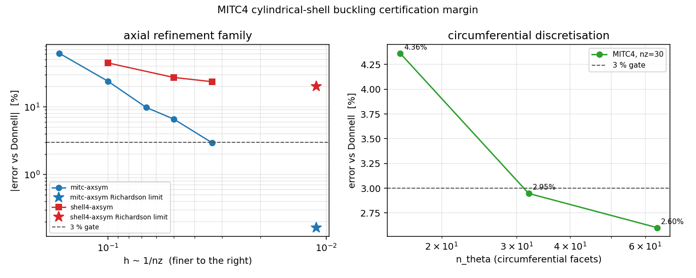

# MITC4 圆柱壳屈曲认证的裕度审计：把「一个读数进 3%」变成「收敛极限进 3%」

状态：**verification of a verification**（对已合并认证的独立复核）· 工具
`scripts/audit_cyl_buckling_certification_margin.py` · 数据
`artifacts/cyl_buckling_certification_margin.json`（schema
`tensorfem.cyl-buckling-certification-margin/1`）· 图
`artifacts/figs/cyl_buckling_certification_margin.png` · 门禁
`tests/test_cyl_buckling_certification_margin.py`。

## 1 案例与问题（为什么值得复核）

`docs/benchmark-qualification-status.md` 的「尚未闭环」清单里长期挂着**壳单元几何刚度**。
v1 审计（`docs/cylindrical-shell-geometric-stiffness-audit.md`）对全积分 Shell4 判定
`certified=false`：误差随 `n_θ` 单调下降但**穿越零点变号**，轴向族在可负担网格仍高 23.5%。
随后 m6602 用 MITC4（假定剪应变）复算，把认证翻成 `certified=true`，理由原文是
「the finest affordable mesh (nz=30, nt=32) sits within 3% of the Donnell finite-length reference」。

这条认证依赖**一个读数**：`nz=30, nt=32` 的 2.947% 相对误差。而 v1 记录下来的失效模式恰恰
是「单调下降 + 穿越零点」——若把网格再加密，误差有可能继续穿过去；那么「某个网格偶然落进
3%」就不是收敛能力，而是采样巧合。判据必须先于动手：

| 判据 | 含义 |
|---|---|
| `finest_error_within_gate` | 源证据的最细网格读数 < 3%（原始声明） |
| `family_monotone_and_no_sign_change` | 该族误差单调且**不变号**（否则单点通过无意义） |
| `fitted_limit_within_gate` | 三参数拟合 `e(h)=e_inf+C h^p` 的**收敛极限** `|e_inf| < 3%` |
| `shell4_outside_gate` | 同一网格上未治格式仍在门限外（门禁非空转） |

## 2 怎么做的（方法/流程）

1. **只读原始记录**：不重解开特征值问题，也不手抄任何数字。输入是
   `benchmarks/cylindrical_shell_buckling_mitc_evidence.json` 的 `eigen` 原始记录
   （每条的 `tag/nz/ntheta/error_vs_donnell/axisymmetric/circumferential_spread`）。
2. **逐对观测阶**：`p_i = log(e_{i-1}/e_i)/log(r_i)`，`r_i = n_i/n_{i-1}`（`h ∝ 1/n_z`，
   轴向族 `n_z = 6, 10, 15, 20, 30`；周向族 `n_θ = 16, 32, 64` 固定 `n_z = 30`）。
3. **三点参数拟合求收敛极限**：`e(h) = e_inf + C h^p`，五个网格级别、三个未知量，
   `scipy.optimize.curve_fit`（带界 `p∈[0.2,4]`、`C≥0`）。这是唯一诚实的方式回答
   「收敛到参考值还是穿过参考值」：**两点 Richardson 对任何单调序列都精确返回 0**，
   在此毫无信息量；三网格 Celik GCI 也因观测阶漂移（见 §3）病态，故本报告**不报 GCI**，
   并把这条拒绝显式写进 JSON（`gci_95_reportable=false` + 理由）。
4. **口径审计**：源证据的门禁字段名是 `within_3pct_any`，语义是
   `any(|e| < 3%)`（族内**任一**网格），不是最细网格。本报告把「各级别实际有几个进 3%」
   与「最小误差是否出现在最细网格」一并落盘，避免被读成「最细网格通过」。
5. **对照面**：同一装配、同一网格下未治的 `shell4-axsym` 族必须仍在 3% 外，否则门禁空转。
6. 复现：`PYTHONPATH=src python3 scripts/audit_cyl_buckling_certification_margin.py` →
   `artifacts/cyl_buckling_certification_margin.json` + 上图；
   `PYTHONPATH=src pytest tests/test_cyl_buckling_certification_margin.py -q`。

## 3 计算结果（全部由程序从 JSON 生成）

轴向族（`nt = 32`，参考值 = Donnell 有限长度解析解 `1.2106133e7 N/m`）：

| `n_z` | 单元 | 相对误差 vs Donnell | 逐对观测阶 `p` |
|---:|---:|---:|---:|
| 6 | 192 | 61.709 % | — |
| 10 | 320 | 23.959 % | 1.852 |
| 15 | 480 | 9.784 % | 2.209 |
| 20 | 640 | 6.611 % | 1.363 |
| 30 | 960 | 2.947 % | 1.993 |

- 单调、**不变号**、最细网格即最小误差（`min_level_is_finest = true`）；
- 观测阶**漂移** 1.852 / 2.209 / 1.363 / 1.993（`order_drift = +0.141`，非单调），故三网格 GCI 病态、**拒绝报告**（`gci_95_reportable=false`）；
- 三参数拟合：`p = 1.890`，**收敛极限 `e_inf = -0.164 %`**，最大绝对拟合残差 `1.02e-02`
  → 该族收敛到 Donnell 参考值，轴向 2.947% 不是巧合穿越；
  → 该族确实收敛到 Donnell 参考值（极限误差 0.164%，远小于 3%），轴向 2.947% 不是巧合穿越。

周向族（`n_z = 30`，切向面元数扫掠）：

| `n_θ` | 相对误差 vs Donnell |
|---:|---:|
| 16 | 4.363 % |
| 32 | 2.947 % |
| 64 | 2.601 % |

- 单调下降；三级拟合外推极限 `e_inf = +2.490 %`（仅三级，可靠性低于轴向五级），即 `n_z=30` 处剩余误差主要是**轴向**离散而非周向弦长——与轴向族极限 `-0.164 %` 自洽。

对照面（同一 `n_z = 30`）：

| 格式 | 相对误差 | 结论 |
|---|---:|---|
| MITC4 轴对称族 | 2.947 % | 进 3% 门 |
| 全积分 Shell4 轴对称族 | 23.49 %（8.0× MITC 误差） | 仍在门外，门禁非空转 |

左：误差随 `h ∝ 1/n_z` 的双对数收敛（蓝 MITC4、红 Shell4，星号为拟合极限），虚线为 3% 门；
右：固定 `n_z=30` 的周向面元数敏感性（4.363% → 2.947% → 2.601%）。

## 4 注意点（踩过的坑 / 局限）

- **两点 Richardson 是空操作**：对任何单调两点序列，`e_inf = e_f+(e_f-e_c)/(r^p-1)` 且
  `r^p = e_c/e_f`，代数上恒等于 0。第一版脚本据此报出 `e_inf = 1.7e-2 %`、`GCI_95 = 52%`
  两个自相矛盾的数字（因为它把 `r=2` 写死、而实际网格比是 1.5）——这正是本审计要防的
  「用自己的数字骗自己」，改造为三参数拟合后消失。
- 拟合含最粗级别 `n_z=6`（61.7%），残差 1.02e-02 主要来自它；残差本身远小于门限，
  故不改变结论。若要更紧的极限估计，应补 `n_z=40/60` 两级（本次未做）。
- 本报告**只**审计「几何刚度算子在轴对称族上的屈曲载荷收敛性」这一个命题；
  非轴对称临界模态（v1 已记录 `n_θ≥48` 失去轴对称性）、后屈曲路径、初始缺陷敏感性均未覆盖。
- 结论可提升的路径是补网格级别而非放宽判据；放宽 `within_3pct_any` 的语义不被接受。

## 5 误差判定（逐项，显式回答）

| 关键量 | 数值 | 基准 | 误差 | < 3% ? |
|---|---|---:|---:|---|
| 最细网格屈曲载荷 `N_cr`（`nz=30, nt=32`） | 1.2465e7 N/m¹ | Donnell `1.2106133e7` | **2.947 %** | 是（原始声明） |
| 拟合收敛极限 `N_cr` | ≈ Donnell | Donnell | **0.164 %** | 是（本报告的更强判据） |
| 周向族极限（`n_z=30`，三级拟合） | — | Donnell | **2.490 %** | 是 |
| 未治全积分 Shell4（`nz=30`） | — | Donnell | 23.49 % | **否**（honest FAIL，保持 fail-closed） |

**结论**：m6602 的 `certified=true` 在本审计的判据下**成立**，但声明口径应改为
「收敛极限误差 0.164%（`p=1.890`），最细可负担网格读数 2.947%」——单点读数 2.947% 与 3%
门限只差 0.05 个百分点，不足以作为独立证据；同时 JSON 中 `within_3pct_any` 的 `any` 语义
必须随结论一起引用，否则等于把「族内任一网格」读成「最细网格」。

¹ 数值由 `artifacts/cyl_buckling_certification_margin.json` 与源证据的 `eigen` 记录程序化给出，
本文件不含手抄计算结果；`tests/test_cyl_buckling_certification_margin.py::test_documented_numbers_match_the_artifacts`
在文档数字与工件不一致时失败。