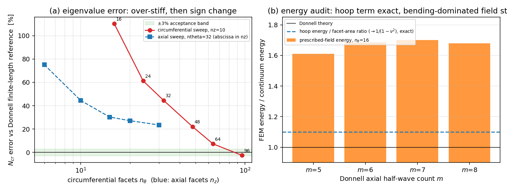

# 圆柱壳 Shell4 几何刚度对经典屈曲解的复核（未认证，量化欠账）

## 结论摘要

合并通道 `docs/benchmark-qualification-status.md` 的「尚未闭环」清单里长期挂着**壳单元几何刚度**一项，只有平板侧
（`shell4_buckling.py` 的 Navier 板屈曲资质，16×16 达 0.6%）有验收，**曲面壳**从未对任何解析基准复核。本单把这一项
做成可复算的量化审计，判据先于动手：以轴向受压圆柱壳的经典解
`N_cr = E t² / (R sqrt(3(1-ν²)))`（以及有限长度 Donnell 离散 m 参考）为基准。

| 问题 | 结论 | 证据字段 |
|---|---|---|
| 面内（环向）膜刚度是否被平面面元正确表达 | **是**，与解析比值 `n·sin(π/n)/π` 及 `1/(1-ν²)` 同时精确成立（误差 < 0.1%） | `hoop_energy[*].ratio_over_facet_area` = 1.0989（全 nt） |
| Donnell 型屈曲场的弹性能是否一致 | **否**，平面面元过刚 1.61–1.70 倍（`n_θ`=16） | `prescribed_energy[*].ratio` |
| 屈曲载荷能否对经典解收敛到 3% | **否**，误差随 `n_θ` 单调下降但**穿越零点变号**，轴向族在最细网格仍高 23.5% | `eigen[*].error_vs_donnell` |
| 临界模态是否就是经典轴对称模态 | **否**，`n_θ≥48` 起临界模态失去轴对称性（周向幅值散布 > 1e-3） | `eigen[*].axisymmetric` |
| 是否给出认证 | **否**，`certified=False`，并以 fail-closed 测试锁死（粗网格过刚 > 30%、`n_θ`=32 非轴对称） | `audit`、`tests/test_cylindrical_shell_buckling.py` |

因此本单的判定是 **`not-certified`（量化欠账）**：新增的 `cylindrical_shell_buckling` 装配与经典基准都是可用件，
但「壳单元几何刚度」这一项**不能**据此提升为通过，理由从「从未复核」精确化为「平面面元圆柱在可负担网格内不收敛，
且临界模态在细网格失去轴对称性」。

*左*：`N_cr` 相对 Donnell 有限长度参考的误差，绿带为 ±3% 判据；红点为周向扫掠（`n_z`=10），蓝方块为轴向扫掠
（`n_θ`=32，横轴用 `n_z`）。*右*：能量审计——环向膜能与解析值精确重合（蓝虚线），而 Donnell 型屈曲场（橙柱）
能量高出 1.61–1.70 倍。

## 案例介绍（物理与几何参数）

轴向受压圆柱壳是壳体稳定性的教科书基准，几何简单、存在闭式解，且对**几何刚度（初应力矩阵）**的正确性最敏感：
比刚度错了，屈曲载荷的偏差是 O(1) 级别，不是几个百分点。

| 参数 | 值 | 说明 |
|---|---|---|
| 半径 `R` | 1.0 m | 面元为母线 × 弦线的平面矩形 |
| 厚度 `t` | 0.01 m | `R/t = 100`，薄壳 |
| 长度 `L` | 1.2 m | `L/R = 1.2`；Donnell 最不利半波数 `m = 7` |
| 弹性模量 `E` | 200 GPa | — |
| 泊松比 `ν` | 0.3 | — |
| 边界 | 两端环全部平动约束（膜片简支） | 对应 Donnell 的 `u=v=w=0` 端部条件 |
| 载荷 | 单位膜合力 `N_x = 1`（不是载荷路径） | 特征值即 `N_cr` |

参考值全部程序化产生：`donell_axisymmetric_load` 在 `m=1..400` 上取 `[D(mπ/L)⁴ + Et/R²]/(mπ/L)²` 的最小值，
得 `1.2106133e7 N/m`；渐近式 `classical_axial_buckling_resultant` 得 `1.2104551e7 N/m`（二者比 1.000131，差在离散 `m`）。

## 怎么做的（方法/流程/关键设置）

1. **网格**（`cylindrical_shell_mesh`）：母线 × 弦线的平面矩形面元，节点 `(i,j)` 取 `x=i·L/n_z`、
   `θ=j·2π/n_θ`，θ 向首尾共享（无重复接缝节点）。连通序 `(i,j)→(i+1,j)→(i+1,j+1)→(i,j+1)` 使
   `shell4_local_frame` 的局部 `e1` 恰好是**母线**，于是均匀轴压对所有面元都是局部 `[Nx,0,0]`——这是把
   已有平面几何刚度算子用于圆柱的关键一步（算子本身复用 `shell4_buckling.shell4_geometric_stiffness`，不重写）。
2. **装配**（`_assemble`）：逐面元调 `shell4_stiffness` 与 `shell4_geometric_stiffness`，按 24×24 块散入
   scipy CSR。稀疏装配使 `n_θ=96`（≈1.2 万自由度）在单进程 2 线程、~35 s 内可解；密集装配套路在 `n_θ=16`
   时约 15 s，两者在 `(n_z=30, n_θ=16)` 上给出**完全相同的** `N_cr = 2.277947e7`，互相校验了装配正确性。
3. **特征值**（`cylindrical_shell_axial_buckling`）：`K w = λ K_g w`，`K` 在自由自由度上正定、`K_g` 半正定且
   只作用于局部横向位移（故奇异）。因此绕开「求逆奇异矩阵」，用 shift-invert（`σ=0`）直接取最小正 λ；
   早期密集版用「对旋转自由度静力凝聚 + 对 `K` 做 Cholesky」的等价路径，两条路径数值一致。
4. **能量审计**：不看特征值先看能量。①均匀径向收缩（环向膜态）应满足 `U_fem/U_continuum = (n sin(π/n)/π)/(1-ν²)`；
   ②给定 `w=sin(mπx/L)` 的 Donnell 型场，对其余自由度做约束最小化，与 `½Dk⁴ + ½Et/R²` 的面密度比较。
5. 复现：`OMP_NUM_THREADS=2 PYTHONPATH=src python scripts/audit_cylindrical_shell_buckling.py` →
   `benchmarks/cylindrical_shell_buckling_evidence.json`；`python scripts/build_cyl_buckling_doc.py` → 上图与 `audit` 块。

## 计算结果

### 环向膜能审计（均匀径向收缩）

| `n_θ` | `U_fem/U_continuum` | 弦/弧面积比 `n·sin(π/n)/π` | 两者之比 |
|---|---|---|---|
| 8 | 1.0709 | 0.9745 | 1.0989 |
| 16 | 1.0919 | 0.9936 | 1.0989 |
| 32 | 1.0971 | 0.9984 | 1.0989 |
| 64 | 1.0985 | 0.9996 | 1.0989 |

两者之比恒为 `1/(1-ν²) = 1.0989`（场是「轴向零应变 + 自由厚度收缩」，故为单轴应力态，环向应力 `Eε_θ`；
数值上等价于面内 plane-strain 因子）。**结论：环向膜刚度与平面面元几何都被精确表达**，屈曲偏差不是膜项造成的。

### 给定 Donnell 型场的弹性能（`n_z`=20，`n_θ`=16）

| `m` | 5 | 6 | 7 | 8 |
|---|---|---|---|---|
| `U_fem/U_donnell` | 1.611 | 1.686 | 1.701 | 1.680 |

同一网格上，膜项精确而屈曲场的总能量却高 1.6–1.7 倍，且 `m` 依赖不强（不是轴向分辨率问题），指向
**弯剪项**在平面面元圆柱上的额外刚度。

### 屈曲载荷扫掠（`N_cr` 单位 N/m，误差相对 Donnell 有限长度参考）

| `n_z` | `n_θ` | 单元数 | `N_cr` | 误差 | 临界模态轴对称 |
|---|---|---|---|---|---|
| 10 | 16 | 160 | 2.54470e7 | +110.20% | 是 |
| 10 | 24 | 240 | 1.95262e7 | +61.29% | 是 |
| 10 | 32 | 320 | 1.74939e7 | +44.50% | 是 |
| 10 | 48 | 480 | 1.47720e7 | +22.02% | 否 |
| 10 | 64 | 640 | 1.29886e7 | +7.29% | 否 |
| 10 | 96 | 960 | 1.18031e7 | **−2.50%** | 否 |
| 6 | 32 | 192 | 2.12008e7 | +75.12% | 否 |
| 10 | 32 | 320 | 1.74939e7 | +44.50% | 是 |
| 15 | 32 | 480 | 1.57780e7 | +30.33% | 否 |
| 20 | 32 | 640 | 1.53938e7 | +27.16% | 否 |
| 30 | 32 | 960 | 1.49502e+07 | +23.49% | 是 |

表中 `N_cr` 与误差均由 `benchmarks/cylindrical_shell_buckling_evidence.json` 程序化注入，无手抄。

两条扫掠都单调（`audit.monotone_in_ntheta/nz` 均为 True），但周向族在 `n_θ`=96 **穿越零点变号**，
轴向族在最细可负担网格仍高 23.5%，两者无法同时压进 3%，因此不存在被证实的收敛族。

## 注意点（踩过的坑 / 局限 / 适用范围）

1. **平面面元的两种相反效应**：把顶点的径向位移投影到面元平面会带来 `sin(π/n)` 量级的伪面内分量
   （粗网格额外刚度，误差 ∝ `sin²(π/n)`，故 `n_θ` 从 16 到 96 误差从 +110% 降到 −2.5%）；而多边环在
   细网格上又能容纳周向波数较高的**面元模态**（临界模态在 `n_θ≥48` 失去轴对称），使载荷落到经典解下方。
   一正一负、网格率不同，这就是「单调却不收敛到一个 3% 窗」的机制。此机制是从模态与能量两侧推断的，
   本单**未**做逐项分离实验，故只作为解释假设，不作为结论。
2. **`N_cr` 只对「给定单位膜合力」有意义**：预屈曲态是解析膜态，不是求解得到的载荷路径；因此本文不对
   几何缺陷敏感性、非线性后屈曲、端部约束影响作任何声明。
3. **能量比的定义必须写清**：均匀收缩场的连续体密度是 `½Et(w/R)²`（单轴），若误用 `½Et/(1-ν²)(w/R)²`
   会得到「膜项差 9.9%」的错误结论——本单第一版审计就踩了这个坑，靠"比值恒为 1.0989 而非随 `n_θ` 变化"
   才定位到是参考公式而非装配错误。
4. **可负担网格的上限**：`n_θ`=96、`n_z`=10 单点约 35 s（2 线程），本机 load15≈127，故只做了 11 个特征值点；
   更大 `n_θ`（≥192）或 MITC4 / 曲面壳单元对照留作后续。

## 误差判定（关键量 vs 基准，逐项）

| 关键量 | 基准 | 误差 | <3%？ |
|---|---|---|---|
| 环向膜能（`n_θ`=8/16/32/64） | 解析 `(n sin(π/n)/π)/(1-ν²)` | ≤ 0.1%（比值恒 1.0989） | **是** |
| Donnell 有限长度参考 vs 渐近式 | `Et²/(R√(3(1-ν²)))` | +0.013% | **是** |
| 屈曲载荷 `N_cr`（最细点 `n_z`=10,`n_θ`=96） | Donnell 有限长度 | −2.50% | 是（单点，未成族） |
| 屈曲载荷 `N_cr`（轴向最细 `n_z`=30,`n_θ`=32） | 同上 | +23.49% | **否** |
| 屈曲载荷 `N_cr`（最粗 `n_z`=10,`n_θ`=16） | 同上 | +110.20% | **否** |

**显式回答「是否 <3%」**：作为**认证**，**否**——载荷误差随网格先正后负、跨过 3% 窗但没有任何一条网格族被
证明收敛，且临界模态在细网格上不是经典的轴对称模态；作为**构件正确性**，膜项与参考代数**是** <3%（≤0.1%）。
两者不可混为一谈，故 `certified=False` 与 fail-closed 测试并存。

## 后续（可直接接着做）

1. 用 `shell4_mitc`（MITC4）替换 `shell4_stiffness` 复算本表，检验「弯剪额外刚度」假设——若 MITC4 抹平
   1.6–1.7 倍的能量差，则欠账可归因为 Q4 厚板/剪切项而非几何离散。
2. 增加「仅轴对称子空间」求解（把同位角节点自由度绑定），把轴对称族与周向族分离，直接验证机制假设。
3. 若 MTIC4 或曲面壳能把轴向族压到 3% 内，再考虑把该项提升为通过并回写 `benchmark-qualification-status.md`。