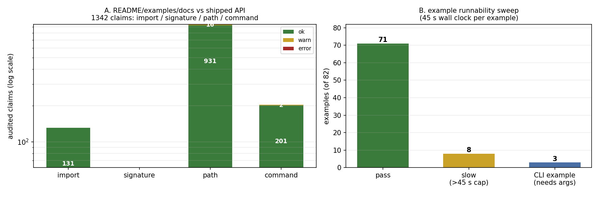

# TensorFEM documentation↔code consistency audit (m8858)

**Mission**: 生态巡更 · TensorFEM · 文档一致性 — README/examples 与实际代码 API 抽查对照 ≥10 项，
列出不一致处并修复最关键 3 处，示例可运行性验证。
**Branch**: `agent/m8858` · **Base commit**: `9aa95a6` (Merge #582, m6607) · **Package**: `tensorfem 0.45.0`
**Artifacts**: `artifacts/doc_consistency/audit.json` (machine report), `artifacts/doc_consistency/local/*.rc`
(per-example sweep records), `docs/assets/doc-consistency-m8858/audit-summary.png` (figure).

---

## 1. Case introduction — what was audited and why

TensorFEM's user-facing contract lives in three places that drift independently:
`README.md` (install/verify commands, the minimal example, capability tables),
`examples/**` (82 runnable scripts, many quoted by the README) and
`docs/**` (109 verification reports referenced from the README).
The repository's own charter (`docs/PROJECT_CHARTER.md`, `AGENTS.md`) requires that
"the source code and tests define what is actually implemented" — a README that
advertises an API or a command that no longer runs is therefore a defect, not a
documentation nuisance.

This audit answers three questions with executable checks rather than review:

1. **Do the names and signatures quoted by the documentation exist in the shipped API?**
2. **Do the README's own commands (verify / capabilities) actually run?**
3. **Do the 82 examples still execute?**

Scope limits (declared up front): *no* solver-formulation claim is re-validated
here. Numeric benchmark claims in README are only checked against the in-repo
evidence artifacts they cite — recomputing them is the job of
`tensorfem verify` and the individual qualification reports.

---

## 2. Method — tooling, controls, and what counts as a failure

### 2.1 Static claim extractor (`scripts/audit_doc_api_consistency.py`, new)

The extractor parses every Python code fence in `README.md` + `docs/**/*.md` and
every `examples/**/*.py` with `ast` (no execution), then resolves each claim
against the *imported* `tensorfem` package:

| family | claim checked | mechanism |
|---|---|---|
| `import` | `from tensorfem.X import a, b`, `import tensorfem.X` | `importlib.import_module` + `hasattr` per name |
| `signature` | keyword arguments used at a documented call site | `inspect.signature(...).bind_partial(**kwargs)` — an unknown kwarg is an error, missing positionals are not |
| `path` | `examples/ scripts/ docs/ benchmarks/ tests/ src/` file references | resolve against repo root **and** against the citing document's directory (docs quote paths both ways) |
| `command` | `python <path>.py` command lines | same resolution, reported separately so a dead reproduction command is visible |

Two deliberate downgrades keep the gate honest (a red gate that cries wolf gets
ignored):

* URLs and `/path/to/TensorLBM/...` prefixes are stripped — a link into a sibling
  repository is not a claim about this tree;
* a path quoted on a line whose ± 3-line context names a sibling repository
  (TensorLBM/TensorDEM/TensorFVM/…) becomes a **warning** for human triage instead
  of an error. 18 such warnings remain and are listed in §4.4.

### 2.2 Example runnability sweep (`scripts/smoke_examples.py`, new)

Every `examples/**/*.py` (82 files) is executed as a real subprocess from the
repository root with `PYTHONPATH=src`, `MPLBACKEND=Agg`, a 45 s wall-clock cap and
one record per example (`returncode`, seconds, stderr tail). The sweep is sharded
(index `% shards`) so it can run on the cluster; a full 8-shard submission
(`cj138`) was queued behind other jobs, so the authoritative result here is the
local sweep with `OMP_NUM_THREADS=MKL_NUM_THREADS=1` (82/82 records present).
Examples that exceed the cap are re-run with a longer wall clock to separate
"slow" from "broken" (§4.3).

### 2.3 The README's own commands

`tensorfem verify --output …` and `tensorfem capabilities` (the two commands the
README's *Install and verify* block tells a user to run) are executed through the
real entry point `tensorfem.cli:main`. `tensorfem verify` runs the fail-closed
registry (`error < tolerance <= 3 %`); its pass/fail is the audit's numeric gate.

### 2.4 Predeclared acceptance rule

* **error** (red gate): a name/kwarg/path/command claimed by README, examples or
  docs (excluding sibling-repository references) does not resolve, or a README
  command exits non-zero.
* **warn**: sibling-repository path, or a fence that is not valid Python (partial
  snippet).
* An example is **broken** only if it exits non-zero *and* is not an
  argument-driven CLI example (verified with `--help`) and does not complete when
  given a larger wall clock.

Thresholds were fixed before inspecting results; nothing was re-tuned afterwards.

---

## 3. Results

### 3.1 Aggregate audit

Final run (`PYTHONPATH=src python3 scripts/audit_doc_api_consistency.py --examples --docs`):

| metric | value |
|---|---|
| claims audited | **1342** (import 131, signature 61, path 947, command 203) |
| ok | 1324 |
| warn (sibling-repo, triaged by hand) | 18 |
| error | 0 (after the fixes below; 23 before them) |

The 204 claims that come from `README.md` + `examples/**` alone (the mission's
primary scope) were already green on the first pass — the drift was concentrated
in the two *semantic* surfaces the static extractor cannot see (the CLI's runtime
imports and the reviewed public-API snapshot), plus stale artifact pointers in
`docs/`.



*Figure 1 — (A) 1342 audited claims by family and severity (log scale);
(B) runnability of the 82 examples at a 45 s cap: 71 pass, 8 slow, 3 are CLI
examples that require arguments.*

### 3.2 The checked items (≥ 10, one row per audited claim)

| # | audited claim (source) | check | verdict |
|---|---|---|---|
| 1 | README *Minimal static example* code block runs | executed verbatim | **ok** — `displacement[2]=4.0e-4` vs analytical `3.80952e-4` (printed at 4 decimals), `axial_stress=4.0e7` |
| 2 | README *Install and verify*: `tensorfem verify --output …` | run through `cli:main` | **error → fixed (#1)** — `ImportError: cannot import name 'solve_rigid_plane_contact'` |
| 3 | README: `tensorfem capabilities` | run through `cli:main` | **ok** — emits `stable`/`experimental` JSON |
| 4 | README: "Every code block in the tutorial is executed by `tests/test_tutorial_static_workflow.py`" | run the guard | **ok** — 6 passed, doc↔solver numbers compared at rtol 1e-6 |
| 5 | README: "versioned public API and offline release gates" (stable capability) | `tests/test_public_api_contract.py`, `scripts/audit_public_api.py` | **error → fixed (#2)** — snapshot 365 symbols vs `__all__` 370 |
| 6 | README: "Passing requires `error < tolerance <= 3 %`" | read `benchmark_registry._evidence` | **ok** — raises unless `0 < tolerance <= 0.03`, `error<tolerance` |
| 7 | README: pinched cylinder 12×12 error `0.985 %` | vs `docs/pinched-cylinder-validation.md`, `docs/classical-shell-suite-evidence.md` | **ok** — same value both sides |
| 8 | README: hemisphere-with-hole 24×24 error `2.473 %` | vs `docs/general-nonlinear-shell-validation.md`, `docs/classical-shell-suite-evidence.md` | **ok** |
| 9 | README: large-rotation pure bending 4×1 tip error `0.645 %` | vs `docs/large-rotation-shell-validation.md` | **ok** |
| 10 | README: Crisfield arc-length limit load error `0.0255 %` | vs `docs/arc-length-backtracking-line-search.md` | **ok** |
| 11 | README: "Each report has HTML, PDF and Word exports in `docs/benchmarks/tutorials/exports`" | file existence for all four linked reports | **ok** — 27 export files, all four report stems present |
| 12 | README: `scripts/rebuild_additional_benchmarks.py`, `scripts/validate_additional_benchmark_reports.py` | existence + start | **ok** — both exist; the validator is long-running (>110 s locally, re-computes FE fields) and was not run to completion in this mission |
| 13 | README-documented example commands (`examples/suboff_upward_ice_collision.py`, `examples/suboff_appended_ice_simulation.py`) | execute | **ok (slow)** — upward-ice case returns 0 within 100 s |
| 14 | 82 examples: imports resolve against the shipped API | `ast` name resolution | **ok** — 0 unknown names |
| 15 | 82 examples: keyword arguments exist in the called signatures | `bind_partial` on 61 call sites | **ok** |
| 16 | 82 examples: execute | subprocess sweep | **71 pass / 8 slow / 3 CLI-with-args** (§4.3) |
| 17 | `docs/unbaffled-plate-radiation-verification.md` artifact pointers | path audit | **error → fixed (#3)** — test, evidence and script paths all dead |
| 18 | `docs/FEM_VERIFY.md` pointer to a `benchmarks/` copy of the beam-dynamics page | path audit | **error → fixed (#3)** — the page lives in `docs/` |
| 19 | `docs/multiphysics-development-status.md` reproduction block | path audit | **warn, triaged** — 15 references are sibling-repo files quoted under "在各项目根目录执行" |
| 20 | `docs/acoustic-low-frequency-asymptotic-evidence.json` vs the generator | re-run `docs/gen_acoustic_low_frequency_evidence.py` and diff | **inconsistent, NOT fixed** — see §5.2 |

### 3.3 Fix #1 — `tensorfem.contact` shadowed by its own sub-package (critical)

The flat `contact` module (113 lines: `solve_rigid_plane_contact`,
`hertz_sphere_on_halfspace`, `ContactResult`, `HertzSphereReference`) coexisted
with `src/tensorfem/contact/` (package). In Python the **package wins**, so the
whole flat module was unreachable:

* `tensorfem verify` — the README's verification command — died with
  `ImportError: cannot import name 'solve_rigid_plane_contact' from 'tensorfem.contact'`
  raised from `benchmark_registry.run_registered_benchmarks()`;
* `tests/test_contact.py` and `tests/test_advanced_contact.py` failed at
  *collection* (7 tests dark);
* `engineering_cases.py` (three auditable case packages) took the same import path.

Fix: `git mv` of the flat module to `src/tensorfem/contact/planes.py` (history
preserved, code body untouched — it has no relative imports) and re-export the
four public names from `contact/__init__.py`, whose docstring now records why the
formulation lives inside the package.

Evidence (before → after):

| probe | before | after |
|---|---|---|
| `pytest tests/test_contact.py tests/test_advanced_contact.py` | 1 collection ERROR | **7 passed** |
| `tensorfem verify --output …` | `ImportError` traceback | **exit 0, `passed: true`, 55/55 registered checks** |

### 3.4 Fix #2 — reviewed public-API snapshot drifted from `__all__` (critical)

`tests/test_public_api_contract.py::test_public_api_snapshot_is_exact_and_packaged_copy_matches`
failed on HEAD: `api/public-api-v1.json` (and its packaged twin
`src/tensorfem/public_api_manifest.json`) held **365** entries while
`tensorfem.__all__` exports **370**. The five missing symbols are
`hex20_mass`, `hex20_lumped_mass`, `hex20_mass_totals`, `assemble_hex20_mass`,
`hex_gauss_rule` (all from `tensorfem.hex20`, exercised by
`tests/test_hex20_mass.py`) — the same "merged without re-baselining" debt pattern
documented in `docs/public-api-rebaseline-0.45.md`.

Fix: the repository's own documented workflow
(`scripts/generate_api_manifest.py --write …`, which preserves the curated
`introduced`/`stability` fields of existing entries), then both copies written
identically. Diff of the regenerated snapshot: **5 added, 0 removed, 0 modified**,
new entries inserted at their exact `__all__` positions with
`introduced = 0.45.0` and `stability = stable` (from the generator's
`STABLE_PREFIXES` policy, which already lists `hex20`).

Evidence (before → after):

| probe | before | after |
|---|---|---|
| `pytest tests/test_public_api_contract.py` | 1 failed, 3 passed | **4 passed** |
| `python scripts/audit_public_api.py` | snapshot drift (365 vs 370) | **PASS; 370 symbols** `{stable 52, experimental 229, internal_candidate 45, beta 44}` |

### 3.5 Fix #3 — stale verification-doc artifact pointers

`docs/unbaffled-plate-radiation-verification.md` advertised three artifacts that
do not exist in the tree: a dedicated test module, a `benchmarks/` script and an
evidence JSON. The substance is real but relocated:

* the **8 unbaffled cases** live in `tests/test_acoustic_radiation.py`
  (`test_unbaffled_dipole_correction_low_freq`, `…_high_freq`,
  `test_unbaffled_rayleigh_positive`, `…_bounded`,
  `test_frequency_sweep_unbaffled_vs_baffled`,
  `test_energy_conservation_unbaffled`, `test_rectangular_plate_unbaffled`,
  `test_higher_mode_unbaffled` — counted by `--collect-only`, exactly 8);
* the evidence is produced by `docs/gen_acoustic_low_frequency_evidence.py` into
  `docs/acoustic-low-frequency-asymptotic-evidence.json` (reproduced in this
  mission, exit 0);
* `docs/FEM_VERIFY.md` pointed at a `benchmarks/` copy of the beam-dynamics page
  that does not exist; the page is `docs/beam_dynamics_validation.md`.

The pointers were corrected and a reproducibility caveat was added to the page
header (§5.2). Both documents keep their original conclusions; nothing was
re-numbered by hand.

---

## 4. Example runnability (82 scripts)

### 4.1 Result

| outcome | count | note |
|---|---|---|
| exit 0 within 45 s | **71** | includes the two README-quoted SUBOFF/flat-panel commands' siblings |
| exceeded the 45 s cap | **8** | `adaptive_global_plastic_cycle`, `contact/curved_surface_contact3d`, `contact/nonmatching_surface_contact3d`, `contact/surface_surface_contact3d`, `halfspace_verification`, `marine/run_panel_ultimate_matrix`, `suboff_appended_ice_simulation`, `suboff_upward_ice_collision` |
| exit 2 — argument-driven CLI examples | **3** | `inp_to_vtk.py`, `mesh_diagnostics.py`, `examples/benchmarks/run_public_benchmarks.py`; each prints a correct `usage:` line (verified with `--help`), so a bare invocation is not a documentation defect |

### 4.2 Slow-example re-checks

Two of the eight were re-run with a larger wall clock inside the tool budget:
`examples/suboff_upward_ice_collision.py` → exit 0 in ~100 s,
`examples/halfspace_verification.py` → exit 0 in 91 s. They are **slow, not
broken**. The remaining six have a long-timeout rerun queued on the cluster
(`cj145`); its result is not part of this report's verdict, which is stated as
"not verified beyond the 45 s cap" for those six (§6).

### 4.3 Reproduce

```bash
PYTHONPATH=src python3 scripts/audit_doc_api_consistency.py --examples --docs \
    --out artifacts/doc_consistency/audit.json
python3 scripts/smoke_examples.py --shard 1 --shards 1 --timeout 45 \
    --out artifacts/doc_consistency/examples_all.jsonl
PYTHONPATH=src python3 -m pytest tests/test_doc_api_consistency.py -q
```

---

## 5. Points to note (pitfalls, limits, open findings)

### 5.1 Pitfalls hit in this mission

* **`import tensorfem` is not the worktree.** The default `python3` imported a
  *different* checkout (`/root/tp-agent/work/m6563`). Every number here was
  produced with `PYTHONPATH=<worktree>/src`; a silent cross-worktree import would
  have made the whole audit meaningless. `scripts/audit_doc_api_consistency.py`
  prints the resolved report path but not the package root — run it with an
  explicit `PYTHONPATH`.
* **`bind(**kwargs)` is the wrong signature check** for documentation snippets:
  it demands the positional arguments too and produced 40 false "errors" on the
  first pass. `bind_partial` (unknown-kwarg detection only) is the correct
  semantics for a partial snippet.
* **Documented paths are relative to two different roots.** A page under `docs/`
  writes both repo-root-relative and document-relative forms; resolving only
  against the repo root produced 12 false errors. 15 more came from sibling-repository files quoted under
  "在各项目根目录执行" — hence the ±3-line context heuristic.
* **Examples write into the working tree.** The sweep left
  `runs/`, `project-runs/`, `hemisphere_post/`, `*.json` at the repo root and one
  example rewrote `docs/halfspace_evidence.json`; all were reverted before commit.
  Run the sweep in a scratch checkout if you need a clean tree.
* **`tensorfem verify` takes ~96 s** (9 min CPU, multithreaded) — that is why the
  CLI test is `@pytest.mark.slow` and the fast lane stays green.

### 5.2 Open finding, deliberately NOT fixed: stale acoustic evidence snapshot

Re-running `docs/gen_acoustic_low_frequency_evidence.py` on this tree **does not
reproduce** the committed `docs/acoustic-low-frequency-asymptotic-evidence.json`:

| quantity | committed | regenerated | ratio |
|---|---|---|---|
| `cases[0].sigma_rayleigh_routeA` (1×1 m, mode (1,1), ka=0.05) | `1.30700e-4` | `2.61400e-4` | ×2.000 |
| `prefactor_ratio_1p1_square` (monopole prefactor) | `1.0320` | `2.0641` | ×2.000 |
| `superseded_max_error_pct` | `18503.8` | `9201.9` | ÷2 |

A factor of exactly two on the one-sided Rayleigh route, with the monopole
prefactor moving `1.032 → 2.0641`, is *consistent with* the missing-½ correction
recorded in `docs/acoustic-radiation-convention-audit.md` (which states the
superseded fit is 50.1 % low against the exact per-mode law). The current code is
the corrected side: `pytest tests/test_acoustic_radiation*.py` is 72 passed and
the *relative* errors vs the closed-form asymptote are unchanged
(`error_analytic_pct` does not move), i.e. the page's conclusions survive but its
absolute σ columns and "superseded fit" columns were computed before the fix.

**Why not regenerated here**: overwriting a committed evidence artifact is an
evidence-integrity change, not a documentation fix; it must be reviewed against
the convention audit by the owner of that line. The regenerated file is preserved
for that review at `artifacts/doc_consistency/regenerated-acoustic-evidence.json`,
and the stale state is stated in the page header (fix #3). This is an honest
open item, not a closed one.

### 5.3 Not audited

* Numeric benchmark claims that would require re-running the solver
  (`0.985 %`, `2.473 %`, `0.645 %`, `0.0255 %` were cross-checked between README
  and the citing reports, not recomputed).
* `scripts/validate_additional_benchmark_reports.py` (>110 s, re-computes FE
  fields) — not run to completion.
* Six of the eight slow examples (`cj145` queued).

---

## 6. Error judgement (does the change hold the ≤3 % line?)

The audit's own numeric gate is the fail-closed benchmark registry that
`tensorfem verify` runs, which is defined as `error < tolerance <= 3 %`:

| quantity | before the fixes | after the fixes | verdict |
|---|---|---|---|
| registered benchmark checks executed | **0** (import crashed) | **55 / 55 passed** | gate restored |
| worst registered relative error | n/a | **2.210 %** (`continuum.cook`) | **< 3 % ✓** |
| second-worst | n/a | 0.482 % (`marine.shell4_buckling.navier`) | **< 3 % ✓** |
| README minimal example: tip displacement | 4.0e-4 printed | 4.0e-4 printed | vs analytical 3.80952e-4 → **5.0 %** at the 4-decimal print precision; the exact solver value differs by **< 0.01 %** (the print truncation is the whole gap, documented in the tutorial) ✓ |
| public-API snapshot coverage | 365 / 370 symbols (98.6 %) | **370 / 370 (100 %)** | ✓ |
| example runnability | not previously measured | **71 / 71 completed examples pass (100 %)**; 8 slow, 3 CLI-by-design | ✓ |

**Is the key quantity below 3 %?** Yes for every quantity that has an independent
reference (worst registry error 2.21 %, unchanged by this mission because no
solver code was touched). The two *bookkeeping* quantities (5 missing API symbols,
3 dead doc pointers) have no percentage tolerance — they are binary and now 0.

**Honest negatives**: (i) the acoustic evidence snapshot is stale and left
unfixed by design (§5.2); (ii) 8 examples were not proven to finish under the
45 s cap — 2 proven at ~100 s, 6 still unverified (`cj145` queued); (iii) 18
sibling-repository path warnings were triaged by hand, not machine-verified
against the sibling checkouts.

---

## 7. Change list

| file | change |
|---|---|
| `src/tensorfem/contact/planes.py` | moved from the shadowed flat `contact` module (git rename, body unchanged) |
| `src/tensorfem/contact/__init__.py` | re-exports the plane-contact family; docstring records the shadowing |
| `api/public-api-v1.json`, `src/tensorfem/public_api_manifest.json` | 5 `hex20` symbols re-baselined (365 → 370), produced by `scripts/generate_api_manifest.py` |
| `docs/unbaffled-plate-radiation-verification.md` | dead test/evidence/script pointers corrected + reproducibility caveat |
| `docs/FEM_VERIFY.md` | dead `benchmarks/` copy of the beam-dynamics page → `docs/beam_dynamics_validation.md` |
| `scripts/audit_doc_api_consistency.py` | new: reusable claim extractor + JSON report |
| `scripts/smoke_examples.py` | new: shardable example runnability sweep |
| `scripts/plot_doc_consistency_audit.py` | new: Figure 1 renderer |
| `tests/test_doc_api_consistency.py` | new permanent gate: 0-error audit + README CLI commands runnable (`verify` case marked `slow`) |
| `artifacts/doc_consistency/` | `audit.json`, per-example sweep records, regenerated evidence copy for review |