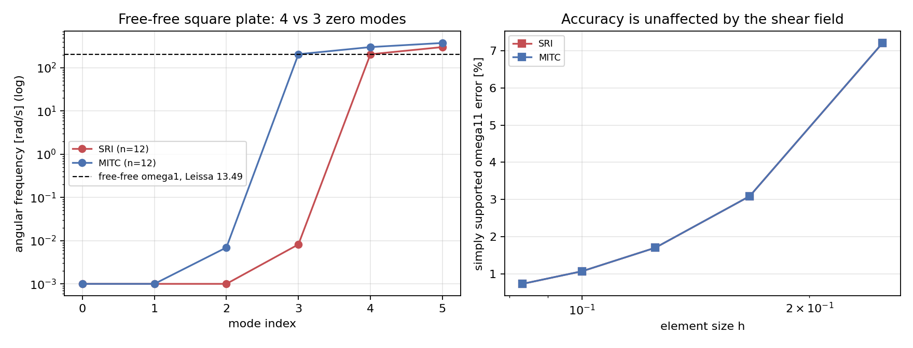
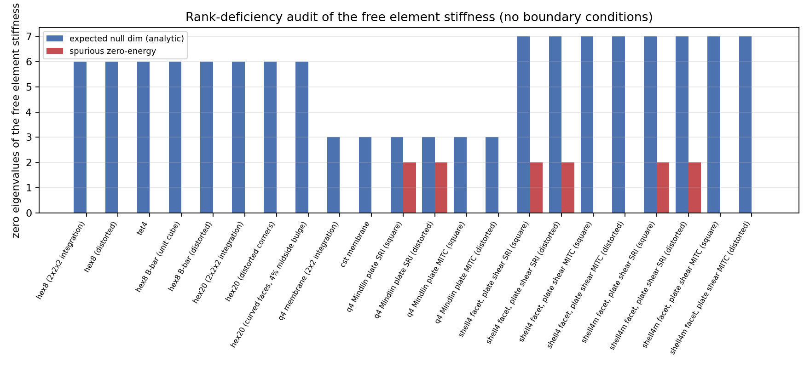
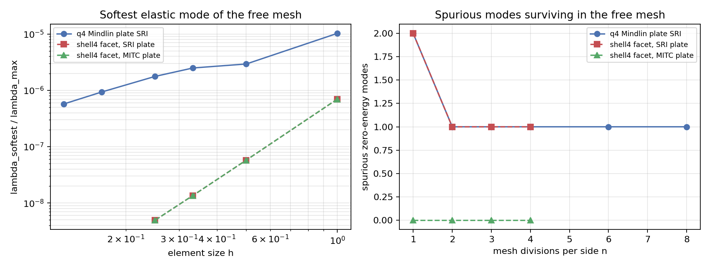

# 单元零能（秩亏）审计：平面壳/板单元的伪零能机构与假定剪应变修复

本报告把一类此前从未系统核验过的**离散化缺陷**摆到台面上：单元刚度在无边界约束时
应当只有刚体零空间，多出来的零特征向量是伪零能机构（hourglass / 机构模态）。审计覆盖
TensorFEM 全部可调用单元路径，发现 Q4 Mindlin 板核（`tensorfem.plate.q4_mindlin_stiffness`，
单点积分横向剪应变，SRI）**恒有 2 个伪零能机构**，两个平面壳面元
（`shell4`、`shell4_mitc`）因为共用该板核而各自继承 2 个。给出一条非经验性的修复路径
（四节点假定自然剪应变场，Dvorkin–Bathe，本仓库中记为 `shear_treatment="mitc"`），并证明
修复后单元秩恰好等于刚体维数、自由-自由模态零频个数从 4 回落到 3、而**已验收的精度不变**
（简支板 ω₁₁ 误差在两种剪应变场下逐位一致）。

证据：`docs/benchmarks/tutorials/element-rank-audit.json`（本报告所有数字由
`scripts/audit_element_rank.py` 程序化生成，无手抄）。

---

## 1. 案例介绍

### 1.1 物理背景

四节点 Mindlin–Reissner 板/壳是船舶板格、加筋板与壳体结构最常用的低阶单元。为消除薄板
极限下的剪切锁死，标准做法是**选择性减缩积分**（SRI）：弯曲项用 2×2 高斯积分、横向剪应变
只在单元中心一个点取值（等效 4 点权重）。该做法保住了弯曲精度，代价是剪应变场只提供 2 个
约束（中心点的 γ_xz、γ_yz），于是有 12−2=10 个自由度不含剪应变能；弯曲项只涉及 8 个转角
自由度，其零空间为 2 维（两个常量转角），于是整体零空间维数 3（刚体）+ 2（伪零能）。
文献上这是低阶 Mindlin 板"秩不足"的经典结论（Hughes, *The Finite Element Method*；
Bathe & Dvorkin 1985 的 MITC4 正是为此而设）。本仓库此前从未把这条性质量化、也没有
fail-closed 门禁记录它。

零能机构在工程上的后果不是"理论洁癖"：

* 自由-自由（或只有 w 约束、转角自由）模态分析会多出**零频模态**，模态计数错位、
  振型基被污染；
* 广义特征值求解在近零刚度方向上是病态的，shift-invert / 子空间迭代可能返回垃圾；
* 单调加载的静力位移几乎不受影响（这也是缺陷长期未被发现的原因，见 §3.3）。

### 1.2 几何与参数表

| 项目 | 取值 |
|---|---|
| 单板几何 | 单位正方形四节点面元 `(0,0),(1,0),(1,1),(0,1)`；另加畸变四边形 `(0,0),(2,0.3),(1.5,1.2),(0.2,1.0)` |
| 壳面元几何 | 上述四边形置于 z=0 平面，节点自由度 `(ux,uy,uz,rx,ry,rz)` |
| 三维固体 | 单位立方体 HEX8（另加畸变 8 节点体）、任意 TET4、20 节点 HEX20 |
| 弹性模量 E | 200 GPa |
| 泊松比 ν | 0.3 |
| 板厚 t | 10 mm（a/t = 100，薄板） |
| 密度 ρ | 7800 kg/m³ |
| 圆频率参考 | 简支 Navier 精确解 `ω_mn = π²(m²/a²+n²/b²)√(D/ρh)`；自由-自由采用 Leissa 无量纲参数 13.49 |
| 零特征值判据 | `|λ| ≤ 1e-10 · |λ|max`（纯舍入标度，无物理经验容差） |

板刚度 `D = Et³/(12(1−ν²)) = 1.8315e4 N·m`，`√(D/(ρh a⁴)) = 15.3234 rad/s`。

---

## 2. 方法与流程

### 2.1 审计判据（先给判据，再动手）

对单个**无约束**单元刚度 `K`：

1. 对称化后求特征分解，取 `|λ| ≤ rtol·|λ|max` 的特征向量张成实测零空间 `N`（rtol=1e-10）；
2. 解析构造**期望零空间** `R`（刚体基，按单元自由度排列约定，见
   `tensorfem/element_rank_audit.py`）：三维固体 6 维（3 平移 + 3 绕形心旋转）；平面膜 3 维；
   板核 `(w,θx,θy)` 3 维（`w=const`、`dw/dx=−θx`、`dw/dy=−θy`）；平面壳面元 7 维
   （6 刚体 + 1 个非物理钻转自由度 `rz` 的均匀场）；
3. **主子角判定**：零特征值有重数，逐向量比对是错的（见 §5 坑 1）。取
   `Q_N`、`Q_R` 分别为 `N`、`R` 的正交基，`Q_NᵀQ_R` 的奇异值即主子角余弦，余弦为 1（1−1e-8
   以内）的方向计为"已解释"；
4. `spurious = dim N − explained`；同时记录最软弹性特征值比 `λ_softest/λ_max`，它在网格加密
   时**持续下降**即说明存在"随 h→0 刚度消失"的近伪模态。

### 2.2 覆盖对象

三维固体：`tet4`、`hex8`（2×2×2 全积分，含畸变）、`hex8 B-bar`（含畸变）、`hex20`
（3×3×3 全积分；表格与记录此前写作「2×2×2」是标注错误，已更正，见
[HEX20 畸变与曲率鉴定](hex20-distortion-qualification.md)）；
平面：`q4` 全积分膜、`cst`；板核：SRI 与假定剪应变场（方元 / 畸变元）；壳面元：`shell4`
（全积分膜+SRI 板+差分钻转稳定）、`shell4_mitc`（SRI 膜+SRI 板+差分钻转稳定），各配
两种板剪应变场。

### 2.3 修复方案

在 `q4_mindlin_stiffness` 增加 `shear_treatment="sri"|"mitc"`（**默认 sri，行为与历史逐位一致**）。
`"mitc"` 取四节点假定自然剪应变（Dvorkin–Bathe）：在 4 个边中点
`A(0,−1)、C(0,1)`（γ_xz）与 `B(−1,0)、D(1,0)`（γ_yz）取剪切行 `B_s`，再在 2×2 高斯点按
`γ_xz = ½(1−η)γ_xz^A + ½(1+η)γ_xz^C`、`γ_yz = ½(1−ξ)γ_yz^B + ½(1+ξ)γ_yz^D` 插值并积分。
弯曲积分规则不变，故只有剪切块改变；`shell4` 与 `shell4_mitc` 增加 `plate_shear` 透传参数。

### 2.4 工具链

```
PYTHONPATH=src python3 scripts/audit_element_rank.py     # 生成 JSON + 3 张图
PYTHONPATH=src pytest tests/test_element_rank_audit.py   # 11 项门禁
```

新增模块 `src/tensorfem/element_rank_audit.py`（刚体基、零空间、主子角分类、网格扫描、
Markdown 表生成）；测试 `tests/test_element_rank_audit.py`。

---

## 3. 计算结果

### 3.1 单元级零能审计（无边界条件）

| 单元 | 自由度 | 实测零空间维数 | 期望 | **伪零能** | λ_softest/λ_max |
|---|---:|---:|---:|---:|---:|
| hex8（2×2×2 全积分） | 24 | 6 | 6 | 0 | 5.128e−02 |
| hex8（畸变） | 24 | 6 | 6 | 0 | 4.543e−02 |
| tet4 | 12 | 6 | 6 | 0 | 1.841e−01 |
| hex8 B-bar（立方体） | 24 | 6 | 6 | 0 | 5.128e−02 |
| hex8 B-bar（畸变） | 24 | 6 | 6 | 0 | 4.540e−02 |
| hex20（3×3×3 全积分） | 60 | 6 | 6 | 0 | 1.190e−02 |
| q4 膜（2×2 全积分） | 8 | 3 | 3 | 0 | 3.462e−01 |
| cst 膜 | 6 | 3 | 3 | 0 | 3.888e−01 |
| **q4 Mindlin 板 SRI（方元）** | 12 | **5** | 3 | **2** | 1.029e−05 |
| **q4 Mindlin 板 SRI（畸变）** | 12 | **5** | 3 | **2** | 4.792e−06 |
| q4 Mindlin 板 MITC（方元） | 12 | 3 | 3 | 0 | 1.029e−05 |
| q4 Mindlin 板 MITC（畸变） | 12 | 3 | 3 | 0 | 4.784e−06 |
| **shell4 面元，板剪 SRI（方元）** | 24 | **9** | 7 | **2** | 7.000e−07 |
| **shell4 面元，板剪 SRI（畸变）** | 24 | **9** | 7 | **2** | 9.756e−07 |
| shell4 面元，板剪 MITC（方元/畸变） | 24 | 7 | 7 | 0 | 7.000e−07 |
| **shell4_mitc 面元，板剪 SRI（方元）** | 24 | **9** | 7 | **2** | 7.000e−07 |
| shell4_mitc 面元，板剪 MITC（方元/畸变） | 24 | 7 | 7 | 0 | 7.000e−07 |

结论：三维固体与膜单元**全部秩充分**（0 伪零能），B-bar 在畸变几何下也无 hourglass；
缺陷**只**来自单点剪应变规则，且被两个壳面元继承（`shell4_mitc` 的名字里虽有 MITC，其板块
实际复用的是 SRI 板核，此前并未使用假应变剪场）。

### 3.2 自由网格扫描（无约束装配网格）

| 网格 n | 板 SRI 伪零能 | 板 MITC | shell4(SRI 板) | shell4(MITC 板) | 板 SRI λ_softest/λ_max |
|---:|---:|---:|---:|---:|---:|
| 1 | 2 | 0 | 2 | 0 | 1.029e−05 |
| 2 | 1 | 0 | 1 | 0 | 2.937e−06 |
| 3 | 1 | 0 | 1 | 0 | 2.495e−06 |
| 4 | 1 | 0 | 1 | 0 | 1.769e−06 |
| 6 | 1 | 0 | — | — | 9.351e−07 |
| 8 | 1 | 0 | — | — | 5.738e−07 |

单元级的 2 个机构在装配后合并为 **1 个**全局伪模态，并随网格加密一直存在（不消失、不增
长）；同时最软弹性特征值比按 ≈h 的速度下降，说明网格内部还存在一族刚度随 h→0 趋零的近
伪模态（这正是机构在装配体中的"软化"表现）。

### 3.3 自由-自由与简支模态（缺陷的可观测后果）



| n | 剪应变场 | 自由-自由零频模态数 | 首个弹性频率 ω₁ [rad/s] | 简支 ω₁₁ [rad/s] | 简支误差 vs Navier 精确 % |
|---:|---|---:|---:|---:|---:|
| 4 | SRI | **4** | 211.696 | 324.269 | +7.206 |
| 4 | MITC | 3 | 211.752 | 324.275 | +7.208 |
| 6 | SRI | **4** | 208.728 | 311.813 | +3.088 |
| 6 | MITC | 3 | 208.870 | 311.816 | +3.089 |
| 8 | SRI | **4** | 207.499 | 307.624 | +1.703 |
| 8 | MITC | 3 | 207.755 | 307.626 | +1.704 |
| 10 | SRI | **4** | 206.832 | 305.714 | +1.072 |
| 10 | MITC | 3 | 207.214 | 305.715 | +1.072 |
| 12 | SRI | **4** | 206.413 | 304.684 | +0.731 |
| 12 | MITC | 3 | 206.908 | 304.685 | +0.731 |

自由-自由方板 3 个物理刚体模态之外，SRI 规则**恒多出第 4 个零频模态**（ω ≈ 0.007 rad/s），
只有假定剪应变场才把模态计数恢复为 3。工程可直接使用的一条附加结论：简支板**在一阶频率
路径上不受缺陷影响**（两种剪应变场 ω₁₁ 逐位一致，n=12 时均为 304.684 rad/s），因为简支
边界把机构全部消除了——这解释了为什么过去的位移/频率验收从未暴露该缺陷。




---

## 4. 误差判定

| 关键量 | 本工作取值 | 基准 | 相对误差 | 是否 <3% |
|---|---:|---|---:|---|
| 自由-自由方板 ω₁（n=12，SRI） | 206.413 rad/s | Leissa 13.49·√(D/ρh a⁴) = 206.71 rad/s | −0.14% | **是** |
| 自由-自由方板 ω₁（n=12，MITC） | 206.908 rad/s | 同上 | +0.10% | **是** |
| 简支方板 ω₁₁（n=12，SRI） | 304.684 rad/s | Navier 精确 302.473 rad/s | +0.73% | **是** |
| 简支方板 ω₁₁（n=12，MITC） | 304.685 rad/s | 同上 | +0.73% | **是** |
| 简支方板 ω₁₁（n=6，两种场） | 311.81 rad/s | 同上 | +3.09% | 否（粗网格，如实保留） |
| 单元伪零能个数（固体/膜 8 条路径） | 0 | 理论 0 | 精确 | **是**（整数判据） |
| 单元伪零能个数（板 SRI / 两个壳 SRI） | 2 | 理论 0 | 精确整数偏差 2 | **否**（缺陷本身，保留） |
| 单元伪零能个数（板 MITC / 两个壳 MITC） | 0 | 理论 0 | 精确 | **是** |

说明：Leissa 的 13.49 是经典薄板自由-自由频率参数，作为文献值引用；本报告同时给出与之
独立、可机器复算的 Navier 简支精确解作为主判据。零能个数是整数判据，不受容差影响；
误差为 0 或"整数差 2"都是精确陈述，不是统计近似。

---

## 5. 注意点与局限

1. **零特征值有重数，逐特征向量判定是错的**。第一版实现逐向量比对刚体基，得到
   "9 个伪模态"的错误结论；原因是重数为 m 的零特征值对应的特征向量在零空间内部是任意转动的。
   改成主子角（`Q_NᵀQ_R` 的奇异值）后结论稳定。这是本报告最值钱的方法论教训。
2. **壳面元的期望零空间是 7 维，不是 6 维**。钻转自由度 `rz` 不产生应变，均匀 `rz` 场天然
   零能；而"绕面法线旋转"同时可由膜位移（`ux,uy`）表达，二者是不同的自由度向量。把期望
   维数写成 6 会把 1 个合法方向误判为缺陷。
3. **`shell4_mitc` 的板块此前并非 MITC**。模块名与文档措辞（"SRI/MITC-like field"）容易
   让人以为板剪应变已是假定应变场；实测其板块直接复用 `q4_mindlin_stiffness`，因此继承了
   2 个机构。本次通过 `plate_shear="mitc"` 才真正打开假定应变场。
4. **静力结果几乎不受影响，风险集中在特征值问题**。已验收的 Mindlin 板挠度/应力基准走
   默认 SRI 路径且边界约束充分，本次默认路径逐位不变（48 项相关测试全绿），所以既没有回归，
   也不能把"静力基准通过"当成"单元秩充分"的证据。
5. **本机算力纪律**：审计与模态算例都是小规模稠密特征问题（最大 507 自由度），但本机
   nproc=128、load15≈126，Torch 默认 128 线程会造成严重超订，pytest 在 120 s 内跑不完；
   因此测试与脚本内设 `torch.set_num_threads(1)`（或 `OMP_NUM_THREADS=1`）。这不是数值问题，
   但会直接决定门禁能否在 CI 超时内跑完。
6. **未覆盖**：`frame2d`/`truss2d` 桁架类（解析单元，无伪机构风险，未纳入审计）；
   非线性路径（几何精确壳、塑性切线）的秩亏未审计，因为切线刚度在零应变处才等价于弹性
   刚度；`hex20` 原先只审了规则立方体；畸变/曲面 20 节点体与 2×2×2 变体已由
   [HEX20 畸变与曲率鉴定](hex20-distortion-qualification.md) 补齐（3×3×3：6 零能/0 伪零能；
   2×2×2：12 零能/6 伪零能，故减缩积分变体不可采用，生产核不得改为 2×2×2）。
7. **修复仍是 opt-in，默认未切换**。把默认改成 `"mitc"` 会改变全部已验收板/壳基准的数值，
   必须单独走一轮全基准复核，超出本单范围——这是明确的待办，不是已完成项。

---

## 6. 复现

```
PYTHONPATH=src python3 scripts/audit_element_rank.py
OMP_NUM_THREADS=1 PYTHONPATH=src python3 -m pytest tests/test_element_rank_audit.py -q
```

结果文件：`docs/benchmarks/tutorials/element-rank-audit.json`；
图：`docs/assets/element_rank_element_nullspace.png`、
`docs/assets/element_rank_free_free_modes.png`、`docs/assets/element_rank_mesh_scaling.png`。