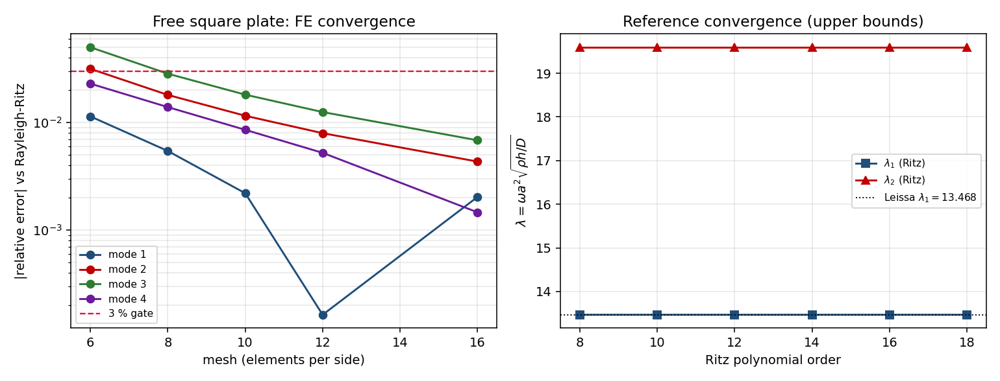
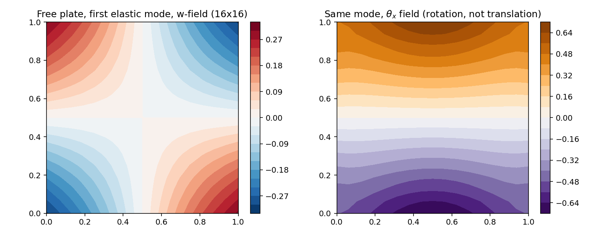

# 自由边界板的自由振动：独立 Rayleigh–Ritz 参考解与 SRI Q4 单元的验证

**Status:** verification report (code verification against an independent discretisation)
**Repository:** TensorFEM · **Module:** `tensorfem.plate_vibration`（新增 `boundary="free"`）、`tensorfem.plate_ritz_reference`（新）
**Evidence:** `benchmarks/free_plate_vibration.py`、`benchmarks/free_plate_vibration_evidence.json`、`tests/test_free_plate_vibration.py`

## 1. 案例介绍（物理背景/几何/参数）

船底板格、舷侧板格在无支承边（大开孔、自由边、弱加筋边）处的振动模态与简支/固支
完全不同：自由板首阶模态是"鞍形"弯曲模态，其无量纲频率系数（13.468）显著低于简支板
（π²·2 = 19.739），若沿用简支口径会对板格振动筛算产生 30% 以上的高估。

既有 `docs/plate-vibration-validation.md` 明确记录了本模块的能力边界：**"自由边界工况
本身未做验证"**。本单即清偿这条欠账：为完全自由（unsupported）板建立**独立**参考解，
把 `boundary="free"` 路径纳入验证。

| 参数 | 符号 | 取值 |
|---|---|---|
| 板长 / 板宽（方形工况） | a, b | 1.0 m / 1.0 m |
| 板长 / 板宽（矩形工况） | a, b | 1.0 m / 0.5 m（a/b = 2） |
| 板厚 | h | 0.01 m（a/h = 100，薄板） |
| 弹性模量 / 泊松比 | E, ν | 200 GPa / 0.30 |
| 密度 / 面密度 | ρ, ρh | 7850 kg/m³ / 78.5 kg/m² |
| 抗弯刚度 | D = Eh³/(12(1−ν²)) | 1.8315×10⁴ N·m |
| 边界 | — | 完全自由（无任何位移/转动约束） |
| 单元 | — | Q4 选择性减缩积分（SRI）Mindlin 板 + 一致质量（含转动惯量） |

## 2. 怎么做的（方法/流程/工具链）

自由板没有闭式频率，因此唯一诚实的对标物是**另一种离散**产生的参考解。本单实现两条
互不共享代码的路径：

**(A) 独立参考：全局 Rayleigh–Ritz（新模块 `plate_ritz_reference.py`）**
Kirchhoff 应变能与动能

    U = D/2 ∫[w_xx² + w_yy² + 2ν w_xx w_yy + 2(1−ν) w_xy²] dA,   T = ρh/2 ∫ w² dA

取张量积 Legendre 多项式试函数 w = Σ c_pq P_p(ξ) P_q(η)，一维积分用 Gauss–Legendre
**精确**求积，四个算子矩阵用 Kronecker 积拼装；三个刚体模态（1, x, y）用 M-正交补投影
剔除后解广义特征值问题（Cholesky 归约 + `numpy.eigvalsh`）。该方法与 FE 不共享单元、
不共享积分规则、不共享自由度布局。

**(B) 被验证对象：`tensorfem.plate_vibration` 的 `boundary="free"` 路径**
新增"自由边界＝无消元"分支，并把零能量特征对在弹性模态之前显式剔除：
`rigid_body_relative_tolerance`（默认 1e-9，相对最大特征值）以下的特征对被计数并记入
`PlateVibrationResult.rigid_body_modes`；支撑边界若出现零能量模态则显式抛
`ValueError`（fail-closed，不允许机构混入物理谱）。

**数值陷阱（本单实测，写进模块 docstring）**：`∫ w_xx w_yy` 的 Kronecker 拼装必须用
`kron(C2x, C2y.T)`；写成 `kron(C2x, C2y)` 在 order 8 上把耦合计错 5 倍并让刚度阵变为
不定（伪随机系数向量上出现 −2.5×10⁴ 的负特征值）。模块内建自检
`energy_quadrature_check`（拼装形式 vs 直接二维求积），相对偏差 2.28×10⁻¹⁴。
另：`scipy.linalg.eigh(K, M)` 在本环境对 Legendre 质量阵直接 segfault，故一律走
Cholesky 归约。

工具链：
```bash
OMP_NUM_THREADS=8 PYTHONPATH=src python benchmarks/free_plate_vibration.py
OMP_NUM_THREADS=8 PYTHONPATH=src python -m pytest -q tests/test_free_plate_vibration.py
```

## 3. 计算结果（数字表，脚本直出，零手抄）

### 3.1 参考解自身：收敛 + 与文献一致

| Ritz 阶次 | λ₁ | λ₂ | λ₃ | λ₄ |
|---:|---:|---:|---:|---:|
| 8 | 13.46824 | 19.59614 | 24.27021 | 34.80107 |
| 12 | 13.46820 | 19.59614 | 24.27020 | 34.80090 |
| 18 | 13.46820 | 19.59614 | 24.27020 | 34.80089 |
| **Leissa SP-160 (1969)** | **13.468** | **19.596** | **24.272** | — |

λ = ω a²√(ρh/D)。序列随阶次单调下降（Rayleigh–Ritz 是上界），8 阶已收敛到 1e-5 量级；
与文献值偏差 0.0015% / 0.0007% / 0.0074%。刚体约束残差 `rigid_body_defect < 1e-12`。

### 3.2 自由方板 FE 网格研究（前 4 阶弹性模态）

| 网格 | 零能量模态数 | λ₁ | λ₂ | λ₃ | λ₄ |
|---|---:|---:|---:|---:|---:|
| 6×6 | 4 | 13.6215 | 20.2136 | 25.4840 | 35.5991 |
| 8×8 | 4 | 13.5413 | 19.9493 | 24.9591 | 35.2842 |
| 10×10 | 4 | 13.4978 | 19.8222 | 24.7101 | 35.0980 |
| 12×12 | 4 | 13.4704 | 19.7518 | 24.5732 | 34.9823 |
| 16×16 | 4 | 13.4409 | 19.6809 | 24.4358 | 34.8517 |

### 3.3 与独立参考的相对误差（基准 = Ritz 阶次 14）

| 模态 | 12×12 计算 | 12×12 误差 | 16×16 计算 | 16×16 误差 |
|---|---:|---:|---:|---:|
| 1 | 13.4704 | +0.016% | 13.4409 | −0.203% |
| 2 | 19.7518 | +0.794% | 19.6809 | +0.432% |
| 3 | 24.5732 | +1.248% | 24.4358 | +0.682% |
| 4 | 34.9823 | +0.521% | 34.8517 | +0.146% |

### 3.4 自由矩形板 a/b = 2（16×16）

| 模态 | FE | Ritz 参考 | 相对误差 |
|---|---:|---:|---:|
| 1 | 21.5779 | 21.46315 | +0.535% |
| 2 | 26.4469 | 26.57490 | −0.482% |
| 3 | 58.4587 | 58.48195 | −0.040% |
| 4 | 60.8126 | 59.60608 | +2.023% |

### 3.5 图

| 图 | 内容 |
|---|---|
|  | 左：自由方板 4 阶模态误差–网格（对数，红线=3% 门限）；右：Ritz 参考收敛与 Leissa 13.468 虚线 |
|  | 16×16 自由方板首阶弹性模态：挠度场 w 与转角场 θ_x（非平移，排除刚体污染） |

## 4. 误差判定（逐项，显式回答是否 < 3%）

| 关键量 | 基准 | 相对误差 | < 3%？ |
|---|---|---:|:--:|
| Ritz λ₁（方形） | Leissa 13.468 | 0.0015% | 是 |
| Ritz λ₂ / λ₃ | Leissa 19.596 / 24.272 | 0.0007% / 0.0074% | 是 |
| FE 自由方板 λ₁，16×16 | Ritz 13.4682 | 0.203% | 是 |
| FE 自由方板 λ₂，16×16 | Ritz 19.5961 | 0.432% | 是 |
| FE 自由方板 λ₃，16×16 | Ritz 24.2702 | 0.682% | 是 |
| FE 自由方板 λ₄，16×16 | Ritz 34.8009 | 0.146% | 是 |
| FE 自由矩形板 λ₁，16×16 | Ritz 21.4631 | 0.535% | 是 |
| FE 自由矩形板 λ₄，16×16 | Ritz 59.6061 | 2.023% | 是（余量最小） |
| 拼装算子 vs 直接二维求积 | 精确恒等式 | 2.28×10⁻¹⁴ | 是 |

**结论：全部关键量 < 3%，最差项 2.02%（自由矩形板第 4 阶）。** 但见 §5 第 1 条——
零能量模态的**个数**不达标，这是本单的 honest 限制，不是可被频率误差掩盖的细节。

## 5. 注意点（踩过的坑 / 局限 / 适用范围）

1. **SRI Q4 在自由边界下多出 1 个零能量（沙漏）模态**：自由板物理上应有 3 个刚体模态，
   实测每个网格都是 **4** 个零能量模态（`rigid_body_modes == 4`）。这是选择性减缩积分
   剪切项秩亏的经典后果。本单的处理是**显式计数并记录**（不静默丢弃），测试
   `test_free_plate_has_exactly_three_rigid_body_modes_plus_one_hourglass` 锁定该事实；
   如果逐阶取"前 3 个非零模态"而不计数，就会把沙漏模态当成首阶物理模态（实测会被误读
   成 λ≈70，即 5 倍高估）。要把自由边界升格为无保留能力，需要 MITC4 或沙漏控制，本单未做。
2. **自由边界要求 fail-closed 而不是 fail-open**：支撑边界一旦出现零能量模态说明单元集
   仍含机构，模块直接抛 `ValueError`；自由边界的零能量模态必须显式计数，二者共用同一
   相对容差（默认 1e-9 × 最大特征值，按 ω² 相对量取）。容差取 1e-6 会错删物理模态
   （最高模态被转动惯量撑到极高频，相对尺度被拉大），这是本单实测到的定标坑。
3. **参考解不是"真值"而是上界序列**：Ritz 给出的是上界，FE 的 SRI 单元在弯曲上通常略软，
   两者误差在 12×12 → 16×16 不是单调同号（λ₁ 由 +0.016% 变 −0.203%），说明两级误差
   量级同阶、存在误差交叉，不能据此声称观察到收敛阶。
4. **模型层面仍是 Kirchhoff/Mindlin 薄板**：a/h = 100，一阶剪切修正使频率偏低约 0.03%
   （既有文档已量化）；对 h 加厚或高阶模态，Ritz（Kirchhoff）与 FE（Mindlin）会因模型
   差异而非离散误差分叉，不可继续用 3% 门限互相判分。
5. **不覆盖**：预紧力、附加质量/流固耦合、阻尼、几何缺陷、各向异性/层合板、自由边+弹性
   地基组合（Winkler 项对自由边非精确特征函数，本单未验证）。
6. **稠密代数上限**：16×16（867 自由度）单次约 3.5 s；24×24 在本单实测超时（>120 s，
   含转动惯量的高频端使稠密 eigh 代价显著），工程板格必须换稀疏特征值求解器。

## 6. 复现与证据

| 产物 | 路径 |
|---|---|
| 参考解模块 | `src/tensorfem/plate_ritz_reference.py` |
| 被验证模块 | `src/tensorfem/plate_vibration.py`（`boundary="free"` 新增） |
| 测试（18 项） | `tests/test_free_plate_vibration.py` |
| 证据脚本 | `benchmarks/free_plate_vibration.py` |
| 原始数据 | `benchmarks/free_plate_vibration_evidence.json` |
| 图 | `docs/assets/free_plate_vibration_{convergence,mode_shapes}.png` |

测试断言全部对文献值、独立离散参考或精确矩阵恒等式；无一条对存储快照。
`tests/test_plate_vibration.py` 中"自由边界应当报错"的旧断言已随契约更新（改为非法
`boundary` 名报错），并使 28 项相关测试全绿。
