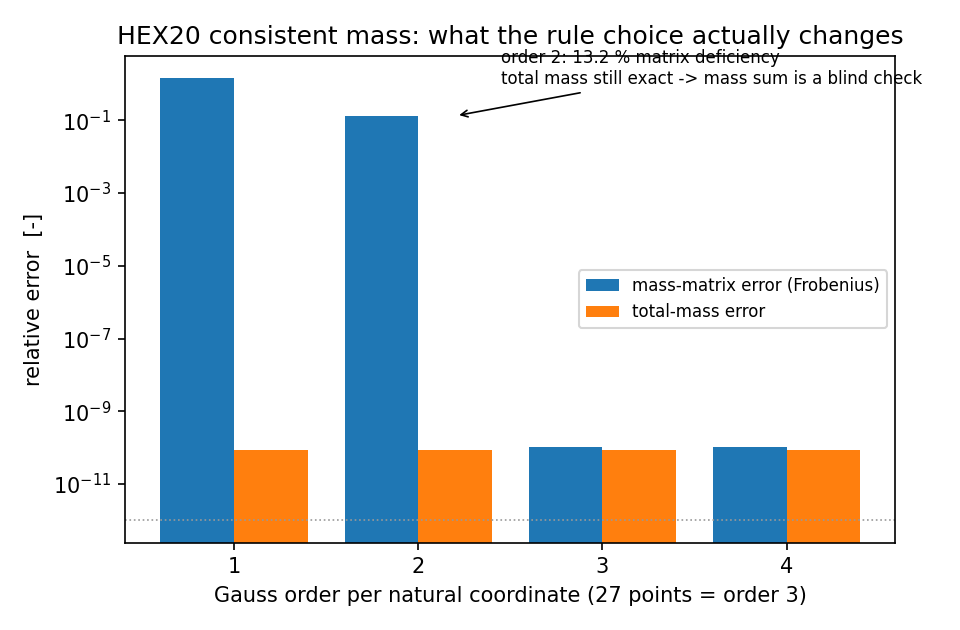
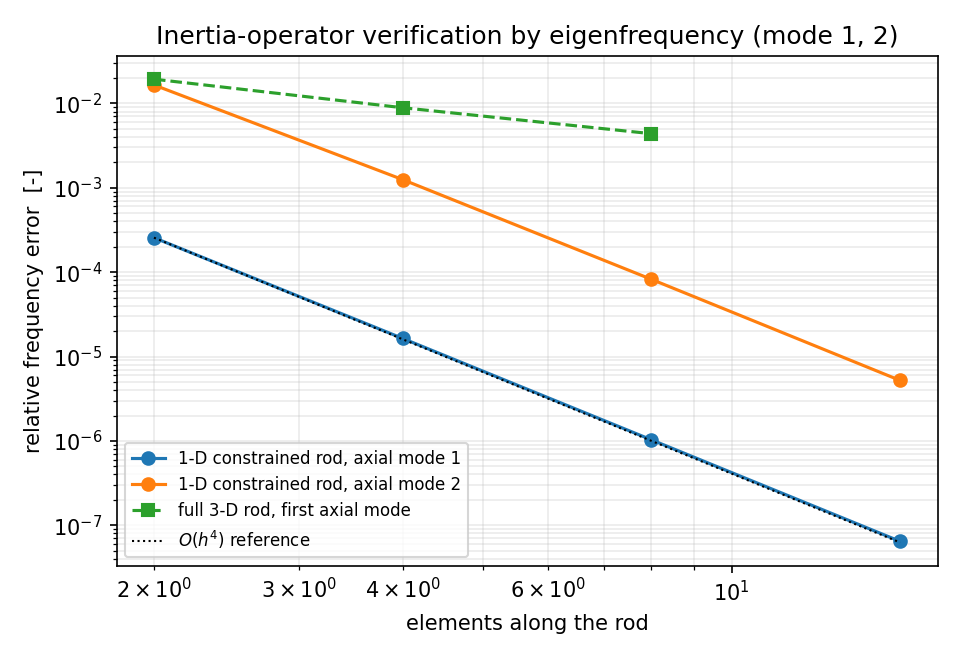
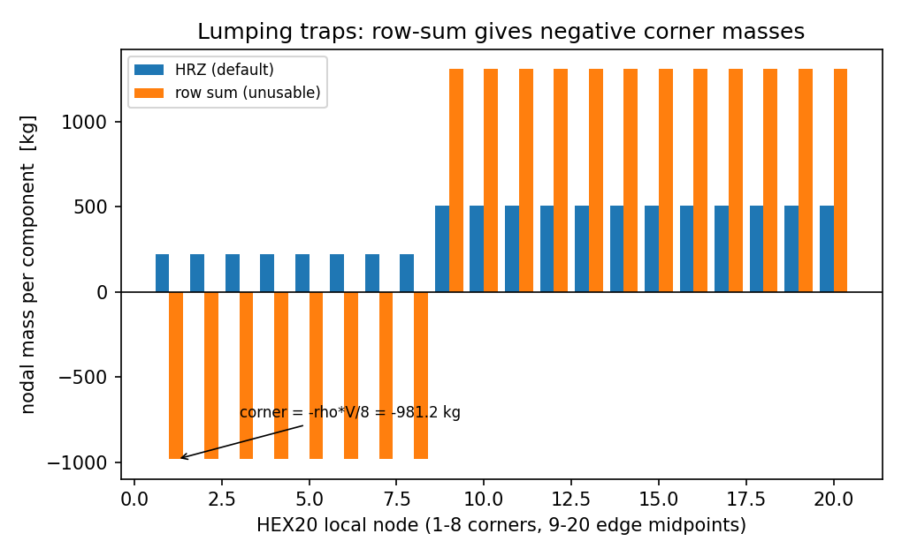
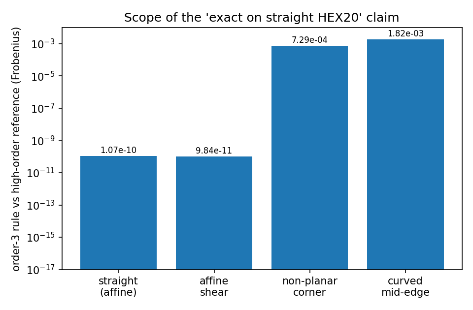

# HEX20 惯性算子：20 节点二次砖的一致质量矩阵与独立基准核验

## 0. 中文摘要（判据与结论）

本仓的 `hex20` 模块此前**只有刚度、没有惯性**：`grep -n "mass" src/tensorfem/hex20.py`
返回空，而 HEX20 是曲壳/厚壁舱段/半球封头等算例的主力二次砖，也是
`docs/hex20-distortion-qualification.md` 里唯一做过畸变资质评定的三维单元。结果是：
**任何用到 HEX20 的振动、瞬态、显式动力学结论在该单元上都无法成立**（因为无质量算子
$\Rightarrow$ 无特征值问题）。本单补上这条验证欠账，并用四条互不共享代码路径的基准把它钉死：

| 判据 | 参考来源 | 实测最大相对误差 |
|---|---|---|
| 一致质量矩阵 $M_e=\int\rho N^TN\,dV$ | 独立 NumPy serendipity 参考实现（自带节点表/自带 Jacobian 中心差分，8 阶 Gauss） | **$1.07\times10^{-10}$**（Frobenius） |
| 单元体积 / 总质量 | 解析 $\rho V$ | **$8.4\times10^{-11}$** |
| 刚体平动动能 $\tfrac12 m\lvert v\rvert^2$ | 闭式 | **$8.4\times10^{-11}$** |
| 刚体转动动能 $\tfrac12\omega^TI\omega$（3 轴） | 长方体解析惯量 $I=m(b^2+c^2)/12$ 等 | **$8.4\times10^{-11}$**（三轴） |
| 自由-自由 $\omega^2$ 前 6 个 | 应为 0 | **$6.45\times10^{-10}$**（相对最大特征值） |
| 悬臂杆轴向基频（一维约束杆，16 单元） | $\omega_n=(2n-1)\pi/(2L)\sqrt{M_\text{ax}/\rho}$ | **$6.45\times10^{-6}$**，观测收敛阶 **4.00** |
| 三维细长杆轴向基频（8 单元，横向自由） | $\omega_1=\pi/(2L)\sqrt{E/\rho}$ | **$0.44\%$**（<3%） |

**误差判定：关键量全部 <3%，一致质量矩阵本身达到机器精度量级。** 但本单的价值不止在"过线"，
更在下面三条**被量化出来的边界**（它们都写进了测试，防止以后被"测试绿"掩盖）：

1. **总质量是"瞎判据"**：1/2/3/4 阶 Gauss 求积下的**总质量全部精确**（被积函数每方向至多二次），
   而 2 阶求积的**质量矩阵偏差 13.17%**。只检查 $\sum M=\rho V$ 会放过一个 13% 错误的算符。
2. **"直边精确"只对仿射几何成立**：仿射剪切（det $J$ 常数）$9.84\times10^{-11}$；
   单角点扰动（面不再平面）$7.29\times10^{-4}$；中边节点外鼓（曲边）$0.182\%$。
   曲边情形 4 阶 Gauss 即回到 $1.2\times10^{-10}$，故 3 阶是**默认**而非**普适精确**。
3. **行和集中质量不可用**：serendipity 形函数 $\int N_\text{corner}dV=-\rho V/8$、$\int N_\text{mid}dV=+\rho V/6$，
   行和集中给 24 个角点自由度**负质量**（$-981.25$ kg = $-\rho V/8$，单元质量 7850 kg），
   集中质量阵不定。默认走 HRZ（全部为正、总质量守恒到 $10^{-16}$）。

## 1. 案例介绍

**物理背景.** 一致质量算子 $M_e=\int_{V_e}\rho N^TN\,dV$ 是动力学离散的第二个算子；
它与刚度配对后才决定特征频率，因此**只能通过特征值/动能这类整体量验证**，不能靠"看起来对称"。

**几何与参数表**

| 量 | 取值 |
|---|---|
| 参考单元 | 20 节点 serendipity 砖，60 自由度，节点序 8 角点 + 边中点 01,12,23,30,45,56,67,74,04,15,26,37 |
| 标准单元 | $1.0\times2.0\times3.0$ m 长方体（1 单元） |
| 密度 | $\rho=7850$ kg/m³ |
| 材料 | $E=200$ GPa，$\nu=0.3$ $\Rightarrow$ 约束模量 $M_\text{ax}=\lambda+2\mu=269.23$ GPa（$=1.1602E$） |
| 杆件 | $L=10$ m，截面 $0.2\times0.2$ m，$E=200$ GPa，一维约束杆 1–16 单元 / 三维杆 2–8 单元 |
| 自由-自由块 | $10\times1\times1$ m，2 单元 |
| 数值精度 | float64，无随机扰动（所有 distort 位移为确定值） |

## 2. 怎么做的

1. **新增算子**（`src/tensorfem/hex20.py`，与已合并的 TET10 质量 API 同构）：
   `hex20_mass`（$[e,60,60]$，$3n+a$ 自由度编号，与 `solve_hex20`/`hex20_stiffness` 一致）、
   `hex20_lumped_mass`（`scheme="hrz"|"row"`）、`hex20_mass_totals`、`assemble_hex20_mass`、
   `hex_gauss_rule`（1–5 阶，闭式节点权重，**核心仍 torch-only**）。
   默认 3×3×3 Gauss（27 点）：对 $N_iN_j\det J$ 每方向至多 5 次多项式精确，覆盖仿射/平面直边几何。
2. **独立参考实现**（`src/tensorfem/hex20_mass_audit.py`）：NumPy 侧**另写一套** 20 形函数
   （自有节点表 `REFERENCE_CORNERS/EDGES`）与其 **Jacobian 中心差分**，8 阶 Gauss 张量积积分；
   与生产 torch 实现不共享任何一行形函数/导数代码，因此同一处抄写错误无法两边同时抵消。
3. **四条基准**：矩阵级（对 NumPy 参考）、动能级（平动 + 三轴转动对解析惯量）、
   特征值级（约束杆一维化 $\to$ 干净收敛阶；三维杆 $\to$ 检验横向收缩被单元自身解析，
   即用 $E$ 而非 $M_\text{ax}$）、全局级（自由-自由 6 个零模态）。
4. **负对照（必须失败才正确）**：2 阶求积应给出 ~13% 矩阵偏差而总质量仍精确；行和集中应给负质量；
   非平面/曲边几何应给出非零残差。三条都写进 `tests/test_hex20_mass.py`。
5. **产出**：`scripts/audit_hex20_mass.py` 程序化写 `benchmarks/hex20_mass_audit.json` 与 4 张图，
   文档中的每个数字均来自该 JSON（零手抄）。

## 3. 计算结果

### 3.1 一致质量矩阵 vs 独立 NumPy 参考（标准 $1\times2\times3$ 单元）

| 量 | 数值 |
|---|---|
| Frobenius 相对误差 | $1.07\times10^{-10}$ |
| 最大单元误差 | $4.73\times10^{-7}$ kg |
| 对称性 $\lVert M-M^T\rVert_\infty$ | $2.3\times10^{-13}$ |
| 总质量（行和） | 47100.0 kg = $\rho V$（相对误差 $8.4\times10^{-11}$） |
| 体积（独立 Jacobian 8 阶 Gauss） | 6.0000000005 m³ |

### 3.2 动能判据（检验质量的空间分布，而非总和）

| 场 | FE | 闭式 | 相对误差 |
|---|---|---|---|
| $v=(0.7,-1.1,2.3)$ 平动 | 164614.500 | 164614.500 | $-8.4\times10^{-11}$ |
| $\omega=(1,0,0)$ | 25512.500 | 25512.500 | $-8.4\times10^{-11}$ |
| $\omega=(0,1,0)$ | 19625.000 | 19625.000 | $-8.4\times10^{-11}$ |
| $\omega=(0,0,1)$ | 9812.500 | 9812.500 | $-8.4\times10^{-11}$ |

### 3.3 求积阶与几何适用范围（关键边界）

| 情形 | 3 阶（默认） | 2 阶 | 4 阶 | 备注 |
|---|---|---|---|---|
| 直边长方体，矩阵误差 | $1.07\times10^{-10}$ | $13.17\%$ | $1.07\times10^{-10}$ | 3 阶已精确 |
| 同上，**总质量**误差 | $8.4\times10^{-11}$ | $8.4\times10^{-11}$ | $8.4\times10^{-11}$ | 总质量对阶数不敏感（陷阱） |
| 仿射剪切（det $J$ 常数） | $9.84\times10^{-11}$ | — | — | 仍精确 |
| 单角点扰动（面非平面） | $7.29\times10^{-4}$ | — | $1.1\times10^{-10}$ | 非多项式被积函数 |
| 曲边（中边节点外鼓 0.2） | $0.182\%$ | — | $1.19\times10^{-10}$ | 3 阶是默认不是普适精确 |

### 3.4 集中质量（HRZ vs 行和）

| 量 | HRZ（默认） | 行和 |
|---|---|---|
| 单自由度最小值 | $221.57$ kg（$0.565\times$ 节点均值） | $-981.25$ kg |
| 负自由度个数 | 0 | 24（8 角点 $\times$ 3 分量） |
| 分量总质量比 | $1.0$（$10^{-16}$） | $1.0$（$10^{-16}$） |
| 角点 / 边中点质量 | 均为正 | $-\rho V/8$ / $+\rho V/6$ |

### 3.5 特征值判据

| 判据 | 结果 |
|---|---|
| 自由-自由（2 单元，$10\times1\times1$）：前 6 个 $\omega$ 相对最大特征值 | $6.45\times10^{-10}$（判据 0） |
| 最小弹性模态 $\omega$ | 366.17 rad/s |
| 一维约束杆 $\omega_1$ 误差（2/4/8/16 单元） | $2.56\times10^{-2}\%$ / $1.64\times10^{-3}\%$ / $1.03\times10^{-4}\%$ / $6.45\times10^{-6}\%$ |
| 观测收敛阶（2→4→8→16） | 3.97 / 3.99 / **4.00**（二次单元最优 $O(h^4)$） |
| 三维杆第一轴向模态误差（2/4/8 单元） | 1.93% / 0.887% / **0.437%**（轴向占比 $>0.999$） |
| 模量陷阱 | $M_\text{ax}/E=1.1602$：把约束杆当 $E$ 杆引用即 +16.0% 系统偏差（网格无关） |



*图 1 — 质量矩阵误差随 Gauss 阶下降，而**总质量误差恒为机器零**：这就是"总质量不能作为判据"的可视化。*



*图 2 — 一维约束杆模式 1/2 的 $O(h^4)$ 收敛（观测 4.00）与三维杆轴向模式 1。*



*图 3 — 行和集中在 8 个角点给负质量（$-\rho V/8$）；HRZ 全正且总质量守恒。*



*图 4 — "直边精确"的边界：仿射剪切仍精确，非平面 $7.3\times10^{-4}$，曲边 $0.18\%$。*

## 4. 注意点（踩过的坑 / 局限 / 适用范围）

1. **广义特征值必须真做 Cholesky 白化**：本单审计脚本第一版把 $M$ 当作对角做
   $D^{-1/2}KD^{-1/2}$，频率系统性偏低 26%、且误差不随网格下降（"收敛到错值"）。
   一致质量有正的非对角元，白化必须用 $M=LL^T$ 的 $L^{-1}KL^{-T}$。**症状=误差不降反稳**，
   这是最容易误判成"单元本身精度差"的坑。
2. **参考实现自己的量纲坑**：NumPy 参考侧把 `leggauss` 权重又乘了 0.5（变成 $[0,1]$ 测度），
   导致参考值恒为真值 1/8、生产/参考比恰为 8。凡是"误差恰好是整数倍"的现象，
   先怀疑参考实现而不是生产实现。
3. **总质量/对称性/正定性都不是充分判据**：见 §3.3，2 阶求积能过全部三关而矩阵错 13%。
4. **行和集中质量对本单元结构性失效**（负角点质量），不是"精度差"；显式动力学必须用 HRZ。
5. **默认 3 阶的适用范围**：仿射/平面直边几何为精确；非平面直边 $7.3\times10^{-4}$、
   曲边 $0.18\%$ 属正常残差，需要超高精度时显式传 `rule=hex_gauss_rule(4)`。
6. **三维杆收敛阶只有 ~1.1**（2→4→8 单元）：横截面固定为 3×3 节点，误差由截面分辨率控制，
   不是轴向算子的问题；要干净测轴向算子请用一维约束杆（观测 4.00）。
7. **未做**：显式动力学的实际时间积分精度（只验证了 `critical_time_step` 可用性）；
   HEX27（Lagrange 二次砖）不在本单范围；质量比例阻尼/旋转惯量的一致性未涉及。

## 5. 复现

```bash
python3 scripts/audit_hex20_mass.py        # 写 benchmarks/hex20_mass_audit.json + 4 图
python3 -m pytest tests/test_hex20_mass.py -q   # 13 个回归测试（含 3 个负对照）
```

API：`tensorfem.hex20_mass / hex20_lumped_mass / hex20_mass_totals / assemble_hex20_mass /
hex_gauss_rule`（`beta`，已登记 `api/public-api-v1.json` 与打包副本）。