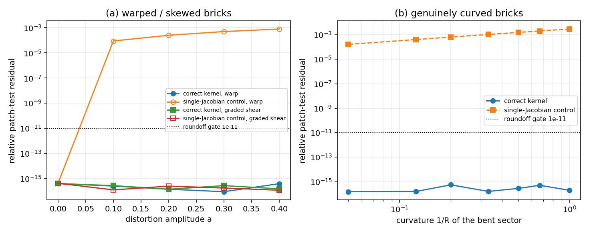

# HEX20 under distortion and curvature — patch test, energy identity and the reduced-integration ruling

This report closes the verification debt recorded in
[element-rank-deficiency-audit.md](element-rank-deficiency-audit.md): *"the 20-node
brick was only audited on the regular cube; distorted bricks and the reduced
integration variant are pending"*. It also corrects an evidence label: the
production kernel is **3×3×3 Gauss**, while the audit record and the audit table
called it "2×2×2".

## 1. What is being verified (and why it was open)

`tensorfem.hex20` is the only 20-node serendipity brick in the library. Its
published evidence before this report was:

| existing gate | file | blind spot |
|---|---|---|
| affine patch test on a `structured_hex20_mesh` | `tests/test_hex20.py` | the structured mapping is trilinear, so every element has *straight* edges and a nearly constant Jacobian |
| uniaxial traction on a structured mesh | `tests/test_hex20.py` | constant strain, aligned with the mesh |
| slender cantilever vs Timoshenko beam, `<3%` | `tests/test_hex20.py` | a response error budget cannot see exactness violations |
| rank audit, one regular unit cube | `src/tensorfem/element_rank_audit.py` | distortion/curvature untested; integration label wrong |

None of these can detect the failure mode that was already found once in the
shell facet family (skew Mindlin coordinate gradients with a spurious
rigid-rotation stiffness): a wrong coordinate-gradient transformation. On a
straight structured mesh such a bug is partly invisible because the Jacobian is
almost constant.

## 2. Method

Three exact statements are checked instead of a response tolerance. For a
constant-strain field `u(x) = A x + b`:

1. **Patch test (completeness).** With `u` prescribed on every boundary node,
   the interior solution must equal `u` to roundoff. Isoparametric theory
   guarantees this for any non-degenerate mapping because the geometry is
   interpolated by the same shape functions (`u(ξ) = a + A x(ξ)`), so a measured
   residual above roundoff is a defect, not a discretisation error.
2. **Centroid stress exactness.** Element-centroid stress of the constrained
   solution must equal `D : sym(A)` to roundoff, independent of distortion.
3. **Strain-energy identity.** For one element loaded with the exact nodal
   values of `u`, `uᵀ K u = V σ:ε` must hold to roundoff; `V` comes from the
   same 3×3×3 rule.
4. **Rank.** The 60-dof element stiffness must have exactly 6 zero eigenvalues
   (3 translations + 3 rotations) and no hourglass mode, on distorted and curved
   bricks.

Geometry families (all built from `structured_hex20_mesh`, so connectivity is
conforming, then mapped):

| family | map | character |
|---|---|---|
| warp | `x + a(yz, xz, xy)` | quadratic; edges become parabolic, Jacobian varies inside each element |
| graded shear | `(x + a y, y + a z/2, z)` | affine; skewed, graded, Jacobian constant per element |
| bent | `((R+z)sinθ, y, (R+z)cosθ − R)`, `θ = x/R` | genuine curvature: a thick shell sector (block 2×1×1 bent into an arc) |

**Negative control (teeth).** The same sweep is re-run with a deliberately
broken kernel: the Jacobian of the element centre is reused at all 27 Gauss
points — the classic "one Jacobian per element" implementation bug. A gate that
cannot reject this kernel proves nothing.

Field data: `A = [[0.012, 0.007, −0.003], [−0.002, −0.009, 0.005], [0.004, 0.006, 0.015]]`,
`b = (0.1, −0.2, 0.05)`, `E = 70 GPa`, `ν = 0.27`, `float64`.

Toolchain: `scripts/audit_hex20_distortion.py` (single process, seconds of
runtime, 60-dof elements only), `tests/test_hex20_distortion.py` (19 tests,
fail-closed), evidence JSON with data hash
[`benchmarks/hex20_distortion_audit.json`](../benchmarks/hex20_distortion_audit.json).

## 3. Results

### Distortion sweep (serendipity brick, 2×2×2 elements, 27 free nodes)

| warp a | displacement | centroid stress | energy identity | control (single Jacobian) |
|---:|---:|---:|---:|---:|
| 0.00 | 4.126e-16 | 2.409e-13 | 8.145e-15 | 4.359e-16 |
| 0.10 | 2.609e-16 | 1.990e-13 | 4.017e-15 | 8.873e-05 |
| 0.20 | 1.469e-16 | 1.406e-13 | 6.505e-15 | 2.525e-04 |
| 0.30 | 9.352e-17 | 1.812e-13 | 3.604e-14 | 4.968e-04 |
| 0.40 | 4.039e-16 | 4.479e-13 | 1.414e-14 | 7.918e-04 |

| graded shear a | displacement | centroid stress | energy identity | control (single Jacobian) |
|---:|---:|---:|---:|---:|
| 0.00 | 4.126e-16 | 2.409e-13 | 8.145e-15 | 4.359e-16 |
| 0.10 | 2.841e-16 | 3.327e-13 | 6.061e-15 | 1.298e-16 |
| 0.20 | 1.456e-16 | 1.033e-13 | 4.546e-15 | 2.567e-16 |
| 0.30 | 2.837e-16 | 1.786e-13 | 1.515e-14 | 1.825e-16 |
| 0.40 | 1.574e-16 | 1.496e-13 | 1.118e-14 | 1.222e-16 |

| bend radius R | displacement | centroid stress | volume error (2 elem) | volume error (4 elem) | control |
|---:|---:|---:|---:|---:|---:|
| 1.0 | 1.987e-16 | 1.715e-13 | 0.202% | 0.013% | 2.955e-03 |
| 1.5 | 5.046e-16 | 3.674e-13 | 0.041% | 0.003% | 2.043e-03 |
| 2.0 | 2.823e-16 | 1.349e-13 | 0.013% | 0.001% | 1.564e-03 |
| 3.0 | 1.601e-16 | 2.015e-13 | 0.003% | 0.000% | 1.065e-03 |
| 5.0 | 5.525e-16 | 2.513e-13 | 0.000% | 0.000% | 6.489e-04 |
| 8.0 | 1.583e-16 | 2.188e-13 | 0.000% | 0.000% | 4.089e-04 |
| 20.0 | 1.523e-16 | 1.472e-13 | 0.000% | 0.000% | 1.648e-04 |

Volume reference is the exact shell-sector expression `V = L·W·(H + H²/(2R))`
for the bent block (`L=2, W=1, H=1`); the residual is the geometric
representation error of the quadratic isoparametric boundary, not an energy or
equilibrium error.

### Rank: full vs reduced integration

| geometry | 3×3×3 null / spurious | 2×2×2 null / spurious |
|---|---:|---:|
| regular cube | 6 / 0 | 12 / 6 |
| warp a=0.3 | 6 / 0 | 12 / 6 |
| graded shear a=0.4 | 6 / 0 | 12 / 6 |
| bent R=2 | 6 / 0 | 12 / 6 |
| bent R=1 | 6 / 0 | 12 / 6 |



Panel (a): distorting a brick never moves the correct kernel off roundoff,
while the single-Jacobian kernel leaves roundoff as soon as the mapping is
non-affine, and the violation grows with the amplitude (7.9e-4 at `a=0.4`,
i.e. 12 orders above the gate). Panel (b): the same for genuine curvature.

## 4. Findings

1. **HEX20 keeps exact linear completeness under arbitrary distortion and
   curvature.** Displacement, centroid stress and energy residuals stay at
   1e-16 / 1e-13 / 1e-14 for all families and all amplitudes tested, including a
   95° bent sector at `R = 1`. The element is **not** in the class of failures
   the shell facet family had.
2. **The single-Jacobian bug is rejected by these gates on non-affine meshes**
   (2.9e-3 at `R=1`, 7.9e-4 at `a=0.4`), so the new tests are not vacuous.
3. **The control is blind on affine meshes, by construction**: for `graded_shear`
   the Jacobian is constant, so the broken kernel is bit-identical in effect.
   Reporting this is part of the evidence: a distortion audit built only from
   skewed straight bricks would have certified a buggy kernel. The curved
   family is what gives the gate teeth.
4. **Reduced integration of HEX20 is inadmissible.** A 2×2×2 rule leaves 6
   spurious zero-energy modes on every geometry, regular or distorted; the
   production 3×3×3 rule leaves none. The library therefore must not expose a
   reduced HEX20, and the earlier "2×2×2" wording in the rank audit was a label
   error, now corrected (the code was always 3×3×3).
5. **Curvature is usable far beyond typical hull-scan element sizes.** At `R=1`
   with element size `h≈0.5` (`h/R≈0.5`) the patch test is still exact; the
   only visible penalty is geometric volume representation (0.2% at 2 elements,
   0.013% at 4 elements along the arc), which converges as the geometry
   interpolation error.

## 5. Error verdict

| key quantity | reference | measured | pass `<3%`? |
|---|---|---:|---|
| interior displacement, warped / sheared / bent meshes | exact linear field | ≤5.6e-16 (relative) | yes (roundoff) |
| element-centroid stress, same meshes | exact `D:sym(A)` | ≤4.5e-13 | yes (roundoff) |
| strain energy, distorted and curved bricks | `V σ:ε` | ≤3.6e-14 | yes (roundoff) |
| bent-sector volume, `R=1`, 2 elements / 4 elements | `L·W·(H+H²/2R)` | 0.202% / 0.013% | yes |
| negative control (single Jacobian), curved brick `R=1` | exact field | 2.955e-03 | rejected by the gate (as required) |
| negative control, affine shear | exact field | 1e-16 | **not detectable** — documented limitation |

## 6. Scope and limitations

- This is **exactness and rank** evidence for the isoparametric brick; it says
  nothing about bending accuracy on coarse meshes. The existing cantilever gate
  (`<3%` vs Timoshenko at `nx=8`) remains the only response-level accuracy claim.
- `float64` only. No `float32` claim.
- Only the 3×3×3 and 2×2×2 rules were examined; no hourglass control is
  implemented for HEX20 (and, given finding 4, none is needed).
- The `bent` family interpolates a curved geometry with quadratic facets; the
  volume column is that representation error and must not be read as an
  integration error.
- Large-deformation / plastic HEX20 paths are outside this report; the audit is
  linear-elastic and small-strain.
- No physical marine case is added here; `hex20` has no marine benchmark with a
  published reference value in this repository, and inventing one was not the
  goal of this debt.

## 7. Reproduction

```bash
python scripts/audit_hex20_distortion.py          # JSON + markdown + figure
python -m pytest tests/test_hex20_distortion.py -q
python -m pytest tests/test_hex20.py tests/test_element_rank_audit.py -q
```