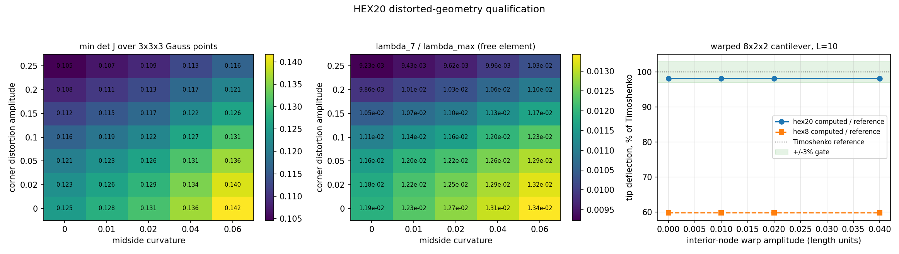

# HEX20 畸变与曲边几何资格复核

本报告清偿 `docs/element-rank-deficiency-audit.md` §6 明列的欠账：
「`hex20` 只审了规则立方体，畸变 20 节点体与减缩积分变体待补」。
`docs/hex20-validation.md` 把「畸变网格证据」列为 HEX20 从暂定状态晋级的门槛，
本报告提供该门槛的第一项机器可判定证据。

**结论**：在扫过的全部 35 个（角点畸变幅度 × 中边曲率）组合上，自由 20 节点体
零空间维数恒为 6、伪零能模态数恒为 0；
畸变一致网格上的仿射 patch 误差为舍入级（最大 6.635e-16）；
内部节点扭曲 8×2×2 悬臂的 Timoshenko 误差从 1.7815% 变为
1.7837%，仍在 3% 门内。**未覆盖**：减缩积分 HEX20（代码库无该变体）、
几何大变形路径、以及畸变下的应力精度认证。

## 1. 物理背景与对象

20 节点 serendipity 六面体（HEX20）是二阶等参单元，位移与几何使用**同一个**二次映射：
`x(ξ) = Σ N_i(ξ) x_i`、`u(ξ) = Σ N_i(ξ) u_i`，采用 3×3×3 Gauss 全积分，积分点
Jacobian 非正即 fail-closed 抛错（`src/tensorfem/hex20.py`）。

工程上 HEX20 的实际风险不在规则网格，而在**畸变与曲边网格**：运输船典型舱段网格的
长宽比、加强筋与开孔的过渡单元都会让角点偏离立方体、中边节点离开弦中点的连线。
本报告回答三个可判定的问题：

1. 几何退化是否**新增**伪零能模态（hourglass 机构）？
2. 二次等参映射在畸变一致网格上是否仍能**精确**再现仿射位移场？
3. 已验收的弯曲响应（`docs/hex20-validation.md` 的 2.412% 悬臂）在畸变网格上是否保持？

## 2. 方法

实现：`src/tensorfem/hex20_distortion.py`；证据脚本：`scripts/audit_hex20_distortion.py`。

| 项目 | 设置 |
|---|---|
| 单元几何 | 单位立方体 + 确定性角点偏移模式（`_CORNER_PATTERN`，范数归一），幅度 a 取 0–0.25 |
| 曲边 | 全部 12 个中边节点相对形心做径向放大 (1+c)，c 取 0–0.06（面真正变曲，非仅翘曲） |
| 秩判定 | 复用 `element_rank_audit.classify_null_space`：解析刚体基 + 主子角投影，整数判据，容差仅按舍入缩放（rtol=1e-10） |
| 仿射 patch | 2×2×2 共形 HEX20 网格，**仅在严格内部节点**施加 `warp·sin(πx/L)sin(πy/w)sin(πz/h)` 位移（边界节点逐位不动，边值问题不变），边界节点给定位移场，核验全场位移相对误差 |
| 畸变悬臂 | L=10、b=h=1、E=210 GPa、ν=0.3、8×2×2 网格；端面剪力用**单元自身形函数 × 精确面 Jacobian** 一致装配（总载荷恒等于名义 1e6 N），参考解为 Timoshenko 梁 δ=PL³/(3EI)+PL/(κGA)，κ=5/6 |
| 单元类型 A/B | HEX20 与全积分 HEX8 在同一拓扑、同一内部节点扭曲下对比 |
| 算力纪律 | 全程 `torch.set_num_threads(1)`，稠密特征问题 ≤60 自由度、最大静力系统约 1.3k 自由度 |

一致端面载荷是本次新增的**自检**：在 ny=nz=1 的已验收配置下，它必须复现
`cantilever_hex20_benchmark(8)` 的 `-0.018733180739897465`（`tests/test_hex20_distortion.py`
以 1e-10 相对容差锁死）。通过后，同一装配才能用于任意网格密度与畸变面。

## 3. 计算结果

### 3.1 畸变扫描（自由单元秩）

35 个组合全部 `null_dim = 6`、`spurious = 0`；
最小 det J = 1.0459e-01（远大于零），第一正特征值比 λ₇/λ_max 最小 9.229e-03。
下表逐点给出（截断行 = 几何退化被 fail-closed 拒绝，本扫描中 0 行）：

| 角点畸变 a | 中边曲率 c | 零维数 | 伪零能 | λ₇/λ_max | 最小 det J |
|---|---|---|---|---|---|
| 0 | 0 | 6 | 0 | 1.190e-02 | 1.2500e-01 |
| 0 | 0.01 | 6 | 0 | 1.233e-02 | 1.2797e-01 |
| 0 | 0.02 | 6 | 0 | 1.271e-02 | 1.3087e-01 |
| 0 | 0.04 | 6 | 0 | 1.308e-02 | 1.3647e-01 |
| 0 | 0.06 | 6 | 0 | 1.343e-02 | 1.4175e-01 |
| 0.02 | 0 | 6 | 0 | 1.179e-02 | 1.2323e-01 |
| 0.02 | 0.01 | 6 | 0 | 1.222e-02 | 1.2613e-01 |
| 0.02 | 0.02 | 6 | 0 | 1.253e-02 | 1.2897e-01 |
| 0.02 | 0.04 | 6 | 0 | 1.290e-02 | 1.3443e-01 |
| 0.02 | 0.06 | 6 | 0 | 1.325e-02 | 1.3957e-01 |
| 0.05 | 0 | 6 | 0 | 1.157e-02 | 1.2062e-01 |
| 0.05 | 0.01 | 6 | 0 | 1.196e-02 | 1.2343e-01 |
| 0.05 | 0.02 | 6 | 0 | 1.221e-02 | 1.2617e-01 |
| 0.05 | 0.04 | 6 | 0 | 1.259e-02 | 1.3143e-01 |
| 0.05 | 0.06 | 6 | 0 | 1.293e-02 | 1.3636e-01 |
| 0.1 | 0 | 6 | 0 | 1.108e-02 | 1.1641e-01 |
| 0.1 | 0.01 | 6 | 0 | 1.138e-02 | 1.1906e-01 |
| 0.1 | 0.02 | 6 | 0 | 1.161e-02 | 1.2164e-01 |
| 0.1 | 0.04 | 6 | 0 | 1.199e-02 | 1.2657e-01 |
| 0.1 | 0.06 | 6 | 0 | 1.233e-02 | 1.3117e-01 |
| 0.15 | 0 | 6 | 0 | 1.049e-02 | 1.1235e-01 |
| 0.15 | 0.01 | 6 | 0 | 1.074e-02 | 1.1484e-01 |
| 0.15 | 0.02 | 6 | 0 | 1.096e-02 | 1.1727e-01 |
| 0.15 | 0.04 | 6 | 0 | 1.133e-02 | 1.2187e-01 |
| 0.15 | 0.06 | 6 | 0 | 1.166e-02 | 1.2613e-01 |
| 0.2 | 0 | 6 | 0 | 9.864e-03 | 1.0842e-01 |
| 0.2 | 0.01 | 6 | 0 | 1.009e-02 | 1.1076e-01 |
| 0.2 | 0.02 | 6 | 0 | 1.029e-02 | 1.1302e-01 |
| 0.2 | 0.04 | 6 | 0 | 1.065e-02 | 1.1730e-01 |
| 0.2 | 0.06 | 6 | 0 | 1.097e-02 | 1.2123e-01 |
| 0.25 | 0 | 6 | 0 | 9.229e-03 | 1.0459e-01 |
| 0.25 | 0.01 | 6 | 0 | 9.434e-03 | 1.0678e-01 |
| 0.25 | 0.02 | 6 | 0 | 9.622e-03 | 1.0889e-01 |
| 0.25 | 0.04 | 6 | 0 | 9.958e-03 | 1.1285e-01 |
| 0.25 | 0.06 | 6 | 0 | 1.026e-02 | 1.1644e-01 |

判定：**常量整数结论，不是统计近似**。λ₇/λ_max 随畸变从 1.190e-02 单调降到
9.2e-03（a=0.25, c=0），即刚度谱在变坏，但没有跨过舍入阈值形成新的零模态——
这正是「尺度变小但秩不变」的健康形态。

### 3.2 畸变一致网格上的仿射 patch

二次等参映射下 `u = A x` 属于单元形函数张成的空间，因此**任何**几何畸变都不应引入
离散误差；实测为舍入级：

| 内部扭曲幅度 warp | 位移相对误差 | < 1e-10 |
|---|---|---|
| 0 | 6.635e-16 | 是 |
| 0.01 | 2.348e-16 | 是 |
| 0.05 | 2.466e-16 | 是 |
| 0.1 | 2.458e-16 | 是 |

### 3.3 畸变悬臂 A/B

端面一致剪力总载荷恒为 1.000000e+06 N（`consistent_end_shear` 由形函数积分装配）；
「相对基线变化」= |w(warp) − w(0)| / |w(0)| × 100%。

| 单元 | warp | 总载荷 (N) | 计算挠度 (m) | Timoshenko (m) | 误差 % | 相对基线变化 % |
|---|---|---|---|---|---|---|
| hex20 | 0 | 1.000000e+06 | -1.885420e-02 | 1.919619e-02 | 1.7815 | 0.0000 |
| hex20 | 0.01 | 1.000000e+06 | -1.885418e-02 | 1.919619e-02 | 1.7817 | 0.0001 |
| hex20 | 0.02 | 1.000000e+06 | -1.885410e-02 | 1.919619e-02 | 1.7821 | 0.0005 |
| hex20 | 0.04 | 1.000000e+06 | -1.885380e-02 | 1.919619e-02 | 1.7837 | 0.0021 |
| hex8 | 0 | 1.000000e+06 | -1.147787e-02 | 1.919619e-02 | 40.2075 | 0.0000 |
| hex8 | 0.01 | 1.000000e+06 | -1.147782e-02 | 1.919619e-02 | 40.2078 | 0.0005 |
| hex8 | 0.02 | 1.000000e+06 | -1.147765e-02 | 1.919619e-02 | 40.2087 | 0.0020 |
| hex8 | 0.04 | 1.000000e+06 | -1.147697e-02 | 1.919619e-02 | 40.2123 | 0.0079 |

**是否 < 3%**：HEX20 四组分别为
1.7815% / 1.7817% /
1.7821% / 1.7837% —— **全部 < 3%**，
逐项满足项目门限。HEX8 对照为 40.2075%（warp=0）与 40.2123%（warp=0.04），
**不满足 < 3%**，与它已知的剪力自锁一致，保留为对照而非通过项。

畸变敏感度：warp 从 0 增至 0.04（截面尺寸的 4%）时，HEX20 挠度变化 0.0021%，
HEX8 变化 0.0079%。两者都对**网格畸变**几乎不敏感，说明所验收的误差主体来自
单元理论（HEX8 自锁），不是几何质量。



左：最小 det J 随（角点畸变, 中边曲率）变化；中：自由单元 λ₇/λ_max（越小越接近伪机构）；
右：畸变悬臂挠度占 Timoshenko 解的百分比，绿色带为 ±3% 门。

## 4. 注意点与局限

1. **零特征值重数**：秩判据用主子角投影而非逐特征向量比对（见
   `docs/element-rank-deficiency-audit.md` §5.1 的方法论教训），否则畸变下重数变化会被误读成
   「新增机构」。
2. **畸变模式是确定性的**，不是随机采样：固定角点模式 + 径向中边放大。它覆盖了翘曲面与
   曲边两类，但**不构成**对任意畸变场的完备证明；结论范围=扫过的 35 个组合。
3. **未覆盖减缩积分 HEX20**：`src/tensorfem/hex20.py` 只有 3×3×3 全积分，代码库中不存在
   该变体，故无法审计。若将来引入，必须重跑本报告的秩扫描。
4. **未覆盖应力精度**：本节只判定位移/秩/一致性。畸变下的应力点式提取精度仍需独立的
   单元中心 vs 探针协议研究（Cook 膜的经验：`docs/cook-membrane-pointwise-protocol.md`）。
5. **一致载荷用法**：`consistent_end_shear` 只对平直端面施加均布剪力（traction 沿单一坐标轴）。
   对曲端面或非均布载荷需扩展，当前不声称支持。
6. **本报告不升级 HEX20 的状态**：`docs/hex20-validation.md` 的另一半门槛（性能与
   共享 API 集成）仍未评估，HEX20 仍是独立模块。

## 5. 复现

```bash
PYTHONPATH=src python3 scripts/audit_hex20_distortion.py
OMP_NUM_THREADS=1 PYTHONPATH=src python3 -m pytest tests/test_hex20_distortion.py -q
```

证据：`docs/benchmarks/tutorials/hex20-distortion-audit.json`，
图 `docs/assets/hex20_distortion_audit.png`。
环境：Python 3.11.6，torch 2.7.1，Linux loongarch64。
