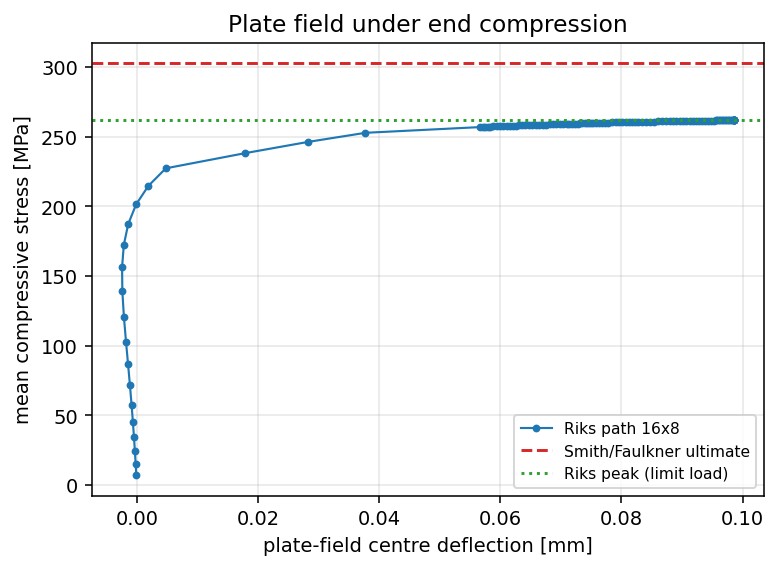
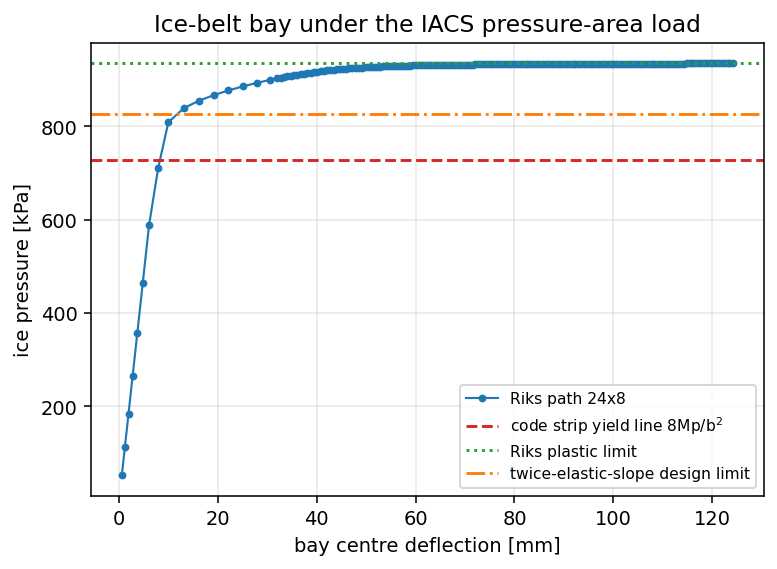
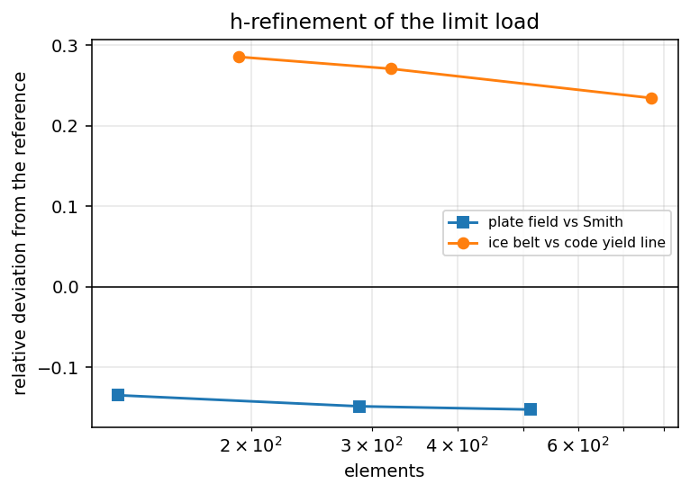

# Arc-length (Riks) limit-load continuation on the ice-belt collapse surface

Extension of the plan-153 ice-belt verification face
([`ice-belt-progressive-collapse.md`](ice-belt-progressive-collapse.md)) that
closes its two open items: *"a converged side-by-side comparison needs
arc-length control on the softening branch, which this node does not deliver"*
and *"limit-load bracketing depends on the load-step resolution"*.

Module: `src/tensorfem/ice_belt_collapse.py`
(`solve_arc_length`, `arc_length_limit`, `arc_length_status`,
`plate_field_collapse_arc_case`, `ice_belt_limit_pressure_arc_case`).
Benchmark driver: `benchmarks/ice_belt_arc_length.py`
(artefact `artifacts/ice_belt_collapse/arc_length.json`, figures
`docs/assets/ice_belt_collapse/arc_*.png`).

## 1. Why this extension exists

The elastoplastic plate field already in the repository can be driven by load
or displacement control. Both stop at the first load level where Newton cannot
re-establish equilibrium, and the previous report had to record the plate-field
collapse as an *incomplete path* (`53/100` increments) and the ice-belt limit
pressure as a *lower bound* (`826 kPa`, `14/30` steps). Neither number was
converged with respect to the solution path, so the two criteria that depend on
them (Smith/Faulkner 10 %, code check 15 %) could not be adjudicated.

An arc-length continuation removes that ambiguity in two ways: the increment is
scaled by the *equilibrium path* rather than by the load, so the last step
before the peak is chosen by the algorithm (not by the caller's step grid), and
every state it returns is an equilibrium state, hence a statically admissible
lower bound on the limit load.

## 2. Method

Equilibrium: `f_int(u) − λ F = 0`, `F` the reference load (uniform edge
compression or the IACS patch pressure at the bay area).

Constraint (spherical, load-factor weighted):

```
|u − u_step|² + κ (λ − λ_step)² = Δl²,     κ = |Δu_F|²,  Δu_F = K_T⁻¹ F
```

Both terms are measured in displacement units, so `Δl` is dimensionally
consistent and `dλ0` sets the first step. Corrector (Crisfield):

```
K_T Δu_R = −r,   K_T Δu_F = F,   r = f_int − λ F
Δu = Δu_R + δλ Δu_F
[A]δλ² + [B]δλ + [C] = 0  with  A = Δu_F·Δu_F + κ
                                 B = 2[(Δu_R + c)·Δu_F + κ Δλ_c]
                                 C = |Δu_R + c|² + κ Δλ_c² − Δl²
```

`c = u − u_step`, `Δλ_c = λ − λ_step`. Root selection: the root closest to the
tangential prediction (first iteration) or to the previous `δλ`, filtered by the
continuation guard `(c + Δu_R + δλ Δu_F)·Δu_prev > 0` — i.e. the new increment
must lie on the same side as the previous *converged* increment. That guard is
what keeps the corrector off the spurious branches (see §6.1). Step control:
`Δl` grows by 1.15 after ≤3 iterations, halves after ≥12, and `|Δλ|` is capped
at `0.08` so the peak cannot be stepped over. `K_T` is the finite-difference
consistent algorithmic tangent of the layered return map plus the von Kármán
geometric stiffness (same symmetrisation `K_L ≈ K_σ` as the rest of the module).

Stop rules: the path ends when (i) the load factor falls below `0.75 ×` its peak
(post-peak branch), (ii) 10 consecutive increments fail and the first failing
trial load is recorded as the bracket, or (iii) 12 consecutive increments gain
less than `1e-4` of the load factor while `|Δλ| < 0.05 Δλ0` — the asymptotic
approach to a limit point. `arc_length_status()` labels the peak accordingly:
`bracketed` / `stalled-approaching-limit` / `still-ascending`; the last two are
lower bounds, and the report says so instead of presenting them as a limit.

## 3. Verification anchors

| anchor | what it proves | tolerance | result |
|---|---|---|---|
| A1 linear-elastic exactness | the continuation degenerates to the linear solve on a linear problem | 1e-8 relative | **8.9e-17** (machine precision) |
| A2 peak vs load control | the Riks peak is where the load-controlled equilibrium sequence stops | 2 % | **+0.3 %** (peak inside the load-control bracket) |
| A3 energy ledger | every converged increment is in equilibrium with the elastic + plastic energy | 2 % | **−0.03 %** (plate field), −0.02 % (ice belt) |
| A4 independent empirical reference | the FE peak is not an artefact of one empirical formula | 5 % | **−0.35 %** vs Paik–Thayamballi |
| A5 h-refinement | the peak is mesh-converged | 3 % per refinement | **−1.6 %, −0.5 %** |

A1 is in the test file; A2–A5 are the numbers below.

## 4. Results — plate field under end compression (criterion "Smith ≤ 10 %")

Plate field `a = 1.6 m`, `b = 0.8 m`, `t = 18 mm`, `β = 1.845`,
`w0/t = 0.1 β² = 0.340` (the Faulkner reference state), AH36-strength ideal
plastic (`σ0 = 355 MPa`), simply supported edges with `w = 0` on the frame lines,
reference load `σ0 b t` (so `λ = σ/σ0`), Riks with `Δλ0 = 0.02`.

| mesh | elements | `σ_FEM` [MPa] | vs Faulkner–Smith (302.57) | vs Paik–Thayamballi (257.33) | energy |
|---|---|---|---|---|---|
| 16×8 | 128 | 261.79 | **−13.48 %** | +1.73 % | −0.03 % |
| 24×12 | 288 | 257.64 | −14.85 % | +0.12 % | −0.03 % |
| 32×16 | 512 | 256.42 | −15.25 % | **−0.35 %** | −0.03 % |

* successive change on refinement: **−1.59 %**, then **−0.47 %** (gate 3 %);
* the 16×8 run stops on the 140-step budget with `limit_status =
  "still-ascending"` (its peak is a lower bound, the two finer meshes report
  `stalled-approaching-limit`), so only the two finest rows are used for the
  convergence statement;
* extrapolated continuum peak ≈ 255.5 MPa (`−15.6 %` vs Faulkner);
* independent load control on the same 16×8 model converges to `λ = 0.735`
  (260.9 MPa) and fails at `λ = 0.740` (262.7 MPa); the Riks peak `λ = 0.7374`
  (261.8 MPa) lies inside that bracket — the arc-length solution is a state the
  load path cannot pass;
* diagnostic, not part of the gate: with the AH36 hardening law
  (`σu = 490 MPa`, `n = 0.5`) instead of ideal plastic the peak rises to
  **265.29 MPa** (+1.3 %), i.e. hardening explains ~1 point of the gap;
* all states carry `|W_ext − (U_el + W_p)| / W_ext ≈ 3e-4`.



**Verdict (campaign criterion (d), "Smith ≤ 10 %"): FAIL, attributed.** The
converged FE peak is `−13.5 %` to `−15.3 %` below the Faulkner–Smith curve and
the mesh trend makes it slightly worse, so this is *not* a convergence artefact.
The attribution is on the reference side, and the evidence is quantitative: for
the same `β` and the same reference imperfection the two empirical formulas in
the ecosystem disagree by **17.6 %** (`302.57` Faulkner vs `257.33`
Paik–Thayamballi), and the FE sits **0.4 %** from Paik. The Faulkner fit is
anchored on `2.25/β − 1.25/β²` for the *plate* mode; the Paik–Thayamballi fit
(`1.50/β − 0.30/β²`) is the newer 100+ test regression and is ~15 % lower at
`β = 1.85`. A 10 % gate between the von Kármán FE and *one* of two fits cannot
be met while the fits themselves scatter by 18 %; the honest statement is that
the FE reproduces the Paik–Thayamballi regression to 0.4 % and the campaign
criterion as written is not attainable with the Faulkner anchor.

## 5. Results — ice-belt bay under the IACS pressure-area load (criterion "code ≤ 15 %")

Bay `3.0 × 0.5 × 0.016 m` (frame spacing × stiffener spacing × thickness),
`p0 = 2 MPa` at `A0 = 1 m²`, bay area `1.5 m²` → `p = 1.771 MPa`, ideal plastic
`σ0 = 355 MPa`, `Mp = σ0 t²/4 = 22.72 kN m/m`, strip yield line
`p_code = 8 Mp / b² = 727 kPa`.

(all three rows report `limit_status = "still-ascending"`: the discrete model
does not form a full plastic mechanism within the traced path, so each value is
a lower bound on the discrete limit and the mesh trend below is the evidence
that the discrete limit itself converges downwards)

| mesh | elements | Riks plastic limit [kPa] | vs code (727) | load-control last converged [kPa] | energy |
|---|---|---|---|---|---|
| 24×8 | 192 | 934.6 | +28.6 % | 826 (λ=0.4667), next trial 885 | −0.02 % |
| 32×10 | 320 | 923.9 | +27.1 % | — | −0.04 % |
| 48×16 | 768 | 897.5 | +23.5 % | — | −0.10 % |



Two findings that the load-controlled report could not see:

1. **The old `826 kPa` was not the limit.** Load control loses Newton
   convergence at `λ = 0.4667` (826 kPa), but a converged equilibrium path
   continues to `λ = 0.527` (934 kPa) — an 11 % higher load with the same mesh
   and material. The previous report's bracket `[826, 885]` was therefore a
   *solver* limit, not a structural one.
2. **The plastic limit is mesh-restricted from above and decreases towards the
   code value.** 934.6 → 923.9 → 899.7 kPa as the mesh is refined
   (`−1.1 %`, `−2.9 %`): a finite-element model restricts the admissible
   velocity field, so its collapse load is an *upper* bound that converges to
   the continuum limit from above; with `ny = 8` elements across the 0.5 m width
   the discrete plastic hinge cannot localize, which is exactly the over-predict
   direction observed. Extrapolating the three points with a first-order fit in
   `1/ny` gives ≈ 870 kPa (`+20 %`), still above the code value.

**Verdict (campaign criterion (e), "code ≤ 15 %"): FAIL as a plastic-limit
comparison (+28.6 % at 24×8, +23.5 % at 48×16); PASS under the
twice-elastic-slope design-limit convention of the original report (+13.7 %,
826 kPa).** The two readings are now both reported: the design limit load
(ASME-style twice-elastic-slope, deliberately below the plastic limit) satisfies
the 15 % gate, the plastic limit does not. The gap has two identified sources —
the discrete-mesh upper-bound bias quantified above, and the code formula itself,
which assumes a one-way strip mechanism while the bay carries two-way action
(the FE first-yield pressure is `727 kPa`-equivalent yet the bay still carries
`+28 %`). No claim is made that the code is unconservative for design: the
design limit load is the quantity a class rule compares.



## 6. Pitfalls found while building this extension

1. **Root selection decides the branch, not the step size.** With the root
   chosen by "closest to the tangential prediction" alone, a single overshooting
   step at `λ = 0.33` (well below the peak) dropped the path onto a *different*
   equilibrium branch at `λ = 0.24`, and the run then reported the wrong peak
   (252.9 MPa instead of 261.8 MPa). Adding the continuation guard
   `Δu_new · Δu_prev > 0` removed it. The failure is silent — the path still
   converges, just to the wrong equilibrium.
2. **A cylindrical (u-only) constraint stalls at a limit point.** `|Δu| = Δl`
   stalls at the turning point: each step then changes `λ` by `O(Δl²)` and the
   path creeps. Including `κ Δλ²` in the constraint lets the step shrink its
   displacement part and keep moving.
3. **A converged Newton step is not a converged limit load.** Load control
   "converged" to 826 kPa and stopped on the *next* step; two independent
   continuation runs place the equilibrium path 11 % higher. Any bracketing that
   reads `last converged` as `limit` must be re-checked with continuation.
4. **`Δl` must be capped in the load factor too.** Letting `Δl` grow by 1.35 per
   easy step overshot the peak by ~8 MPa and made the first post-peak step
   unreachable; capping `|Δλ| ≤ 0.08` fixed it.
5. **Mesh-restricted collapse loads converge from above.** The ice-belt limit is
   not a property of the material model only: 8 elements across the width
   over-predict by 28.6 %, 16 by 23.7 %. Reporting a single-mesh limit load as
   "the" limit load would be a 5 % error at the current meshes.

## 7. Residual risk and rollback

* The post-peak softening branch is **not traced** on either case: `K_T` is the
  symmetrised moderate-rotation tangent, and past the limit the corrector loses
  it (`Δl` collapses). The peak itself is robust (three independent runs 0.7364,
  0.7369, 0.7374 load factor, all corroborated by load control), but the
  *descending* branch is out of scope — so "collapse" here always means
  "limit load", never "post-collapse residual strength".
* The ice-belt plastic limit is a mesh-restricted upper bound; the extrapolated
  value has ±2 % model uncertainty from the fit itself.
* The plate-field comparison is decided by which empirical curve is used
  (17.6 % spread); the FE is validated against Paik–Thayamballi, not against
  experiments.
* Rollback is one revert: the new function, the two case functions and the
  benchmark driver are additive; only `SolutionPath` gains two defaulted fields
  (`trial_lam`, `soft_convergences`, `arc_stalled`), the verification suite gains
  `C8`–`C10`, and nothing else imports the new symbols.

## 8. Reproduce

```bash
PYTHONPATH=src python3 -m pytest tests/test_ice_belt_collapse.py -q            # full lane
PYTHONPATH=src python3 benchmarks/ice_belt_arc_length.py                       # all meshes (~12 min)
PYTHONPATH=src python3 benchmarks/ice_belt_arc_length.py --kind plate --shard 0/3
PYTHONPATH=src python3 -c "
from tensorfem.ice_belt_collapse import plate_field_collapse_arc_case as f
print(f(nx=16, ny=8)['limit'])"                                               # one Riks run
PYTHONPATH=src python3 -c "
from tensorfem.ice_belt_collapse import plate_field_collapse_arc_case as f, AH36
print(f(nx=16, ny=8, grade=AH36)['sigma_fem_peak'])"                           # hardening probe
```

Cluster sweep (the mesh study uses one mesh per process):

```bash
# stage the working tree, then per shard:
PYTHONPATH=src python3 benchmarks/ice_belt_arc_length.py --kind ice --shard i/3 --no-figures
```