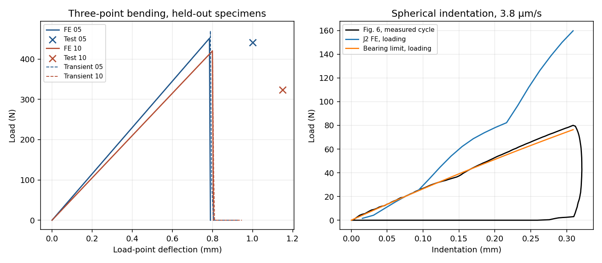

# 冰试件的弯曲、断裂与压入

## 三点弯曲

跨度 180 mm，刚性压头以 2.5 mm/s 加载。用 Ren 等人的 02、03、04 号试件反算共同材料参数，得到有效模量 221.26 MPa、弯曲强度 1.017 MPa。05、10 号试件只提供几何输入，实测峰值与挠度用于事后比较。共同断裂能取 1.5 J/m²，密度取 917 kg/m³。对应试件的断裂能、独立初始模量和完整试验曲线未见于该文表 1。[测量来源、数字化方法与另一组海冰数据](../benchmarks/data/ice_coupons/README.md)

| 试件 | 实测峰值 / 挠度 | 静力压头位移控制 | 动力接触与断裂 | 动力峰值 / 挠度误差 |
|---|---|---|---|---|
| 05 | 441.3 N / 1.000 mm | 451.4 N / 0.785 mm | 479.1 N / 0.790 mm | 8.6% / 21.0% |
| 10 | 323.6 N / 1.150 mm | 420.0 N / 0.800 mm | 443.0 N / 0.800 mm | 36.9% / 30.4% |

三种计算回答不同问题。

* 焊合界面的完整 Q4 网格先沿上下表面搜索最大纵向拉应力。24×16 网格上，首裂候选点在受拉底面，离加载中线 3.75 mm。动态平衡使用集中质量、单侧压头和平均加速度 Newmark 积分。该位置来自应力搜索。
* 内聚界面沿跨中布置。静力位移控制先凝聚内部自由度，再交替更新平衡与不可逆损伤。八组网格、界面罚刚度、位移增量组合都走到承载力低于峰值 2%。同时保留裂口张开位移控制的原始停滞历史。突然卸载时，静力计算留下约 0.16–0.17 J 未解释释放能量。
* 显式瞬态计算把这部分能量分成碎块动能、弹性能和内聚耗散。使用双线性法向牵引、单侧压头、集中质量和 Velocity-Verlet 积分。初态取接近损伤起点的匀速线弹性特解，忽略试验启动时的短暂弹性波。每步检查稳定步长。持续卸载一个波传播时间后记录能量。八组计算均达到卸载条件，最大能量平衡相对误差低于 0.001%。05 号基准组外功约 0.181 J，卸载末刻碎块动能约 0.107 J，断裂耗散约 0.00448 J。界面规定了传播平面，能量和峰值均由求解产生。[各时步、网格、接触刚度与能量历程](../artifacts/ice_coupons/transient.json)

05 号试件的动力模型按单因素变换。固定接触刚度比 100、时间步长 0.2 µs，12×8 / 24×16 / 36×24 三档峰值分别为 460.3 / 479.1 / 483.2 N。固定中网格和时间步，将压头刚度比改为 50 / 100 / 200，峰值为 475.4 / 479.1 / 480.6 N。固定中网格及刚度比，将步长改为 0.1 / 0.2 / 0.3 µs，峰值均约 479.1 N。仅细化网格或步长不足以解释 10 号试件的偏差。按本研究 10% 的峰值和挠度验收限，两件留出试样都未通过联合验收。

按简支梁弯曲强度公式分别反算，两件试样要达到 ±10% 峰值精度，其等效弯曲强度允许区间分别为 05 号的 0.892–1.091 MPa 和 10 号的 0.700–0.856 MPa。两个区间没有交集。这个检查解释了共享强度假设的局限；进一步检验需要新的、在破坏前独立测得的材料特征和新的留出试件。

两件留出梁已另做成对控制试验。按表列几何，解析共享强度的最小最坏峰值误差为 12.05%；尺寸舍入的假设会影响这个界限。完整记录含独立评分器、50 次瞬态计算、加载点观测与待测材料量。[Ren 冰梁专项复核](ren-bending-audit.md)

另对 Wang 等人的南极海冰实测曲线积分。用加载行程的 10%–40% 估计刚度，在观测到的断裂位移截断线弹性预测，以检验剩余加载段和外功。柱状冰、混合冰、雪冰的实测全曲线外功约为 0.07256、0.04978、0.00463 J。假设瞬间失载时相应外功误差为 7.9%、50.1%、9.4%。混合冰的峰后承载对积分有显著贡献。这组三类曲线没有对应到 Ren 的个体试件，外功包含试验系统的响应。[逐类载荷与功](../artifacts/ice_coupons/prydz.json)

## 球形压入

对 Liefferink 等人的红色加载与卸载曲线数字化。同一条曲线在 20 N 校准一种材料参数，30–78 N 留作载荷预测，完整闭合路径用于外功比较。加载速率和温度对应本次试验。J2 模型使用轴对称有限元和压入/释放循环，分别改变网格、接触罚刚度和加载增量；承压极限模型根据球冠投影面积计算载荷。归一化均方根误差以实测最高载荷为分母。

| 模型 | 加载留出段误差 | 峰值误差 | 功误差 | 10% 筛选 |
|---|---:|---:|---:|---|
| J2 基准网格 16×16 | 49.55% | 99.61% | 32.46% | 未通过 |
| 恒承压极限，硬度 27.22 MPa | 2.73% | 4.60% | 7.47% | 三项通过 |

承压模型可描述此速率、这条曲线的加载段和做功量级；其不可逆极限忽略弹性回复与卸载蠕变，尚无跨温度、跨试件验收。两个模型使用相同观测量和校准点。[完整载荷、卸载功与敏感性数据](../artifacts/ice_coupons/indentation.json)



## 复算

从仓库根目录执行。Python 依赖使用项目 dev extra。

```bash
for case in bending initiation stroke transient indentation prydz; do
  PYTHONPATH=src OPENBLAS_NUM_THREADS=1 OMP_NUM_THREADS=1 python benchmarks/ice_coupon_validation.py "$case" || exit 1
done
PYTHONPATH=src python benchmarks/render_ice_coupon_validation.py
python -m pytest -q tests/test_cohesive_bending.py tests/test_structural_coupon_paths.py
```
