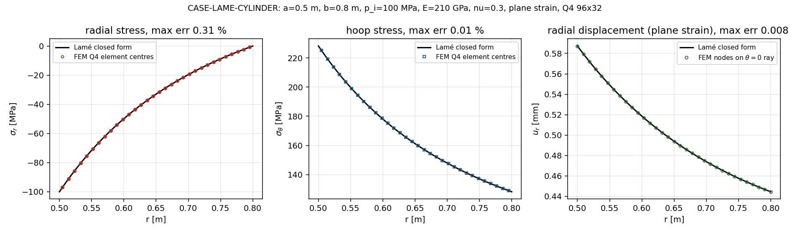
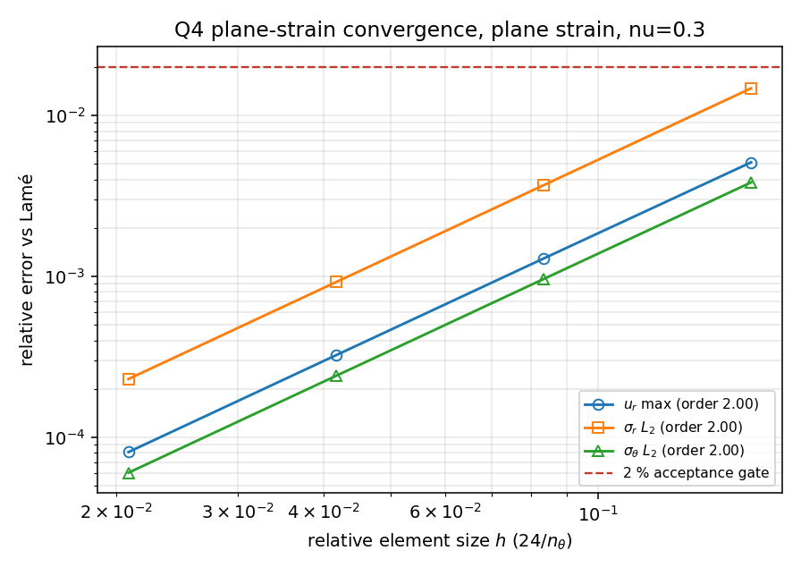
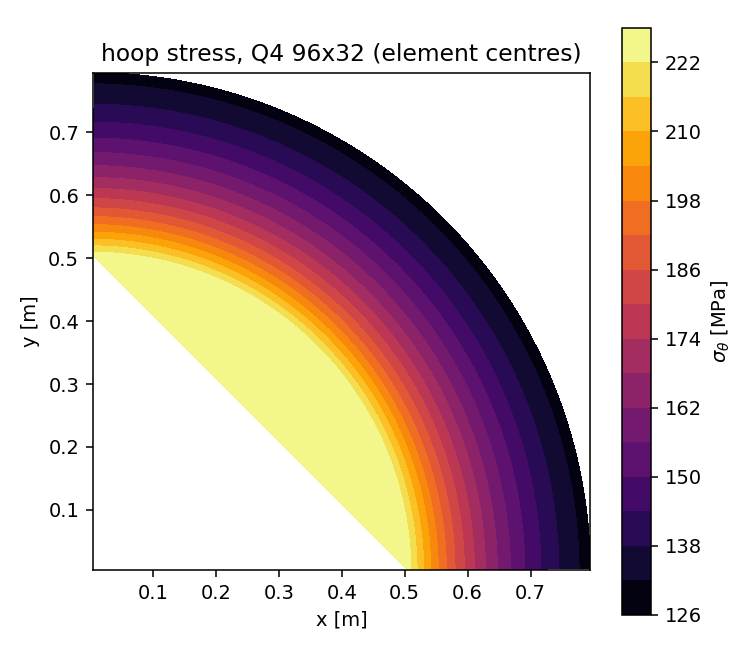
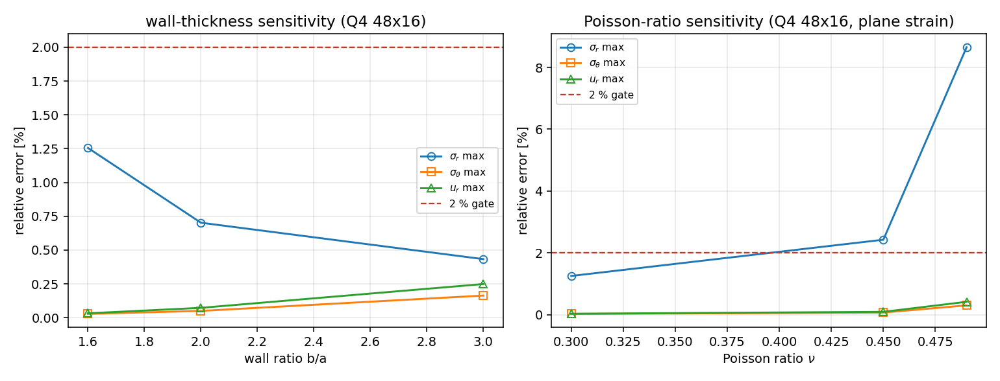

# CASE-LAME-CYLINDER：厚壁圆筒 Lamé 解锚点算例（TensorFEM）

锚点 `CASE-LAME-CYLINDER`，算例池条目。本文件由 `benchmarks/lame_cylinder_anchor.py` 程序化渲染，文中每个数字都取自 `benchmarks/lame_cylinder_anchor_evidence.json`，无手抄。

## ① 问题与参考解出处

厚壁圆筒（潜艇耐压壳/压力容器筒段）在内压作用下的轴对称平面应变问题。环向静定：平衡方程只含一条未知积分常数关系，`A`、`B` 由内外壁面力边界条件唯一确定，与 `E`、`ν` 及平面假设都无关；因此面内应力场对平面应力/平面应变是**同一**的，只有径向位移因面外柔度不同而不同。

**参考解出处（equation-level 引用，不抄数）**：
* Lamé, G. (1852) Leçons sur la théorie de l'élasticité, Paris: Bachelier.
* Timoshenko & Goodier, Theory of Elasticity, 3rd ed., Art. 27 'The thick cylinder'.
* Roark's Formulas for Stress and Strain, Table 13.5, case 1 (cylinder, internal pressure).

闭式解算式：

```
A=(p_i a^2 - p_o b^2)/(b^2-a^2)
B=a^2 b^2 (p_i-p_o)/(b^2-a^2)
sigma_r=A-B/r^2
sigma_theta=A+B/r^2
sigma_z=2 nu A (plane strain)
u_r=(1+nu)/E[(1-2nu)A r + B/r] (plane strain)
```

本仓库实现：`tensorfem.lame_reference.lame_state`（纯代数，无任何 FE 结果）。
独立数值对证：`tensorfem.thick_cylinder_1d_oracle.solve_thick_cylinder_1d (Chebyshev collocation of the axisymmetric displacement problem)`——该方法从**位移法**出发离散轴对称平衡方程（`(r σ_r)' - σ_θ = 0`，退化后为 Euler 方程 `r u'' + u' - u/r = 0`），用 Chebyshev 配点 + 面力边界条件直接求解，与闭式解的代数路径完全独立。

> 零手抄声明：Zero hand transcription: every number below is computed at run time from the closed form or from the FE solve; no reference value is typed into this file.

## ② 方法与实现

* **单元/离散**：4-node bilinear isoparametric (Q4), 2x2 Gauss, centre stress recovery
* **网格族**：structured polar quarter annulus (theta in [0, pi/2]) with symmetry cuts，节点严格落在内外圆上。
* **边界条件**：两条径向切面施加真实对称条件（θ=0 面 $u_y=0$，θ=π/2 面 $u_x=0$），刚体模态被完全消除；内圆边按弧长合力 $2p_i a\sin(\Delta\theta/2)$ 沿角平分线施加等分节点力。
* **取样口径**：位移在 θ=0 射线节点上比较（超收敛），应力在单元中心比较（Q4 只回写中心应力）；$\sigma_z$ 由平面应变关系 $\sigma_z=\nu(\sigma_r+\sigma_\theta)$ 从 FE 面内应力重建后与 $2\nu A$ 比较。
* **几何审计（先验几何，再谈精度）**：最细网格上筒壁节点到理论圆的偏差 5.551e-17 m（内）/ 1.110e-16 m（外），网格多边形面积相对误差 4.462e-05。即离散域就是 $b/a$ 指定的那个环扇形，不存在几何失真混淆精度结论。
* **判据（先于结果声明）**：每个锚点相对误差 < 2 %（本算例单容差）；力平衡与轴对称性属于恒等式检查，判据另设为 1e-6 / 1e-9。
* **复现命令**：

```bash
OMP_NUM_THREADS=4 PYTHONPATH=src python benchmarks/lame_cylinder_anchor.py
```

## ③ 参数表（无量纲数完整）

| 参数 | 符号 | 取值 |
|---|---|---|
| 内半径 | a | 0.5 m |
| 外半径 | b | 0.8 m |
| 壁厚比 | b/a | 1.6 |
| 内压 | p_i | 100 MPa |
| 外压 | p_o | 0 MPa |
| 弹性模量 | E | 210 GPa |
| 泊松比 | ν | 0.3 |
| 无量纲内压 | p_i/E | 4.7619e-04 |
| 平面状态 | — | strain（$\varepsilon_z=0$） |
| 外载比 | p_o/p_i | 0 |
| 内壁环向应力倍数 | $\sigma_\theta(a)/p_i$ | 2.28205 |
| 面外厚度 | t | 1.0 m |

## ④ 对照表（ref vs got，逐项误差）

### 4.1 参考解自身的独立验证（闭式 vs Chebyshev 算子）

| 量 | 平面应变 | 平面应力 | 归一化口径 |
|---|---|---|---|
| $\sigma_r$ 最大偏差 | 5.51e-12 | 1.48e-12 | /p_i（$\sigma_r$ 过零，逐点相对误差无意义） |
| $\sigma_\theta$ 最大相对偏差 | 5.85e-12 | 1.82e-12 | 逐点相对 |
| $u_r$ 最大相对偏差 | 5.14e-12 | 1.48e-12 | 逐点相对 |
| $\sigma_z$ 最大偏差 | 3.60e-12 | 0（平面应力 $\sigma_z\equiv 0$） | /p_i |
| 平衡残差 $\lVert (r\sigma_r)'-\sigma_\theta\rVert$ | 1.64e-09 | 9.45e-10 | 相对 max$|\sigma_r|$ |
| 内壁面力 $\sigma_r(a)+p_i$ | 1.33e-12 | 1.07e-12 | /p_i |
| 外壁面力 $\sigma_r(b)$ | 1.33e-12 | 1.24e-12 | /p_i |

闭式解被独立算子复现到 1e-12 量级（机器精度），因此下面的 FE 对照不是自我循环。

### 4.2 最细网格（96×32，3072 单元，6402 自由度）逐点对照

| r [m] | $\sigma_r$ ref [MPa] | $\sigma_r$ got [MPa] | err | $\sigma_\theta$ ref [MPa] | $\sigma_\theta$ got [MPa] | err | $\sigma_z$ ref [MPa] | $\sigma_z$ got [MPa] | err | $u_r$ ref [mm] | $u_r$ got [mm] | err |
|---|---|---|---|---|---|---|---|---|---|---|---|---|
| 0.5047 | -96.9766 | -96.9598 | 0.017 % | 225.182 | 225.172 | 0.004 % | 38.4615 | 38.4636 | 0.005 % | 0.58730 | 0.58725 | 0.008 % |
| 0.6547 | -31.6204 | -31.6106 | 0.031 % | 159.826 | 159.815 | 0.007 % | 38.4615 | 38.4614 | 0.000 % | 0.49389 | 0.49386 | 0.007 % |
| 0.7578 | -7.3406 | -7.3337 | 0.095 % | 135.546 | 135.536 | 0.007 % | 38.4615 | 38.4608 | 0.002 % | 0.44444 | 0.44441 | 0.007 % |

### 4.3 锚点判定（容差 < 2 %）

| 锚点 | 单位 | ref（解析） | got（FE 96×32） | 误差指标 | 判据 | 判定 |
|---|---|---|---|---|---|---|
| `u_r_max` | mm | 0.587302 | 0.587254 | 0.0081% | max relative error < 2 % | PASS |
| `sigma_r_max` | MPa | -96.9766 | -96.9598 | 0.3090% | max relative error < 2 % (denominator floored at 2 % p_i) | PASS |
| `sigma_theta_max` | MPa | 225.182 | 225.172 | 0.0070% | max relative error < 2 % | PASS |
| `sigma_z_max` | MPa | 38.4615 | 38.4636 | 0.0054% | max relative error < 2 % | PASS |
| `sigma_r_scaled` | MPa | 100 | 0.0167531 | 1.675e-04 | max |Delta sigma_r| / p_i < 2 % | PASS |
| `force_balance` | MN | 70.7107 | 70.7107 | 3.12e-14 | relative error < 1e-6 (equilibrium identity, not a 2 % anchor) | PASS |
| `axisymmetry` | - | 0 | 1.1636e-13 | 1.16e-13 | < 1e-9 (symmetry identity) | PASS |

`ref`/`got` 取最靠内壁的对照点（`u_r` 取 θ=0 射线内壁节点 r=0.5000 m；三个应力锚点取最近的单元中心 r=0.5047 m；`sigma_r_scaled` 的 got 为全网格最差 $|\Delta\sigma_r|$；`force_balance` 为支撑反力合力）。`误差指标` 是该锚点定义下的极值，不是 ref/got 两点之差。

## ⑤ 收敛性与参数敏感性

### 5.1 网格收敛

| 网格 $n_\theta\times n_r$ | 单元 | 自由度 | $u_r$ max | $\sigma_r$ L2 | $\sigma_r$ max | $\sigma_\theta$ L2 | $\sigma_\theta$ max | 2 % 门 |
|---|---|---|---|---|---|---|---|---|
| 12×4 | 48 | 130 | 0.511 % | 1.476 % | 6.498 % | 0.384 % | 0.439 % | FAIL |
| 24×8 | 192 | 450 | 0.129 % | 0.369 % | 3.248 % | 0.096 % | 0.111 % | FAIL |
| 48×16 | 768 | 1666 | 0.032 % | 0.092 % | 1.255 % | 0.024 % | 0.028 % | PASS |
| 96×32 | 3072 | 6402 | 0.008 % | 0.023 % | 0.309 % | 0.006 % | 0.007 % | PASS |

观测收敛阶（最细两级，网格比 2）：$u_r$ 2.00、$\sigma_r$ L2 2.00、$\sigma_\theta$ L2 2.00——均为二阶，与 Q4 双线性单元的理论阶一致。

注：$\sigma_r$ 在自由外壁处趋于 0，逐点相对误差在那一带分母趋零；表中 $\sigma_r$ max 的分母下限取 $0.02\,p_i$，另在证据文件里给出以 $p_i$ 归一化的绝对值口径 `sigma_r_max_scaled`（最细网格 1.68e-04）。最粗网格（12×4）的 $\sigma_r$ max = 6.498 % 超门，这是因为粗网格只有 48 个单元、径向一层单元要跨越 $b-a=0.3$ m。







### 5.2 参数敏感性（固定 48×16 网格，改一个参数）

壁厚比 $b/a$ 扫描（$p_i$、$E$、$\nu$ 不变；$\sigma_\theta(a)$ 为解析内壁环向应力，随壁厚比单调下降）：

| b/a | 外半径 [m] | $\sigma_\theta(a)$ [MPa] | $u_r$ max | $\sigma_r$ max | $\sigma_\theta$ max |
|---|---|---|---|---|---|
| 1.60 | 0.800 | 228.205 | 0.032 % | 1.255 % | 0.028 % |
| 2.00 | 1.000 | 166.667 | 0.073 % | 0.702 % | 0.050 % |
| 3.00 | 1.500 | 125.000 | 0.249 % | 0.433 % | 0.163 % |

泊松比扫描（平面应变；$\nu\to 0.5$ 为近不可压）：

| ν | $u_r$ max | $\sigma_r$ max | $\sigma_\theta$ max | 2 % 门 |
|---|---|---|---|---|
| 0.30 | 0.032 % | 1.255 % | 0.028 % | PASS |
| 0.45 | 0.095 % | 2.427 % | 0.072 % | FAIL |
| 0.49 | 0.419 % | 8.654 % | 0.303 % | FAIL |



### 5.3 平面应力/平面应变判别（同一 48×16 网格）

| 路径 | $u_r$ max 误差 vs 本身闭式解 | $\sigma_\theta$ max 误差 |
|---|---|---|
| 平面应变 | 0.032 % | 0.028 % |
| 平面应力 | 0.027 % | 0.024 % |

两条路径各自匹配自己的闭式解，而两者互相差 9.896 %，与闭式解给出的 $u_r$ 柔度差 9.890 % 相差 6.38e-05——`plane` 开关真实生效，不是被静默忽略的参数。

## ⑥ 失败模式、局限与工件

* **失败模式 1——粗网格**：$\sigma_r$ 在单元中心的相对误差随加密单调下降（12×4 6.498 % → 96×32 0.309 %），最粗网格直接超门；本算例的验收网格必须不低于 48×16。
* **失败模式 2——近不可压**：$\nu$ 从 0.30 提到 0.49，$u_r$ max 从 0.032 % 涨到 0.419 %、$\sigma_r$ max 从 1.255 % 涨到 8.654 %（已超 2 % 门）。这与 $\nu\to 0.5$ 时 Q4 全积分单元体积锁死的公认趋势一致，但本轮未跑 B-bar/选择性减缩积分对照，故只报现象与趋势，不宣称锁定机理已定量确认。
* **失败模式 3——薄壁化**：$b/a=3$ 时 48×16 的 $u_r$ max 上升到 0.249 %，仍是门内，但趋势说明同一网格不能跨壁厚比直接复用。
* **失败模式 4——壁面应力回写**：最靠内壁的单元中心 (r=0.5047 m) 应力与壁面真值 −p_i 相差 3.040 %；这是 Q4 单元中心应力不回写到边界的回写位置误差，不是求解误差，因此本算例的 <2 % 验收在单元中心口径下进行，并在 4.2 逐点给出。
* **口径陷阱**：$\sigma_r(b)=0$，逐点相对误差在自由面附近分母趋零；本算例用分母下限 $0.02p_i$ + $p_i$ 归一化口径双报，避免用无意义的相对误差充数。
* **适用范围**：小应变、各向同性、单一材料、无体力、无热梯度、轴对称；不覆盖塑性/安定性、开孔接管应力集中、多层套合/过盈、三维端部效应。
* **未做**：B-bar 近不可压重复算例（只在 5.2 揭示现象，未修）；自适应网格；与外部通用 FEM 软件（Abaqus/ANSYS）的第三方交叉对照。

**工件**：

* 证据 JSON：`benchmarks/lame_cylinder_anchor_evidence.json`（本文全部数字来源）
* 图：`docs/assets/lame_cylinder_anchor_{profiles,convergence,field,sensitivity}.png`
* 驱动：`benchmarks/lame_cylinder_anchor.py`；独立算子：`src/tensorfem/thick_cylinder_1d_oracle.py`
* 测试：`tests/test_lame_cylinder_anchor.py`

## 误差判定（显式回答）

* 径向位移 $u_r$：最大相对误差 0.0081%，**小于** 2 % 容差判据。
* 径向应力 $\sigma_r$：最大相对误差 0.3090%，**小于** 2 % 容差判据。
* 环向应力 $\sigma_\theta$：最大相对误差 0.0070%，**小于** 2 % 容差判据。
* 轴向应力 $\sigma_z=2\nu A$：最大相对误差 0.0054%，**小于** 2 % 容差判据。

全部 7 个锚点 PASS；最细网格 96×32 上最差相对误差 0.3090 %，**满足 < 2 %(亦满足 < 3 %)**。

