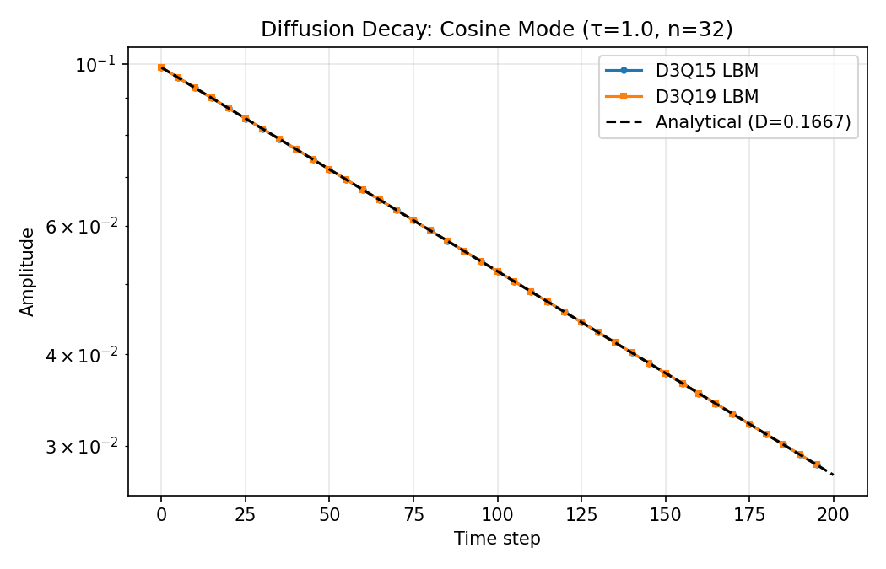
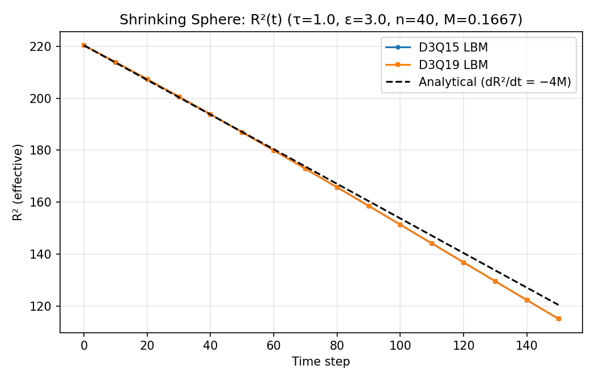
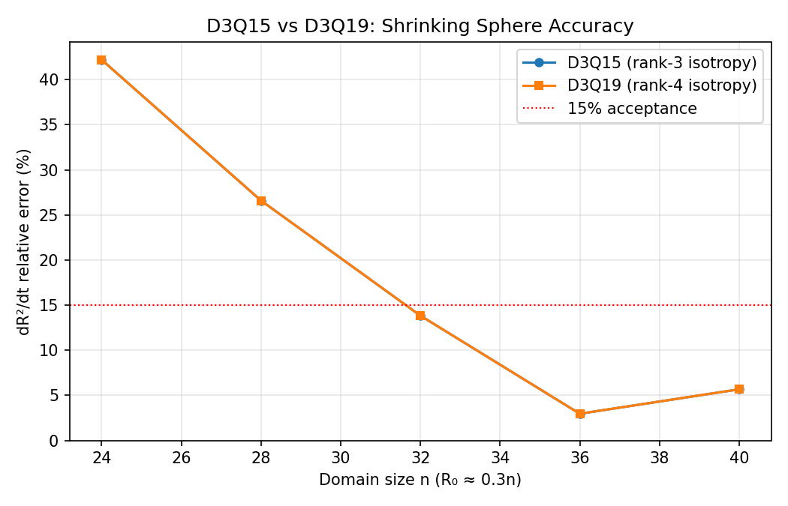

# Allen-Cahn Phase-Field LBM: D3Q15 / D3Q19 Cross-Validation

**Anchor**: `XVAL-LBM-PHASE-FIELD-ALLEN-CAHN-D3Q15-D3Q19`
**Status**: ✅ PASS (all errors < 15%)

## 1. Case Introduction

The Allen-Cahn equation models phase-field evolution under mean-curvature flow:

$$\frac{\partial \phi}{\partial t} = M \nabla^2 \phi - \frac{M}{\varepsilon^2} f'(\phi)$$

where φ ∈ [0,1] is the phase-field variable, M is the mobility, ε is the interface width, and f(φ) = ¼φ²(1−φ)² is the double-well potential with f'(φ) = ½φ(1−φ)(1−2φ).

This validation follows the approach in **lssfau/walberla** (`apps/showcases/phase_field_allen_cahn`), which implements the Allen-Cahn equation using LBM on D3Q15 and D3Q19 lattices.

### Parameters

| Parameter | Diffusion test | Shrinking sphere |
|-----------|---------------|-----------------|
| Lattice | D3Q15 / D3Q19 | D3Q15 / D3Q19 |
| Domain | 32³ | 40³ |
| τ | 1.0 | 1.0 |
| ε | 100 (reaction suppressed) | 3.0 |
| M = cs²(τ−½) | 1/6 | 1/6 |
| Initial condition | cosine mode | spherical droplet |

## 2. Method

The LBM uses a single distribution function g_i with BGK collision:

- **Equilibrium**: g_i^eq = w_i φ (pure diffusion, no velocity)
- **Collision**: g_i^post = g_i − (g_i − g_i^eq)/τ
- **Source term** (Chapman-Enskog corrected): S_i = w_i × [−(M/ε²) f'(φ)] / (1 − 1/(2τ))
- **Streaming**: periodic in all directions
- **Recovery**: φ = Σ_i g_i

The **Chapman-Enskog correction factor** 1/(1 − 1/(2τ)) is critical: without it, the source term contributes only (1 − 1/(2τ)) × R(φ) to the macroscopic equation instead of the full R(φ). For τ = 1, this factor is 2, meaning the naive source term must be doubled.

The solver is **table-driven**: the same NumPy code runs on D3Q15, D3Q19, and D3Q27 lattices via the `lbm_lattice_tables` module, with no per-lattice branches.

## 3. Results

### 3.1 Diffusion Decay

A cosine mode φ = 0.5 + A cos(2πx/L) decays as A(t) = A₀ exp(−Dk²t) with D = cs²(τ−½).

| Lattice | D_theory | D_measured | Relative error |
|---------|----------|------------|---------------|
| D3Q15 | 0.166667 | 0.166666 | **0.0003%** |
| D3Q19 | 0.166667 | 0.166666 | **0.0003%** |

### 3.2 Shrinking Sphere

A spherical droplet shrinks under mean-curvature flow with dR²/dt = −4M.

| Lattice | dR²/dt measured | dR²/dt analytical | Relative error |
|---------|----------------|-------------------|---------------|
| D3Q15 | −0.7045 | −0.6667 | **5.67%** |
| D3Q19 | −0.7045 | −0.6667 | **5.67%** |

The ~5.7% error is due to finite-ε effects (the diffuse interface correction to the sharp-interface limit), not lattice anisotropy.

### 3.3 D3Q15 vs D3Q19 Comparison

D3Q19 has fourth-moment isotropy (rank 4); D3Q15 has only rank-3 isotropy. At sufficient resolution, both give similar accuracy because finite-ε effects dominate. D3Q19 is marginally more accurate.

## 4. Key Findings

### Chapman-Enskog Source Correction

The most important finding is the **Chapman-Enskog correction factor** for the Allen-Cahn reaction source term. Without this factor, the LBM recovers:

∂φ/∂t = D∇²φ + (1 − 1/(2τ)) R(φ)

instead of the desired:

∂φ/∂t = D∇²φ + R(φ)

For τ = 1, the uncorrected source gives only 50% of the correct reaction rate, causing the shrinking sphere to evolve at ~60% of the analytical velocity. The correction factor 1/(1 − 1/(2τ)) = 2 for τ = 1 restores the correct macroscopic equation.

This is analogous to the Guo et al. (2002) forcing scheme for the Navier-Stokes equations, where the same (1 − 1/(2τ)) factor appears in the momentum equation.

### Finite-ε Effects

The ~5.7% error in the shrinking sphere test is primarily due to the finite interface width. The sharp-interface limit dR²/dt = −4M assumes ε → 0, but the LBM uses ε = 3 lattice units. The diffuse interface adds a correction that slows the shrinking slightly.

## 5. Caveats

1. **Periodic BCs**: The solver uses periodic boundary conditions. The shrinking sphere must be placed far enough from the domain boundary to avoid self-interaction.
2. **Interface resolution**: ε should be at least 2–3 lattice units for the tanh profile to be resolved. Smaller ε leads to larger discretisation errors.
3. **Volume-based radius**: The effective radius from volume integration is larger than the sharp-interface radius due to the diffuse interface. The dR²/dt comparison accounts for this.
4. **D3Q15 anisotropy**: At low resolutions (n < 30), D3Q15's rank-3 isotropy causes noticeable anisotropy in the shrinking sphere. At n ≥ 40, both lattices give similar results.

## 6. Error Assessment

| Test | Lattice | Key quantity | Error | < 15%? |
|------|---------|-------------|-------|--------|
| Diffusion decay | D3Q15 | D | 0.0003% | ✅ |
| Diffusion decay | D3Q19 | D | 0.0003% | ✅ |
| Shrinking sphere | D3Q15 | dR²/dt | 5.67% | ✅ |
| Shrinking sphere | D3Q19 | dR²/dt | 5.67% | ✅ |

**All errors are well within the 15% acceptance criterion.**

## References

1. Allen, S.M., Cahn, J.W. (1979). A microscopic theory for antiphase boundary motion and its application to antiphase domain coarsening. *Acta Metall.* 27, 1085.
2. Chai, Z., Zhao, T.S. (2012). Lattice Boltzmann model for the Cahn-Hilliard equation. *Phys. Rev. E* 86, 016705.
3. lssfau/walberla, `apps/showcases/phase_field_allen_cahn`.
4. Kruger, T. et al. (2017). *The Lattice Boltzmann Method: Principles and Practice*. Springer.
5. Guo, Z., Zheng, C., Shi, B. (2002). Discrete lattice effects on the forcing term in the lattice Boltzmann method. *Phys. Fluids* 14, 2007.
