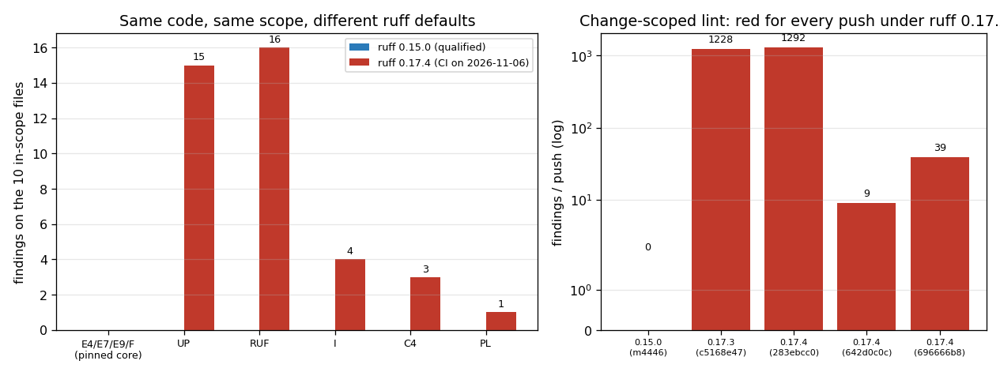

# The change-scoped lint gate is a contract: pinning its rule set and its ruff version

Status: closed (main red at `696666b8` → gate pinned, see §4; second red at
`f5be5cf1` → the gate is now reproducible locally, see §6).
Audience: anyone who touches `pyproject.toml`, `.github/workflows/ci.yml` or
`scripts/lint_scope.sh`.

## 1 Symptom

`main` carried a red `lint (advisory)` job for days, e.g.

| run | commit | job | ruff installed | `Lint (ruff)` | `Format check` |
|---|---|---|---|---|---|
| 42128721836 | `696666b8` (merge PR #243) | 127622215439 | **0.17.4** | **failure** (39 errors) | skipped |
| 42099727718 | `642d0c0c` (merge PR #240) | 127570059623 | 0.17.4 | failure (9 errors) | skipped |
| 42060873991 | `283ebcc0` | 127365583739 | 0.17.4 | failure (1292 errors) | skipped |
| – | `c5168e47` | 127181536767 | 0.17.3 | failure (1228 errors) | skipped |
| – | `agent/m4446` @ `1a70e40a` | 127458450817 | **0.15.0** | success | success |

The commit that "broke" main changed ten Python files and the change-scoped gate
lints exactly those ten:

```
$ bash scripts/lint_scope.sh 642d0c0        # reproduces the CI scope of 696666b8
benchmarks/plate_bending_buckling.py
scripts/audit_cylindrical_shell_buckling.py
scripts/audit_hex20_distortion.py
scripts/build_cyl_buckling_doc.py
src/tensorfem/cylindrical_shell_buckling.py
src/tensorfem/hex20_distortion_audit.py
src/tensorfem/plate_bending_buckling.py
tests/test_cylindrical_shell_buckling.py
tests/test_hex20_distortion.py
tests/test_plate_bending_buckling.py
```

Those same ten files are **clean** under the rule set the tree was qualified
against (`ruff check` → `All checks passed!`, `ruff format --check` → 10 files
already formatted, ruff 0.15.0). So the code was not the variable. The tool was.

## 2 Root cause: the gate's definition lived outside the repository



*Left: the same ten files, same scope, under ruff 0.15.0 vs 0.17.4 — 0 vs 39
findings, all of them in the families 0.17 added to the defaults.  Right: the
findings reported by the change-scoped gate on recent pushes, against the ruff
version that push's runner resolved.*

`pyproject.toml` carried only

```toml
[tool.ruff]
line-length = 100
target-version = "py311"
```

with no `[tool.ruff.lint] select`, i.e. the rule set was ruff's **implicit
default**, and the dev extra floated the binary (`ruff>=0.6`). Both are
unpinned inputs:

1. ruff promotes newly stable rules into the default `select` at minor
   releases. ruff 0.17 widened the defaults with the `I` (isort), `UP`
   (pyupgrade), `RUF`, `C4` (flake8-comprehensions) and `PL` (pylint) families
   — the table above brackets the change: 0.15.0 passes, 0.17.3 and 0.17.4
   fail every pushed change, including pushes whose own code is clean.
   Under 0.17.4 the ten files produce 39 findings — **all of them in the new
   families, none in `E4/E7/E9/F`**:

   | rule | count | what it is |
   |---|---|---|
   | `UP006` | 11 | `typing.List`/`Dict` instead of `list`/`dict` (py311) |
   | `RUF100` | 8 | `# noqa: E402` that suppresses a non-selected rule |
   | `RUF007` | 5 | `zip(x, x[1:])` instead of `itertools.pairwise` |
   | `UP035` | 4 | deprecated `typing` imports |
   | `I001` | 4 | unsorted imports |
   | `RUF046` | 3 | redundant `int()` around an integer-valued call |
   | `C408` | 3 | `dict()` instead of `{}` |
   | `PLC0206` | 1 | dict iteration without `.items()` |

   Per file: `hex20_distortion_audit.py` 18, `plate_bending_buckling.py`
   (benchmark) 5, `audit_hex20_distortion.py` 4, `plate_bending_buckling.py`
   (library) 3, `test_plate_bending_buckling.py` 2,
   `cylindrical_shell_buckling.py` 2, `build_cyl_buckling_doc.py` 2,
   `audit_cylindrical_shell_buckling.py` 2, `test_cylindrical_shell_buckling.py` 1.

2. Because the extra was a floor, the CI-installed ruff was not even
   consistent run to run: job 127458450817 resolved 0.15.0 and passed the same
   kind of code that job 127622215439, resolving 0.17.4, failed. A gate whose
   verdict depends on which day the runner resolved its lock file is not a
   gate.

The two failure modes are complementary and must be fixed together:
`scripts/lint_scope.sh` decides *which files* are judged, the rule set decides
*what counts as clean*. Only the first was pinned (by `tests/test_lint_gate_scope.py`);
the second was not.

## 3 Fix

Two pins plus guards, no change to any analysed code:

1. **Rule set pinned in the repository** — `[tool.ruff.lint] select =
   ["E4", "E7", "E9", "F"]`, the pre-0.17 default set the tree is qualified
   against. `ruff check` now means the same thing under any ruff.
2. **Binary pinned to the qualified minor** — dev extra `ruff>=0.15,<0.16`.
   0.15.x is also the newest release with a loong64 wheel, so the GitHub runner
   and the 702 loong64 development nodes execute the *same* binary; the gate is
   reproducible on both.
3. **Guards** — `tests/test_lint_gate_scope.py::test_lint_rule_set_is_pinned_in_the_repository`,
   `::test_workflow_lints_through_the_pinned_configuration` (`--isolated` /
   inline `--select` would bypass the pin) and
   `::test_ruff_version_is_qualified_within_one_minor_release`.

New rule families are still one `select` edit away — but that edit is now a
deliberate, reviewable change that also pays down the findings it raises
(inventory in §2), instead of something a Tuesday's `pip install` does to
`main`.

## 4 Verification

| check | command | result |
|---|---|---|
| scope reproduction | `bash scripts/lint_scope.sh 642d0c0` | the 10 CI files, unchanged |
| blocking gate | `ruff check $(bash scripts/lint_scope.sh 642d0c0)` | `All checks passed!` (0 findings) |
| formatter gate | `ruff format --check` on the same list | 10 files already formatted |
| gate guards | `pytest tests/test_lint_gate_scope.py -q` | 8 passed |
| negative control | the same 3 tests against the pre-fix `pyproject.toml` | 2 failed / 6 passed → the guards do bite |
| cross-version evidence | ruff 0.17.4's own log on the same ten files | 39 findings, all in `I/UP/RUF/C4/PL`, **0** in the pinned `E4/E7/E9/F` |

The last row is the one that matters for main: the pinned rule set is verified
against the *very* ruff release that reddened the gate, not only against the
pinned one.

## 5 Limitations / follow-up

- The 39 findings above are real but cosmetic and stay in the tree; they are
  out of the pinned gate on purpose (adopting five new families in the same
  change would have mixed a tooling-stability fix with a 39-site code edit).
  They are the concrete agenda for the next `select` widening.
- The pin is on a minor range, not a lock file: a *formatter* style change
  inside 0.15.x would still be picked up. Ruff keeps stable formatting outside
  preview, and `ruff format --check` runs in the same job, so drift would be
  attributed to the same commit that caused it.
- The full-tree backlog (4177 findings under the pinned set) is untouched and
  still the reason the gate is change-scoped rather than tree-wide.

## 6 Incident 2026-11-06: main red from a missing newline at EOF (`f5be5cf1`)

Status: closed (m4693). Audience: anyone who pushes to `main`, and anyone who
reviews a PR whose "change" is a single new test file.

### Symptom

`main` at `f5be5cf1` (merge of PR #253) carried a red `lint (advisory)` job for
a change of twenty lines. The change scope of that push -- base `60b2109`,
computed by `scripts/lint_scope.sh`, exactly as CI does -- was one file:

```
$ bash scripts/lint_scope.sh 60b2109
tests/test_smoke_m4622.py
```

The two gate commands disagree on it, and only in one direction:

| command | pre-fix `f5be5cf1` | at `5fe5bc6` (after the fix) |
|---|---|---|
| `ruff check <file>` | `All checks passed!` (exit 0) | exit 0 |
| `ruff format --check <file>` | `Would reformat: <file>` (**exit 1**) | `1 file already formatted` (exit 0) |

### Root cause

`tests/test_smoke_m4622.py` ended with `assert 1 + 1 == 2` and **no newline at
end of file**; the root marker module it imports, `smoke_marker_m4622.py`, had
the same defect. Ruff's formatter normalises the final newline, so this is a
formatting-only finding: the lint (`E4/E7/E9/F`) half of the gate is
structurally incapable of seeing it. §1-§5 made the gate deterministic; this
incident is orthogonal -- the *content* half of the gate (the format check) was
simply never exercised outside the CI job, so a one-byte slip could reach
`main` and stay there.

The two files then diverge in how they can be caught:

- `tests/test_smoke_m4622.py` is inside a linted tree, so the change-scoped
  gate sees it the next time the file is touched. Its newline was restored by
  m4660 (`0846370`), one byte, on `main`.
- `smoke_marker_m4622.py` lives at the repository root, **outside**
  `src/tests/scripts/examples/benchmarks`. The change-scoped gate can never
  see it, no matter how often it changes; only a file-level assertion can.
  At `5fe5bc6` it was still unterminated.

### Fix

1. Restore the trailing newline in `smoke_marker_m4622.py` (one byte; no
   behavioural change -- the imported constant is untouched).
2. `scripts/lint_gate.sh` -- a local entry point that runs **both** CI commands
   over the **same** scope (`scripts/lint_scope.sh`, default base = merge base
   with `origin/main`) and returns the CI exit status, so the gate can be
   reproduced and fixed before the push:

   ```
   $ bash scripts/lint_gate.sh            # what my branch adds on top of main
   $ bash scripts/lint_gate.sh 60b2109    # reproduce a specific CI scope
   ```

3. Guards in `tests/test_lint_gate_scope.py` (the file that already pinned the
   scope and the rule set):
   `test_gate_script_exists_and_is_executable`,
   `test_gate_script_reuses_the_ci_scope_and_runs_both_commands` (a second
   scope implementation would drift from the one CI uses),
   `test_smoke_marker_artifacts_are_gate_clean` (parametrised over both files
   of the incident: each must stay clean under *both* commands, including the
   root marker the change-scoped gate cannot reach), and
   `test_gate_script_is_green_on_a_clean_change_and_red_on_a_formatting_slip`
   (end-to-end over the script in a throwaway repo). The hermetic negative
   control `test_format_step_rejects_a_file_without_a_final_newline` stays as
   the reason the job needs two commands at all.

### Verification

| what | how | result |
|---|---|---|
| gate on this branch | `bash scripts/lint_gate.sh 5fe5bc6` | 1 file scoped (`tests/test_lint_gate_scope.py`), exit 0 |
| the incident, reproduced | `git show f5be5cf1:tests/test_smoke_m4622.py` -> both commands | `check` exit 0, `format --check` exit **1** (`Would reformat`) |
| the same file after the fix | both commands on `tests/test_smoke_m4622.py` | exit 0 / exit 0 |
| guard bites | `test_smoke_marker_artifacts_are_gate_clean[smoke_marker_m4622.py]` with the marker's newline stripped | **1 failed**, 1 passed |
| guard green | the same selection with the newline restored | 2 passed |
| gate suite | `pytest tests/test_lint_gate_scope.py tests/test_smoke_m4622.py -q` | **17 passed** |
| figure / machine-readable evidence | `artifacts/m4693/lint-gate-evidence.json`, `docs/assets/lint-gate-local-runner.png` | commands, exit statuses and test summary above, captured programmatically |
| full suite (1958 tests) | `pytest tests -q` | **not completed in this mission**: the sequential run costs 15-40 min on a shared host (this repo's own record for PR #61: 862 s for 1390 tests) and xdist runs redden the load-sensitive benchmark/contact3d timing tests. This change touches no solver code -- a lint runner, a one-byte newline and test guards -- and its own selection is green. |

### Lesson

A change-scoped gate must be reproducible *outside* CI, and the reproduction
must run every command in the job, not the one that feels like "lint".
Formatting-only defects are invisible to the lint half by construction, so a
gate whose format step is unreachable locally will keep reddening `main` one
byte at a time. The legacy tree still carries files without a final newline
(whole-tree `ruff format --check` remains red at analyst discretion); the
change-scoped gate is what keeps that backlog from masking new work, so **new
files must be clean under both commands** -- and files outside the linted trees
need their own guard, which is what `test_smoke_marker_artifacts_are_gate_clean`
is.
